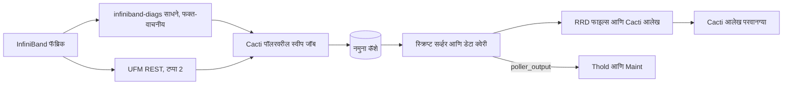

<!-- Source: README.md; SHA256: ce5af61a1bc993ec2aae6d4f22c3885694632f2b1d5eb94e2ce88b8390e96f1e -->

<!-- translations:start -->
[English](../../../README.md) | [简体中文](../zh-CN/README.md) | [हिन्दी](../hi-IN/README.md) | [Español (España)](../es-ES/README.md) | [Español (Latinoamérica)](../es-419/README.md) | [العربية (السعودية)](../ar-SA/README.md) | [Afrikaans](../af-ZA/README.md) | [አማርኛ](../am-ET/README.md) | [العربية (مصر)](../ar-EG/README.md) | [العربية (المغرب)](../ar-MA/README.md) | [বাংলা](../bn-BD/README.md) | [Bosanski](../bs-BA/README.md) | [Deutsch](../de-DE/README.md) | [فارسی](../fa-IR/README.md) | [Filipino](../fil-PH/README.md) | [Français](../fr-FR/README.md) | [Français (Maroc)](../fr-MA/README.md) | [Français (Sénégal)](../fr-SN/README.md) | [Hausa](../ha-NG/README.md) | [עברית](../he-IL/README.md) | [Hrvatski](../hr-HR/README.md) | [Bahasa Indonesia](../id-ID/README.md) | [Igbo](../ig-NG/README.md) | [Italiano](../it-IT/README.md) | [日本語](../ja-JP/README.md) | [한국어](../ko-KR/README.md) | [Malagasy](../mg-MG/README.md) | [मराठी](README.md) | [Bahasa Melayu](../ms-MY/README.md) | [Nederlands](../nl-NL/README.md) | [Polski](../pl-PL/README.md) | [Português (Brasil)](../pt-BR/README.md) | [Русский](../ru-RU/README.md) | [Kinyarwanda](../rw-RW/README.md) | [Soomaali](../so-SO/README.md) | [Српски](../sr-RS/README.md) | [Svenska](../sv-SE/README.md) | [Kiswahili](../sw-KE/README.md) | [தமிழ்](../ta-IN/README.md) | [తెలుగు](../te-IN/README.md) | [ไทย](../th-TH/README.md) | [Türkçe](../tr-TR/README.md) | [Українська](../uk-UA/README.md) | [اردو](../ur-PK/README.md) | [Tiếng Việt](../vi-VN/README.md) | [isiXhosa](../xh-ZA/README.md) | [Yorùbá](../yo-NG/README.md) | [繁體中文](../zh-TW/README.md) | [isiZulu](../zu-ZA/README.md)
<!-- translations:end -->

# plugin_fabric

एक Cacti 1.2 प्लगइन जे InfiniBand पोर्ट काउंटर्स, लिंकची रुंदी व वेग आणि कंजेशन निर्देशक यांना Cacti मध्ये नेहमीचे डिव्हाइसेस, डेटा स्रोत आणि आलेख म्हणून आणते. त्यामुळे 4X ऐवजी 1X वर ट्रेन झालेली लिंक ती ज्या होस्टला सेवा देते त्याच्या शेजारी आलेख आणि Thold अलर्ट म्हणून दिसते; हे सर्व Cacti च्या परवानग्यांच्या अधीन राहून काम करते आणि Maint वापरून हा अलर्ट तात्पुरता बंद करता येतो.

> **स्थिती: विकासाधीन, अद्याप कोणतेही प्रकाशन नाही.** माइलस्टोन 2 (पायाभूत रचना) `main` वर मर्ज झाला आहे, आणि माइलस्टोन 3 (Cacti ऑब्जेक्ट्स आणि अलर्टिंग) पुनरावलोकनाधीन आहे. माइलस्टोन 1 ने दस्तऐवजीकरण आणि अपस्ट्रीम स्रोताच्या आधारे रचनेची खात्री केली (PR #71); त्याचे निष्कर्ष, स्रोतांसह, [docs/research/](../../research) मध्ये आहेत. माइलस्टोन 2 मध्ये प्लगइनची पायाभूत रचना समाविष्ट आहे:
>
> - इंस्टॉल, अपग्रेड, अनइंस्टॉल आणि PHP 8.2 गार्ड
> - View, Operator आणि Admin अधिकारक्षेत्रे आणि सेटिंग्ज
> - फॅब्रिक नोंदी
> - `perfquery`, `ibnetdiscover`, आणि `iblinkinfo` साठी फक्त-वाचनीय कमांड मर्यादा
> - GUID नुसार यादी, ओळख संघर्ष आणि पुन्हा-जोडणी प्रस्तावांसह
> - लिंक स्थिती आणि काउंटर स्वीप कॅशे
> - यादी, प्रशासन आणि आरोग्य पृष्ठे
>
> माइलस्टोन 3 मध्ये Cacti ऑब्जेक्ट्स समाविष्ट आहेत:
>
> - Cacti टेम्पलेट XML म्हणून दिलेले डिव्हाइस, डेटा आणि आलेख टेम्पलेट्स, आणि "Fabric Port" डेटा क्वेरी
> - नोडला Cacti डिव्हाइसशी मॅप करणे, किंवा पुष्टीकरणानंतर नवीन तयार करणे ([ADR 0010](../../decisions/0010-one-device-per-node.md))
> - आलेखांसाठी काउंटर डेटा स्रोत, आणि Thold साठी GAUGE लिंक स्थिती व दर डेटा स्रोत ([ADR 0011](../../decisions/0011-derive-counters-and-gauge-alert-values.md))
> - सातत्यभंग हाताळणी आणि संतृप्त मूलभूत काउंटर्स अज्ञात म्हणून वाचणे ([ADR 0012](../../decisions/0012-saturated-basic-counters-read-as-unknown.md)), पोर्ट पृष्ठावर काउंटर वैधता व आलेख दुवे, आणि कंजेशन क्रमवारी
> - न बदललेल्या Thold v1.8.2 आणि Maint v1.3 सह एंड-टू-एंड चाचणी, आणि सिम्युलेटेड फॅब्रिकवर वास्तविक निदान साधने चालवणारे CI काम
>
> टप्पा 3 मध्ये रिमोट डेटा कलेक्टर्सना समर्थन मिळेपर्यंत फॅब्रिकचे स्वीप फक्त मुख्य पॉलरवरूनच करता येते. याची चाचणी बनावट साधने आणि ibsim फॅब्रिक सिम्युलेटरवर केली गेली आहे, प्रत्यक्ष InfiniBand फॅब्रिकवर कधीही नाही. फॅब्रिकची आवश्यकता असलेल्या तपासण्या प्रत्येक संशोधन पृष्ठाच्या थेट-तपासणी सारणीत अद्याप खुल्या आहेत. हा प्रकल्प Cacti प्रकल्पाशी संलग्न नाही.

## प्रवेश भूमिका

| अधिकारक्षेत्र | प्रवेश |
| --- | --- |
| Fabric View | विद्यमान देखरेख पृष्ठे. |
| Fabric Operator | देखरेख तसेच Operations पृष्ठ आणि वैयक्तिक ट्रायज पोचपावती. |
| Fabric Admin | Operator प्रवेश तसेच विद्यमान कॉन्फिगरेशन आणि प्रशासकीय कृती. |

अपग्रेड फाइल्स कॉपी केल्यानंतर, नवीन अधिकारक्षेत्र नोंदणीकृत करण्यासाठी प्रशासक म्हणून Plugins पृष्ठ उघडा. **Configuration > Users** किंवा वापरकर्ता गटांखाली Operator अधिकारक्षेत्र स्पष्टपणे नेमून द्या.
अपग्रेडमध्ये विद्यमान View आणि Admin अधिकारक्षेत्र आयडी आणि परवानग्या कायम राहतात. प्रत्येक विनंतीवर Admin प्रवेशाला Operator प्रवेश वारसाहक्काने मिळतो,
आणि Operator प्रवेशाला View प्रवेश वारसाहक्काने मिळतो; यामुळे वापरकर्त्यांना किंवा गटांना साठवलेल्या परवानग्या जोडल्या जात नाहीत. प्लगइन सेटिंग्जसाठी
Cacti च्या Settings परवानगीव्यतिरिक्त Fabric Admin प्रवेश देखील आवश्यक आहे.

Cacti डिव्हाइस परवानग्या अजूनही प्रत्येक वापरकर्त्यासाठी उपलब्ध ओळी आणि कृती मर्यादित ठेवतात; मॅप न केलेल्या ऑब्जेक्ट्ससाठी प्रशासकाची आवश्यकता असते.
क्रेडेन्शियल्स, कॉन्फिगरेशन, मॅपिंग, हटवणे आणि इतर प्रशासकीय बदल
प्रशासकीय पृष्ठांवरच राहतात. पोचपावती केवळ सध्याच्या वापरकर्त्याच्या सत्रात,
जास्तीत जास्त एक तासासाठी आणि केवळ तेच निरीक्षण ताजे असेपर्यंत टिकतात.
नवीन किंवा बदललेली निरीक्षणे त्यांना अवैध ठरवतात. ते कधीही अयशस्वी
मोजमाप निरोगी म्हणून चिन्हांकित करत नाहीत किंवा अलर्ट्स दाबत नाहीत.

## हे का आवश्यक आहे

खराब झालेली InfiniBand लिंक तरीही ट्रॅफिक पुढे पाठवत राहते. 4X लिंक जेव्हा 1X वर पुन्हा ट्रेन होते तेव्हा पोर्ट "active" राहते, आणि होस्टचे SNMP इंटरफेस आलेख सामान्य दिसतात, परंतु एकमेकांवर अवलंबून असलेली कामे मंदावतात. याचा पुरावा फॅब्रिकमध्ये असतो: प्रत्येक पोर्ट आपली सक्रिय, सक्षम आणि समर्थित रुंदी व वेग, तसेच त्रुटी आणि कंजेशन काउंटर्स नोंदवते. ते वाचण्यासाठी InfiniBand निदान साधने किंवा फॅब्रिक मॅनेजर API लागतो. हाताने चालवल्यास, त्यात तीन उणिवा राहतात:

- **इतिहास नाही.** `perfquery` आणि `iblinkinfo` फक्त सद्यस्थिती दाखवतात, त्यामुळे गेल्या आठवड्यात खराब झालेली लिंक अदृश्य राहते.
- **डिव्हाइस संदर्भ नाही.** फॅब्रिक पोर्ट्स हे Cacti ऑब्जेक्ट्स नसतात, त्यामुळे पोर्ट ज्या होस्टला जोडलेले आहे त्याच्या शेजारी त्याचा आलेख काढता येत नाही.
- **Cacti अलर्टिंगमध्ये मार्ग नाही.** Thold आणि Maint हे Cacti डेटा स्रोत आणि डिव्हाइसेसवर काम करतात.

हे प्लगइन स्वतःच्या निदान साधनांद्वारे (आणि नंतर UFM द्वारे) फॅब्रिक वाचून, GUID ने नोड्स आणि पोर्ट्स ओळखून, आणि काउंटर्स व लिंक स्थिती Cacti डेटा स्रोत म्हणून प्रकाशित करून या उणिवा भरून काढते. ते फक्त वाचन करते: ते कधीही काउंटर्स रीसेट करत नाही किंवा पोर्टची स्थिती बदलत नाही.

## पहिला शोध

नवीन फॅब्रिकमध्ये कोणतेही नोड्स नसतात, आणि स्क्रिप्ट सर्व्हरवरून स्वीप्स केवळ अशाच नोडसाठी सुरू होतात जो Cacti डिव्हाइसशी मॅप केलेला असतो. त्यामुळे पहिला शोध ही एक व्यक्तिचलित पायरी आहे. सक्षम केलेले फॅब्रिक जतन केल्यानंतर, फॅब्रिक ज्या पॉलरला नेमलेले आहे त्या पॉलरवर, पॉलरच्या खात्यातून, `/path/to/cacti` च्या जागी तुमची Cacti डिरेक्टरी वापरून ही कमांड एकदा चालवा (पूर्ण पाथ cron मधूनही काम करतो):

```
php /path/to/cacti/plugins/fabric/fabric_sweep.php --fabric=ID --force
```

त्यानंतर यादी भरली जाते. Fabric Admin पृष्ठावर नोड्सना Cacti डिव्हाइसेसशी मॅप करा; पुढील स्वीप्स डेटा क्वेरीवरून सुरू होतात. जोपर्यंत फॅब्रिकचा कोणताही नोड मॅप केलेला नसतो, तोपर्यंत काहीही त्याची यादी ताजी करत नाही, त्यामुळे नवीन किंवा गहाळ नोड्स नोंदवण्यासाठी हीच कमांड पुन्हा चालवा (हवे असल्यास cron मधून). शोध न घेतलेल्या किंवा मॅप केलेला नोड नसलेल्या सक्षम फॅब्रिकसाठी आरोग्य पृष्ठ ही कमांड दाखवते.

## नियोजित व्याप्ती

| टप्पा | व्याप्ती | माइलस्टोन्स |
|---|---|---|
| 0, संशोधन | आवृत्ती सारणी, अपस्ट्रीम वर्तनाची खात्री, हार्डवेअरवरील काउंटर वर्तन, विशेषाधिकार मॉडेल, MAD बजेट, UFM API | [M1](https://github.com/somethingwithproof/plugin_fabric/milestone/1) |
| 1, निरीक्षण | GUID नुसार यादी, Cacti डिव्हाइसेस, पोर्ट डेटा क्वेरी, काउंटर आणि लिंक-स्थिती डेटा स्रोत, Thold अलर्टिंग, Maint दडपण, आरोग्य पृष्ठ | [M2](https://github.com/somethingwithproof/plugin_fabric/milestone/2), [M3](https://github.com/somethingwithproof/plugin_fabric/milestone/3), [M4](https://github.com/somethingwithproof/plugin_fabric/milestone/4) |
| 2, UFM | फक्त-वाचनीय UFM REST बॅकएंड, क्रेडेन्शियल हाताळणी, बॅकएंड्समधील ओळख सातत्य | [M5](https://github.com/somethingwithproof/plugin_fabric/milestone/5) |
| 3, रिमोट | रिमोट डेटा कलेक्टर्स, प्रतिकृती, `remote_agent` कृती, मोठ्या फॅब्रिक्ससाठी विभागलेले स्वीप्स | [M6](https://github.com/somethingwithproof/plugin_fabric/milestone/6) |

व्याप्तीबाहेर: फॅब्रिक स्थिती बदलणे, फॅब्रिक मॅनेजर किंवा सबनेट मॅनेजर बदलणे, प्लगइन-मालकीचे अलर्टिंग इंजिन, कस्टम डिमन किंवा नेटवर्क प्रोटोकॉल, आणि Ethernet किंवा RoCE फॅब्रिक्स (संशोधन).

## सुसंगतता उद्दिष्टे

| घटक | उद्दिष्ट |
|---|---|
| Cacti | 1.2.31 किंवा नंतरची आवृत्ती, कोणत्याही कोर पॅचेसशिवाय |
| PHP | 8.2 किंवा नंतरची आवृत्ती; `setup.php` हे 8.0 वर पार्स करण्यायोग्य राहते जेणेकरून असमर्थित रनटाइमला तुटलेल्या Cacti UI ऐवजी नकार मिळतो |
| InfiniBand साधने | rdma-core मधील infiniband-diags; आउटपुट फॉरमॅट्स v66.0 स्रोताशी तपासलेले |
| UFM | UFM Enterprise REST API, टप्पा 2; प्रकाशन सारणी हे माइलस्टोन 1 चे देय काम आहे |
| Thold, Maint | कोणत्याही बदलांची आवश्यकता नाही |

Cacti चा स्क्रिप्ट टाइमआउट त्याच्या डीफॉल्ट 25 सेकंदांवर किंवा त्याहून अधिक ठेवा. डेटा-क्वेरी वाचनाद्वारे सुरू केलेला स्वीप साधन अंमलबजावणीला त्या टाइमआउट वजा पाच सेकंदांपर्यंत मर्यादित करतो, ज्यामुळे कॅशे वाचण्यासाठी आणि उत्तर देण्यासाठी वेळ राखीव राहतो. जेव्हा हा वेळ संपतो, तेव्हा क्वेरी शेवटचा वर्तमान नमुना किंवा अज्ञात देते; पुढील चक्रात स्वीपचा पुन्हा प्रयत्न केला जातो. ही मर्यादा PHP पॉलरला देखील लागू होते. पाच सेकंद किंवा त्यापेक्षा कमी टाइमआउटमुळे साधन सुरू करण्यासाठी वेळ उरत नाही.

## रचना

- [docs/PLAN.md](../../PLAN.md) ही संपूर्ण योजना आहे: आर्किटेक्चर, ती ज्या अपस्ट्रीम तथ्यांवर अवलंबून आहे (स्रोतांसह) आणि अद्याप खात्री करायची असलेली गृहीतके, ओळख मॉडेल, काउंटर आणि लिंक-स्थिती नियम, सुरक्षा मर्यादा, कार्यप्रदर्शन गणित, चाचणी आणि धोके.
- [docs/decisions/](../../decisions) मध्ये आधीच घेतलेल्या निवडींच्या आर्किटेक्चर निर्णय नोंदी आहेत.
- [docs/REQUIREMENTS.md](../../REQUIREMENTS.md) प्रत्येक आवश्यकता आयडीला त्याच्या इश्यूशी जोडते.



## कामाचा मागोवा कसा घेतला जातो

- **माइलस्टोन्स** योजनेतील माइलस्टोन्सचे अनुसरण करतात. प्रत्येकाकडे एक एपिक इश्यू आहे ज्यामध्ये त्याचे उप-इश्यू आणि पूर्णत्वाचे पुरावे सूचीबद्ध आहेत.
- **इश्यूज** लेबलनुसार वर्गीकृत केले जातात: `type: requirement`, `type: research`, `type: decision`, `type: epic`. आवश्यकता इश्यूजमध्ये क्रमांकित, तपासण्यायोग्य आवश्यकता (`REQ-AREA-NNN`) आणि स्वीकृती निकष नमूद केलेले असतात.
- **लेबल्स** मध्ये `area:`, `phase:`, `priority:`, आणि `status:` देखील असतात. पहा [CONTRIBUTING.md](../../../CONTRIBUTING.md#labels).
- [प्रकल्प बोर्ड](https://github.com/users/somethingwithproof/projects/8) सर्व माइलस्टोन्समधील इश्यूज दाखवतो.

## योगदान

[CONTRIBUTING.md](../../../CONTRIBUTING.md) वाचा. कमिट्ससाठी DCO साइन-ऑफ आवश्यक आहे. रचनेसंबंधी चर्चा इश्यूजवर होते; प्रलंबित निर्णयांवर `type: decision` लेबल असते.

## सुरक्षा

सुरक्षा त्रुटी खाजगीरीत्या कळवा; पहा [SECURITY.md](../../../SECURITY.md).

## परवाना

GNU General Public License v2.0, Cacti आणि त्याच्या प्लगइन्सप्रमाणेच परवाना. पहा [LICENSE](../../../LICENSE).
