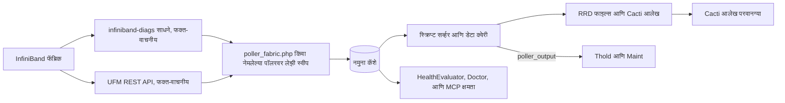

<!-- Source: README.md; SHA256: 79a16fb906f96ee79de2c719f18c38836f555440a7571a4a5ba38c64bb5b099f -->

<!-- translations:start -->
[English](../../../README.md) | [简体中文](../zh-CN/README.md) | [हिन्दी](../hi-IN/README.md) | [Español (España)](../es-ES/README.md) | [Español (Latinoamérica)](../es-419/README.md) | [العربية (السعودية)](../ar-SA/README.md) | [Afrikaans](../af-ZA/README.md) | [አማርኛ](../am-ET/README.md) | [العربية (مصر)](../ar-EG/README.md) | [العربية (المغرب)](../ar-MA/README.md) | [Български](../bg-BG/README.md) | [বাংলা](../bn-BD/README.md) | [Bosanski](../bs-BA/README.md) | [Deutsch](../de-DE/README.md) | [Ελληνικά](../el-GR/README.md) | [فارسی](../fa-IR/README.md) | [Filipino](../fil-PH/README.md) | [Français](../fr-FR/README.md) | [Français (Maroc)](../fr-MA/README.md) | [Français (Sénégal)](../fr-SN/README.md) | [Hausa](../ha-NG/README.md) | [עברית](../he-IL/README.md) | [Hrvatski](../hr-HR/README.md) | [Bahasa Indonesia](../id-ID/README.md) | [Igbo](../ig-NG/README.md) | [Italiano](../it-IT/README.md) | [日本語](../ja-JP/README.md) | [ქართული](../ka-GE/README.md) | [한국어](../ko-KR/README.md) | [Latviešu](../lv-LV/README.md) | [Malagasy](../mg-MG/README.md) | [मराठी](README.md) | [Bahasa Melayu](../ms-MY/README.md) | [Nederlands](../nl-NL/README.md) | [Polski](../pl-PL/README.md) | [Português (Brasil)](../pt-BR/README.md) | [Português (Portugal)](../pt-PT/README.md) | [Русский](../ru-RU/README.md) | [Kinyarwanda](../rw-RW/README.md) | [Soomaali](../so-SO/README.md) | [Српски](../sr-RS/README.md) | [Svenska](../sv-SE/README.md) | [Kiswahili](../sw-KE/README.md) | [தமிழ்](../ta-IN/README.md) | [తెలుగు](../te-IN/README.md) | [ไทย](../th-TH/README.md) | [Türkçe](../tr-TR/README.md) | [Українська](../uk-UA/README.md) | [اردو](../ur-PK/README.md) | [Tiếng Việt](../vi-VN/README.md) | [isiXhosa](../xh-ZA/README.md) | [Yorùbá](../yo-NG/README.md) | [繁體中文](../zh-TW/README.md) | [isiZulu](../zu-ZA/README.md)
<!-- translations:end -->

# plugin_fabric

एक Cacti 1.2 प्लगइन (`fabric`, आवृत्ती `0.1.0-dev`) जे InfiniBand पोर्ट काउंटर्स, लिंकची रुंदी व वेग आणि कंजेशन निर्देशक यांना Cacti मध्ये नेहमीचे डिव्हाइसेस, डेटा स्रोत आणि आलेख म्हणून आणते. त्यामुळे 4X ऐवजी 1X वर ट्रेन झालेली लिंक ती ज्या होस्टला सेवा देते त्याच्या शेजारी आलेख आणि Thold अलर्ट म्हणून दिसते; हे सर्व Cacti च्या परवानग्यांच्या अधीन राहून काम करते आणि Maint च्या जाणिवेसह अलर्ट दाबता येतो.

> **स्थिती: विकासाधीन, अद्याप कोणतेही प्रकाशन नाही.** या शाखेमध्ये प्लगइनची पायाभूत रचना, Cacti ऑब्जेक्ट्स व अलर्टिंग, नियोजित पार्श्वभूमी पॉलर स्वीप्स, रिमोट कलेक्टर प्रतिकृती, एनक्रिप्टेड क्रेडेन्शियल व्हॉल्टसह फक्त-वाचनीय NVIDIA UFM REST बॅकएंड, Configuration-as-Code (CasC) CLI व्यवस्थापन, आणि Cacti इकोसिस्टम हुक्स (CasC, Doctor, आणि MCP / Abilities API v2) कार्यान्वित केले आहेत. याची चाचणी बनावट साधने, कृत्रिम UFM ट्रान्सपोर्ट्स आणि `ibsim` फॅब्रिक सिम्युलेटर (rdma-core 50.0) वर केली गेली आहे, प्रत्यक्ष InfiniBand फॅब्रिक किंवा थेट UFM सर्व्हरवर कधीही नाही. हार्डवेअरची आवश्यकता असलेल्या तपासण्या [docs/research/](../../research/) मध्ये खुल्या आहेत. हा प्रकल्प Cacti प्रकल्पाशी संलग्न नाही.

## काय कार्यान्वित केले आहे

- **जीवनचक्र आणि स्कीमा (v3)**: इंस्टॉल, आयडेम्पोटंट अपग्रेड, अनइंस्टॉल (डीफॉल्टनुसार प्लगइन टेबल्स जतन करून), आणि प्रवेश बिंदू PHP 8.0 वर पार्स करण्यायोग्य ठेवताना PHP 8.2 आवश्यकतेचा गार्ड.
- **प्रवेश भूमिका आणि पृष्ठे**: `Fabric View` (`fabric.php`), `Fabric Operator` (`fabric_operator.php`), आणि `Fabric Admin` (`fabric_admin.php`, `fabric_health.php`) अधिकारक्षेत्रे, तसेच **Configuration > Settings > Fabrics** अंतर्गत Settings टॅब.
- **फक्त-वाचनीय निदान बॅकएंड (`diags`)**: `perfquery`, `ibnetdiscover`, आणि `iblinkinfo` ची काटेकोर आर्ग्युमेंट-व्हेक्टर अंमलबजावणी, ओळख संघर्ष शोध आणि पुन्हा-जोडणी प्रस्तावांसह GUID-आधारित यादी, लिंक-स्थिती मूल्यांकन, आणि प्रति-नोड काउंटर स्वीप्स.
- **फक्त-वाचनीय NVIDIA UFM REST बॅकएंड (`ufm`) आणि एनक्रिप्टेड व्हॉल्ट**: फक्त-GET अनुमत सूचीबद्ध REST क्लायंट (`/ufmRest/resources/ports`, `/ufmRest/resources/systems`, `/ufmRest/monitoring/session/0/data`, आणि टोकन प्रमाणीकरणासाठी `/ufmRestV3/...` समकक्ष) जो `diags` प्रमाणेच यादी, लिंक-स्थिती, नमुना आणि आरोग्य टेबल्स भरतो. क्रेडेन्शियल्स (`token` किंवा `basic`) `fabric_vault_key_file` द्वारे कॉन्फिगर केलेल्या बाह्य 256-बिट कीफाइलचा वापर करून AES-256-GCM ने एनक्रिप्ट करून `plugin_fabric_secret` मध्ये साठवली जातात. UFM फॅब्रिक्स CasC (`cli/fabric.php`) किंवा रिपॉझिटरीजद्वारे परिभाषित केले जाऊ शकतात; वेब अ‍ॅडमिन फॉर्म सध्या `diags` फील्ड्स दाखवतो.
- **Cacti ऑब्जेक्ट्स, Thold, आणि Maint**: Cacti डिव्हाइस, डेटा आणि आलेख टेम्पलेट्स (`templates/fabric-templates.xml`), "Fabric Port" स्क्रिप्ट-सर्व्हर डेटा क्वेरी (`scripts/ss_fabric_ports.php`, `resource/script_server/fabric_ports.xml`), Thold साठी `DERIVE` काउंटर डेटा स्रोत आणि `GAUGE` लिंक-स्थिती/दर डेटा स्रोत, सातत्यभंग मागोवा, आणि `U` म्हणून नोंदवलेले संतृप्त मूलभूत काउंटर्स. Maint एकत्रीकरण (`MaintMaintenance`) `plugin_maint_check_cacti_host()` तपासते (`is_device_in_maintenance` हुककडे फॉलबॅकसह) जेणेकरून सक्रिय देखभालीतील नोड्स वेगळे मोजले जातात आणि अयशस्वी-स्वीप व खराब-पोर्ट आरोग्य इशाऱ्यांमधून वगळले जातात.
- **नियोजित स्वीप्स, शार्डिंग, आणि रिमोट कलेक्टर्स**: `poller_bottom` सध्याच्या पॉलरला नेमलेल्या योग्य फॅब्रिक्ससाठी पार्श्वभूमीत `poller_fabric.php` सुरू करते, तसेच स्क्रिप्ट सर्व्हरद्वारे सुरू होणारे लेझी स्वीप्सही चालतात. `INFO` हे `remote_collect:1, remote_poller:1` घोषित करते, `poller_fabric.php` नियतकालिक GUID शार्डिंगला (`--shard=K/N`) समर्थन देते, आणि `replicate_out` गोपनीय नसलेल्या `plugin_fabric_fabric` ओळींची रिमोट कलेक्टर्सकडे (`poller_id >= 2`) प्रतिकृती बनवते. व्हॉल्ट नोंदी (`plugin_fabric_secret`) आणि बाह्य कीफाइल्सची कधीही प्रतिकृती बनवली जात नाही.
- **CasC CLI आणि इकोसिस्टम हुक्स**: YAML/XML निर्यात, प्रमाणीकरण, ड्राय-रन फरक नियोजन, पुष्टी-आधारित अंमलबजावणी, आणि आरोग्य अहवालासाठी `cli/fabric.php`, तसेच `casc_register_providers`, `doctor_register_checks`, आणि `abilities_register` हुक्स.

## प्रवेश भूमिका

| अधिकारक्षेत्र | प्रवेश |
| --- | --- |
| Fabric View | यादी आणि पोर्ट दृश्यांचे निरीक्षण (`fabric.php`). |
| Fabric Operator | View प्रवेश तसेच Operations पृष्ठ (`fabric_operator.php`) आणि वैयक्तिक ट्रायज पोचपावती. |
| Fabric Admin | Operator प्रवेश तसेच कॉन्फिगरेशन, प्रशासकीय कृती (`fabric_admin.php`), आणि आरोग्य पृष्ठ (`fabric_health.php`). |

अपग्रेड फाइल्स कॉपी केल्यानंतर, नवीन अधिकारक्षेत्रे आणि हुक्स नोंदणीकृत करण्यासाठी प्रशासक म्हणून Plugins पृष्ठ उघडा. **Configuration > Users** किंवा वापरकर्ता गटांखाली Operator अधिकारक्षेत्र स्पष्टपणे नेमून द्या. अपग्रेडमध्ये विद्यमान View आणि Admin अधिकारक्षेत्र आयडी आणि परवानग्या कायम राहतात. प्रत्येक विनंतीवर Admin प्रवेशाला Operator प्रवेश वारसाहक्काने मिळतो आणि Operator प्रवेशाला View प्रवेश वारसाहक्काने मिळतो; यामुळे वापरकर्त्यांना किंवा गटांना साठवलेल्या परवानग्या जोडल्या जात नाहीत. प्लगइन सेटिंग्जसाठी Cacti च्या Settings परवानगीव्यतिरिक्त Fabric Admin प्रवेश देखील आवश्यक आहे.

Cacti डिव्हाइस परवानग्या प्रत्येक वापरकर्त्यासाठी उपलब्ध ओळी आणि कृती मर्यादित ठेवतात; मॅप न केलेल्या ऑब्जेक्ट्ससाठी प्रशासकाची आवश्यकता असते. क्रेडेन्शियल्स, कॉन्फिगरेशन, मॅपिंग, हटवणे आणि इतर प्रशासकीय बदल प्रशासकीय पृष्ठांवर किंवा CLI मध्ये राहतात. पोचपावती केवळ सध्याच्या वापरकर्त्याच्या सत्रात, जास्तीत जास्त एक तासासाठी आणि केवळ तेच निरीक्षण ताजे असेपर्यंत टिकतात. नवीन किंवा बदललेली निरीक्षणे त्यांना अवैध ठरवतात. ते कधीही अयशस्वी मोजमाप निरोगी म्हणून चिन्हांकित करत नाहीत किंवा अलर्ट्स दाबत नाहीत.

## हे का आवश्यक आहे

खराब झालेली InfiniBand लिंक तरीही ट्रॅफिक पुढे पाठवत राहते. 4X लिंक जेव्हा 1X वर पुन्हा ट्रेन होते तेव्हा पोर्ट "active" राहते, आणि होस्टचे SNMP इंटरफेस आलेख सामान्य दिसतात, परंतु एकमेकांवर अवलंबून असलेली कामे मंदावतात. याचा पुरावा फॅब्रिकमध्ये असतो: प्रत्येक पोर्ट आपली सक्रिय, सक्षम आणि समर्थित रुंदी व वेग, तसेच त्रुटी आणि कंजेशन काउंटर्स नोंदवते. ते वाचण्यासाठी InfiniBand निदान साधने किंवा फॅब्रिक मॅनेजर API लागतो. हाताने चालवल्यास, त्यात तीन उणिवा राहतात:

- **इतिहास नाही.** `perfquery` आणि `iblinkinfo` फक्त सद्यस्थिती दाखवतात, त्यामुळे गेल्या आठवड्यात खराब झालेली लिंक अदृश्य राहते.
- **डिव्हाइस संदर्भ नाही.** फॅब्रिक पोर्ट्स हे Cacti ऑब्जेक्ट्स नसतात, त्यामुळे पोर्ट ज्या होस्टला जोडलेले आहे त्याच्या शेजारी त्याचा आलेख काढता येत नाही.
- **Cacti अलर्टिंगमध्ये मार्ग नाही.** Thold आणि Maint हे Cacti डेटा स्रोत आणि डिव्हाइसेसवर काम करतात.

हे प्लगइन `infiniband-diags` किंवा NVIDIA UFM REST API द्वारे फॅब्रिक वाचून, GUID ने नोड्स आणि पोर्ट्स ओळखून, आणि काउंटर्स व लिंक स्थिती Cacti डेटा स्रोत म्हणून प्रकाशित करून या उणिवा भरून काढते. ते फक्त वाचन करते: ते कधीही काउंटर्स रीसेट करत नाही किंवा पोर्टची स्थिती बदलत नाही.

## ऑपरेशन्स आणि CLI

### पार्श्वभूमी पॉलर आणि व्यक्तिचलित स्वीप्स

`fabric_poller_bottom()` प्रत्येक पॉलरवर त्या `poller_id` ला नेमलेल्या आणि स्वीपची वेळ झालेल्या सक्षम फॅब्रिक्ससाठी पार्श्वभूमीत `poller_fabric.php` सुरू करते. तुम्ही नेमलेल्या पॉलरवर पॉलर वापरकर्ता म्हणून थेट पॉलर रनर किंवा व्यक्तिचलित स्वीप देखील चालवू शकता (`/path/to/cacti` च्या जागी तुमची Cacti डिरेक्टरी वापरा):

```sh
php /path/to/cacti/plugins/fabric/poller_fabric.php [--fabric=ID] [--shard=K/N] [--force] [--debug]
php /path/to/cacti/plugins/fabric/fabric_sweep.php --fabric=ID [--node=GUID] [--force]
```

- `poller_fabric.php` स्थानिक पॉलरसाठी सर्व देय फॅब्रिक्स (किंवा `--fabric=ID` सह एक फॅब्रिक) चालवते, `max(30, intdiv(sweep_interval, 2))` सेकंदांच्या वेळ मर्यादेसह Cacti चे प्रक्रिया नोंदणी लॉक आणि `ClaimRepository` भाडेपट्टी लागू करते, आणि नोड GUID द्वारे `diags` नोड काउंटर स्वीप्स निश्चितपणे विभागण्यासाठी `--shard=K/N` (`0 <= K < N`) ला समर्थन देते.
- `fabric_sweep.php` स्थानिक पॉलरला नेमलेल्या एका सक्षम फॅब्रिकचा (किंवा `--node=GUID` सह एका नोडचा) मागणीनुसार स्वीप चालवते. `--force` दाव्यांचा आदर राखून फॅब्रिकची वेळ झाली आहे का ते दुर्लक्षित करते.

पहिल्या शोधाने यादी भरल्यानंतर, Fabric Admin पृष्ठावर नोड्सना Cacti डिव्हाइसेसशी मॅप करा. Cacti चा स्क्रिप्ट टाइमआउट 25 सेकंद किंवा त्याहून अधिक ठेवा: डेटा-क्वेरी वाचनाद्वारे सुरू केलेला लेझी स्वीप साधन अंमलबजावणीला `script_timeout - 5` सेकंदांपर्यंत मर्यादित करतो जेणेकरून स्क्रिप्ट सर्व्हर शेवटच्या साठवलेल्या नमुन्यासह किंवा `U` सह वेळेत उत्तर देईल.

### NVIDIA UFM REST बॅकएंड आणि क्रेडेन्शियल व्हॉल्ट

`ufm` फॅब्रिकसाठी एम्बेडेड क्रेडेन्शियल्स, क्वेरी स्ट्रिंग्ज किंवा फ्रॅगमेंट्स नसलेली `https://` URL आवश्यक असते. `UfmSocketTransport` TLS पीअर आणि होस्टनेम पडताळणी लागू करते, रीडायरेक्ट्स नाकारते, आणि पर्यायी CA बंडल (`ufm_ca_file`) व SHA-256 SPKI पिन (`ufm_spki_pin`) यांना समर्थन देते.

`plugin_fabric_secret` मध्ये UFM क्रेडेन्शियल्स साठवण्यासाठी, **Configuration > Settings > Fabrics** अंतर्गत `fabric_vault_key_file` पॉलर वापरकर्त्याच्या मालकीच्या नियमित फाइलच्या संपूर्ण पाथसह कॉन्फिगर करा (कोणत्याही मूळ डिरेक्टरीमध्ये सिमलिंक्स नसावेत, मोड `0600`, `openssl rand -hex 32` सारखे 64 हेक्स वर्ण किंवा 32 यादृच्छिक न-छापता येणारे बाइट्स असलेले). प्लगइन कधीही कीफाइल तयार करत नाही किंवा लिहीत नाही, आणि `replicate_out` कधीही `plugin_fabric_secret` किंवा कीफाइल्सची रिमोट पॉलर्सवर प्रतिकृती बनवत नाही.

### Configuration-as-Code आणि आरोग्य CLI

`cli/fabric.php` YAML किंवा XML मध्ये प्लगइन सेटिंग्ज आणि फॅब्रिक व्याख्या घोषणात्मकरित्या व्यवस्थापित करते, आणि थेट स्वीप्स न चालवता देखभाल-जागरूक आरोग्य अहवाल देते:

```sh
php /path/to/cacti/plugins/fabric/cli/fabric.php export [--format=yaml|xml] [--file=PATH]
php /path/to/cacti/plugins/fabric/cli/fabric.php validate --file=PATH [--format=yaml|xml]
php /path/to/cacti/plugins/fabric/cli/fabric.php plan --file=PATH [--format=yaml|xml]
php /path/to/cacti/plugins/fabric/cli/fabric.php apply --file=PATH --confirm=PLAN_HASH [--format=yaml|xml]
php /path/to/cacti/plugins/fabric/cli/fabric.php health [--format=text|json]
```

`export` `0600` मोडसह नवीन फाइल्स तयार करते, `fabric_vault_key_file` ला `[REDACTED]` म्हणून लपवते, आणि गोपनीय माहितीऐवजी नामित `ufm_credential_ref` संदर्भ देते. `plan` आणि `apply` इनलाइन `ufm_token`, `ufm_password`, `secret`, आणि इनलाइन `fabric_vault_key_file` मूल्ये नाकारतात. `apply` साठी `plan` ने तयार केलेला अचूक `--confirm=PLAN_HASH` आवश्यक असतो.

### इकोसिस्टम हुक्स

जेव्हा संबंधित Cacti प्लगइन्स किंवा होस्ट एकत्रीकरण उपस्थित असतात, तेव्हा `setup.php` नोंदणी करते:

- `casc_register_providers`: गोपनीयता लपवण्यासह `fabric` कॉन्फिगरेशन (`yaml` आणि `xml`, स्कीमा v1) निर्यात करते, प्रमाणित करते, नियोजित करते आणि पुष्टीकरणानंतर लागू करते.
- `doctor_register_checks`: चार फक्त-वाचनीय निदान तपासण्या प्रदान करते (`fabric.schema`, `fabric.poller_freshness`, `fabric.identity_conflicts`, `fabric.ufm_vault`).
- `abilities_register`: `fabric` श्रेणी अंतर्गत तीन फक्त-वाचनीय, विनाशक नसलेल्या, आयडेम्पोटंट क्षमता नोंदणीकृत करते, ज्या Fabric View अधिकारक्षेत्राद्वारे (आणि पोर्ट त्रुटींसाठी Cacti डिव्हाइस परवानग्यांद्वारे) नियंत्रित असतात: `fabric-list-fabrics`, `fabric-get-health`, आणि `fabric-list-port-errors`.

## व्याप्ती आणि मर्यादा

व्याप्तीबाहेर: फॅब्रिक स्थिती बदलणे, काउंटर्स रीसेट करणे, फॅब्रिक मॅनेजर किंवा सबनेट मॅनेजर बदलणे, प्लगइन-मालकीचे अलर्टिंग इंजिन, कस्टम डिमन किंवा नेटवर्क प्रोटोकॉल, आणि Ethernet किंवा RoCE फॅब्रिक्स.

## आवश्यकता आणि सुसंगतता

| घटक | उद्दिष्ट |
|---|---|
| Cacti | 1.2.31 किंवा नंतरची आवृत्ती (`compat = 1.2.31`), कोणत्याही कोर पॅचेसशिवाय |
| PHP | 8.2 किंवा नंतरची आवृत्ती; प्रवेश बिंदू 8.0 वर पार्स करण्यायोग्य राहतात आणि 8.1 वर सक्रियता नाकारतात जेणेकरून असमर्थित रनटाइमला तुटलेल्या Cacti UI ऐवजी नकार मिळतो |
| InfiniBand साधने | `rdma-core` मधील `infiniband-diags` (`ibsim` अंतर्गत rdma-core 50.0 सह CI मध्ये चाचणी केली; आउटपुट फॉरमॅट्स v66.0 स्रोताशी तपासलेले) |
| UFM | NVIDIA UFM Enterprise REST API (`ufmRest` आणि `ufmRestV3` फक्त-वाचनीय एंडपॉइंट्स; युनिट चाचण्यांमध्ये कृत्रिम ट्रान्सपोर्ट्सवर चाचणी केली) |
| Thold, Maint | कोणत्याही बदलांची आवश्यकता नाही; CI न बदललेल्या Thold v1.8.2 आणि Maint v1.3 सह एंड-टू-एंड चाचणी चालवते |

## विकास आणि चाचणी

CI वर्कफ्लो (`.github/workflows/plugin-ci-workflow.yml`) Cacti `release/1.2.31` आणि `1.2.x` विरुद्ध PHP 8.2 ते 8.5, PHP 8.0 प्रवेश-बिंदू लिंटिंग, PHP 8.1 नकार, PHPStan, gettext/भाषांतर पडताळणी, REUSE परवाना, वर्कफ्लो लिंटिंग, Thold/Maint एंड-टू-एंड रिप्ले, आणि `ibsim` फॅब्रिक सिम्युलेशनची चाचणी करते.

Cacti च्या लॉक केलेल्या शेअर्ड Pest प्लगइन हार्नेस (`CACTI_PEST_BIN`) आणि डिस्पोजेबल Cacti डेटाबेससह:

```sh
# Unit tests
"$CACTI_PEST_BIN" --configuration=phpunit.xml

# Lifecycle integration tests (disposable database only)
CACTI_PATH=/path/to/cacti FABRIC_TEST_DATABASE=disposable "$CACTI_PEST_BIN" --configuration=phpunit-integration.xml

# Static analysis (against Cacti 1.2.31)
CACTI_PATH=/path/to/cacti phpstan analyse -c phpstan.neon --no-progress

# Translation template, catalogs, and localized README checks
sh locales/build_gettext.sh --check

# Simulated ibsim fixture parser check
php tests/bin/check-ibsim-fixtures.php tests/fixtures/ibsim
```

## रचना

- [docs/PLAN.md](../../PLAN.md) ही आर्किटेक्चर आणि डिझाइन योजना आहे: स्रोतांसह अपस्ट्रीम तथ्ये, खुल्या हार्डवेअर तपासण्या, ओळख मॉडेल, काउंटर आणि लिंक-स्थिती नियम, सुरक्षा मर्यादा, कार्यप्रदर्शन गणित, चाचणी आणि धोके.
- [docs/decisions/](../../decisions/) मध्ये आर्किटेक्चर निर्णय नोंदी आहेत.
- [docs/REQUIREMENTS.md](../../REQUIREMENTS.md) प्रत्येक आवश्यकता आयडीला त्याच्या इश्यूशी जोडते.



## कामाचा मागोवा कसा घेतला जातो

- **माइलस्टोन्स** योजनेतील माइलस्टोन्सचे अनुसरण करतात. प्रत्येकाकडे एक एपिक इश्यू आहे ज्यामध्ये त्याचे उप-इश्यू आणि पूर्णत्वाचे पुरावे सूचीबद्ध आहेत.
- **इश्यूज** लेबलनुसार वर्गीकृत केले जातात: `type: requirement`, `type: research`, `type: decision`, `type: epic`. आवश्यकता इश्यूजमध्ये क्रमांकित, तपासण्यायोग्य आवश्यकता (`REQ-AREA-NNN`) आणि स्वीकृती निकष नमूद केलेले असतात.
- **लेबल्स** मध्ये `area:`, `phase:`, `priority:`, आणि `status:` देखील असतात. पहा [CONTRIBUTING.md](../../../CONTRIBUTING.md#labels).
- [प्रकल्प बोर्ड](https://github.com/users/somethingwithproof/projects/8) सर्व माइलस्टोन्समधील इश्यूज दाखवतो.

## योगदान

[CONTRIBUTING.md](../../../CONTRIBUTING.md) वाचा. कमिट्ससाठी DCO साइन-ऑफ (`git commit -s`) आवश्यक आहे. रचनेसंबंधी चर्चा इश्यूजवर होते; प्रलंबित निर्णयांवर `type: decision` लेबल असते.

## सुरक्षा

सुरक्षा त्रुटी खाजगीरीत्या कळवा; पहा [SECURITY.md](../../../SECURITY.md).

## परवाना

GNU General Public License v2.0, Cacti आणि त्याच्या प्लगइन्सप्रमाणेच परवाना. पहा [LICENSE](../../../LICENSE).
