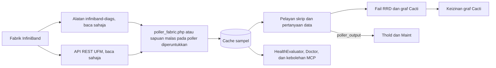

<!-- Source: README.md; SHA256: 79a16fb906f96ee79de2c719f18c38836f555440a7571a4a5ba38c64bb5b099f -->

<!-- translations:start -->
[English](../../../README.md) | [简体中文](../zh-CN/README.md) | [हिन्दी](../hi-IN/README.md) | [Español (España)](../es-ES/README.md) | [Español (Latinoamérica)](../es-419/README.md) | [العربية (السعودية)](../ar-SA/README.md) | [Afrikaans](../af-ZA/README.md) | [አማርኛ](../am-ET/README.md) | [العربية (مصر)](../ar-EG/README.md) | [العربية (المغرب)](../ar-MA/README.md) | [Български](../bg-BG/README.md) | [বাংলা](../bn-BD/README.md) | [Bosanski](../bs-BA/README.md) | [Deutsch](../de-DE/README.md) | [Ελληνικά](../el-GR/README.md) | [فارسی](../fa-IR/README.md) | [Filipino](../fil-PH/README.md) | [Français](../fr-FR/README.md) | [Français (Maroc)](../fr-MA/README.md) | [Français (Sénégal)](../fr-SN/README.md) | [Hausa](../ha-NG/README.md) | [עברית](../he-IL/README.md) | [Hrvatski](../hr-HR/README.md) | [Bahasa Indonesia](../id-ID/README.md) | [Igbo](../ig-NG/README.md) | [Italiano](../it-IT/README.md) | [日本語](../ja-JP/README.md) | [ქართული](../ka-GE/README.md) | [한국어](../ko-KR/README.md) | [Latviešu](../lv-LV/README.md) | [Malagasy](../mg-MG/README.md) | [मराठी](../mr-IN/README.md) | [Bahasa Melayu](README.md) | [Nederlands](../nl-NL/README.md) | [Polski](../pl-PL/README.md) | [Português (Brasil)](../pt-BR/README.md) | [Português (Portugal)](../pt-PT/README.md) | [Русский](../ru-RU/README.md) | [Kinyarwanda](../rw-RW/README.md) | [Soomaali](../so-SO/README.md) | [Српски](../sr-RS/README.md) | [Svenska](../sv-SE/README.md) | [Kiswahili](../sw-KE/README.md) | [தமிழ்](../ta-IN/README.md) | [తెలుగు](../te-IN/README.md) | [ไทย](../th-TH/README.md) | [Türkçe](../tr-TR/README.md) | [Українська](../uk-UA/README.md) | [اردو](../ur-PK/README.md) | [Tiếng Việt](../vi-VN/README.md) | [isiXhosa](../xh-ZA/README.md) | [Yorùbá](../yo-NG/README.md) | [繁體中文](../zh-TW/README.md) | [isiZulu](../zu-ZA/README.md)
<!-- translations:end -->

# plugin_fabric

Pemalam Cacti 1.2 (`fabric`, versi `0.1.0-dev`) yang membawa pembilang port InfiniBand, lebar dan kelajuan pautan, serta penunjuk kesesakan ke dalam Cacti sebagai peranti, sumber data, dan graf biasa. Pautan yang terlatih pada 1X berbanding 4X kemudiannya akan dipaparkan sebagai graf dan amaran Thold di sebelah hos yang dilayaninya, di bawah keizinan Cacti, dengan kesedaran dan sekatan Maint.

> **Status: dalam pembangunan, belum ada keluaran lagi.** Cawangan ini melaksanakan asas pemalam, objek dan pemakluman Cacti, sapuan poller latar belakang berjadual, replikasi pengumpul jauh, bahagian belakang REST NVIDIA UFM baca sahaja dengan peti besi kelayakan tersulit, pengurusan CLI Configuration-as-Code (CasC), serta cangkuk ekosistem Cacti (CasC, Doctor, dan MCP / Abilities API v2). Ia telah diuji terhadap alatan palsu, pengangkutan UFM sintetik, dan simulator fabrik `ibsim` (rdma-core 50.0), tidak pernah pada fabrik InfiniBand fizikal atau pelayan UFM langsung. Semakan yang memerlukan perkakasan kekal terbuka dalam [docs/research/](../../research/). Projek ini tidak mempunyai kaitan dengan projek Cacti.

## Apa yang dilaksanakan

- **Kitaran hayat dan skema (v3)**: pemasangan, naik taraf idempoten, nyahpasang (mengekalkan jadual pemalam secara lalai), dan pengawal keperluan PHP 8.2 sambil mengekalkan titik masuk boleh dihuraikan pada PHP 8.0.
- **Peranan akses dan halaman**: realm `Fabric View` (`fabric.php`), `Fabric Operator` (`fabric_operator.php`), dan `Fabric Admin` (`fabric_admin.php`, `fabric_health.php`), berserta tab Settings di bawah **Configuration > Settings > Fabrics**.
- **Bahagian belakang diagnostik baca sahaja (`diags`)**: pelaksanaan vektor argumen ketat bagi `perfquery`, `ibnetdiscover`, dan `iblinkinfo`, inventori berkunci GUID dengan pengesanan konflik identiti dan cadangan pautan semula, penilaian keadaan pautan, dan sapuan pembilang bagi setiap nod.
- **Bahagian belakang REST NVIDIA UFM baca sahaja (`ufm`) dan peti besi tersulit**: klien REST senarai dibenarkan GET sahaja (`/ufmRest/resources/ports`, `/ufmRest/resources/systems`, `/ufmRest/monitoring/session/0/data`, dan padanan `/ufmRestV3/...` untuk pengesahan token) yang menyalurkan ke jadual inventori, keadaan pautan, sampel, dan kesihatan yang sama seperti `diags`. Kelayakan (`token` atau `basic`) disimpan tersulit dengan AES-256-GCM dalam `plugin_fabric_secret` menggunakan fail kunci 256-bit luaran yang dikonfigurasikan oleh `fabric_vault_key_file`. Fabrik UFM boleh ditakrifkan melalui CasC (`cli/fabric.php`) atau repositori; borang pentadbir web pada masa ini mendedahkan medan `diags`.
- **Objek Cacti, Thold, dan Maint**: templat peranti, data, dan graf Cacti (`templates/fabric-templates.xml`), pertanyaan data pelayan skrip "Fabric Port" (`scripts/ss_fabric_ports.php`, `resource/script_server/fabric_ports.xml`), sumber data pembilang `DERIVE` dan sumber data keadaan/kadar pautan `GAUGE` untuk Thold, penjejakan ketidaksinambungan, dan pembilang asas tepu yang dilaporkan sebagai `U`. Integrasi Maint (`MaintMaintenance`) menanyakan `plugin_maint_check_cacti_host()` (beralih kepada cangkuk `is_device_in_maintenance` sebagai sandaran) supaya nod dalam penyelenggaraan aktif dikira secara berasingan dan dikecualikan daripada amaran kesihatan sapuan gagal dan port merosot.
- **Sapuan berjadual, penyerpihan, dan pengumpul jauh**: `poller_bottom` melancarkan `poller_fabric.php` di latar belakang untuk fabrik yang tiba masanya dan diperuntukkan kepada poller semasa, di samping sapuan malas yang dicetuskan oleh pelayan skrip. `INFO` mengisytiharkan `remote_collect:1, remote_poller:1`, `poller_fabric.php` menyokong penyerpihan GUID deterministik (`--shard=K/N`), dan `replicate_out` mereplikasi baris `plugin_fabric_fabric` bukan rahsia ke pengumpul jauh (`poller_id >= 2`). Entri peti besi (`plugin_fabric_secret`) dan fail kunci luaran tidak sekali-kali direplikasi.
- **CLI CasC dan cangkuk ekosistem**: `cli/fabric.php` untuk eksport YAML/XML, pengesahan, perancangan perbezaan jalan kering, penerapan berperingkat pengesahan, dan pelaporan kesihatan, berserta cangkuk `casc_register_providers`, `doctor_register_checks`, dan `abilities_register`.

## Peranan akses

| Realm | Akses |
| --- | --- |
| Fabric View | Memantau paparan inventori dan port (`fabric.php`). |
| Fabric Operator | Akses View berserta halaman Operations (`fabric_operator.php`) dan pengakuan triaj peribadi. |
| Fabric Admin | Akses Operator berserta konfigurasi, tindakan pentadbiran (`fabric_admin.php`), dan halaman kesihatan (`fabric_health.php`). |

Selepas menyalin fail naik taraf, buka halaman Plugins sebagai pentadbir untuk mendaftarkan realm dan cangkuk baharu. Berikan realm Operator secara eksplisit di bawah **Configuration > Users** atau kumpulan pengguna. Naik taraf mengekalkan ID dan pemberian realm View serta Admin sedia ada. Akses Admin mewarisi akses Operator, dan akses Operator mewarisi akses View pada setiap permintaan; ini tidak menambah pemberian tersimpan kepada pengguna atau kumpulan. Tetapan pemalam juga memerlukan akses Fabric Admin selain keizinan Settings Cacti.

Keizinan peranti Cacti mengehadkan baris dan tindakan yang tersedia untuk setiap pengguna; objek yang tidak dipetakan memerlukan pentadbir. Kelayakan, konfigurasi, pemetaan, pemadaman, dan perubahan pentadbiran lain kekal di halaman pentadbiran atau CLI. Pengakuan hanya bertahan dalam sesi pengguna semasa, untuk paling lama satu jam dan hanya selagi pemerhatian yang sama kekal segar. Pemerhatian baharu atau yang berubah akan membatalkannya. Ia tidak sekali-kali menandakan pengukuran yang gagal sebagai sihat atau menyekat amaran.

## Mengapa

Pautan InfiniBand yang merosot masih melalukan trafik. Pautan 4X yang melatih semula pada 1X membiarkan port dalam keadaan "active", dan graf antara muka SNMP hos kelihatan normal, tetapi kerja yang berganding rapat menjadi perlahan. Buktinya berada dalam fabrik: setiap port melaporkan lebar dan kelajuan yang aktif, didayakan, dan disokong, berserta pembilang ralat dan kesesakan. Membacanya memerlukan alatan diagnostik InfiniBand atau API pengurus fabrik. Apabila dijalankan secara manual, ia meninggalkan tiga jurang:

- **Tiada sejarah.** `perfquery` dan `iblinkinfo` menunjukkan keadaan semasa, jadi pautan yang merosot pada minggu lepas tidak kelihatan.
- **Tiada konteks peranti.** Port fabrik bukan objek Cacti, jadi port tidak dapat digrafkan di sebelah hos yang dibekalkannya.
- **Tiada laluan ke pemakluman Cacti.** Thold dan Maint berfungsi pada sumber data dan peranti Cacti.

Pemalam ini menutup jurang tersebut dengan membaca fabrik melalui `infiniband-diags` atau API REST NVIDIA UFM, mengenal pasti nod dan port mengikut GUID, serta menerbitkan pembilang dan keadaan pautan sebagai sumber data Cacti. Ia hanya membaca: ia tidak sekali-kali menetapkan semula pembilang atau mengubah keadaan port.

## Operasi dan CLI

### Poller latar belakang dan sapuan manual

`fabric_poller_bottom()` memulakan `poller_fabric.php` di latar belakang pada setiap poller untuk fabrik didayakan yang diperuntukkan kepada `poller_id` tersebut yang sapuannya sudah tiba masanya. Anda juga boleh menjalankan pelari poller atau sapuan manual secara terus pada poller yang diperuntukkan sebagai pengguna poller (menggantikan `/path/to/cacti` dengan direktori Cacti anda):

```sh
php /path/to/cacti/plugins/fabric/poller_fabric.php [--fabric=ID] [--shard=K/N] [--force] [--debug]
php /path/to/cacti/plugins/fabric/fabric_sweep.php --fabric=ID [--node=GUID] [--force]
```

- `poller_fabric.php` menjalankan semua fabrik yang tiba masanya bagi poller tempatan (atau satu fabrik dengan `--fabric=ID`), menguatkuasakan kunci registri proses Cacti dan pajakan `ClaimRepository` dengan belanjawan masa `max(30, intdiv(sweep_interval, 2))` saat, dan menyokong `--shard=K/N` (`0 <= K < N`) untuk menyerpihkan sapuan pembilang nod `diags` secara deterministik mengikut GUID nod.
- `fabric_sweep.php` menjalankan sapuan atas permintaan bagi satu fabrik didayakan (atau satu nod dengan `--node=GUID`) yang diperuntukkan kepada poller tempatan. `--force` mengabaikan sama ada fabrik sudah tiba masanya sambil tetap mematuhi tuntutan.

Selepas penemuan pertama mengisi inventori, petakan nod kepada peranti Cacti pada halaman Fabric Admin. Kekalkan tamat masa skrip Cacti pada 25 saat atau lebih tinggi: sapuan malas yang dimulakan oleh bacaan pertanyaan data mengehadkan pelaksanaan alat kepada `script_timeout - 5` saat supaya pelayan skrip kembali tepat pada masanya dengan sampel tersimpan terakhir atau `U`.

### Bahagian belakang REST NVIDIA UFM dan peti besi kelayakan

Fabrik `ufm` memerlukan URL `https://` tanpa kelayakan terbenam, rentetan pertanyaan, atau serpihan. `UfmSocketTransport` menguatkuasakan pengesahan rakan dan nama hos TLS, menolak ubah hala, dan menyokong himpunan CA pilihan (`ufm_ca_file`) dan pin SPKI SHA-256 (`ufm_spki_pin`).

Untuk menyimpan kelayakan UFM dalam `plugin_fabric_secret`, konfigurasikan `fabric_vault_key_file` di bawah **Configuration > Settings > Fabrics** dengan laluan mutlak ke fail biasa milik pengguna poller (tiada pautan simbolik dalam mana-mana direktori induk, mod `0600`, mengandungi 64 aksara heks seperti `openssl rand -hex 32` atau 32 bait rawak tidak boleh cetak). Pemalam tidak sekali-kali mencipta atau menulis fail kunci, dan `replicate_out` tidak sekali-kali mereplikasi `plugin_fabric_secret` atau fail kunci ke poller jauh.

### Configuration-as-Code dan CLI kesihatan

`cli/fabric.php` menguruskan tetapan pemalam dan takrifan fabrik secara deklaratif dalam YAML atau XML, serta melaporkan kesihatan peka penyelenggaraan tanpa menjalankan sapuan langsung:

```sh
php /path/to/cacti/plugins/fabric/cli/fabric.php export [--format=yaml|xml] [--file=PATH]
php /path/to/cacti/plugins/fabric/cli/fabric.php validate --file=PATH [--format=yaml|xml]
php /path/to/cacti/plugins/fabric/cli/fabric.php plan --file=PATH [--format=yaml|xml]
php /path/to/cacti/plugins/fabric/cli/fabric.php apply --file=PATH --confirm=PLAN_HASH [--format=yaml|xml]
php /path/to/cacti/plugins/fabric/cli/fabric.php health [--format=text|json]
```

`export` mencipta fail baharu dengan mod `0600`, menyunting `fabric_vault_key_file` sebagai `[REDACTED]`, dan mengeluarkan rujukan `ufm_credential_ref` bernama berbanding rahsia. `plan` dan `apply` menolak nilai sebaris `ufm_token`, `ufm_password`, `secret`, dan nilai sebaris `fabric_vault_key_file`. `apply` memerlukan `--confirm=PLAN_HASH` yang tepat seperti dihasilkan oleh `plan`.

### Cangkuk ekosistem

Apabila pemalam Cacti atau integrasi hos yang sepadan hadir, `setup.php` mendaftarkan:

- `casc_register_providers`: mengeksport, mengesahkan, merancang, dan menerapkan dengan pengesahan bagi konfigurasi `fabric` (`yaml` dan `xml`, skema v1) bersama penyuntingan rahsia.
- `doctor_register_checks`: menyediakan empat semakan diagnostik baca sahaja (`fabric.schema`, `fabric.poller_freshness`, `fabric.identity_conflicts`, `fabric.ufm_vault`).
- `abilities_register`: mendaftarkan tiga kebolehan baca sahaja, tidak memusnahkan, dan idempoten di bawah kategori `fabric`, dikawal oleh realm Fabric View (dan keizinan peranti Cacti bagi ralat port): `fabric-list-fabrics`, `fabric-get-health`, dan `fabric-list-port-errors`.

## Skop dan sempadan

Di luar skop: mengubah keadaan fabrik, menetapkan semula pembilang, menggantikan pengurus fabrik atau pengurus subnet, enjin pemakluman milik pemalam, daemon atau protokol rangkaian tersuai, dan fabrik Ethernet atau RoCE.

## Keperluan dan keserasian

| Komponen | Sasaran |
|---|---|
| Cacti | 1.2.31 atau lebih baharu (`compat = 1.2.31`), tiada tampalan teras |
| PHP | 8.2 atau lebih baharu; titik masuk kekal boleh dihuraikan pada 8.0 dan menolak pengaktifan pada 8.1 supaya masa jalan yang tidak disokong mendapat penolakan dan bukannya UI Cacti yang rosak |
| Alatan InfiniBand | `infiniband-diags` daripada `rdma-core` (diuji dalam CI dengan rdma-core 50.0 di bawah `ibsim`; format output disemak terhadap sumber v66.0) |
| UFM | API REST NVIDIA UFM Enterprise (titik akhir baca sahaja `ufmRest` dan `ufmRestV3`; diuji terhadap pengangkutan sintetik dalam ujian unit) |
| Thold, Maint | Tiada perubahan diperlukan; CI menjalankan ujian hujung ke hujung dengan Thold v1.8.2 dan Maint v1.3 yang tidak diubah |

## Pembangunan dan pengujian

Aliran kerja CI (`.github/workflows/plugin-ci-workflow.yml`) menguji PHP 8.2 hingga 8.5 terhadap Cacti `release/1.2.31` dan `1.2.x`, linting titik masuk PHP 8.0, penolakan PHP 8.1, PHPStan, pengesahan gettext/terjemahan, pelesenan REUSE, linting aliran kerja, ulang main hujung ke hujung Thold/Maint, dan simulasi fabrik `ibsim`.

Dengan abah-abah pemalam Pest kongsi terkunci Cacti (`CACTI_PEST_BIN`) dan pangkalan data Cacti pakai buang:

```sh
# Unit tests
"$CACTI_PEST_BIN" --configuration=phpunit.xml

# Lifecycle integration tests (disposable database only)
CACTI_PATH=/path/to/cacti FABRIC_TEST_DATABASE=disposable "$CACTI_PEST_BIN" --configuration=phpunit-integration.xml

# Static analysis (against Cacti 1.2.31)
CACTI_PATH=/path/to/cacti phpstan analyse -c phpstan.neon --no-progress

# Translation template, catalogs, and localized README checks
sh locales/build_gettext.sh --check

# Simulated ibsim fixture parser check
php tests/bin/check-ibsim-fixtures.php tests/fixtures/ibsim
```

## Reka bentuk

- [docs/PLAN.md](../../PLAN.md) ialah pelan seni bina dan reka bentuk: fakta huluan berserta sumber, semakan perkakasan terbuka, model identiti, peraturan pembilang dan keadaan pautan, sempadan keselamatan, aritmetik prestasi, pengujian, dan risiko.
- [docs/decisions/](../../decisions/) menyimpan rekod keputusan seni bina.
- [docs/REQUIREMENTS.md](../../REQUIREMENTS.md) memetakan setiap ID keperluan kepada isunya.



## Cara kerja dijejaki

- **Pencapaian** mengikut pencapaian pelan tersebut. Setiap satu mempunyai isu epik yang menyenaraikan sub-isu dan bukti keluarannya.
- **Isu** ditaipkan mengikut label: `type: requirement`, `type: research`, `type: decision`, `type: epic`. Isu keperluan menyatakan keperluan bernombor yang boleh diuji (`REQ-AREA-NNN`) dan kriteria penerimaan.
- **Label** juga membawa `area:`, `phase:`, `priority:`, dan `status:`. Lihat [CONTRIBUTING.md](../../../CONTRIBUTING.md#labels).
- [Papan projek](https://github.com/users/somethingwithproof/projects/8) menunjukkan semua isu merentas pencapaian.

## Penyumbangan

Baca [CONTRIBUTING.md](../../../CONTRIBUTING.md). Komit memerlukan tandatangan DCO (`git commit -s`). Perbincangan reka bentuk berlaku pada isu; keputusan terbuka membawa label `type: decision`.

## Keselamatan

Laporkan kerentanan secara peribadi; lihat [SECURITY.md](../../../SECURITY.md).

## Lesen

GNU General Public License v2.0, lesen yang sama seperti Cacti dan pemalamnya. Lihat [LICENSE](../../../LICENSE).
