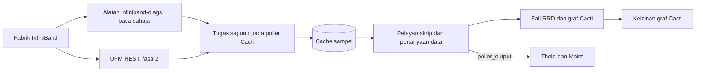

<!-- Source: README.md; SHA256: ce5af61a1bc993ec2aae6d4f22c3885694632f2b1d5eb94e2ce88b8390e96f1e -->

<!-- translations:start -->
[English](../../../README.md) | [简体中文](../zh-CN/README.md) | [हिन्दी](../hi-IN/README.md) | [Español (España)](../es-ES/README.md) | [Español (Latinoamérica)](../es-419/README.md) | [العربية (السعودية)](../ar-SA/README.md) | [Afrikaans](../af-ZA/README.md) | [አማርኛ](../am-ET/README.md) | [العربية (مصر)](../ar-EG/README.md) | [العربية (المغرب)](../ar-MA/README.md) | [বাংলা](../bn-BD/README.md) | [Bosanski](../bs-BA/README.md) | [Deutsch](../de-DE/README.md) | [فارسی](../fa-IR/README.md) | [Filipino](../fil-PH/README.md) | [Français](../fr-FR/README.md) | [Français (Maroc)](../fr-MA/README.md) | [Français (Sénégal)](../fr-SN/README.md) | [Hausa](../ha-NG/README.md) | [עברית](../he-IL/README.md) | [Hrvatski](../hr-HR/README.md) | [Bahasa Indonesia](../id-ID/README.md) | [Igbo](../ig-NG/README.md) | [Italiano](../it-IT/README.md) | [日本語](../ja-JP/README.md) | [한국어](../ko-KR/README.md) | [Malagasy](../mg-MG/README.md) | [मराठी](../mr-IN/README.md) | [Bahasa Melayu](README.md) | [Nederlands](../nl-NL/README.md) | [Polski](../pl-PL/README.md) | [Português (Brasil)](../pt-BR/README.md) | [Русский](../ru-RU/README.md) | [Kinyarwanda](../rw-RW/README.md) | [Soomaali](../so-SO/README.md) | [Српски](../sr-RS/README.md) | [Svenska](../sv-SE/README.md) | [Kiswahili](../sw-KE/README.md) | [தமிழ்](../ta-IN/README.md) | [తెలుగు](../te-IN/README.md) | [ไทย](../th-TH/README.md) | [Türkçe](../tr-TR/README.md) | [Українська](../uk-UA/README.md) | [اردو](../ur-PK/README.md) | [Tiếng Việt](../vi-VN/README.md) | [isiXhosa](../xh-ZA/README.md) | [Yorùbá](../yo-NG/README.md) | [繁體中文](../zh-TW/README.md) | [isiZulu](../zu-ZA/README.md)
<!-- translations:end -->

# plugin_fabric

Pemalam Cacti 1.2 yang membawa pembilang port InfiniBand, lebar dan kelajuan pautan, serta penunjuk kesesakan ke dalam Cacti sebagai peranti, sumber data, dan graf biasa. Pautan yang terlatih pada 1X berbanding 4X kemudiannya akan dipaparkan sebagai graf dan amaran Thold di sebelah hos yang dilayaninya, di bawah keizinan Cacti, dengan Maint berupaya menyekatnya.

> **Status: dalam pembangunan, belum ada keluaran lagi.** Pencapaian 2 (asas) telah digabungkan pada `main`, dan pencapaian 3 (objek Cacti dan pemakluman) sedang dalam semakan. Pencapaian 1 mengesahkan reka bentuk terhadap dokumentasi dan sumber huluan (PR #71); keputusannya, berserta sumber, terdapat di [docs/research/](../../research). Pencapaian 2 menambah asas pemalam:
>
> - pemasangan, naik taraf, nyahpasang, dan pengawal PHP 8.2
> - realm View, Operator dan Admin, serta tetapan
> - rekod fabrik
> - sempadan arahan baca sahaja untuk `perfquery`, `ibnetdiscover`, dan `iblinkinfo`
> - inventori mengikut GUID, dengan konflik identiti dan cadangan pautan semula
> - keadaan pautan dan cache sapuan pembilang
> - halaman inventori, pentadbir, dan kesihatan
>
> Pencapaian 3 menambah objek Cacti:
>
> - templat peranti, data, dan graf yang disertakan sebagai XML templat Cacti, serta pertanyaan data "Fabric Port"
> - pemetaan nod kepada peranti Cacti, atau menciptanya setelah disahkan ([ADR 0010](../../decisions/0010-one-device-per-node.md))
> - sumber data pembilang untuk graf, serta keadaan pautan GAUGE dan sumber data kadar untuk Thold ([ADR 0011](../../decisions/0011-derive-counters-and-gauge-alert-values.md))
> - pengendalian ketidaksinambungan dan pembilang asas tepu yang dibaca sebagai tidak diketahui ([ADR 0012](../../decisions/0012-saturated-basic-counters-read-as-unknown.md)), kesahihan pembilang dan pautan graf pada halaman port, serta kedudukan kesesakan
> - ujian hujung ke hujung dengan Thold v1.8.2 dan Maint v1.3 yang tidak diubah, serta kerja CI yang menjalankan alatan diagnostik sebenar terhadap fabrik tersimulasi
>
> Sesebuah fabrik hanya boleh disapu daripada poller utama sehinggalah pengumpul data jauh disokong dalam fasa 3. Ia telah diuji terhadap alatan palsu dan simulator fabrik ibsim, dan tidak pernah pada fabrik InfiniBand sebenar. Semakan yang memerlukan fabrik kekal terbuka dalam jadual semakan langsung pada setiap halaman penyelidikan. Projek ini tidak mempunyai kaitan dengan projek Cacti.

## Peranan akses

| Realm | Akses |
| --- | --- |
| Fabric View | Halaman pemantauan sedia ada. |
| Fabric Operator | Pemantauan berserta halaman Operasi dan pengakuan triaj peribadi. |
| Fabric Admin | Akses Operator berserta konfigurasi dan tindakan pentadbiran sedia ada. |

Selepas menyalin fail naik taraf, buka halaman Plugins sebagai pentadbir untuk mendaftarkan
realm baharu. Berikan realm Operator secara eksplisit di bawah **Configuration > Users** atau kumpulan pengguna.
Naik taraf mengekalkan ID dan pemberian realm View serta Admin sedia ada. Akses Admin
mewarisi akses Operator, dan akses Operator mewarisi akses View pada setiap permintaan;
ini tidak menambah pemberian tersimpan kepada pengguna atau kumpulan. Tetapan pemalam juga memerlukan
akses Fabric Admin selain keizinan Settings Cacti.

Keizinan peranti Cacti masih mengehadkan baris dan tindakan yang tersedia untuk setiap pengguna; objek yang tidak dipetakan memerlukan pentadbir.
Kelayakan, konfigurasi, pemetaan, pemadaman dan perubahan pentadbiran lain
kekal berada di halaman pentadbiran. Pengakuan hanya bertahan dalam sesi pengguna
semasa, untuk paling lama satu jam dan hanya selagi pemerhatian yang sama kekal
segar. Pemerhatian baharu atau yang berubah akan membatalkannya. Ia tidak sekali-kali menandakan pengukuran yang gagal
sebagai sihat atau menyekat amaran.

## Mengapa

Pautan InfiniBand yang merosot masih melalukan trafik. Pautan 4X yang melatih semula pada 1X membiarkan port dalam keadaan "aktif", dan graf antara muka SNMP hos kelihatan normal, tetapi kerja yang berganding rapat menjadi perlahan. Buktinya berada dalam fabrik: setiap port melaporkan lebar dan kelajuan yang aktif, didayakan, dan disokong, berserta pembilang ralat dan kesesakan. Membacanya memerlukan alatan diagnostik InfiniBand atau API pengurus fabrik. Apabila dijalankan secara manual, ia meninggalkan tiga jurang:

- **Tiada sejarah.** `perfquery` dan `iblinkinfo` menunjukkan keadaan semasa, jadi pautan yang merosot pada minggu lepas tidak kelihatan.
- **Tiada konteks peranti.** Port fabrik bukan objek Cacti, jadi port tidak dapat digrafkan di sebelah hos yang dibekalkannya.
- **Tiada laluan ke pemakluman Cacti.** Thold dan Maint berfungsi pada sumber data dan peranti Cacti.

Pemalam ini menutup jurang tersebut dengan membaca fabrik melalui alatan diagnostiknya sendiri (dan kemudiannya melalui UFM), mengenal pasti nod dan port mengikut GUID, serta menerbitkan pembilang dan keadaan pautan sebagai sumber data Cacti. Ia hanya membaca: ia tidak sekali-kali menetapkan semula pembilang atau mengubah keadaan port.

## Penemuan pertama

Fabrik baharu tidak mempunyai nod, dan sapuan bermula daripada pelayan skrip hanya untuk nod yang dipetakan kepada peranti Cacti. Oleh itu, penemuan pertama ialah langkah manual. Selepas menyimpan fabrik yang didayakan, jalankan ini sekali pada poller yang diperuntukkan kepada fabrik tersebut, sebagai akaun poller itu, dengan `/path/to/cacti` digantikan dengan direktori Cacti anda (laluan mutlak juga berfungsi daripada cron):

```
php /path/to/cacti/plugins/fabric/fabric_sweep.php --fabric=ID --force
```

Inventori kemudiannya akan diisi. Petakan nod kepada peranti Cacti pada halaman Fabric Admin; sapuan seterusnya bermula daripada pertanyaan data. Selagi tiada nod fabrik yang dipetakan, tiada apa yang akan menyegar semula inventorinya, jadi jalankan arahan yang sama sekali lagi, daripada cron jika anda mahu, untuk merekodkan nod baharu atau yang hilang. Halaman kesihatan menunjukkan arahan ini untuk fabrik yang didayakan yang belum ditemui atau tidak mempunyai nod yang dipetakan.

## Skop dirancang

| Fasa | Skop | Pencapaian |
|---|---|---|
| 0, penyelidikan | Matriks versi, pengesahan tingkah laku huluan, tingkah laku pembilang pada perkakasan, model keistimewaan, belanjawan MAD, API UFM | [M1](https://github.com/somethingwithproof/plugin_fabric/milestone/1) |
| 1, pemerhatian | Inventori mengikut GUID, peranti Cacti, pertanyaan data port, sumber data pembilang dan keadaan pautan, pemakluman Thold, sekatan Maint, halaman kesihatan | [M2](https://github.com/somethingwithproof/plugin_fabric/milestone/2), [M3](https://github.com/somethingwithproof/plugin_fabric/milestone/3), [M4](https://github.com/somethingwithproof/plugin_fabric/milestone/4) |
| 2, UFM | Bahagian belakang REST UFM baca sahaja, pengendalian kelayakan, kesinambungan identiti antara bahagian belakang | [M5](https://github.com/somethingwithproof/plugin_fabric/milestone/5) |
| 3, jauh | Pengumpul data jauh, replikasi, tindakan `remote_agent`, sapuan berserpih untuk fabrik besar | [M6](https://github.com/somethingwithproof/plugin_fabric/milestone/6) |

Di luar skop: mengubah keadaan fabrik, menggantikan pengurus fabrik atau pengurus subnet, enjin pemakluman milik pemalam, daemon atau protokol rangkaian tersuai, serta fabrik Ethernet atau RoCE (penyelidikan).

## Sasaran keserasian

| Komponen | Sasaran |
|---|---|
| Cacti | 1.2.31 atau lebih baharu, tiada tampalan teras |
| PHP | 8.2 atau lebih baharu; `setup.php` kekal boleh dihuraikan pada 8.0 supaya masa jalan yang tidak disokong mendapat penolakan dan bukannya UI Cacti yang rosak |
| Alatan InfiniBand | infiniband-diags daripada rdma-core; format output disemak terhadap sumber v66.0 |
| UFM | API REST UFM Enterprise, fasa 2; matriks keluaran ialah hasil serahan pencapaian 1 |
| Thold, Maint | Tiada perubahan diperlukan |

Kekalkan tamat masa skrip Cacti pada nilai lalai 25 saat atau lebih tinggi. Sapuan yang dimulakan oleh bacaan pertanyaan data mengehadkan pelaksanaan alat kepada tamat masa tersebut ditolak lima saat, menempah masa untuk membaca cache dan membalas. Apabila belanjawan tamat, pertanyaan menyajikan sampel semasa yang terakhir atau tidak diketahui; kitaran seterusnya mencuba semula sapuan. Had ini juga terpakai kepada poller PHP. Tamat masa lima saat atau kurang tidak meninggalkan masa untuk memulakan alat.

## Reka bentuk

- [docs/PLAN.md](../../PLAN.md) ialah pelan penuh: seni bina, fakta huluan yang menjadi sandarannya (berserta sumber) dan andaian yang masih perlu disahkan, model identiti, peraturan pembilang dan keadaan pautan, sempadan keselamatan, aritmetik prestasi, pengujian, dan risiko.
- [docs/decisions/](../../decisions) menyimpan rekod keputusan seni bina bagi pilihan yang telah dibuat.
- [docs/REQUIREMENTS.md](../../REQUIREMENTS.md) memetakan setiap ID keperluan kepada isunya.



## Cara kerja dijejaki

- **Pencapaian** mengikut pencapaian pelan tersebut. Setiap satu mempunyai isu epik yang menyenaraikan sub-isu dan bukti keluarannya.
- **Isu** ditaipkan mengikut label: `type: requirement`, `type: research`, `type: decision`, `type: epic`. Isu keperluan menyatakan keperluan bernombor yang boleh diuji (`REQ-AREA-NNN`) dan kriteria penerimaan.
- **Label** juga membawa `area:`, `phase:`, `priority:`, dan `status:`. Lihat [CONTRIBUTING.md](../../../CONTRIBUTING.md#labels).
- [Papan projek](https://github.com/users/somethingwithproof/projects/8) menunjukkan semua isu merentas pencapaian.

## Penyumbangan

Baca [CONTRIBUTING.md](../../../CONTRIBUTING.md). Komit memerlukan tandatangan DCO. Perbincangan reka bentuk berlaku pada isu; keputusan terbuka membawa label `type: decision`.

## Keselamatan

Laporkan kerentanan secara peribadi; lihat [SECURITY.md](../../../SECURITY.md).

## Lesen

GNU General Public License v2.0, lesen yang sama seperti Cacti dan pemalamnya. Lihat [LICENSE](../../../LICENSE).
