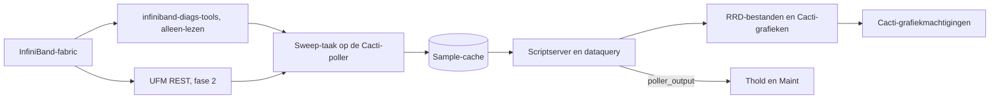

<!-- Source: README.md; SHA256: ce5af61a1bc993ec2aae6d4f22c3885694632f2b1d5eb94e2ce88b8390e96f1e -->

<!-- translations:start -->
[English](../../../README.md) | [简体中文](../zh-CN/README.md) | [हिन्दी](../hi-IN/README.md) | [Español (España)](../es-ES/README.md) | [Español (Latinoamérica)](../es-419/README.md) | [العربية (السعودية)](../ar-SA/README.md) | [Afrikaans](../af-ZA/README.md) | [አማርኛ](../am-ET/README.md) | [العربية (مصر)](../ar-EG/README.md) | [العربية (المغرب)](../ar-MA/README.md) | [বাংলা](../bn-BD/README.md) | [Bosanski](../bs-BA/README.md) | [Deutsch](../de-DE/README.md) | [فارسی](../fa-IR/README.md) | [Filipino](../fil-PH/README.md) | [Français](../fr-FR/README.md) | [Français (Maroc)](../fr-MA/README.md) | [Français (Sénégal)](../fr-SN/README.md) | [Hausa](../ha-NG/README.md) | [עברית](../he-IL/README.md) | [Hrvatski](../hr-HR/README.md) | [Bahasa Indonesia](../id-ID/README.md) | [Igbo](../ig-NG/README.md) | [Italiano](../it-IT/README.md) | [日本語](../ja-JP/README.md) | [한국어](../ko-KR/README.md) | [Malagasy](../mg-MG/README.md) | [मराठी](../mr-IN/README.md) | [Bahasa Melayu](../ms-MY/README.md) | [Nederlands](README.md) | [Polski](../pl-PL/README.md) | [Português (Brasil)](../pt-BR/README.md) | [Русский](../ru-RU/README.md) | [Kinyarwanda](../rw-RW/README.md) | [Soomaali](../so-SO/README.md) | [Српски](../sr-RS/README.md) | [Svenska](../sv-SE/README.md) | [Kiswahili](../sw-KE/README.md) | [தமிழ்](../ta-IN/README.md) | [తెలుగు](../te-IN/README.md) | [ไทย](../th-TH/README.md) | [Türkçe](../tr-TR/README.md) | [Українська](../uk-UA/README.md) | [اردو](../ur-PK/README.md) | [Tiếng Việt](../vi-VN/README.md) | [isiXhosa](../xh-ZA/README.md) | [Yorùbá](../yo-NG/README.md) | [繁體中文](../zh-TW/README.md) | [isiZulu](../zu-ZA/README.md)
<!-- translations:end -->

# plugin_fabric

Een Cacti 1.2-plug-in die InfiniBand-poorttellers, linkbreedte en -snelheid, en congestie-indicatoren naar Cacti brengt als gewone apparaten, gegevensbronnen en grafieken. Een link die is getraind op 1X in plaats van 4X verschijnt dan als een grafiek en een Thold-melding naast de host die hij bedient, onder de machtigingen van Cacti, waarbij Maint deze kan onderdrukken.

> **Status: in ontwikkeling, nog geen release.** Mijlpaal 2 (basis) is samengevoegd op `main`, en mijlpaal 3 (Cacti-objecten en waarschuwingen) wordt beoordeeld. Mijlpaal 1 heeft het ontwerp bevestigd aan de hand van documentatie en upstream-broncode (PR #71); de resultaten, met bronnen, staan in [docs/research/](../../research). Mijlpaal 2 voegt de basis van de plug-in toe:
>
> - installatie, upgrade, verwijdering en de PHP 8.2-controle
> - View-, Operator- en Admin-realms, en instellingen
> - fabric-records
> - de alleen-lezen opdrachtgrens voor `perfquery`, `ibnetdiscover` en `iblinkinfo`
> - inventarisatie op GUID, met identiteitsconflicten en voorstellen voor herkoppeling
> - linkstatus en de cache voor tellersweeps
> - inventarisatie-, beheer- en statuspagina's
>
> Mijlpaal 3 voegt de Cacti-objecten toe:
>
> - apparaat-, gegevens- en grafieksjablonen meegeleverd als Cacti-sjabloon-XML, en de dataquery "Fabric Port"
> - een node koppelen aan een Cacti-apparaat, of er een aanmaken na bevestiging ([ADR 0010](../../decisions/0010-one-device-per-node.md))
> - tellergegevensbronnen voor grafieken, en GAUGE-linkstatus- en snelheidsgegevensbronnen voor Thold ([ADR 0011](../../decisions/0011-derive-counters-and-gauge-alert-values.md))
> - afhandeling van discontinuïteiten en verzadigde basistellers gelezen als onbekend ([ADR 0012](../../decisions/0012-saturated-basic-counters-read-as-unknown.md)), tellervaliditeit en grafiekkoppelingen op de poortpagina, en een congestierangschikking
> - een end-to-endtest met ongewijzigde Thold v1.8.2 en Maint v1.3, en een CI-taak die de echte diagnosetools uitvoert tegen een gesimuleerde fabric
>
> Een fabric kan alleen vanaf de hoofdpoller worden gesweept totdat externe gegevensverzamelaars in fase 3 worden ondersteund. De plug-in is getest met mock-tools en de ibsim-fabricsimulator, nooit op een InfiniBand-fabric. Controles waarvoor een fabric nodig is, blijven openstaan in de tabel met live-controles op elke onderzoekspagina. Dit project is niet gelieerd aan het Cacti-project.

## Toegangsrollen

| Realm | Toegang |
| --- | --- |
| Fabric View | Bestaande monitoringpagina's. |
| Fabric Operator | Monitoring plus de Operations-pagina en persoonlijke triage-bevestigingen. |
| Fabric Admin | Operator-toegang plus de bestaande configuratie- en beheeracties. |

Open na het kopiëren van de upgradebestanden de pagina Plugins als beheerder om de nieuwe realm te registreren. Wijs de Operator-realm expliciet toe onder **Configuration > Users** of gebruikersgroepen. Upgrades behouden de bestaande View- en Admin-realm-ID's en -machtigingen. Admin-toegang erft Operator-toegang en Operator-toegang erft View-toegang bij elk verzoek; hierdoor worden geen opgeslagen machtigingen aan gebruikers of groepen toegevoegd. Plug-ininstellingen vereisen naast de Settings-machtiging van Cacti ook Fabric Admin-toegang.

Cacti-apparaatmachtigingen beperken nog steeds de rijen en acties die beschikbaar zijn voor elke gebruiker; voor niet-gekoppelde objecten is een beheerder vereist. Referenties, configuratie, koppeling, verwijdering en andere beheerswijzigingen blijven op de beheerpagina's. Bevestigingen blijven alleen geldig in de huidige sessie van de gebruiker, gedurende maximaal één uur en alleen zolang dezelfde waarneming actueel blijft. Nieuwe of gewijzigde waarnemingen maken ze ongeldig. Ze markeren een mislukte meting nooit als gezond en onderdrukken nooit waarschuwingen.

## Waarom

Een gedegradeerde InfiniBand-link geeft nog steeds verkeer door. Een 4X-link die opnieuw traint op 1X laat de poort "active" en de SNMP-interfacegrafieken van de host zien er normaal uit, maar nauw gekoppelde taken vertragen. Het bewijs bevindt zich in de fabric: elke poort rapporteert zijn actieve, ingeschakelde en ondersteunde breedte en snelheid, plus fout- en congestietellers. Om dit uit te lezen zijn de InfiniBand-diagnosetools of een fabric manager-API nodig. Wanneer deze handmatig worden uitgevoerd, laten ze drie gaten achter:

- **Geen historie.** `perfquery` en `iblinkinfo` tonen het heden, waardoor een link die vorige week is gedegradeerd onzichtbaar blijft.
- **Geen apparaatcontext.** Fabric-poorten zijn geen Cacti-objecten, dus een poort kan niet naast de host worden geplot die hij voedt.
- **Geen pad naar Cacti-waarschuwingen.** Thold en Maint werken op gegevensbronnen en apparaten van Cacti.

De plug-in dicht deze gaten door de fabric uit te lezen via de eigen diagnosetools (en later via UFM), nodes en poorten te identificeren op basis van GUID, en tellers en linkstatus te publiceren als gegevensbronnen van Cacti. De plug-in leest alleen: hij reset nooit tellers en wijzigt nooit de poortstatus.

## Eerste ontdekking

Een nieuwe fabric heeft geen nodes, en sweeps starten vanuit de scriptserver alleen voor een node die is gekoppeld aan een Cacti-apparaat. De eerste ontdekking is daarom een handmatige stap. Nadat u een ingeschakelde fabric hebt opgeslagen, voert u dit eenmaal uit op de poller waaraan de fabric is toegewezen, als het account van de poller, waarbij `/path/to/cacti` wordt vervangen door uw Cacti-map (het absolute pad werkt ook vanuit cron):

```
php /path/to/cacti/plugins/fabric/fabric_sweep.php --fabric=ID --force
```

De inventaris wordt vervolgens gevuld. Koppel nodes aan Cacti-apparaten op de pagina Fabric Admin; latere sweeps starten vanuit de dataquery. Zolang geen enkele node van een fabric is gekoppeld, wordt de inventaris ervan niet vernieuwd, dus voer dezelfde opdracht opnieuw uit — desgewenst vanuit cron — om nieuwe of ontbrekende nodes te registreren. De statuspagina toont deze opdracht voor een ingeschakelde fabric die nog niet is ontdekt of geen gekoppelde node heeft.

## Geplande scope

| Fase | Scope | Mijlpalen |
|---|---|---|
| 0, onderzoek | Versiematrix, bevestiging van upstream-gedrag, tellergedrag op hardware, rechtenmodel, MAD-budget, UFM-API | [M1](https://github.com/somethingwithproof/plugin_fabric/milestone/1) |
| 1, observeren | Inventarisatie op GUID, Cacti-apparaten, poortdataquery, teller- en linkstatusgegevensbronnen, Thold-waarschuwingen, Maint-onderdrukking, statuspagina | [M2](https://github.com/somethingwithproof/plugin_fabric/milestone/2), [M3](https://github.com/somethingwithproof/plugin_fabric/milestone/3), [M4](https://github.com/somethingwithproof/plugin_fabric/milestone/4) |
| 2, UFM | Alleen-lezen UFM REST-backend, afhandeling van referenties, identiteitscontinuïteit tussen backends | [M5](https://github.com/somethingwithproof/plugin_fabric/milestone/5) |
| 3, extern | Externe gegevensverzamelaars, replicatie, `remote_agent`-acties, gesharde sweeps voor grote fabrics | [M6](https://github.com/somethingwithproof/plugin_fabric/milestone/6) |

Buiten scope: het wijzigen van de fabric-status, het vervangen van een fabric manager of subnet manager, een eigen waarschuwingsengine van de plug-in, een aangepaste daemon of netwerkprotocol, en Ethernet- of RoCE-fabrics (onderzoek).

## Compatibiliteitsdoelen

| Component | Doel |
|---|---|
| Cacti | 1.2.31 of hoger, geen core-patches |
| PHP | 8.2 of hoger; `setup.php` blijft parseerbaar op 8.0 zodat een niet-ondersteunde runtime een weigering krijgt in plaats van een defecte Cacti-UI |
| InfiniBand-tools | infiniband-diags uit rdma-core; uitvoerformaten gecontroleerd tegen v66.0-broncode |
| UFM | UFM Enterprise REST-API, fase 2; releasematrix is een oplevering van mijlpaal 1 |
| Thold, Maint | Geen wijzigingen vereist |

Houd de scripttime-out van Cacti op de standaardwaarde van 25 seconden of hoger. Een sweep die wordt gestart door het lezen van een dataquery beperkt de uitvoering van tools tot die time-out minus vijf seconden, zodat er tijd overblijft om de cache te lezen en te antwoorden. Wanneer het budget verstrijkt, levert de query het laatste actuele monster of onbekend; de volgende cyclus probeert de sweep opnieuw. Deze limiet geldt ook voor de PHP-poller. Een time-out van vijf seconden of minder laat geen tijd over om een tool te starten.

## Ontwerp

- [docs/PLAN.md](../../PLAN.md) is het volledige plan: architectuur, upstream-feiten waarvan het afhankelijk is (met bronnen) en aannames die nog bevestigd moeten worden, identiteitsmodel, regels voor tellers en linkstatus, beveiligingsgrenzen, prestatierekenkunde, testen en risico's.
- [docs/decisions/](../../decisions) bevat architectuurbeslissingsrecords voor reeds gemaakte keuzes.
- [docs/REQUIREMENTS.md](../../REQUIREMENTS.md) koppelt elk vereiste-ID aan het bijbehorende issue.



## Hoe werk wordt bijgehouden

- **Mijlpalen** volgen de mijlpalen van het plan. Elke mijlpaal heeft een epic-issue met de sub-issues en het opleveringsbewijs.
- **Issues** worden getypeerd via een label: `type: requirement`, `type: research`, `type: decision`, `type: epic`. Vereiste-issues vermelden genummerde, testbare vereisten (`REQ-AREA-NNN`) en acceptatiecriteria.
- **Labels** bevatten ook `area:`, `phase:`, `priority:` en `status:`. Zie [CONTRIBUTING.md](../../../CONTRIBUTING.md#labels).
- Het [projectbord](https://github.com/users/somethingwithproof/projects/8) toont alle issues over de verschillende mijlpalen heen.

## Bijdragen

Lees [CONTRIBUTING.md](../../../CONTRIBUTING.md). Commits vereisen een DCO-ondertekening. Ontwerpdiscussies vinden plaats in issues; openstaande beslissingen dragen het label `type: decision`.

## Beveiliging

Meld kwetsbaarheden privé; zie [SECURITY.md](../../../SECURITY.md).

## Licentie

GNU General Public License v2.0, dezelfde licentie als Cacti en zijn plug-ins. Zie [LICENSE](../../../LICENSE).
