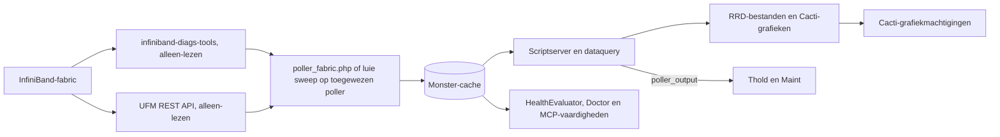

<!-- Source: README.md; SHA256: 79a16fb906f96ee79de2c719f18c38836f555440a7571a4a5ba38c64bb5b099f -->

<!-- translations:start -->
[English](../../../README.md) | [简体中文](../zh-CN/README.md) | [हिन्दी](../hi-IN/README.md) | [Español (España)](../es-ES/README.md) | [Español (Latinoamérica)](../es-419/README.md) | [العربية (السعودية)](../ar-SA/README.md) | [Afrikaans](../af-ZA/README.md) | [አማርኛ](../am-ET/README.md) | [العربية (مصر)](../ar-EG/README.md) | [العربية (المغرب)](../ar-MA/README.md) | [বাংলা](../bn-BD/README.md) | [Bosanski](../bs-BA/README.md) | [Deutsch](../de-DE/README.md) | [فارسی](../fa-IR/README.md) | [Filipino](../fil-PH/README.md) | [Français](../fr-FR/README.md) | [Français (Maroc)](../fr-MA/README.md) | [Français (Sénégal)](../fr-SN/README.md) | [Hausa](../ha-NG/README.md) | [עברית](../he-IL/README.md) | [Hrvatski](../hr-HR/README.md) | [Bahasa Indonesia](../id-ID/README.md) | [Igbo](../ig-NG/README.md) | [Italiano](../it-IT/README.md) | [日本語](../ja-JP/README.md) | [한국어](../ko-KR/README.md) | [Malagasy](../mg-MG/README.md) | [मराठी](../mr-IN/README.md) | [Bahasa Melayu](../ms-MY/README.md) | [Nederlands](README.md) | [Polski](../pl-PL/README.md) | [Português (Brasil)](../pt-BR/README.md) | [Русский](../ru-RU/README.md) | [Kinyarwanda](../rw-RW/README.md) | [Soomaali](../so-SO/README.md) | [Српски](../sr-RS/README.md) | [Svenska](../sv-SE/README.md) | [Kiswahili](../sw-KE/README.md) | [தமிழ்](../ta-IN/README.md) | [తెలుగు](../te-IN/README.md) | [ไทย](../th-TH/README.md) | [Türkçe](../tr-TR/README.md) | [Українська](../uk-UA/README.md) | [اردو](../ur-PK/README.md) | [Tiếng Việt](../vi-VN/README.md) | [isiXhosa](../xh-ZA/README.md) | [Yorùbá](../yo-NG/README.md) | [繁體中文](../zh-TW/README.md) | [isiZulu](../zu-ZA/README.md)
<!-- translations:end -->

# plugin_fabric

Een Cacti 1.2-plug-in (`fabric`, versie `0.1.0-dev`) die InfiniBand-poorttellers, linkbreedte en -snelheid, en congestie-indicatoren naar Cacti brengt als gewone apparaten, gegevensbronnen en grafieken. Een link die is getraind op 1X in plaats van 4X verschijnt dan als een grafiek en een Thold-melding naast de host die hij bedient, onder de machtigingen van Cacti, met Maint-herkenning en -onderdrukking.

> **Status: in ontwikkeling, nog geen release.** Deze branch implementeert het fundament van de plug-in, Cacti-objecten en waarschuwingen, geplande achtergrond-pollersweeps, replicatie naar externe verzamelaars, een alleen-lezen NVIDIA UFM REST-backend met een versleutelde referentiekluis, Configuration-as-Code (CasC) CLI-beheer, en Cacti-ecosysteemhooks (CasC, Doctor en MCP / Abilities API v2). De plug-in is getest met mock-tools, synthetische UFM-transporten en de `ibsim`-fabricsimulator (rdma-core 50.0), nooit op een fysieke InfiniBand-fabric of live UFM-server. Controles waarvoor hardware nodig is, blijven openstaan in [docs/research/](../../research/). Dit project is niet gelieerd aan het Cacti-project.

## Wat is geïmplementeerd

- **Levenscyclus en schema (v3)**: installatie, idempotente upgrade, verwijdering (waarbij plug-intabellen standaard behouden blijven), en een PHP 8.2-vereistencontrole terwijl toegangspunten parseerbaar blijven op PHP 8.0.
- **Toegangsrollen en pagina's**: de realms `Fabric View` (`fabric.php`), `Fabric Operator` (`fabric_operator.php`) en `Fabric Admin` (`fabric_admin.php`, `fabric_health.php`), plus een tabblad Settings onder **Configuration > Settings > Fabrics**.
- **Alleen-lezen diagnosebackend (`diags`)**: strikte argument-vectoruitvoering van `perfquery`, `ibnetdiscover` en `iblinkinfo`, GUID-gebaseerde inventarisatie met detectie van identiteitsconflicten en voorstellen voor herkoppeling, evaluatie van linkstatus en tellersweeps per node.
- **Alleen-lezen NVIDIA UFM REST-backend (`ufm`) en versleutelde kluis**: alleen-GET REST-client met acceptatielijst (`/ufmRest/resources/ports`, `/ufmRest/resources/systems`, `/ufmRest/monitoring/session/0/data`, en `/ufmRestV3/...`-equivalenten voor tokenauthenticatie) die dezelfde inventarisatie-, linkstatus-, monster- en statustabellen vult als `diags`. Referenties (`token` of `basic`) worden versleuteld met AES-256-GCM opgeslagen in `plugin_fabric_secret` met behulp van een extern 256-bits sleutelbestand dat is geconfigureerd via `fabric_vault_key_file`. UFM-fabrics kunnen worden gedefinieerd via CasC (`cli/fabric.php`) of de repositories; het webbeheerformulier toont momenteel `diags`-velden.
- **Cacti-objecten, Thold en Maint**: Cacti-apparaat-, gegevens- en grafieksjablonen (`templates/fabric-templates.xml`), de scriptserver-dataquery "Fabric Port" (`scripts/ss_fabric_ports.php`, `resource/script_server/fabric_ports.xml`), `DERIVE`-tellergegevensbronnen en `GAUGE`-gegevensbronnen voor linkstatus/snelheid voor Thold, discontinuïteitstracking en verzadigde basistellers gerapporteerd als `U`. Maint-integratie (`MaintMaintenance`) bevraagt `plugin_maint_check_cacti_host()` (met terugval op de hook `is_device_in_maintenance`) zodat nodes in actief onderhoud afzonderlijk worden geteld en worden uitgesloten van statuswaarschuwingen voor mislukte sweeps en gedegradeerde poorten.
- **Geplande sweeps, sharding en externe verzamelaars**: `poller_bottom` start `poller_fabric.php` op de achtergrond voor geplande fabrics die aan de huidige poller zijn toegewezen, naast luie sweeps die door de scriptserver worden gestart. `INFO` declareert `remote_collect:1, remote_poller:1`, `poller_fabric.php` ondersteunt deterministische GUID-sharding (`--shard=K/N`), en `replicate_out` repliceert niet-geheime `plugin_fabric_fabric`-rijen naar externe verzamelaars (`poller_id >= 2`). Kluisitems (`plugin_fabric_secret`) en externe sleutelbestanden worden nooit gerepliceerd.
- **CasC CLI en ecosysteemhooks**: `cli/fabric.php` voor YAML/XML-export, validatie, dry-run diff-planning, bevestigingsgebaseerde toepassing en statusrapportage, plus de hooks `casc_register_providers`, `doctor_register_checks` en `abilities_register`.

## Toegangsrollen

| Realm | Toegang |
| --- | --- |
| Fabric View | Monitoring van inventarisatie- en poortweergaven (`fabric.php`). |
| Fabric Operator | View-toegang plus de Operations-pagina (`fabric_operator.php`) en persoonlijke triage-bevestigingen. |
| Fabric Admin | Operator-toegang plus configuratie, beheeracties (`fabric_admin.php`) en de statuspagina (`fabric_health.php`). |

Open na het kopiëren van de upgradebestanden de pagina Plugins als beheerder om nieuwe realms en hooks te registreren. Wijs de Operator-realm expliciet toe onder **Configuration > Users** of gebruikersgroepen. Upgrades behouden de bestaande View- en Admin-realm-ID's en -machtigingen. Admin-toegang erft Operator-toegang en Operator-toegang erft View-toegang bij elk verzoek; hierdoor worden geen opgeslagen machtigingen aan gebruikers of groepen toegevoegd. Plug-ininstellingen vereisen naast de Settings-machtiging van Cacti ook Fabric Admin-toegang.

Cacti-apparaatmachtigingen beperken de rijen en acties die beschikbaar zijn voor elke gebruiker; voor niet-gekoppelde objecten is een beheerder vereist. Referenties, configuratie, koppeling, verwijdering en andere beheerswijzigingen blijven op de beheerpagina's of in de CLI. Bevestigingen blijven alleen geldig in de huidige sessie van de gebruiker, gedurende maximaal één uur en alleen zolang dezelfde waarneming actueel blijft. Nieuwe of gewijzigde waarnemingen maken ze ongeldig. Ze markeren een mislukte meting nooit als gezond en onderdrukken nooit waarschuwingen.

## Waarom

Een gedegradeerde InfiniBand-link geeft nog steeds verkeer door. Een 4X-link die opnieuw traint op 1X laat de poort "active" en de SNMP-interfacegrafieken van de host zien er normaal uit, maar nauw gekoppelde taken vertragen. Het bewijs bevindt zich in de fabric: elke poort rapporteert zijn actieve, ingeschakelde en ondersteunde breedte en snelheid, plus fout- en congestietellers. Om dit uit te lezen zijn de InfiniBand-diagnosetools of een fabric manager-API nodig. Wanneer deze handmatig worden uitgevoerd, laten ze drie gaten achter:

- **Geen historie.** `perfquery` en `iblinkinfo` tonen het heden, waardoor een link die vorige week is gedegradeerd onzichtbaar blijft.
- **Geen apparaatcontext.** Fabric-poorten zijn geen Cacti-objecten, dus een poort kan niet naast de host worden geplot die hij voedt.
- **Geen pad naar Cacti-waarschuwingen.** Thold en Maint werken op gegevensbronnen en apparaten van Cacti.

De plug-in dicht deze gaten door de fabric uit te lezen via `infiniband-diags` of de NVIDIA UFM REST-API, nodes en poorten te identificeren op basis van GUID, en tellers en linkstatus te publiceren als gegevensbronnen van Cacti. De plug-in leest alleen: hij reset nooit tellers en wijzigt nooit de poortstatus.

## Beheer en CLI

### Achtergrondpoller en handmatige sweeps

`fabric_poller_bottom()` start `poller_fabric.php` op de achtergrond op elke poller voor ingeschakelde fabrics die aan die `poller_id` zijn toegewezen en waarvan de sweep aan de beurt is. U kunt de poller-runner of een handmatige sweep ook rechtstreeks uitvoeren op de toegewezen poller als de poller-gebruiker (vervang `/path/to/cacti` door uw Cacti-map):

```sh
php /path/to/cacti/plugins/fabric/poller_fabric.php [--fabric=ID] [--shard=K/N] [--force] [--debug]
php /path/to/cacti/plugins/fabric/fabric_sweep.php --fabric=ID [--node=GUID] [--force]
```

- `poller_fabric.php` voert alle geplande fabrics voor de lokale poller uit (of één fabric met `--fabric=ID`), handhaaft de procesregistervergrendeling van Cacti en `ClaimRepository`-leases met een tijdsbudget van `max(30, intdiv(sweep_interval, 2))` seconden, en ondersteunt `--shard=K/N` (`0 <= K < N`) om `diags`-node-tellersweeps deterministisch op node-GUID te sharden.
- `fabric_sweep.php` voert een on-demand sweep uit van één ingeschakelde fabric (of één node met `--node=GUID`) die is toegewezen aan de lokale poller. `--force` negeert of de fabric aan de beurt is, terwijl claims wel worden gerespecteerd.

Nadat de eerste ontdekking de inventaris heeft gevuld, koppelt u nodes aan Cacti-apparaten op de pagina Fabric Admin. Houd de scripttime-out van Cacti op 25 seconden of hoger: een luie sweep die wordt gestart door het lezen van een dataquery beperkt de uitvoering van tools tot `script_timeout - 5` seconden, zodat de scriptserver op tijd terugkeert met het laatst opgeslagen monster of `U`.

### NVIDIA UFM REST-backend en referentiekluis

Een `ufm`-fabric vereist een `https://`-URL zonder ingesloten referenties, querytekenreeksen of fragmenten. `UfmSocketTransport` dwingt TLS-peer- en hostnaamverificatie af, weigert omleidingen en ondersteunt een optionele CA-bundel (`ufm_ca_file`) en SHA-256 SPKI-pin (`ufm_spki_pin`).

Om UFM-referenties op te slaan in `plugin_fabric_secret`, configureert u `fabric_vault_key_file` onder **Configuration > Settings > Fabrics** met een absoluut pad naar een regulier bestand dat eigendom is van de poller-gebruiker (geen symlinks in een bovenliggende map, modus `0600`, met 64 hexadecimale tekens zoals `openssl rand -hex 32` of 32 willekeurige niet-afdrukbare bytes). De plug-in maakt of schrijft het sleutelbestand nooit, en `replicate_out` repliceert `plugin_fabric_secret` of sleutelbestanden nooit naar externe pollers.

### Configuration-as-Code en status-CLI

`cli/fabric.php` beheert plug-ininstellingen en fabric-definities declaratief in YAML of XML, en rapporteert onderhoudsbewuste statusinformatie zonder live sweeps uit te voeren:

```sh
php /path/to/cacti/plugins/fabric/cli/fabric.php export [--format=yaml|xml] [--file=PATH]
php /path/to/cacti/plugins/fabric/cli/fabric.php validate --file=PATH [--format=yaml|xml]
php /path/to/cacti/plugins/fabric/cli/fabric.php plan --file=PATH [--format=yaml|xml]
php /path/to/cacti/plugins/fabric/cli/fabric.php apply --file=PATH --confirm=PLAN_HASH [--format=yaml|xml]
php /path/to/cacti/plugins/fabric/cli/fabric.php health [--format=text|json]
```

`export` maakt nieuwe bestanden aan met modus `0600`, maskeert `fabric_vault_key_file` als `[REDACTED]`, en geeft benoemde `ufm_credential_ref`-verwijzingen uit in plaats van geheimen. `plan` en `apply` weigeren inline `ufm_token`, `ufm_password`, `secret` en inline `fabric_vault_key_file`-waarden. `apply` vereist de exacte `--confirm=PLAN_HASH` die door `plan` is gegenereerd.

### Ecosysteemhooks

Wanneer de bijbehorende Cacti-plug-ins of hostintegraties aanwezig zijn, registreert `setup.php`:

- `casc_register_providers`: exporteert, valideert, plant en past met bevestiging `fabric`-configuratie toe (`yaml` en `xml`, schema v1) met geheimenmaskering.
- `doctor_register_checks`: biedt vier alleen-lezen diagnosecontroles (`fabric.schema`, `fabric.poller_freshness`, `fabric.identity_conflicts`, `fabric.ufm_vault`).
- `abilities_register`: registreert drie alleen-lezen, niet-destructieve, idempotente vaardigheden onder categorie `fabric`, afgeschermd door de Fabric View-realm (en Cacti-apparaatmachtigingen voor poortfouten): `fabric-list-fabrics`, `fabric-get-health` en `fabric-list-port-errors`.

## Scope en grenzen

Buiten scope: het wijzigen van de fabric-status, het resetten van tellers, het vervangen van een fabric manager of subnet manager, een eigen waarschuwingsengine van de plug-in, een aangepaste daemon of netwerkprotocol, en Ethernet- of RoCE-fabrics.

## Vereisten en compatibiliteit

| Component | Doel |
|---|---|
| Cacti | 1.2.31 of hoger (`compat = 1.2.31`), geen core-patches |
| PHP | 8.2 of hoger; toegangspunten blijven parseerbaar op 8.0 en weigeren activering op 8.1 zodat een niet-ondersteunde runtime een weigering krijgt in plaats van een defecte Cacti-UI |
| InfiniBand-tools | `infiniband-diags` uit `rdma-core` (getest in CI met rdma-core 50.0 onder `ibsim`; uitvoerformaten gecontroleerd tegen v66.0-broncode) |
| UFM | NVIDIA UFM Enterprise REST API (alleen-lezen eindpunten `ufmRest` en `ufmRestV3`; getest tegen synthetische transporten in unit-tests) |
| Thold, Maint | Geen wijzigingen vereist; CI voert een end-to-endtest uit met ongewijzigde Thold v1.8.2 en Maint v1.3 |

## Ontwikkeling en testen

De CI-workflow (`.github/workflows/plugin-ci-workflow.yml`) test PHP 8.2 tot en met 8.5 tegen Cacti `release/1.2.31` en `1.2.x`, PHP 8.0-linting voor toegangspunten, PHP 8.1-weigering, PHPStan, gettext/vertalingscontrole, REUSE-licenties, workflow-linting, Thold/Maint end-to-end-replay en `ibsim`-fabricsimulatie.

Met het vergrendelde gedeelde Pest-plug-inharnas van Cacti (`CACTI_PEST_BIN`) en een wegwerp-Cacti-database:

```sh
# Unit tests
"$CACTI_PEST_BIN" --configuration=phpunit.xml

# Lifecycle integration tests (disposable database only)
CACTI_PATH=/path/to/cacti FABRIC_TEST_DATABASE=disposable "$CACTI_PEST_BIN" --configuration=phpunit-integration.xml

# Static analysis (against Cacti 1.2.31)
CACTI_PATH=/path/to/cacti phpstan analyse -c phpstan.neon --no-progress

# Translation template, catalogs, and localized README checks
sh locales/build_gettext.sh --check

# Simulated ibsim fixture parser check
php tests/bin/check-ibsim-fixtures.php tests/fixtures/ibsim
```

## Ontwerp

- [docs/PLAN.md](../../PLAN.md) is het architectuur- en ontwerpplan: upstream-feiten met bronnen, openstaande hardwarecontroles, identiteitsmodel, regels voor tellers en linkstatus, beveiligingsgrenzen, prestatierekenkunde, testen en risico's.
- [docs/decisions/](../../decisions/) bevat architectuurbeslissingsrecords.
- [docs/REQUIREMENTS.md](../../REQUIREMENTS.md) koppelt elk vereiste-ID aan het bijbehorende issue.



## Hoe werk wordt bijgehouden

- **Mijlpalen** volgen de mijlpalen van het plan. Elke mijlpaal heeft een epic-issue met de sub-issues en het opleveringsbewijs.
- **Issues** worden getypeerd via een label: `type: requirement`, `type: research`, `type: decision`, `type: epic`. Vereiste-issues vermelden genummerde, testbare vereisten (`REQ-AREA-NNN`) en acceptatiecriteria.
- **Labels** bevatten ook `area:`, `phase:`, `priority:` en `status:`. Zie [CONTRIBUTING.md](../../../CONTRIBUTING.md#labels).
- Het [projectbord](https://github.com/users/somethingwithproof/projects/8) toont alle issues over de verschillende mijlpalen heen.

## Bijdragen

Lees [CONTRIBUTING.md](../../../CONTRIBUTING.md). Commits vereisen een DCO-ondertekening (`git commit -s`). Ontwerpdiscussies vinden plaats in issues; openstaande beslissingen dragen het label `type: decision`.

## Beveiliging

Meld kwetsbaarheden privé; zie [SECURITY.md](../../../SECURITY.md).

## Licentie

GNU General Public License v2.0, dezelfde licentie als Cacti en zijn plug-ins. Zie [LICENSE](../../../LICENSE).
