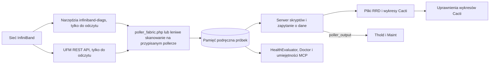

<!-- Source: README.md; SHA256: 79a16fb906f96ee79de2c719f18c38836f555440a7571a4a5ba38c64bb5b099f -->

<!-- translations:start -->
[English](../../../README.md) | [简体中文](../zh-CN/README.md) | [हिन्दी](../hi-IN/README.md) | [Español (España)](../es-ES/README.md) | [Español (Latinoamérica)](../es-419/README.md) | [العربية (السعودية)](../ar-SA/README.md) | [Afrikaans](../af-ZA/README.md) | [አማርኛ](../am-ET/README.md) | [العربية (مصر)](../ar-EG/README.md) | [العربية (المغرب)](../ar-MA/README.md) | [বাংলা](../bn-BD/README.md) | [Bosanski](../bs-BA/README.md) | [Deutsch](../de-DE/README.md) | [فارسی](../fa-IR/README.md) | [Filipino](../fil-PH/README.md) | [Français](../fr-FR/README.md) | [Français (Maroc)](../fr-MA/README.md) | [Français (Sénégal)](../fr-SN/README.md) | [Hausa](../ha-NG/README.md) | [עברית](../he-IL/README.md) | [Hrvatski](../hr-HR/README.md) | [Bahasa Indonesia](../id-ID/README.md) | [Igbo](../ig-NG/README.md) | [Italiano](../it-IT/README.md) | [日本語](../ja-JP/README.md) | [한국어](../ko-KR/README.md) | [Malagasy](../mg-MG/README.md) | [मराठी](../mr-IN/README.md) | [Bahasa Melayu](../ms-MY/README.md) | [Nederlands](../nl-NL/README.md) | [Polski](README.md) | [Português (Brasil)](../pt-BR/README.md) | [Русский](../ru-RU/README.md) | [Kinyarwanda](../rw-RW/README.md) | [Soomaali](../so-SO/README.md) | [Српски](../sr-RS/README.md) | [Svenska](../sv-SE/README.md) | [Kiswahili](../sw-KE/README.md) | [தமிழ்](../ta-IN/README.md) | [తెలుగు](../te-IN/README.md) | [ไทย](../th-TH/README.md) | [Türkçe](../tr-TR/README.md) | [Українська](../uk-UA/README.md) | [اردو](../ur-PK/README.md) | [Tiếng Việt](../vi-VN/README.md) | [isiXhosa](../xh-ZA/README.md) | [Yorùbá](../yo-NG/README.md) | [繁體中文](../zh-TW/README.md) | [isiZulu](../zu-ZA/README.md)
<!-- translations:end -->

# plugin_fabric

Wtyczka do Cacti 1.2 (`fabric`, wersja `0.1.0-dev`) wprowadzająca liczniki portów InfiniBand, szerokość i szybkość łącza oraz wskaźniki przeciążenia do Cacti jako standardowe urządzenia, źródła danych i wykresy. Łącze wynegocjowane jako 1X zamiast 4X pojawia się wówczas jako wykres oraz alert Thold obok obsługiwanego hosta, z zachowaniem uprawnień Cacti oraz obsługą świadomości i wyciszania przez Maint.

> **Status: w trakcie prac, brak jeszcze wydania.** Ta gałąź implementuje podstawy wtyczki, obiekty Cacti i alertowanie, zaplanowane skanowania pollera w tle, replikację do zdalnych kolektorów, backend NVIDIA UFM REST tylko do odczytu z szyfrowanym magazynem poświadczeń, zarządzanie CLI w modelu Configuration-as-Code (CasC) oraz punkty rozszerzeń ekosystemu Cacti (CasC, Doctor oraz MCP / Abilities API v2). Rozwiązanie było testowane z atrapami narzędzi, syntetycznymi transportami UFM i symulatorem sieci fabric `ibsim` (rdma-core 50.0), nigdy na fizycznej sieci InfiniBand ani na działającym serwerze UFM. Testy wymagające sprzętu pozostają otwarte w [docs/research/](../../research/). Ten projekt nie jest powiązany z projektem Cacti.

## Co zostało zaimplementowane

- **Cykl życia i schemat (v3)**: instalacja, idempotentna aktualizacja, deinstalacja (domyślnie zachowująca tabele wtyczki) oraz weryfikacja wymagania PHP 8.2 przy zachowaniu możliwości parsowania punktów wejścia w PHP 8.0.
- **Role dostępu i strony**: obszary uprawnień `Fabric View` (`fabric.php`), `Fabric Operator` (`fabric_operator.php`) oraz `Fabric Admin` (`fabric_admin.php`, `fabric_health.php`), a także karta Settings w sekcji **Configuration > Settings > Fabrics**.
- **Backend diagnostyczny tylko do odczytu (`diags`)**: ścisłe wykonywanie poleceń z wektorem argumentów dla `perfquery`, `ibnetdiscover` i `iblinkinfo`, inwentaryzacja oparta na GUID z wykrywaniem konfliktów tożsamości i propozycjami ponownego powiązania, ocena stanu łącza oraz skanowanie liczników dla poszczególnych węzłów.
- **Backend NVIDIA UFM REST tylko do odczytu (`ufm`) i szyfrowany magazyn**: klient REST z listą dozwolonych ścieżek tylko dla metody GET (`/ufmRest/resources/ports`, `/ufmRest/resources/systems`, `/ufmRest/monitoring/session/0/data` oraz odpowiedniki `/ufmRestV3/...` dla uwierzytelniania tokenem) zasilający te same tabele inwentarza, stanu łącza, próbek i kondycji co `diags`. Poświadczenia (`token` lub `basic`) są przechowywane w postaci zaszyfrowanej algorytmem AES-256-GCM w tabeli `plugin_fabric_secret` przy użyciu zewnętrznego 256-bitowego pliku klucza skonfigurowanego przez `fabric_vault_key_file`. Sieci fabric UFM można definiować poprzez CasC (`cli/fabric.php`) lub repozytoria; formularz administracyjny w interfejsie WWW udostępnia obecnie pola `diags`.
- **Obiekty Cacti, Thold i Maint**: szablony urządzeń, danych i wykresów Cacti (`templates/fabric-templates.xml`), zapytanie o dane serwera skryptów „Fabric Port” (`scripts/ss_fabric_ports.php`, `resource/script_server/fabric_ports.xml`), źródła danych liczników `DERIVE` oraz źródła danych stanu i szybkości łącza `GAUGE` dla Thold, śledzenie nieciągłości oraz raportowanie nasyconych liczników podstawowych jako `U`. Integracja z Maint (`MaintMaintenance`) odpytuje `plugin_maint_check_cacti_host()` (z mechanizmem awaryjnym w postaci punktu rozszerzeń `is_device_in_maintenance`), dzięki czemu węzły w aktywnym oknie konserwacji są zliczane osobno oraz wykluczane z ostrzeżeń kondycji dotyczących nieudanych skanowań i zdegradowanych portów.
- **Zaplanowane skanowania, podział na fragmenty i zdalne kolektory**: `poller_bottom` uruchamia `poller_fabric.php` w tle dla wymagających odświeżenia sieci fabric przypisanych do bieżącego pollera, obok leniwych skanowań wyzwalanych przez serwer skryptów. `INFO` deklaruje `remote_collect:1, remote_poller:1`, `poller_fabric.php` obsługuje deterministyczny podział po GUID (`--shard=K/N`), a `replicate_out` replikuje niepoufne wiersze `plugin_fabric_fabric` do zdalnych kolektorów (`poller_id >= 2`). Wpisy magazynu (`plugin_fabric_secret`) oraz zewnętrzne pliki kluczy nigdy nie podlegają replikacji.
- **CasC CLI i punkty rozszerzeń ekosystemu**: `cli/fabric.php` do eksportu YAML/XML, walidacji, planowania różnic w trybie próbnym, zatwierdzanego zastosowania zmian i raportowania kondycji, a także punkty rozszerzeń `casc_register_providers`, `doctor_register_checks` oraz `abilities_register`.

## Role dostępu

| Obszar uprawnień | Dostęp |
| --- | --- |
| Fabric View | Monitorowanie widoków inwentarza i portów (`fabric.php`). |
| Fabric Operator | Dostęp View oraz strona Operations (`fabric_operator.php`) i osobiste potwierdzenia w ramach triażu. |
| Fabric Admin | Dostęp Operator oraz konfiguracja, działania administracyjne (`fabric_admin.php`) i strona kondycji (`fabric_health.php`). |

Po skopiowaniu plików aktualizacji otwórz stronę Plugins jako administrator, aby zarejestrować nowe obszary uprawnień i punkty rozszerzeń. Przypisz obszar Operator jawnie w sekcji **Configuration > Users** lub w grupach użytkowników. Aktualizacje zachowują istniejące identyfikatory i uprawnienia obszarów View oraz Admin. Dostęp Admin dziedziczy dostęp Operator, a dostęp Operator dziedziczy dostęp View przy każdym żądaniu; nie powoduje to zapisywania dodatkowych uprawnień w profilach użytkowników ani grup. Ustawienia wtyczki wymagają również dostępu Fabric Admin oprócz uprawnienia Settings w Cacti.

Uprawnienia do urządzeń w Cacti ograniczają wiersze i akcje dostępne dla każdego użytkownika; nieprzypisane obiekty wymagają uprawnień administratora. Poświadczenia, konfiguracja, mapowanie, usuwanie oraz pozostałe zmiany administracyjne pozostają na stronach administracyjnych lub w CLI. Potwierdzenia obowiązują wyłącznie w bieżącej sesji użytkownika, maksymalnie przez jedną godzinę i tylko dopóki ta sama obserwacja pozostaje aktualna. Nowe lub zmienione obserwacje unieważniają je. Nigdy nie oznaczają nieudanego pomiaru jako prawidłowego ani nie wyciszają alertów.

## Dlaczego

Zdegradowane łącze InfiniBand nadal przesyła ruch. Łącze 4X, które ponownie wynegocjowało szerokość 1X, pozostawia port w stanie „active”, a wykresy interfejsu SNMP hosta wyglądają normalnie, jednak zadania ściśle sprzężone działają wolniej. Dowód znajduje się w samej sieci fabric: każdy port raportuje aktywną, włączoną i obsługiwaną szerokość oraz szybkość, a także liczniki błędów i przeciążeń. Odczyt tych informacji wymaga narzędzi diagnostycznych InfiniBand lub interfejsu API menedżera sieci fabric. Uruchamiane ręcznie pozostawiają trzy luki:

- **Brak historii.** `perfquery` i `iblinkinfo` pokazują stan bieżący, więc degradacja łącza z ubiegłego tygodnia jest niewidoczna.
- **Brak kontekstu urządzenia.** Porty sieci fabric nie są obiektami Cacti, więc nie można wyświetlić wykresu portu obok obsługiwanego hosta.
- **Brak ścieżki do alertowania w Cacti.** Thold i Maint działają na źródłach danych i urządzeniach Cacti.

Wtyczka zamyka te luki, odczytując sieć fabric za pomocą `infiniband-diags` lub interfejsu API NVIDIA UFM REST, identyfikując węzły i porty po identyfikatorze GUID oraz publikując liczniki i stan łącza jako źródła danych Cacti. Działa wyłącznie w trybie do odczytu: nigdy nie resetuje liczników ani nie zmienia stanu portów.

## Operacje i CLI

### Poller w tle i ręczne skanowania

`fabric_poller_bottom()` uruchamia `poller_fabric.php` w tle na każdym pollerze dla włączonych sieci fabric przypisanych do tego `poller_id`, których skanowanie jest wymagalne. Możesz również uruchomić mechanizm pollera lub ręczne skanowanie bezpośrednio na przypisanym pollerze z konta użytkownika pollera (zastępując `/path/to/cacti` ścieżką do katalogu Cacti):

```sh
php /path/to/cacti/plugins/fabric/poller_fabric.php [--fabric=ID] [--shard=K/N] [--force] [--debug]
php /path/to/cacti/plugins/fabric/fabric_sweep.php --fabric=ID [--node=GUID] [--force]
```

- `poller_fabric.php` wykonuje wszystkie wymagalne sieci fabric dla lokalnego pollera (lub jedną sieć z opcją `--fabric=ID`), egzekwuje blokadę rejestru procesów Cacti oraz dzierżawy `ClaimRepository` z budżetem czasu `max(30, intdiv(sweep_interval, 2))` sekund, a także obsługuje `--shard=K/N` (`0 <= K < N`) do deterministycznego podziału skanowań liczników węzłów `diags` według GUID węzła.
- `fabric_sweep.php` wykonuje skanowanie na żądanie jednej włączonej sieci fabric (lub jednego węzła z opcją `--node=GUID`) przypisanej do lokalnego pollera. Flaga `--force` pomija sprawdzanie, czy skanowanie sieci jest wymagalne, jednocześnie respektując dzierżawy.

Po zapełnieniu inwentarza przez pierwsze wykrywanie zmapuj węzły na urządzenia Cacti na stronie Fabric Admin. Utrzymuj limit czasu skryptu Cacti na poziomie 25 sekund lub wyższym: leniwe skanowanie wywołane odczytem zapytania o dane ogranicza wykonywanie narzędzi do `script_timeout - 5` sekund, aby serwer skryptów zdążył zwrócić ostatnią zapisaną próbkę lub `U`.

### Backend NVIDIA UFM REST i magazyn poświadczeń

Sieć fabric typu `ufm` wymaga adresu URL `https://` bez osadzonych poświadczeń, ciągów zapytania ani fragmentów. `UfmSocketTransport` wymusza weryfikację partnera i nazwy hosta TLS, odrzuca przekierowania oraz obsługuje opcjonalny pakiet CA (`ufm_ca_file`) i przypięcie klucza SPKI SHA-256 (`ufm_spki_pin`).

Aby przechowywać poświadczenia UFM w tabeli `plugin_fabric_secret`, skonfiguruj `fabric_vault_key_file` w sekcji **Configuration > Settings > Fabrics**, podając bezwzględną ścieżkę do zwykłego pliku należącego do użytkownika pollera (bez dowiązań symbolicznych w żadnym katalogu nadrzędnym, uprawnienia `0600`, zawierającego 64 znaki szesnastkowe, np. z `openssl rand -hex 32`, lub 32 losowe niedrukowalne bajty). Wtyczka nigdy nie tworzy ani nie zapisuje pliku klucza, a `replicate_out` nigdy nie replikuje `plugin_fabric_secret` ani plików kluczy do zdalnych pollerów.

### Configuration-as-Code i CLI kondycji

`cli/fabric.php` zarządza ustawieniami wtyczki i definicjami sieci fabric w sposób deklaratywny w formacie YAML lub XML oraz raportuje kondycję z uwzględnieniem konserwacji bez uruchamiania skanowań na żywo:

```sh
php /path/to/cacti/plugins/fabric/cli/fabric.php export [--format=yaml|xml] [--file=PATH]
php /path/to/cacti/plugins/fabric/cli/fabric.php validate --file=PATH [--format=yaml|xml]
php /path/to/cacti/plugins/fabric/cli/fabric.php plan --file=PATH [--format=yaml|xml]
php /path/to/cacti/plugins/fabric/cli/fabric.php apply --file=PATH --confirm=PLAN_HASH [--format=yaml|xml]
php /path/to/cacti/plugins/fabric/cli/fabric.php health [--format=text|json]
```

Polecenie `export` tworzy nowe pliki z uprawnieniami `0600`, maskuje `fabric_vault_key_file` jako `[REDACTED]` i emituje nazwane odwołania `ufm_credential_ref` zamiast sekretów. Polecenia `plan` i `apply` odrzucają wbudowane wartości `ufm_token`, `ufm_password`, `secret` oraz wbudowaną wartość `fabric_vault_key_file`. Polecenie `apply` wymaga dokładnego parametru `--confirm=PLAN_HASH` wygenerowanego przez `plan`.

### Punkty rozszerzeń ekosystemu

Gdy obecne są odpowiednie wtyczki Cacti lub integracje hosta, `setup.php` rejestruje:

- `casc_register_providers`: eksportuje, waliduje, planuje i po potwierdzeniu stosuje konfigurację `fabric` (`yaml` i `xml`, schemat v1) z maskowaniem sekretów.
- `doctor_register_checks`: udostępnia cztery kontrole diagnostyczne tylko do odczytu (`fabric.schema`, `fabric.poller_freshness`, `fabric.identity_conflicts`, `fabric.ufm_vault`).
- `abilities_register`: rejestruje trzy idempotentne, nieniszczące umiejętności tylko do odczytu w kategorii `fabric`, chronione obszarem uprawnień Fabric View (oraz uprawnieniami do urządzeń Cacti dla błędów portów): `fabric-list-fabrics`, `fabric-get-health` i `fabric-list-port-errors`.

## Zakres i granice

Poza zakresem: zmiana stanu sieci fabric, resetowanie liczników, zastępowanie menedżera sieci fabric lub menedżera podsieci, własny silnik alertowania wtyczki, niestandardowy demon lub protokół sieciowy oraz sieci Ethernet lub RoCE.

## Wymagania i zgodność

| Komponent | Wersja docelowa |
|---|---|
| Cacti | 1.2.31 lub nowsza (`compat = 1.2.31`), bez łatek jądra |
| PHP | 8.2 lub nowsza; punkty wejścia pozostają możliwe do sparsowania w 8.0 i odmawiają aktywacji w 8.1, dzięki czemu nieobsługiwane środowisko uruchomieniowe otrzymuje odmowę zamiast uszkodzonego interfejsu Cacti |
| Narzędzia InfiniBand | `infiniband-diags` z `rdma-core` (przetestowane w CI z rdma-core 50.0 pod kontrolą `ibsim`; formaty wyjściowe sprawdzone względem kodu źródłowego v66.0) |
| UFM | NVIDIA UFM Enterprise REST API (punkty końcowe tylko do odczytu `ufmRest` i `ufmRestV3`; przetestowane na syntetycznych transportach w testach jednostkowych) |
| Thold, Maint | Nie wymagają zmian; CI uruchamia test end-to-end z niezmodyfikowanymi wtyczkami Thold v1.8.2 i Maint v1.3 |

## Rozwój i testowanie

Przepływ pracy CI (`.github/workflows/plugin-ci-workflow.yml`) testuje PHP od 8.2 do 8.5 z Cacti `release/1.2.31` i `1.2.x`, sprawdzanie składni punktów wejścia PHP 8.0, odmowę dla PHP 8.1, PHPStan, weryfikację gettext/tłumaczeń, licencjonowanie REUSE, linting przepływów pracy, powtarzanie scenariusza end-to-end Thold/Maint oraz symulację sieci fabric `ibsim`.

Z zablokowanym współdzielonym środowiskiem testowym wtyczek Pest dla Cacti (`CACTI_PEST_BIN`) oraz tymczasową bazą danych Cacti:

```sh
# Unit tests
"$CACTI_PEST_BIN" --configuration=phpunit.xml

# Lifecycle integration tests (disposable database only)
CACTI_PATH=/path/to/cacti FABRIC_TEST_DATABASE=disposable "$CACTI_PEST_BIN" --configuration=phpunit-integration.xml

# Static analysis (against Cacti 1.2.31)
CACTI_PATH=/path/to/cacti phpstan analyse -c phpstan.neon --no-progress

# Translation template, catalogs, and localized README checks
sh locales/build_gettext.sh --check

# Simulated ibsim fixture parser check
php tests/bin/check-ibsim-fixtures.php tests/fixtures/ibsim
```

## Projekt

- [docs/PLAN.md](../../PLAN.md) to plan architektury i projektu: fakty z projektu nadrzędnego wraz ze źródłami, otwarte kontrole sprzętowe, model tożsamości, reguły liczników i stanu łącza, granice bezpieczeństwa, obliczenia wydajnościowe, testowanie oraz ryzyka.
- [docs/decisions/](../../decisions/) przechowuje rekordy decyzji architektonicznych (ADR).
- [docs/REQUIREMENTS.md](../../REQUIREMENTS.md) mapuje każdy identyfikator wymagania na odpowiadające mu zgłoszenie.



## Śledzenie prac

- **Kamienie milowe** odpowiadają kamieniom milowym planu. Każdy ma zgłoszenie nadrzędne (epic) zawierające listę podzadań oraz dowody zakończenia.
- **Zgłoszenia** są klasyfikowane etykietami: `type: requirement`, `type: research`, `type: decision`, `type: epic`. Zgłoszenia wymagań określają numerowane, testowalne wymagania (`REQ-AREA-NNN`) oraz kryteria akceptacji.
- **Etykiety** zawierają również prefiksy `area:`, `phase:`, `priority:` oraz `status:`. Zobacz [CONTRIBUTING.md](../../../CONTRIBUTING.md#labels).
- [Tablica projektu](https://github.com/users/somethingwithproof/projects/8) pokazuje wszystkie zgłoszenia we wszystkich kamieniach milowych.

## Współpraca

Przeczytaj [CONTRIBUTING.md](../../../CONTRIBUTING.md). Commity wymagają podpisu DCO (`git commit -s`). Dyskusje projektowe odbywają się w zgłoszeniach; otwarte decyzje noszą etykietę `type: decision`.

## Bezpieczeństwo

Podatności należy zgłaszać prywatnie; zobacz [SECURITY.md](../../../SECURITY.md).

## Licencja

GNU General Public License v2.0, ta sama licencja co Cacti i jego wtyczki. Zobacz [LICENSE](../../../LICENSE).
