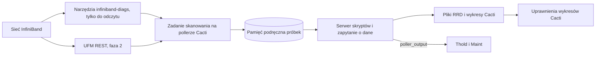

<!-- Source: README.md; SHA256: ce5af61a1bc993ec2aae6d4f22c3885694632f2b1d5eb94e2ce88b8390e96f1e -->

<!-- translations:start -->
[English](../../../README.md) | [简体中文](../zh-CN/README.md) | [हिन्दी](../hi-IN/README.md) | [Español (España)](../es-ES/README.md) | [Español (Latinoamérica)](../es-419/README.md) | [العربية (السعودية)](../ar-SA/README.md) | [Afrikaans](../af-ZA/README.md) | [አማርኛ](../am-ET/README.md) | [العربية (مصر)](../ar-EG/README.md) | [العربية (المغرب)](../ar-MA/README.md) | [বাংলা](../bn-BD/README.md) | [Deutsch](../de-DE/README.md) | [فارسی](../fa-IR/README.md) | [Filipino](../fil-PH/README.md) | [Français](../fr-FR/README.md) | [Français (Maroc)](../fr-MA/README.md) | [Français (Sénégal)](../fr-SN/README.md) | [Hausa](../ha-NG/README.md) | [עברית](../he-IL/README.md) | [Bahasa Indonesia](../id-ID/README.md) | [Igbo](../ig-NG/README.md) | [Italiano](../it-IT/README.md) | [日本語](../ja-JP/README.md) | [한국어](../ko-KR/README.md) | [Malagasy](../mg-MG/README.md) | [मराठी](../mr-IN/README.md) | [Bahasa Melayu](../ms-MY/README.md) | [Nederlands](../nl-NL/README.md) | [Polski](README.md) | [Português (Brasil)](../pt-BR/README.md) | [Русский](../ru-RU/README.md) | [Kinyarwanda](../rw-RW/README.md) | [Soomaali](../so-SO/README.md) | [Svenska](../sv-SE/README.md) | [Kiswahili](../sw-KE/README.md) | [தமிழ்](../ta-IN/README.md) | [తెలుగు](../te-IN/README.md) | [ไทย](../th-TH/README.md) | [Türkçe](../tr-TR/README.md) | [Українська](../uk-UA/README.md) | [اردو](../ur-PK/README.md) | [Tiếng Việt](../vi-VN/README.md) | [isiXhosa](../xh-ZA/README.md) | [Yorùbá](../yo-NG/README.md) | [繁體中文](../zh-TW/README.md) | [isiZulu](../zu-ZA/README.md)
<!-- translations:end -->

# plugin_fabric

Wtyczka do Cacti 1.2 wprowadzająca liczniki portów InfiniBand, szerokość i szybkość łącza oraz wskaźniki przeciążenia do Cacti jako standardowe urządzenia, źródła danych i wykresy. Łącze wynegocjowane jako 1X zamiast 4X pojawia się wówczas jako wykres oraz alert Thold obok obsługiwanego hosta, z zachowaniem uprawnień Cacti i możliwością wyciszenia za pomocą Maint.

> **Status: w trakcie prac, brak jeszcze wydania.** Kamień milowy 2 (podstawy) został scalony z gałęzią `main`, a kamień milowy 3 (obiekty Cacti i alertowanie) jest w trakcie przeglądu. Kamień milowy 1 potwierdził projekt względem dokumentacji oraz kodu źródłowego projektu nadrzędnego (PR #71); wyniki wraz ze źródłami znajdują się w [docs/research/](../../research). Kamień milowy 2 dodaje podstawy wtyczki:
>
> - instalację, aktualizację, deinstalację oraz weryfikację wersji PHP 8.2
> - obszary uprawnień View, Operator i Admin oraz ustawienia
> - rekordy sieci fabric
> - granicę poleceń tylko do odczytu dla `perfquery`, `ibnetdiscover` i `iblinkinfo`
> - inwentaryzację według GUID z obsługą konfliktów tożsamości i propozycjami ponownego powiązania
> - stan łącza oraz pamięć podręczną odczytów liczników
> - strony inwentaryzacji, administracji i kondycji
>
> Kamień milowy 3 dodaje obiekty Cacti:
>
> - szablony urządzeń, danych i wykresów dostarczane jako pliki XML szablonów Cacti oraz zapytanie o dane „Fabric Port”
> - mapowanie węzła na urządzenie Cacti lub utworzenie go po potwierdzeniu ([ADR 0010](../../decisions/0010-one-device-per-node.md))
> - źródła danych typu licznikowego dla wykresów oraz źródła danych GAUGE dla stanu łącza i szybkości na potrzeby Thold ([ADR 0011](../../decisions/0011-derive-counters-and-gauge-alert-values.md))
> - obsługę nieciągłości oraz traktowanie nasyconych liczników podstawowych jako wartości nieznanej (unknown) ([ADR 0012](../../decisions/0012-saturated-basic-counters-read-as-unknown.md)), wskaźnik ważności liczników i odnośniki do wykresów na stronie portu oraz ranking przeciążenia
> - test end-to-end z niezmodyfikowanymi wtyczkami Thold v1.8.2 i Maint v1.3 oraz zadanie CI uruchamiające rzeczywiste narzędzia diagnostyczne przeciwko symulowanej sieci fabric
>
> Skanowanie sieci fabric można wykonywać wyłącznie z głównego pollera do czasu obsługi zdalnych kolektorów danych w fazie 3. Rozwiązanie było testowane wyłącznie z atrapami narzędzi oraz symulatorem sieci fabric ibsim, nigdy w rzeczywistej sieci InfiniBand. Testy wymagające fizycznej sieci fabric pozostają otwarte w tabeli weryfikacji na żywo na poszczególnych stronach badawczych. Ten projekt nie jest powiązany z projektem Cacti.

## Role dostępu

| Obszar uprawnień | Dostęp |
| --- | --- |
| Fabric View | Istniejące strony monitorowania. |
| Fabric Operator | Monitorowanie oraz strona Operations i osobiste potwierdzenia w ramach triażu. |
| Fabric Admin | Dostęp Operator oraz istniejące działania konfiguracyjne i administracyjne. |

Po skopiowaniu plików aktualizacji otwórz stronę Plugins jako administrator, aby zarejestrować
nowy obszar uprawnień. Przypisz obszar Operator jawnie w sekcji **Configuration > Users** lub w grupach użytkowników.
Aktualizacje zachowują istniejące identyfikatory i uprawnienia obszarów View oraz Admin. Dostęp Admin
dziedziczy dostęp Operator, a dostęp Operator dziedziczy dostęp View przy każdym żądaniu;
nie powoduje to zapisywania dodatkowych uprawnień w profilach użytkowników ani grup. Ustawienia wtyczki wymagają
również dostępu Fabric Admin oprócz uprawnienia Settings w Cacti.

Uprawnienia do urządzeń w Cacti nadal ograniczają wiersze i akcje dostępne dla każdego użytkownika; nieprzypisane obiekty wymagają uprawnień administratora.
Poświadczenia, konfiguracja, mapowanie, usuwanie oraz pozostałe zmiany administracyjne
pozostają na stronach administracyjnych. Potwierdzenia obowiązują wyłącznie w bieżącej
sesji użytkownika, maksymalnie przez jedną godzinę i tylko dopóki ta sama obserwacja pozostaje
aktualna. Nowe lub zmienione obserwacje unieważniają je. Nigdy nie oznaczają nieudanego
pomiaru jako prawidłowego ani nie wyciszają alertów.

## Dlaczego

Zdegradowane łącze InfiniBand nadal przesyła ruch. Łącze 4X, które ponownie wynegocjowało szerokość 1X, pozostawia port w stanie „active”, a wykresy interfejsu SNMP hosta wyglądają normalnie, jednak zadania ściśle sprzężone działają wolniej. Dowód znajduje się w samej sieci fabric: każdy port raportuje aktywną, włączoną i obsługiwaną szerokość oraz szybkość, a także liczniki błędów i przeciążeń. Odczyt tych informacji wymaga narzędzi diagnostycznych InfiniBand lub interfejsu API menedżera sieci fabric. Uruchamiane ręcznie pozostawiają trzy luki:

- **Brak historii.** `perfquery` i `iblinkinfo` pokazują stan bieżący, więc degradacja łącza z ubiegłego tygodnia jest niewidoczna.
- **Brak kontekstu urządzenia.** Porty sieci fabric nie są obiektami Cacti, więc nie można wyświetlić wykresu portu obok obsługiwanego hosta.
- **Brak ścieżki do alertowania w Cacti.** Thold i Maint działają na źródłach danych i urządzeniach Cacti.

Wtyczka zamyka te luki, odczytując sieć fabric za pomocą własnych narzędzi diagnostycznych (a w późniejszym etapie przez UFM), identyfikując węzły i porty po identyfikatorze GUID oraz publikując liczniki i stan łącza jako źródła danych Cacti. Działa wyłącznie w trybie do odczytu: nigdy nie resetuje liczników ani nie zmienia stanu portów.

## Pierwsze wykrywanie

Nowa sieć fabric nie ma jeszcze węzłów, a skanowania są uruchamiane z serwera skryptów wyłącznie dla węzła zmapowanego na urządzenie Cacti. Pierwsze wykrywanie jest zatem krokiem ręcznym. Po zapisaniu włączonej sieci fabric uruchom poniższe polecenie jednokrotnie na pollerze przypisanym do tej sieci, z konta pollera, zastępując `/path/to/cacti` ścieżką do katalogu Cacti (ścieżka bezwzględna działa również z poziomu crona):

```
php /path/to/cacti/plugins/fabric/fabric_sweep.php --fabric=ID --force
```

Inwentarz zostanie wówczas uzupełniony. Zmapuj węzły na urządzenia Cacti na stronie Fabric Admin; kolejne skanowania będą uruchamiane przez zapytanie o dane. Dopóki żaden węzeł sieci fabric nie jest zmapowany, nic nie odświeża jej inwentarza, więc uruchamiaj to samo polecenie ponownie — opcjonalnie z crona — aby rejestrować nowe lub brakujące węzły. Strona kondycji wyświetla to polecenie dla każdej włączonej sieci fabric, która nie została jeszcze wykryta lub nie ma żadnego zmapowanego węzła.

## Planowany zakres

| Faza | Zakres | Kamienie milowe |
|---|---|---|
| 0, badania | Macierz wersji, potwierdzenie zachowania kodu nadrzędnego, zachowanie liczników na sprzęcie, model uprawnień, budżet MAD, API UFM | [M1](https://github.com/somethingwithproof/plugin_fabric/milestone/1) |
| 1, obserwacja | Inwentaryzacja według GUID, urządzenia Cacti, zapytanie o dane portów, źródła danych liczników i stanu łącza, alertowanie Thold, wyciszanie Maint, strona kondycji | [M2](https://github.com/somethingwithproof/plugin_fabric/milestone/2), [M3](https://github.com/somethingwithproof/plugin_fabric/milestone/3), [M4](https://github.com/somethingwithproof/plugin_fabric/milestone/4) |
| 2, UFM | Backend UFM REST tylko do odczytu, obsługa poświadczeń, ciągłość tożsamości między backendami | [M5](https://github.com/somethingwithproof/plugin_fabric/milestone/5) |
| 3, zdalne | Zdalne kolektory danych, replikacja, akcje `remote_agent`, podział skanowań na fragmenty dla dużych sieci fabric | [M6](https://github.com/somethingwithproof/plugin_fabric/milestone/6) |

Poza zakresem: zmiana stanu sieci fabric, zastępowanie menedżera sieci fabric lub menedżera podsieci, własny silnik alertowania wtyczki, niestandardowy demon lub protokół sieciowy oraz sieci Ethernet lub RoCE (w fazie badań).

## Docelowa zgodność

| Komponent | Wersja docelowa |
|---|---|
| Cacti | 1.2.31 lub nowsza, bez łatek jądra |
| PHP | 8.2 lub nowsza; `setup.php` pozostaje możliwy do sparsowania w 8.0, dzięki czemu nieobsługiwane środowisko uruchomieniowe zwraca odmowę zamiast uszkodzonego interfejsu Cacti |
| Narzędzia InfiniBand | infiniband-diags z rdma-core; formaty wyjściowe sprawdzone względem kodu źródłowego v66.0 |
| UFM | UFM Enterprise REST API, faza 2; macierz wydań jest elementem dostarczanym w kamieniu milowym 1 |
| Thold, Maint | Nie wymagają zmian |

Pozostaw limit czasu skryptu Cacti na domyślnej wartości 25 sekund lub wyższej. Skanowanie uruchomione przez odczyt zapytania o dane ogranicza czas wykonania narzędzia do tego limitu pomniejszonego o pięć sekund, rezerwując czas na odczyt pamięci podręcznej i wysłanie odpowiedzi. Po wyczerpaniu budżetu zapytanie zwraca ostatnią aktualną próbkę lub wartość nieznaną (unknown); kolejny cykl ponawia skanowanie. Ten limit dotyczy również pollera PHP. Limit czasu wynoszący pięć sekund lub mniej nie pozostawia czasu na uruchomienie narzędzia.

## Projekt

- [docs/PLAN.md](../../PLAN.md) zawiera pełny plan: architekturę, fakty z projektu nadrzędnego, na których się opiera (wraz ze źródłami), założenia wymagające jeszcze potwierdzenia, model tożsamości, reguły liczników i stanu łącza, granice bezpieczeństwa, obliczenia wydajnościowe, testowanie oraz ryzyka.
- [docs/decisions/](../../decisions) przechowuje rekordy decyzji architektonicznych (ADR) dla podjętych już wyborów.
- [docs/REQUIREMENTS.md](../../REQUIREMENTS.md) mapuje każdy identyfikator wymagania na odpowiadające mu zgłoszenie.



## Śledzenie prac

- **Kamienie milowe** odpowiadają kamieniom milowym planu. Każdy ma zgłoszenie nadrzędne (epic) zawierające listę podzadań oraz dowody zakończenia.
- **Zgłoszenia** są klasyfikowane etykietami: `type: requirement`, `type: research`, `type: decision`, `type: epic`. Zgłoszenia wymagań określają numerowane, testowalne wymagania (`REQ-AREA-NNN`) oraz kryteria akceptacji.
- **Etykiety** zawierają również prefiksy `area:`, `phase:`, `priority:` oraz `status:`. Zobacz [CONTRIBUTING.md](../../../CONTRIBUTING.md#labels).
- [Tablica projektu](https://github.com/users/somethingwithproof/projects/8) pokazuje wszystkie zgłoszenia we wszystkich kamieniach milowych.

## Współpraca

Przeczytaj [CONTRIBUTING.md](../../../CONTRIBUTING.md). Commity wymagają podpisu DCO. Dyskusje projektowe odbywają się w zgłoszeniach; otwarte decyzje noszą etykietę `type: decision`.

## Bezpieczeństwo

Podatności należy zgłaszać prywatnie; zobacz [SECURITY.md](../../../SECURITY.md).

## Licencja

GNU General Public License v2.0 — ta sama licencja co Cacti i jego wtyczki. Zobacz [LICENSE](../../../LICENSE).
