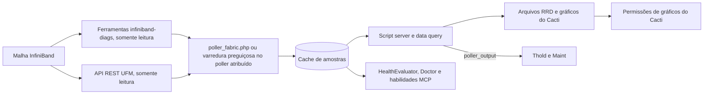

<!-- Source: README.md; SHA256: 79a16fb906f96ee79de2c719f18c38836f555440a7571a4a5ba38c64bb5b099f -->

<!-- translations:start -->
[English](../../../README.md) | [简体中文](../zh-CN/README.md) | [हिन्दी](../hi-IN/README.md) | [Español (España)](../es-ES/README.md) | [Español (Latinoamérica)](../es-419/README.md) | [العربية (السعودية)](../ar-SA/README.md) | [Afrikaans](../af-ZA/README.md) | [አማርኛ](../am-ET/README.md) | [العربية (مصر)](../ar-EG/README.md) | [العربية (المغرب)](../ar-MA/README.md) | [বাংলা](../bn-BD/README.md) | [Bosanski](../bs-BA/README.md) | [Deutsch](../de-DE/README.md) | [فارسی](../fa-IR/README.md) | [Filipino](../fil-PH/README.md) | [Français](../fr-FR/README.md) | [Français (Maroc)](../fr-MA/README.md) | [Français (Sénégal)](../fr-SN/README.md) | [Hausa](../ha-NG/README.md) | [עברית](../he-IL/README.md) | [Hrvatski](../hr-HR/README.md) | [Bahasa Indonesia](../id-ID/README.md) | [Igbo](../ig-NG/README.md) | [Italiano](../it-IT/README.md) | [日本語](../ja-JP/README.md) | [한국어](../ko-KR/README.md) | [Malagasy](../mg-MG/README.md) | [मराठी](../mr-IN/README.md) | [Bahasa Melayu](../ms-MY/README.md) | [Nederlands](../nl-NL/README.md) | [Polski](../pl-PL/README.md) | [Português (Brasil)](README.md) | [Русский](../ru-RU/README.md) | [Kinyarwanda](../rw-RW/README.md) | [Soomaali](../so-SO/README.md) | [Српски](../sr-RS/README.md) | [Svenska](../sv-SE/README.md) | [Kiswahili](../sw-KE/README.md) | [தமிழ்](../ta-IN/README.md) | [తెలుగు](../te-IN/README.md) | [ไทย](../th-TH/README.md) | [Türkçe](../tr-TR/README.md) | [Українська](../uk-UA/README.md) | [اردو](../ur-PK/README.md) | [Tiếng Việt](../vi-VN/README.md) | [isiXhosa](../xh-ZA/README.md) | [Yorùbá](../yo-NG/README.md) | [繁體中文](../zh-TW/README.md) | [isiZulu](../zu-ZA/README.md)
<!-- translations:end -->

# plugin_fabric

Um plugin para Cacti 1.2 (`fabric`, versão `0.1.0-dev`) que traz contadores de portas InfiniBand, largura e velocidade de enlace e indicadores de congestionamento para o Cacti como dispositivos, fontes de dados e gráficos comuns. Um enlace que treinou a 1X em vez de 4X passa a aparecer como um gráfico e um alerta do Thold ao lado do host que atende, sob as permissões do Cacti, com reconhecimento e supressão pelo Maint.

> **Status: em desenvolvimento, ainda sem versão lançada.** Este branch implementa a base do plugin, objetos e alertas do Cacti, varreduras agendadas pelo poller em segundo plano, replicação para coletores remotos, um backend REST NVIDIA UFM somente leitura com cofre de credenciais criptografado, gerenciamento via CLI de Configuration-as-Code (CasC) e hooks do ecossistema Cacti (CasC, Doctor e MCP / Abilities API v2). Ele foi testado contra ferramentas simuladas, transportes UFM sintéticos e o simulador de malha `ibsim` (rdma-core 50.0), nunca em uma malha InfiniBand física ou servidor UFM ativo. As verificações que exigem hardware permanecem em aberto em [docs/research/](../../research/). Este projeto não é afiliado ao projeto Cacti.

## O que está implementado

- **Ciclo de vida e esquema (v3)**: instalação, atualização idempotente, desinstalação (mantendo as tabelas do plugin por padrão) e verificação de requisito do PHP 8.2, mantendo os pontos de entrada analisáveis no PHP 8.0.
- **Papéis de acesso e páginas**: realms `Fabric View` (`fabric.php`), `Fabric Operator` (`fabric_operator.php`) e `Fabric Admin` (`fabric_admin.php`, `fabric_health.php`), além de uma aba Settings em **Configuration > Settings > Fabrics**.
- **Backend de diagnóstico somente leitura (`diags`)**: execução estrita por vetor de argumentos de `perfquery`, `ibnetdiscover` e `iblinkinfo`, inventário indexado por GUID com detecção de conflitos de identidade e propostas de revinculação, avaliação do estado de enlace e varreduras de contadores por nó.
- **Backend REST NVIDIA UFM somente leitura (`ufm`) e cofre criptografado**: cliente REST somente GET com lista de permissões (`/ufmRest/resources/ports`, `/ufmRest/resources/systems`, `/ufmRest/monitoring/session/0/data` e equivalentes `/ufmRestV3/...` para autenticação por token) alimentando as mesmas tabelas de inventário, estado de enlace, amostras e integridade que o `diags`. As credenciais (`token` ou `basic`) são armazenadas criptografadas com AES-256-GCM em `plugin_fabric_secret` usando um arquivo de chave externo de 256 bits configurado por `fabric_vault_key_file`. Malhas UFM podem ser definidas via CasC (`cli/fabric.php`) ou pelos repositórios; o formulário administrativo web expõe atualmente os campos de `diags`.
- **Objetos do Cacti, Thold e Maint**: modelos de dispositivo, dados e gráfico do Cacti (`templates/fabric-templates.xml`), a data query de script server "Fabric Port" (`scripts/ss_fabric_ports.php`, `resource/script_server/fabric_ports.xml`), fontes de dados de contadores `DERIVE` e fontes de dados de estado de enlace/taxa `GAUGE` para o Thold, rastreamento de descontinuidade e contadores básicos saturados reportados como `U`. A integração com o Maint (`MaintMaintenance`) consulta `plugin_maint_check_cacti_host()` (recorrendo ao hook `is_device_in_maintenance` como alternativa) para que nós em manutenção ativa sejam contabilizados separadamente e excluídos dos avisos de integridade de varredura com falha e porta degradada.
- **Varreduras agendadas, fragmentação (sharding) e coletores remotos**: `poller_bottom` inicia `poller_fabric.php` em segundo plano para malhas com varredura vencida atribuídas ao poller atual, junto com varreduras preguiçosas (lazy sweeps) acionadas pelo script server. `INFO` declara `remote_collect:1, remote_poller:1`, `poller_fabric.php` oferece suporte a fragmentação determinística por GUID (`--shard=K/N`), e `replicate_out` replica linhas não secretas de `plugin_fabric_fabric` para coletores remotos (`poller_id >= 2`). Entradas do cofre (`plugin_fabric_secret`) e arquivos de chave externos nunca são replicados.
- **CLI de CasC e hooks do ecossistema**: `cli/fabric.php` para exportação YAML/XML, validação, planejamento de diff em simulação (dry-run), aplicação controlada por confirmação e relatório de integridade, além dos hooks `casc_register_providers`, `doctor_register_checks` e `abilities_register`.

## Papéis de acesso

| Realm | Acesso |
| --- | --- |
| Fabric View | Monitoramento de inventário e visualizações de portas (`fabric.php`). |
| Fabric Operator | Acesso View mais a página Operations (`fabric_operator.php`) e confirmações pessoais de triagem. |
| Fabric Admin | Acesso Operator mais configuração, ações administrativas (`fabric_admin.php`) e a página de integridade (`fabric_health.php`). |

Após copiar os arquivos de atualização, abra a página Plugins como administrador para registrar os novos realms e hooks. Atribua o realm Operator explicitamente em **Configuration > Users** ou nos grupos de usuários. As atualizações mantêm os IDs e concessões existentes dos realms View e Admin. O acesso Admin herda o acesso Operator, e o acesso Operator herda o acesso View a cada requisição; isso não adiciona concessões armazenadas aos usuários ou grupos. As configurações do plugin também exigem acesso Fabric Admin além da permissão Settings do Cacti.

As permissões de dispositivo do Cacti limitam as linhas e ações disponíveis para cada usuário; objetos não mapeados exigem um administrador. Credenciais, configuração, mapeamento, exclusão e outras alterações administrativas permanecem nas páginas administrativas ou na CLI. As confirmações duram apenas na sessão atual do usuário, por no máximo uma hora e somente enquanto a mesma observação permanecer atual. Observações novas ou alteradas invalidam essas confirmações. Elas nunca marcam uma medição com falha como saudável nem suprimem alertas.

## Por quê

Um enlace InfiniBand degradado continua trafegando dados. Um enlace 4X que renegocia para 1X mantém a porta como "active", e os gráficos de interface SNMP do host parecem normais, mas tarefas fortemente acopladas ficam lentas. A evidência está na malha: cada porta reporta sua largura e velocidade ativas, habilitadas e suportadas, além dos contadores de erro e congestionamento. Para ler esses dados são necessárias as ferramentas de diagnóstico InfiniBand ou uma API de gerenciador de malha. Executadas manualmente, elas deixam três lacunas:

- **Sem histórico.** `perfquery` e `iblinkinfo` mostram o momento atual, então um enlace que se degradou na semana passada fica invisível.
- **Sem contexto de dispositivo.** Portas da malha não são objetos do Cacti, então uma porta não pode ser exibida em gráfico ao lado do host que ela atende.
- **Sem caminho para os alertas do Cacti.** O Thold e o Maint atuam sobre fontes de dados e dispositivos do Cacti.

O plugin fecha essas lacunas lendo a malha por meio de `infiniband-diags` ou da API REST NVIDIA UFM, identificando nós e portas por GUID e publicando contadores e o estado dos enlaces como fontes de dados do Cacti. Ele opera apenas em modo de leitura: nunca zera contadores nem altera o estado das portas.

## Operações e CLI

### Poller em segundo plano e varreduras manuais

`fabric_poller_bottom()` inicia `poller_fabric.php` em segundo plano em cada poller para malhas habilitadas atribuídas àquele `poller_id` cuja varredura esteja vencida. Você também pode executar o executor do poller ou uma varredura manual diretamente no poller atribuído como o usuário do poller (substituindo `/path/to/cacti` pelo diretório do seu Cacti):

```sh
php /path/to/cacti/plugins/fabric/poller_fabric.php [--fabric=ID] [--shard=K/N] [--force] [--debug]
php /path/to/cacti/plugins/fabric/fabric_sweep.php --fabric=ID [--node=GUID] [--force]
```

- `poller_fabric.php` executa todas as malhas vencidas para o poller local (ou uma malha com `--fabric=ID`), impõe o bloqueio do registro de processos do Cacti e concessões de `ClaimRepository` com um orçamento de tempo de `max(30, intdiv(sweep_interval, 2))` segundos, e oferece suporte a `--shard=K/N` (`0 <= K < N`) para fragmentar varreduras de contadores de nós `diags` deterministicamente por GUID do nó.
- `fabric_sweep.php` executa uma varredura sob demanda de uma malha habilitada (ou de um nó com `--node=GUID`) atribuída ao poller local. `--force` ignora se a malha está vencida, ainda respeitando as concessões (claims).

Depois que a primeira descoberta preencher o inventário, mapeie os nós para dispositivos do Cacti na página Fabric Admin. Mantenha o timeout de script do Cacti em 25 segundos ou mais: uma varredura preguiçosa iniciada por uma leitura de data query limita a execução de ferramentas a `script_timeout - 5` segundos para que o script server retorne a tempo com a última amostra armazenada ou `U`.

### Backend REST NVIDIA UFM e cofre de credenciais

Uma malha `ufm` exige uma URL `https://` sem credenciais embutidas, strings de consulta ou fragmentos. `UfmSocketTransport` impõe verificação de par TLS e nome de host, rejeita redirecionamentos e oferece suporte a um pacote de CA opcional (`ufm_ca_file`) e pin SHA-256 SPKI (`ufm_spki_pin`).

Para armazenar credenciais do UFM em `plugin_fabric_secret`, configure `fabric_vault_key_file` em **Configuration > Settings > Fabrics** com um caminho absoluto para um arquivo regular pertencente ao usuário do poller (sem links simbólicos em nenhum diretório pai, modo `0600`, contendo 64 caracteres hexadecimais como `openssl rand -hex 32` ou 32 bytes aleatórios não imprimíveis). O plugin nunca cria nem grava o arquivo de chave, e `replicate_out` nunca replica `plugin_fabric_secret` nem arquivos de chave para pollers remotos.

### Configuration-as-Code e CLI de integridade

`cli/fabric.php` gerencia configurações do plugin e definições de malha declarativamente em YAML ou XML, e relata a integridade com reconhecimento de manutenção sem executar varreduras ao vivo:

```sh
php /path/to/cacti/plugins/fabric/cli/fabric.php export [--format=yaml|xml] [--file=PATH]
php /path/to/cacti/plugins/fabric/cli/fabric.php validate --file=PATH [--format=yaml|xml]
php /path/to/cacti/plugins/fabric/cli/fabric.php plan --file=PATH [--format=yaml|xml]
php /path/to/cacti/plugins/fabric/cli/fabric.php apply --file=PATH --confirm=PLAN_HASH [--format=yaml|xml]
php /path/to/cacti/plugins/fabric/cli/fabric.php health [--format=text|json]
```

`export` cria novos arquivos com modo `0600`, oculta `fabric_vault_key_file` como `[REDACTED]` e emite referências `ufm_credential_ref` nomeadas em vez de segredos. `plan` e `apply` rejeitam valores inline de `ufm_token`, `ufm_password`, `secret` e `fabric_vault_key_file`. `apply` exige o `--confirm=PLAN_HASH` exato produzido por `plan`.

### Hooks do ecossistema

Quando os plugins do Cacti ou integrações de host correspondentes estão presentes, `setup.php` registra:

- `casc_register_providers`: exporta, valida, planeja e aplica mediante confirmação a configuração `fabric` (`yaml` e `xml`, esquema v1) com ocultação de segredos.
- `doctor_register_checks`: fornece quatro verificações de diagnóstico somente leitura (`fabric.schema`, `fabric.poller_freshness`, `fabric.identity_conflicts`, `fabric.ufm_vault`).
- `abilities_register`: registra três habilidades somente leitura, não destrutivas e idempotentes na categoria `fabric`, protegidas pelo realm Fabric View (e permissões de dispositivo do Cacti para erros de porta): `fabric-list-fabrics`, `fabric-get-health` e `fabric-list-port-errors`.

## Escopo e limites

Fora do escopo: alterar o estado da malha, zerar contadores, substituir um gerenciador de malha ou subnet manager, motor de alertas próprio do plugin, daemon ou protocolo de rede personalizado e malhas Ethernet ou RoCE.

## Requisitos e compatibilidade

| Componente | Alvo |
|---|---|
| Cacti | 1.2.31 ou superior (`compat = 1.2.31`), sem patches no core |
| PHP | 8.2 ou superior; os pontos de entrada permanecem analisáveis no 8.0 e recusam ativação no 8.1 para que um runtime não suportado receba uma recusa em vez de uma interface do Cacti quebrada |
| Ferramentas InfiniBand | `infiniband-diags` do `rdma-core` (testado no CI com rdma-core 50.0 sob `ibsim`; formatos de saída verificados em relação ao código-fonte da v66.0) |
| UFM | NVIDIA UFM Enterprise REST API (endpoints somente leitura `ufmRest` e `ufmRestV3`; testado contra transportes sintéticos em testes unitários) |
| Thold, Maint | Nenhuma alteração necessária; o CI executa um teste de ponta a ponta com Thold v1.8.2 e Maint v1.3 sem modificações |

## Desenvolvimento e testes

O fluxo de trabalho de CI (`.github/workflows/plugin-ci-workflow.yml`) testa PHP 8.2 a 8.5 contra Cacti `release/1.2.31` e `1.2.x`, linting de ponto de entrada no PHP 8.0, recusa no PHP 8.1, PHPStan, verificação de gettext/traduções, licenciamento REUSE, linting de workflow, repetição de ponta a ponta de Thold/Maint e simulação de malha `ibsim`.

Com o harness de plugin Pest compartilhado bloqueado do Cacti (`CACTI_PEST_BIN`) e um banco de dados Cacti descartável:

```sh
# Unit tests
"$CACTI_PEST_BIN" --configuration=phpunit.xml

# Lifecycle integration tests (disposable database only)
CACTI_PATH=/path/to/cacti FABRIC_TEST_DATABASE=disposable "$CACTI_PEST_BIN" --configuration=phpunit-integration.xml

# Static analysis (against Cacti 1.2.31)
CACTI_PATH=/path/to/cacti phpstan analyse -c phpstan.neon --no-progress

# Translation template, catalogs, and localized README checks
sh locales/build_gettext.sh --check

# Simulated ibsim fixture parser check
php tests/bin/check-ibsim-fixtures.php tests/fixtures/ibsim
```

## Design

- [docs/PLAN.md](../../PLAN.md) é o plano de arquitetura e design: fatos do upstream com fontes, verificações de hardware em aberto, modelo de identidade, regras de contadores e estado de enlace, limites de segurança, aritmética de desempenho, testes e riscos.
- [docs/decisions/](../../decisions/) reúne os registros de decisões arquiteturais.
- [docs/REQUIREMENTS.md](../../REQUIREMENTS.md) mapeia cada ID de requisito para sua respectiva issue.



## Como o trabalho é acompanhado

- **Marcos** seguem os marcos do plano. Cada um possui uma issue épica listando suas sub-issues e evidências de conclusão.
- **Issues** são tipificadas por rótulo: `type: requirement`, `type: research`, `type: decision`, `type: epic`. Issues de requisito definem requisitos numerados e testáveis (`REQ-AREA-NNN`) e critérios de aceitação.
- **Rótulos** também trazem `area:`, `phase:`, `priority:` e `status:`. Consulte [CONTRIBUTING.md](../../../CONTRIBUTING.md#labels).
- O [quadro do projeto](https://github.com/users/somethingwithproof/projects/8) mostra todas as issues entre os marcos.

## Contribuição

Leia [CONTRIBUTING.md](../../../CONTRIBUTING.md). Os commits precisam de um sign-off DCO (`git commit -s`). Discussões de design acontecem nas issues; decisões em aberto levam o rótulo `type: decision`.

## Segurança

Reporte vulnerabilidades em privado; consulte [SECURITY.md](../../../SECURITY.md).

## Licença

GNU General Public License v2.0, a mesma licença do Cacti e de seus plugins. Consulte [LICENSE](../../../LICENSE).
