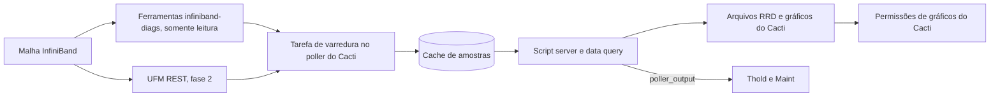

<!-- Source: README.md; SHA256: ce5af61a1bc993ec2aae6d4f22c3885694632f2b1d5eb94e2ce88b8390e96f1e -->

<!-- translations:start -->
[English](../../../README.md) | [简体中文](../zh-CN/README.md) | [हिन्दी](../hi-IN/README.md) | [Español (España)](../es-ES/README.md) | [Español (Latinoamérica)](../es-419/README.md) | [العربية (السعودية)](../ar-SA/README.md) | [Afrikaans](../af-ZA/README.md) | [አማርኛ](../am-ET/README.md) | [العربية (مصر)](../ar-EG/README.md) | [العربية (المغرب)](../ar-MA/README.md) | [বাংলা](../bn-BD/README.md) | [Bosanski](../bs-BA/README.md) | [Deutsch](../de-DE/README.md) | [فارسی](../fa-IR/README.md) | [Filipino](../fil-PH/README.md) | [Français](../fr-FR/README.md) | [Français (Maroc)](../fr-MA/README.md) | [Français (Sénégal)](../fr-SN/README.md) | [Hausa](../ha-NG/README.md) | [עברית](../he-IL/README.md) | [Hrvatski](../hr-HR/README.md) | [Bahasa Indonesia](../id-ID/README.md) | [Igbo](../ig-NG/README.md) | [Italiano](../it-IT/README.md) | [日本語](../ja-JP/README.md) | [한국어](../ko-KR/README.md) | [Malagasy](../mg-MG/README.md) | [मराठी](../mr-IN/README.md) | [Bahasa Melayu](../ms-MY/README.md) | [Nederlands](../nl-NL/README.md) | [Polski](../pl-PL/README.md) | [Português (Brasil)](README.md) | [Русский](../ru-RU/README.md) | [Kinyarwanda](../rw-RW/README.md) | [Soomaali](../so-SO/README.md) | [Српски](../sr-RS/README.md) | [Svenska](../sv-SE/README.md) | [Kiswahili](../sw-KE/README.md) | [தமிழ்](../ta-IN/README.md) | [తెలుగు](../te-IN/README.md) | [ไทย](../th-TH/README.md) | [Türkçe](../tr-TR/README.md) | [Українська](../uk-UA/README.md) | [اردو](../ur-PK/README.md) | [Tiếng Việt](../vi-VN/README.md) | [isiXhosa](../xh-ZA/README.md) | [Yorùbá](../yo-NG/README.md) | [繁體中文](../zh-TW/README.md) | [isiZulu](../zu-ZA/README.md)
<!-- translations:end -->

# plugin_fabric

Um plugin para Cacti 1.2 que traz contadores de portas InfiniBand, largura e velocidade de enlace e indicadores de congestionamento para o Cacti como dispositivos, fontes de dados e gráficos comuns. Um enlace que negociou a 1X em vez de 4X passa a aparecer como um gráfico e um alerta do Thold ao lado do host que atende, sob as permissões do Cacti e com suporte à supressão pelo Maint.

> **Status: em desenvolvimento, ainda sem versão lançada.** O marco 2 (base do plugin) já foi integrado em `main`, e o marco 3 (objetos do Cacti e alertas) está em revisão. O marco 1 confirmou o design em relação à documentação e ao código-fonte upstream (PR #71); os resultados, com fontes, estão em [docs/research/](../../research). O marco 2 adiciona a base do plugin:
>
> - instalação, atualização, desinstalação e a verificação de PHP 8.2
> - os realms View, Operator e Admin, além das configurações
> - registros de malha
> - a camada de comandos somente leitura para `perfquery`, `ibnetdiscover` e `iblinkinfo`
> - inventário por GUID, com conflitos de identidade e propostas de revinculação
> - estado de enlace e cache de varredura de contadores
> - páginas de inventário, administração e integridade
>
> O marco 3 adiciona os objetos do Cacti:
>
> - modelos de dispositivo, dados e gráfico fornecidos em XML de template do Cacti, e a data query "Fabric Port"
> - mapeamento de um nó para um dispositivo do Cacti, ou criação de um mediante confirmação ([ADR 0010](../../decisions/0010-one-device-per-node.md))
> - fontes de dados de contadores para gráficos e fontes de dados GAUGE de estado de enlace e taxa para o Thold ([ADR 0011](../../decisions/0011-derive-counters-and-gauge-alert-values.md))
> - tratamento de descontinuidade e leitura de contadores básicos saturados como desconhecidos ([ADR 0012](../../decisions/0012-saturated-basic-counters-read-as-unknown.md)), validade de contadores e links para gráficos na página da porta, além de um ranking de congestionamento
> - um teste de ponta a ponta com Thold v1.8.2 e Maint v1.3 sem modificações, e um job de CI que executa as ferramentas reais de diagnóstico contra uma malha simulada
>
> Uma malha só pode ser varrida a partir do poller principal até que coletores remotos de dados sejam suportados na fase 3. O plugin foi testado apenas com ferramentas simuladas e com o simulador de malha ibsim, nunca em uma malha InfiniBand real. As verificações que dependem de uma malha real permanecem em aberto na tabela de verificações ao vivo de cada página de pesquisa. Este projeto não é afiliado ao projeto Cacti.

## Papéis de acesso

| Realm | Acesso |
| --- | --- |
| Fabric View | Páginas de monitoramento existentes. |
| Fabric Operator | Monitoramento, além da página Operations e confirmações pessoais de triagem. |
| Fabric Admin | Acesso de Operator, além da configuração existente e das ações administrativas. |

Após copiar os arquivos de atualização, abra a página Plugins como administrador para registrar
o novo realm. Atribua o realm Operator explicitamente em **Configuration > Users** ou nos grupos de usuários.
As atualizações mantêm os IDs e concessões existentes dos realms View e Admin. O acesso Admin
herda o acesso Operator, e o acesso Operator herda o acesso View a cada requisição;
isso não adiciona concessões armazenadas aos usuários ou grupos. As configurações do plugin também exigem
acesso Fabric Admin além da permissão Settings do Cacti.

As permissões de dispositivo do Cacti continuam limitando as linhas e ações disponíveis para cada usuário; objetos não mapeados exigem um administrador.
Credenciais, configuração, mapeamento, exclusão e outras alterações administrativas
permanecem nas páginas administrativas. As confirmações duram apenas na sessão
atual do usuário, por no máximo uma hora e somente enquanto a mesma observação permanecer
atual. Observações novas ou alteradas invalidam essas confirmações. Elas nunca marcam uma
medição com falha como saudável nem suprimem alertas.

## Por quê

Um enlace InfiniBand degradado continua trafegando dados. Um enlace 4X que renegocia para 1X mantém a porta como "active", e os gráficos de interface SNMP do host parecem normais, mas tarefas fortemente acopladas ficam lentas. A evidência está na malha: cada porta reporta sua largura e velocidade ativas, habilitadas e suportadas, além dos contadores de erro e congestionamento. Para ler esses dados são necessárias as ferramentas de diagnóstico InfiniBand ou uma API de gerenciador de malha. Executadas manualmente, elas deixam três lacunas:

- **Sem histórico.** `perfquery` e `iblinkinfo` mostram o momento atual, então um enlace que se degradou na semana passada fica invisível.
- **Sem contexto de dispositivo.** Portas da malha não são objetos do Cacti, então uma porta não pode ser exibida em gráfico ao lado do host que ela atende.
- **Sem integração com os alertas do Cacti.** O Thold e o Maint atuam sobre fontes de dados e dispositivos do Cacti.

O plugin fecha essas lacunas lendo a malha por meio de suas próprias ferramentas de diagnóstico (e, futuramente, pelo UFM), identificando nós e portas por GUID e publicando contadores e o estado dos enlaces como fontes de dados do Cacti. Ele opera apenas em modo de leitura: nunca zera contadores nem altera o estado das portas.

## Primeira descoberta

Uma nova malha não possui nós, e as varreduras iniciam a partir do script server apenas para um nó que esteja mapeado para um dispositivo do Cacti. A primeira descoberta é, portanto, uma etapa manual. Após salvar uma malha habilitada, execute este comando uma vez no poller ao qual a malha está atribuída, com a conta do poller, substituindo `/path/to/cacti` pelo diretório do seu Cacti (o caminho absoluto também funciona via cron):

```
php /path/to/cacti/plugins/fabric/fabric_sweep.php --fabric=ID --force
```

O inventário será preenchido em seguida. Mapeie os nós para dispositivos do Cacti na página Fabric Admin; as varreduras seguintes passam a ser iniciadas pela data query. Enquanto nenhum nó de uma malha estiver mapeado, nada atualiza seu inventário; portanto, execute o mesmo comando novamente — pelo cron, se preferir — para registrar nós novos ou ausentes. A página de integridade exibe esse comando para uma malha habilitada que ainda não tenha sido descoberta ou não possua nenhum nó mapeado.

## Escopo planejado

| Fase | Escopo | Marcos |
|---|---|---|
| 0, pesquisa | Matriz de versões, confirmação de comportamento upstream, comportamento de contadores em hardware, modelo de privilégios, orçamento de MAD, API do UFM | [M1](https://github.com/somethingwithproof/plugin_fabric/milestone/1) |
| 1, observação | Inventário por GUID, dispositivos do Cacti, data query de porta, fontes de dados de contadores e estado de enlace, alertas no Thold, supressão no Maint, página de integridade | [M2](https://github.com/somethingwithproof/plugin_fabric/milestone/2), [M3](https://github.com/somethingwithproof/plugin_fabric/milestone/3), [M4](https://github.com/somethingwithproof/plugin_fabric/milestone/4) |
| 2, UFM | Backend REST UFM somente leitura, tratamento de credenciais, continuidade de identidade entre backends | [M5](https://github.com/somethingwithproof/plugin_fabric/milestone/5) |
| 3, remoto | Coletores remotos de dados, replicação, ações de `remote_agent`, varreduras fragmentadas para malhas grandes | [M6](https://github.com/somethingwithproof/plugin_fabric/milestone/6) |

Fora do escopo: alterar o estado da malha, substituir um gerenciador de malha ou subnet manager, motor de alertas próprio do plugin, daemon ou protocolo de rede personalizado e malhas Ethernet ou RoCE (pesquisa).

## Metas de compatibilidade

| Componente | Alvo |
|---|---|
| Cacti | 1.2.31 ou superior, sem patches no core |
| PHP | 8.2 ou superior; `setup.php` permanece analisável no 8.0 para que um runtime não suportado receba uma recusa em vez de quebrar a interface do Cacti |
| Ferramentas InfiniBand | infiniband-diags do rdma-core; formatos de saída verificados em relação ao código-fonte da v66.0 |
| UFM | UFM Enterprise REST API, fase 2; a matriz de versões é uma entrega do marco 1 |
| Thold, Maint | Nenhuma alteração necessária |

Mantenha o timeout de script do Cacti no padrão de 25 segundos ou superior. Uma varredura iniciada por uma leitura de data query limita a execução das ferramentas a esse timeout menos cinco segundos, reservando tempo para ler o cache e responder. Quando o limite de tempo expira, a consulta entrega a última amostra atual ou desconhecido; o próximo ciclo tenta a varredura novamente. Esse limite também se aplica ao poller PHP. Um timeout de cinco segundos ou menos não deixa tempo para iniciar uma ferramenta.

## Design

- [docs/PLAN.md](../../PLAN.md) é o plano completo: arquitetura, fatos do upstream dos quais depende (com fontes) e premissas ainda a confirmar, modelo de identidade, regras de contadores e estado de enlace, limites de segurança, aritmética de desempenho, testes e riscos.
- [docs/decisions/](../../decisions) reúne os registros de decisões arquiteturais para escolhas já feitas.
- [docs/REQUIREMENTS.md](../../REQUIREMENTS.md) mapeia cada ID de requisito para sua respectiva issue.



## Como o trabalho é acompanhado

- **Marcos** seguem os marcos do plano. Cada um possui uma issue épica listando suas sub-issues e evidências de conclusão.
- **Issues** são tipificadas por rótulo: `type: requirement`, `type: research`, `type: decision`, `type: epic`. Issues de requisito definem requisitos numerados e testáveis (`REQ-AREA-NNN`) e critérios de aceitação.
- **Rótulos** também trazem `area:`, `phase:`, `priority:` e `status:`. Consulte [CONTRIBUTING.md](../../../CONTRIBUTING.md#labels).
- O [quadro do projeto](https://github.com/users/somethingwithproof/projects/8) mostra todas as issues entre os marcos.

## Contribuição

Leia [CONTRIBUTING.md](../../../CONTRIBUTING.md). Os commits precisam de um sign-off DCO. Discussões de design acontecem nas issues; decisões em aberto levam o rótulo `type: decision`.

## Segurança

Reporte vulnerabilidades em privado; consulte [SECURITY.md](../../../SECURITY.md).

## Licença

GNU General Public License v2.0, a mesma licença do Cacti e de seus plugins. Consulte [LICENSE](../../../LICENSE).
