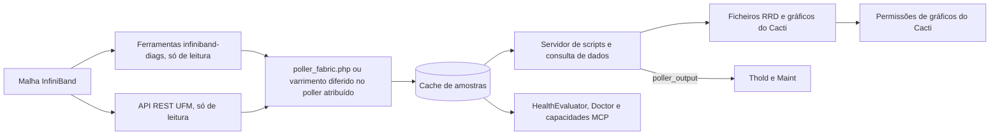

<!-- Source: README.md; SHA256: 79a16fb906f96ee79de2c719f18c38836f555440a7571a4a5ba38c64bb5b099f -->

<!-- translations:start -->
[English](../../../README.md) | [简体中文](../zh-CN/README.md) | [हिन्दी](../hi-IN/README.md) | [Español (España)](../es-ES/README.md) | [Español (Latinoamérica)](../es-419/README.md) | [العربية (السعودية)](../ar-SA/README.md) | [Afrikaans](../af-ZA/README.md) | [አማርኛ](../am-ET/README.md) | [العربية (مصر)](../ar-EG/README.md) | [العربية (المغرب)](../ar-MA/README.md) | [Български](../bg-BG/README.md) | [বাংলা](../bn-BD/README.md) | [Bosanski](../bs-BA/README.md) | [Deutsch](../de-DE/README.md) | [Ελληνικά](../el-GR/README.md) | [فارسی](../fa-IR/README.md) | [Filipino](../fil-PH/README.md) | [Français](../fr-FR/README.md) | [Français (Maroc)](../fr-MA/README.md) | [Français (Sénégal)](../fr-SN/README.md) | [Hausa](../ha-NG/README.md) | [עברית](../he-IL/README.md) | [Hrvatski](../hr-HR/README.md) | [Bahasa Indonesia](../id-ID/README.md) | [Igbo](../ig-NG/README.md) | [Italiano](../it-IT/README.md) | [日本語](../ja-JP/README.md) | [ქართული](../ka-GE/README.md) | [한국어](../ko-KR/README.md) | [Latviešu](../lv-LV/README.md) | [Malagasy](../mg-MG/README.md) | [मराठी](../mr-IN/README.md) | [Bahasa Melayu](../ms-MY/README.md) | [Nederlands](../nl-NL/README.md) | [Polski](../pl-PL/README.md) | [Português (Brasil)](../pt-BR/README.md) | [Português (Portugal)](README.md) | [Русский](../ru-RU/README.md) | [Kinyarwanda](../rw-RW/README.md) | [Soomaali](../so-SO/README.md) | [Српски](../sr-RS/README.md) | [Svenska](../sv-SE/README.md) | [Kiswahili](../sw-KE/README.md) | [தமிழ்](../ta-IN/README.md) | [తెలుగు](../te-IN/README.md) | [ไทย](../th-TH/README.md) | [Türkçe](../tr-TR/README.md) | [Українська](../uk-UA/README.md) | [اردو](../ur-PK/README.md) | [Tiếng Việt](../vi-VN/README.md) | [isiXhosa](../xh-ZA/README.md) | [Yorùbá](../yo-NG/README.md) | [繁體中文](../zh-TW/README.md) | [isiZulu](../zu-ZA/README.md)
<!-- translations:end -->

# plugin_fabric

Um plugin para Cacti 1.2 (`fabric`, versão `0.1.0-dev`) que integra no Cacti contadores de portas InfiniBand, largura e velocidade das ligações e indicadores de congestionamento sob a forma de dispositivos, origens de dados e gráficos comuns. Uma ligação negociada a 1X em vez de 4X passa assim a aparecer como gráfico e alerta do Thold junto ao anfitrião que serve, sob as permissões do Cacti, com reconhecimento e supressão pelo Maint.

> **Estado: em desenvolvimento, ainda sem versão publicada.** Este ramo implementa a base do plugin, objetos do Cacti e alertas, varrimentos agendados em segundo plano pelo poller, replicação para recoletores remotos, um backend REST só de leitura para NVIDIA UFM com cofre encriptado de credenciais, gestão CLI de Configuração como Código (CasC) e hooks de ecossistema do Cacti (CasC, Doctor e MCP / Abilities API v2). Foi testado contra ferramentas simuladas, transportes UFM sintéticos e o simulador de malha `ibsim` (rdma-core 50.0), mas nunca numa malha InfiniBand física nem num servidor UFM real. As verificações que requerem hardware permanecem em aberto em [docs/research/](../../research/). Este projeto não é afiliado ao projeto Cacti.

## O que está implementado

- **Ciclo de vida e esquema (v3)**: instalação, atualização idempotente, desinstalação (mantendo as tabelas do plugin por predefinição) e proteção do requisito de PHP 8.2, mantendo os pontos de entrada analisáveis em PHP 8.0.
- **Funções de acesso e páginas**: âmbitos `Fabric View` (`fabric.php`), `Fabric Operator` (`fabric_operator.php`) e `Fabric Admin` (`fabric_admin.php`, `fabric_health.php`), além de um separador de Definições em **Configuration > Settings > Fabrics**.
- **Backend de diagnóstico só de leitura (`diags`)**: execução rigorosa por vetor de argumentos de `perfquery`, `ibnetdiscover` e `iblinkinfo`, inventário indexado por GUID com deteção de conflitos de identidade e propostas de reassociação, avaliação do estado das ligações e varrimentos de contadores por nó.
- **Backend REST só de leitura NVIDIA UFM (`ufm`) e cofre encriptado**: cliente REST apenas GET com lista de permissões (`/ufmRest/resources/ports`, `/ufmRest/resources/systems`, `/ufmRest/monitoring/session/0/data` e equivalentes `/ufmRestV3/...` para autenticação por token) que alimenta as mesmas tabelas de inventário, estado de ligação, amostras e estado de saúde que `diags`. As credenciais (`token` ou `basic`) são armazenadas encriptadas com AES-256-GCM em `plugin_fabric_secret` usando um ficheiro de chave externo de 256 bits configurado por `fabric_vault_key_file`. As malhas UFM podem ser definidas através de CasC (`cli/fabric.php`) ou dos repositórios; o formulário web de administração expõe atualmente os campos `diags`.
- **Objetos do Cacti, Thold e Maint**: modelos de dispositivo, de dados e de gráficos do Cacti (`templates/fabric-templates.xml`), consulta de dados de servidor de scripts «Fabric Port» (`scripts/ss_fabric_ports.php`, `resource/script_server/fabric_ports.xml`), origens de dados de contadores `DERIVE` e origens de dados `GAUGE` de estado/taxa de ligação para o Thold, acompanhamento de descontinuidades e contadores básicos saturados comunicados como `U`. A integração Maint (`MaintMaintenance`) consulta `plugin_maint_check_cacti_host()` (recorrendo em alternativa ao hook `is_device_in_maintenance`) para que os nós em manutenção ativa sejam contados separadamente e excluídos dos avisos de saúde de varrimento falhado e porta degradada.
- **Varrimentos agendados, segmentação e recoletores remotos**: `poller_bottom` lança `poller_fabric.php` em segundo plano para as malhas devidas atribuídas ao poller atual, a par dos varrimentos diferidos desencadeados pelo servidor de scripts. `INFO` declara `remote_collect:1, remote_poller:1`, `poller_fabric.php` suporta segmentação determinística por GUID (`--shard=K/N`) e `replicate_out` replica linhas não secretas de `plugin_fabric_fabric` para recoletores remotos (`poller_id >= 2`). As entradas do cofre (`plugin_fabric_secret`) e os ficheiros de chave externos nunca são replicados.
- **CLI CasC e hooks de ecossistema**: `cli/fabric.php` para exportação YAML/XML, validação, planeamento de diferenças em simulação, aplicação mediante confirmação e relatórios de estado de saúde, além dos hooks `casc_register_providers`, `doctor_register_checks` e `abilities_register`.

## Funções de acesso

| Âmbito | Acesso |
| --- | --- |
| Fabric View | Inventário de monitorização e vistas de portas (`fabric.php`). |
| Fabric Operator | Acesso View mais a página Operações (`fabric_operator.php`) e reconhecimentos pessoais de triagem. |
| Fabric Admin | Acesso Operator mais configuração, ações administrativas (`fabric_admin.php`) e a página de estado de saúde (`fabric_health.php`). |

Após copiar os ficheiros de atualização, abra a página Plugins como administrador para registar novos âmbitos e hooks. Atribua explicitamente o âmbito Operator em **Configuration > Users** ou em grupos de utilizadores. As atualizações mantêm os IDs e concessões existentes dos âmbitos View e Admin. O acesso Admin herda o acesso Operator e o acesso Operator herda o acesso View em cada pedido; isto não adiciona concessões armazenadas a utilizadores nem a grupos. As definições do plugin requerem também acesso Fabric Admin além da permissão Settings do Cacti.

As permissões de dispositivos do Cacti limitam as linhas e ações disponíveis para cada utilizador; objetos não associados requerem um administrador. Credenciais, configuração, associação, eliminação e outras alterações administrativas permanecem nas páginas administrativas ou na CLI. Os reconhecimentos duram apenas na sessão atual do utilizador, no máximo durante uma hora e apenas enquanto a mesma observação permanecer atual. Observações novas ou alteradas invalidam-nos. Nunca marcam uma medição falhada como saudável nem suprimem alertas.

## Porquê

Uma ligação InfiniBand degradada continua a passar tráfego. Uma ligação 4X que volta a negociar a 1X mantém a porta «ativa» e os gráficos de interface SNMP do anfitrião parecem normais, mas as tarefas fortemente acopladas ficam lentas. A evidência encontra-se na malha: cada porta comunica a sua largura e velocidade ativas, ativadas e suportadas, além de contadores de erros e congestionamento. Ler estes dados exige as ferramentas de diagnóstico InfiniBand ou a API de um gestor de malha. Executadas manualmente, deixam três lacunas:

- **Sem histórico.** `perfquery` e `iblinkinfo` mostram apenas o presente, pelo que uma ligação que se degradou na semana passada fica invisível.
- **Sem contexto de dispositivo.** As portas da malha não são objetos do Cacti, pelo que uma porta não pode ser representada em gráfico junto ao anfitrião que alimenta.
- **Sem caminho para os alertas do Cacti.** O Thold e o Maint trabalham sobre origens de dados e dispositivos do Cacti.

O plugin colmata estas lacunas lendo a malha através de `infiniband-diags` ou da API REST do NVIDIA UFM, identificando nós e portas por GUID e publicando contadores e estado de ligação como origens de dados do Cacti. Efetua apenas leitura: nunca repõe contadores nem altera o estado de uma porta.

## Operações e CLI

### Poller em segundo plano e varrimentos manuais

`fabric_poller_bottom()` inicia `poller_fabric.php` em segundo plano em cada poller para as malhas ativadas atribuídas a esse `poller_id` cujo varrimento esteja devido. Pode também executar o corredor do poller ou um varrimento manual diretamente no poller atribuído como o utilizador do poller (substituindo `/path/to/cacti` pelo seu diretório do Cacti):

```sh
php /path/to/cacti/plugins/fabric/poller_fabric.php [--fabric=ID] [--shard=K/N] [--force] [--debug]
php /path/to/cacti/plugins/fabric/fabric_sweep.php --fabric=ID [--node=GUID] [--force]
```

- `poller_fabric.php` executa todas as malhas devidas para o poller local (ou uma malha com `--fabric=ID`), impõe o bloqueio do registo de processos do Cacti e as concessões de `ClaimRepository` com um orçamento de tempo de `max(30, intdiv(sweep_interval, 2))` segundos, e suporta `--shard=K/N` (`0 <= K < N`) para segmentar os varrimentos de contadores de nós `diags` de forma determinística pelo GUID do nó.
- `fabric_sweep.php` executa um varrimento a pedido de uma malha ativada (ou de um nó com `--node=GUID`) atribuída ao poller local. `--force` ignora se o varrimento da malha está devido, continuando a respeitar as concessões.

Depois de a primeira deteção preencher o inventário, associe os nós a dispositivos do Cacti na página Administração de Malha. Mantenha o tempo limite de scripts do Cacti em 25 segundos ou mais: um varrimento diferido iniciado por uma leitura de consulta de dados limita a execução da ferramenta a `script_timeout - 5` segundos para que o servidor de scripts devolva a tempo a última amostra armazenada ou `U`.

### Backend REST NVIDIA UFM e cofre de credenciais

Uma malha `ufm` requer um URL `https://` sem credenciais incorporadas, parâmetros de consulta nem fragmentos. `UfmSocketTransport` impõe a verificação de certificado TLS e do nome de anfitrião, rejeita redirecionamentos e suporta um pacote de AC opcional (`ufm_ca_file`) e fixação SPKI SHA-256 (`ufm_spki_pin`).

Para armazenar credenciais UFM em `plugin_fabric_secret`, configure `fabric_vault_key_file` em **Configuration > Settings > Fabrics** com um caminho absoluto para um ficheiro normal pertencente ao utilizador do poller (sem ligações simbólicas em nenhum diretório pai, modo `0600`, contendo 64 carateres hexadecimais como `openssl rand -hex 32` ou 32 bytes aleatórios não imprimíveis). O plugin nunca cria nem escreve o ficheiro de chave e `replicate_out` nunca replica `plugin_fabric_secret` nem ficheiros de chave para pollers remotos.

### CLI de Configuração como Código e estado de saúde

`cli/fabric.php` gere definições do plugin e definições de malhas de forma declarativa em YAML ou XML, e comunica o estado de saúde com reconhecimento de manutenção sem executar varrimentos em direto:

```sh
php /path/to/cacti/plugins/fabric/cli/fabric.php export [--format=yaml|xml] [--file=PATH]
php /path/to/cacti/plugins/fabric/cli/fabric.php validate --file=PATH [--format=yaml|xml]
php /path/to/cacti/plugins/fabric/cli/fabric.php plan --file=PATH [--format=yaml|xml]
php /path/to/cacti/plugins/fabric/cli/fabric.php apply --file=PATH --confirm=PLAN_HASH [--format=yaml|xml]
php /path/to/cacti/plugins/fabric/cli/fabric.php health [--format=text|json]
```

`export` cria novos ficheiros com modo `0600`, oculta `fabric_vault_key_file` como `[REDACTED]` e emite referências nomeadas `ufm_credential_ref` em vez de segredos. `plan` e `apply` rejeitam valores incorporados `ufm_token`, `ufm_password`, `secret` e `fabric_vault_key_file`. `apply` exige exatamente o `--confirm=PLAN_HASH` produzido por `plan`.

### Hooks de ecossistema

Quando os plugins do Cacti ou integrações de anfitrião correspondentes estão presentes, `setup.php` regista:

- `casc_register_providers`: exporta, valida, planeia e aplica com confirmação a configuração de `fabric` (`yaml` e `xml`, esquema v1) com ocultação de segredos.
- `doctor_register_checks`: fornece quatro verificações de diagnóstico só de leitura (`fabric.schema`, `fabric.poller_freshness`, `fabric.identity_conflicts`, `fabric.ufm_vault`).
- `abilities_register`: regista três capacidades só de leitura, não destrutivas e idempotentes na categoria `fabric`, protegidas pelo âmbito Fabric View (e pelas permissões de dispositivos do Cacti para erros de portas): `fabric-list-fabrics`, `fabric-get-health` e `fabric-list-port-errors`.

## Âmbito e fronteiras

Fora de âmbito: alterar o estado da malha, repor contadores, substituir um gestor de malha ou gestor de sub-rede, um motor de alertas próprio do plugin, um daemon ou protocolo de rede personalizado e malhas Ethernet ou RoCE.

## Requisitos e compatibilidade

| Componente | Alvo |
|---|---|
| Cacti | 1.2.31 ou posterior (`compat = 1.2.31`), sem correções ao núcleo |
| PHP | 8.2 ou posterior; os pontos de entrada mantêm-se analisáveis em 8.0 e recusam ativação em 8.1 para que um ambiente não suportado receba uma recusa em vez de partir a interface do Cacti |
| Ferramentas InfiniBand | `infiniband-diags` de `rdma-core` (testado em CI com rdma-core 50.0 sob `ibsim`; formatos de saída verificados com o código-fonte v66.0) |
| UFM | API REST NVIDIA UFM Enterprise (pontos terminais só de leitura `ufmRest` e `ufmRestV3`; testado com transportes sintéticos em testes unitários) |
| Thold, Maint | Não requer alterações; o CI executa um teste de ponta a ponta com Thold v1.8.2 e Maint v1.3 inalterados |

## Desenvolvimento e testes

O fluxo de trabalho de CI (`.github/workflows/plugin-ci-workflow.yml`) testa PHP 8.2 a 8.5 contra Cacti `release/1.2.31` e `1.2.x`, verificação de sintaxe de pontos de entrada em PHP 8.0, recusa em PHP 8.1, PHPStan, verificação de gettext/traduções, licenciamento REUSE, validação de fluxos de trabalho, reprodução de ponta a ponta com Thold/Maint e simulação de malha `ibsim`.

Com o ambiente de testes Pest partilhado do Cacti (`CACTI_PEST_BIN`) e uma base de dados descartável do Cacti:

```sh
# Unit tests
"$CACTI_PEST_BIN" --configuration=phpunit.xml

# Lifecycle integration tests (disposable database only)
CACTI_PATH=/path/to/cacti FABRIC_TEST_DATABASE=disposable "$CACTI_PEST_BIN" --configuration=phpunit-integration.xml

# Static analysis (against Cacti 1.2.31)
CACTI_PATH=/path/to/cacti phpstan analyse -c phpstan.neon --no-progress

# Translation template, catalogs, and localized README checks
sh locales/build_gettext.sh --check

# Simulated ibsim fixture parser check
php tests/bin/check-ibsim-fixtures.php tests/fixtures/ibsim
```

## Arquitetura

- [docs/PLAN.md](../../PLAN.md) é o plano de arquitetura e desenho: factos a montante com fontes, verificações de hardware em aberto, modelo de identidade, regras de contadores e estado de ligação, fronteiras de segurança, aritmética de desempenho, testes e riscos.
- [docs/decisions/](../../decisions/) contém registos de decisões de arquitetura.
- [docs/REQUIREMENTS.md](../../REQUIREMENTS.md) mapeia cada ID de requisito à respetiva issue.



## Como o trabalho é acompanhado

- Os **Marcos (Milestones)** seguem os marcos do plano. Cada um tem uma issue épica que lista as respetivas sub-issues e evidências de conclusão.
- As **Issues** são tipificadas por etiqueta: `type: requirement`, `type: research`, `type: decision`, `type: epic`. As issues de requisitos especificam requisitos numerados e testáveis (`REQ-AREA-NNN`) e critérios de aceitação.
- As **Etiquetas** incluem também `area:`, `phase:`, `priority:` e `status:`. Consulte [CONTRIBUTING.md](../../../CONTRIBUTING.md#labels).
- O [quadro do projeto](https://github.com/users/somethingwithproof/projects/8) mostra todas as issues ao longo dos marcos.

## Contribuir

Leia [CONTRIBUTING.md](../../../CONTRIBUTING.md). Os commits requerem assinatura DCO (`git commit -s`). A discussão de arquitetura decorre nas issues; as decisões em aberto utilizam a etiqueta `type: decision`.

## Segurança

Comunique vulnerabilidades de forma privada; consulte [SECURITY.md](../../../SECURITY.md).

## Licença

GNU General Public License v2.0, a mesma licença do Cacti e dos seus plugins. Consulte [LICENSE](../../../LICENSE).
