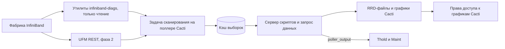

<!-- Source: README.md; SHA256: ce5af61a1bc993ec2aae6d4f22c3885694632f2b1d5eb94e2ce88b8390e96f1e -->

<!-- translations:start -->
[English](../../../README.md) | [简体中文](../zh-CN/README.md) | [हिन्दी](../hi-IN/README.md) | [Español (España)](../es-ES/README.md) | [Español (Latinoamérica)](../es-419/README.md) | [العربية (السعودية)](../ar-SA/README.md) | [Afrikaans](../af-ZA/README.md) | [አማርኛ](../am-ET/README.md) | [العربية (مصر)](../ar-EG/README.md) | [العربية (المغرب)](../ar-MA/README.md) | [বাংলা](../bn-BD/README.md) | [Deutsch](../de-DE/README.md) | [فارسی](../fa-IR/README.md) | [Filipino](../fil-PH/README.md) | [Français](../fr-FR/README.md) | [Français (Maroc)](../fr-MA/README.md) | [Français (Sénégal)](../fr-SN/README.md) | [Hausa](../ha-NG/README.md) | [עברית](../he-IL/README.md) | [Bahasa Indonesia](../id-ID/README.md) | [Igbo](../ig-NG/README.md) | [Italiano](../it-IT/README.md) | [日本語](../ja-JP/README.md) | [한국어](../ko-KR/README.md) | [Malagasy](../mg-MG/README.md) | [मराठी](../mr-IN/README.md) | [Bahasa Melayu](../ms-MY/README.md) | [Nederlands](../nl-NL/README.md) | [Polski](../pl-PL/README.md) | [Português (Brasil)](../pt-BR/README.md) | [Русский](README.md) | [Kinyarwanda](../rw-RW/README.md) | [Soomaali](../so-SO/README.md) | [Svenska](../sv-SE/README.md) | [Kiswahili](../sw-KE/README.md) | [தமிழ்](../ta-IN/README.md) | [తెలుగు](../te-IN/README.md) | [ไทย](../th-TH/README.md) | [Türkçe](../tr-TR/README.md) | [Українська](../uk-UA/README.md) | [اردو](../ur-PK/README.md) | [Tiếng Việt](../vi-VN/README.md) | [isiXhosa](../xh-ZA/README.md) | [Yorùbá](../yo-NG/README.md) | [繁體中文](../zh-TW/README.md) | [isiZulu](../zu-ZA/README.md)
<!-- translations:end -->

# plugin_fabric

Плагин для Cacti 1.2, который добавляет счётчики портов InfiniBand, ширину и скорость линий связи, а также индикаторы перегрузки в Cacti как обычные устройства, источники данных и графики. Линия связи, согласовавшаяся на скорости 1X вместо 4X, отображается в виде графика и оповещения Thold рядом с обслуживаемым хостом с учётом прав доступа Cacti и возможностью подавления через Maint.

> **Статус: в разработке, релизов пока нет.** Этап 2 (базовая основа) уже влит в `main`, а этап 3 (объекты Cacti и оповещения) находится на ревью. На этапе 1 архитектура была подтверждена по документации и исходному коду апстрима (PR #71); результаты со ссылками на источники находятся в [docs/research/](../../research). Этап 2 добавляет основу плагина:
>
> - установку, обновление, удаление и проверку версии PHP 8.2
> - области доступа View, Operator и Admin, а также настройки
> - записи о фабриках
> - границу выполнения команд только для чтения для `perfquery`, `ibnetdiscover` и `iblinkinfo`
> - инвентаризацию по GUID с обработкой конфликтов идентификации и предложениями повторной привязки
> - состояние линий связи и кэш сканирования счётчиков
> - страницы инвентаризации, администрирования и состояния
>
> Этап 3 добавляет объекты Cacti:
>
> - шаблоны устройств, данных и графиков в формате XML-шаблонов Cacti и запрос данных «Fabric Port»
> - сопоставление узла с устройством Cacti или создание устройства после подтверждения ([ADR 0010](../../decisions/0010-one-device-per-node.md))
> - источники данных типа счётчиков для графиков, а также источники данных типа GAUGE для состояния линий связи и скоростей в Thold ([ADR 0011](../../decisions/0011-derive-counters-and-gauge-alert-values.md))
> - обработку разрывов счётчиков и интерпретацию насыщенных базовых счётчиков как unknown ([ADR 0012](../../decisions/0012-saturated-basic-counters-read-as-unknown.md)), отображение достоверности счётчиков и ссылок на графики на странице порта, а также рейтинг перегрузки
> - сквозной тест с неизменёнными Thold v1.8.2 и Maint v1.3, а также задачу CI, запускающую реальные диагностические утилиты на симулированной фабрике
>
> До реализации поддержки удалённых сборщиков данных на фазе 3 сканирование фабрики возможно только с главного поллера. Плагин тестировался только с имитацией утилит и симулятором фабрики ibsim и никогда не проверялся на реальной фабрике InfiniBand. Проверки, требующие реальной фабрики, остаются открытыми в таблице живых проверок на каждой странице исследований. Этот проект не связан с проектом Cacti.

## Роли доступа

| Область доступа | Права |
| --- | --- |
| Fabric View | Существующие страницы мониторинга. |
| Fabric Operator | Мониторинг, а также страница Operations и личные подтверждения при разборе инцидентов. |
| Fabric Admin | Права Operator, а также существующие настройки и административные действия. |

После копирования файлов обновления откройте страницу Plugins под учётной записью администратора, чтобы зарегистрировать новую область доступа. Назначьте область Operator явно в разделе **Configuration > Users** или для групп пользователей.
При обновлении сохраняются существующие идентификаторы и права областей View и Admin. Доступ Admin наследует права Operator, а доступ Operator наследует права View при каждом запросе; это не добавляет сохранённых разрешений пользователям или группам. Для доступа к настройкам плагина в дополнение к праву Settings в Cacti также требуется доступ Fabric Admin.

Права доступа к устройствам Cacti по-прежнему ограничивают строки и действия, доступные каждому пользователю; для несопоставленных объектов требуется администратор.
Учётные данные, конфигурация, сопоставление, удаление и другие административные изменения остаются на страницах администрирования. Подтверждения действуют только в рамках текущей сессии пользователя, не дольше одного часа и только пока остаётся актуальным то же самое наблюдение. Новые или изменившиеся наблюдения делают их недействительными. Они никогда не помечают неудачное измерение как исправное и не подавляют оповещения.

## Зачем это нужно

Деградировавшая линия связи InfiniBand продолжает передавать трафик. Линия 4X, пересогласованная на 1X, оставляет порт в состоянии «active», а графики SNMP-интерфейсов хоста выглядят нормально, однако тесно связанные задачи замедляются. Признаки проблемы видны в самой фабрике: каждый порт сообщает активную, разрешённую и поддерживаемую ширину и скорость, а также счётчики ошибок и перегрузки. Для их чтения требуются диагностические утилиты InfiniBand или API менеджера фабрики. При запуске вручную остаются три пробела:

- **Нет истории.** `perfquery` и `iblinkinfo` показывают текущее состояние, поэтому деградация линии связи на прошлой неделе остаётся невидимой.
- **Нет контекста устройства.** Порты фабрики не являются объектами Cacti, поэтому график порта нельзя разместить рядом с обслуживаемым хостом.
- **Нет интеграции с оповещениями Cacti.** Thold и Maint работают с источниками данных и устройствами Cacti.

Плагин устраняет эти пробелы, считывая данные фабрики через собственные диагностические утилиты (а позже — через UFM), идентифицируя узлы и порты по GUID и публикуя счётчики и состояние линий связи в виде источников данных Cacti. Он работает только на чтение: плагин никогда не сбрасывает счётчики и не изменяет состояние портов.

## Первое обнаружение

У новой фабрики нет узлов, а сканирование с сервера скриптов запускается только для узла, сопоставленного с устройством Cacti. Поэтому первое обнаружение выполняется вручную. После сохранения включённой фабрики выполните следующую команду один раз на поллере, к которому привязана фабрика, от имени учётной записи поллера, заменив `/path/to/cacti` на каталог вашей установки Cacti (абсолютный путь также работает из cron):

```
php /path/to/cacti/plugins/fabric/fabric_sweep.php --fabric=ID --force
```

После этого инвентарь заполнится. Сопоставьте узлы с устройствами Cacti на странице Fabric Admin; последующие сканирования будут запускаться из запроса данных. Пока ни один узел фабрики не сопоставлен, инвентарь не обновляется автоматически, поэтому при необходимости запускайте ту же команду снова — например, из cron — для фиксации новых или пропавших узлов. Страница состояния отображает эту команду для каждой включённой фабрики, для которой ещё не выполнялось обнаружение или нет ни одного сопоставленного узла.

## Планируемый охват

| Фаза | Содержание | Этапы |
|---|---|---|
| 0, исследование | Матрица версий, подтверждение поведения апстрима, поведение счётчиков на оборудовании, модель привилегий, бюджет MAD, UFM API | [M1](https://github.com/somethingwithproof/plugin_fabric/milestone/1) |
| 1, наблюдение | Инвентаризация по GUID, устройства Cacti, запрос данных портов, источники данных счётчиков и состояния линий, оповещения Thold, подавление в Maint, страница состояния | [M2](https://github.com/somethingwithproof/plugin_fabric/milestone/2), [M3](https://github.com/somethingwithproof/plugin_fabric/milestone/3), [M4](https://github.com/somethingwithproof/plugin_fabric/milestone/4) |
| 2, UFM | Бэкенд UFM REST только для чтения, работа с учётными данными, преемственность идентификации между бэкендами | [M5](https://github.com/somethingwithproof/plugin_fabric/milestone/5) |
| 3, удалённый сбор | Удалённые сборщики данных, репликация, действия `remote_agent`, шардированное сканирование для крупных фабрик | [M6](https://github.com/somethingwithproof/plugin_fabric/milestone/6) |

Вне рамок проекта: изменение состояния фабрики, замена менеджера фабрики или менеджера подсети, собственный движок оповещений плагина, собственный демон или сетевой протокол, а также фабрики Ethernet или RoCE (исследование).

## Цели совместимости

| Компонент | Целевая версия / требование |
|---|---|
| Cacti | 1.2.31 или новее, без патчей ядра |
| PHP | 8.2 или новее; `setup.php` остаётся синтаксически корректным на 8.0, чтобы неподдерживаемая среда выполнения выдавала отказ вместо поломки интерфейса Cacti |
| Утилиты InfiniBand | infiniband-diags из rdma-core; форматы вывода проверены по исходному коду v66.0 |
| UFM | UFM Enterprise REST API, фаза 2; матрица релизов является результатом этапа 1 |
| Thold, Maint | Изменения не требуются |

Сохраняйте таймаут скриптов Cacti не ниже значения по умолчанию — 25 секунд. Сканирование, запущенное при чтении запроса данных, ограничивает выполнение утилит этим таймаутом минус пять секунд, резервируя время на чтение кэша и формирование ответа. При исчерпании бюджета времени запрос возвращает последнюю актуальную выборку или unknown; в следующем цикле сканирование повторяется. Это ограничение также распространяется на PHP-поллер. Таймаут в пять секунд или меньше не оставляет времени на запуск утилиты.

## Архитектура

- [docs/PLAN.md](../../PLAN.md) — полный план: архитектура, факты об апстриме, на которые она опирается (с источниками), и допущения, требующие подтверждения, модель идентификации, правила обработки счётчиков и состояния линий, границы безопасности, расчёты производительности, тестирование и риски.
- [docs/decisions/](../../decisions) содержит записи архитектурных решений (ADR) для уже принятых выборов.
- [docs/REQUIREMENTS.md](../../REQUIREMENTS.md) сопоставляет каждый идентификатор требования с соответствующей задачей.



## Как отслеживается работа

- **Этапы** соответствуют этапам плана. Для каждого этапа заведена эпик-задача со списком подзадач и критериями завершения.
- **Задачи** классифицируются метками: `type: requirement`, `type: research`, `type: decision`, `type: epic`. Задачи требований формулируют нумерованные проверяемые требования (`REQ-AREA-NNN`) и критерии приёмки.
- **Метки** также указывают `area:`, `phase:`, `priority:` и `status:`. См. [CONTRIBUTING.md](../../../CONTRIBUTING.md#labels).
- Все задачи по всем этапам отображаются на [доске проекта](https://github.com/users/somethingwithproof/projects/8).

## Участие в разработке

Прочитайте [CONTRIBUTING.md](../../../CONTRIBUTING.md). Для коммитов требуется подпись DCO. Обсуждение архитектуры ведётся в задачах; открытые решения помечены меткой `type: decision`.

## Безопасность

Сообщайте об уязвимостях конфиденциально; см. [SECURITY.md](../../../SECURITY.md).

## Лицензия

GNU General Public License v2.0 — та же лицензия, что и у Cacti и его плагинов. См. [LICENSE](../../../LICENSE).
