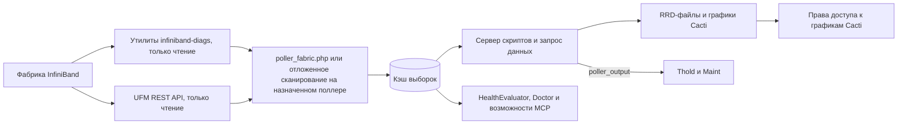

<!-- Source: README.md; SHA256: 79a16fb906f96ee79de2c719f18c38836f555440a7571a4a5ba38c64bb5b099f -->

<!-- translations:start -->
[English](../../../README.md) | [简体中文](../zh-CN/README.md) | [हिन्दी](../hi-IN/README.md) | [Español (España)](../es-ES/README.md) | [Español (Latinoamérica)](../es-419/README.md) | [العربية (السعودية)](../ar-SA/README.md) | [Afrikaans](../af-ZA/README.md) | [አማርኛ](../am-ET/README.md) | [العربية (مصر)](../ar-EG/README.md) | [العربية (المغرب)](../ar-MA/README.md) | [Български](../bg-BG/README.md) | [বাংলা](../bn-BD/README.md) | [Bosanski](../bs-BA/README.md) | [Deutsch](../de-DE/README.md) | [Ελληνικά](../el-GR/README.md) | [فارسی](../fa-IR/README.md) | [Filipino](../fil-PH/README.md) | [Français](../fr-FR/README.md) | [Français (Maroc)](../fr-MA/README.md) | [Français (Sénégal)](../fr-SN/README.md) | [Hausa](../ha-NG/README.md) | [עברית](../he-IL/README.md) | [Hrvatski](../hr-HR/README.md) | [Bahasa Indonesia](../id-ID/README.md) | [Igbo](../ig-NG/README.md) | [Italiano](../it-IT/README.md) | [日本語](../ja-JP/README.md) | [ქართული](../ka-GE/README.md) | [한국어](../ko-KR/README.md) | [Latviešu](../lv-LV/README.md) | [Malagasy](../mg-MG/README.md) | [मराठी](../mr-IN/README.md) | [Bahasa Melayu](../ms-MY/README.md) | [Nederlands](../nl-NL/README.md) | [Polski](../pl-PL/README.md) | [Português (Brasil)](../pt-BR/README.md) | [Português (Portugal)](../pt-PT/README.md) | [Русский](README.md) | [Kinyarwanda](../rw-RW/README.md) | [Soomaali](../so-SO/README.md) | [Српски](../sr-RS/README.md) | [Svenska](../sv-SE/README.md) | [Kiswahili](../sw-KE/README.md) | [தமிழ்](../ta-IN/README.md) | [తెలుగు](../te-IN/README.md) | [ไทย](../th-TH/README.md) | [Türkçe](../tr-TR/README.md) | [Українська](../uk-UA/README.md) | [اردو](../ur-PK/README.md) | [Tiếng Việt](../vi-VN/README.md) | [isiXhosa](../xh-ZA/README.md) | [Yorùbá](../yo-NG/README.md) | [繁體中文](../zh-TW/README.md) | [isiZulu](../zu-ZA/README.md)
<!-- translations:end -->

# plugin_fabric

Плагин для Cacti 1.2 (`fabric`, версия `0.1.0-dev`), который добавляет счётчики портов InfiniBand, ширину и скорость линий связи, а также индикаторы перегрузки в Cacti как обычные устройства, источники данных и графики. Линия связи, согласовавшаяся на скорости 1X вместо 4X, отображается в виде графика и оповещения Thold рядом с обслуживаемым хостом с учётом прав доступа Cacti и с поддержкой распознавания и подавления через Maint.

> **Статус: в разработке, релизов пока нет.** В этой ветке реализованы основа плагина, объекты и оповещения Cacti, фоновые сканирования поллера по расписанию, репликация на удалённые сборщики, бэкенд NVIDIA UFM REST только для чтения с зашифрованным хранилищем учётных данных, управление CLI в стиле Configuration-as-Code (CasC) и хуки экосистемы Cacti (CasC, Doctor и MCP / Abilities API v2). Плагин тестировался с имитацией утилит, синтетическими транспортами UFM и симулятором фабрики `ibsim` (rdma-core 50.0) и никогда не проверялся на физической фабрике InfiniBand или живом сервере UFM. Проверки, требующие оборудования, остаются открытыми в [docs/research/](../../research/). Этот проект не связан с проектом Cacti.

## Что реализовано

- **Жизненный цикл и схема (v3)**: установка, идемпотентное обновление, удаление (с сохранением таблиц плагина по умолчанию) и проверка требования PHP 8.2 при сохранении синтаксической корректности точек входа на PHP 8.0.
- **Роли доступа и страницы**: области доступа `Fabric View` (`fabric.php`), `Fabric Operator` (`fabric_operator.php`) и `Fabric Admin` (`fabric_admin.php`, `fabric_health.php`), а также вкладка Settings в разделе **Configuration > Settings > Fabrics**.
- **Диагностический бэкенд только для чтения (`diags`)**: строгий запуск `perfquery`, `ibnetdiscover` и `iblinkinfo` с передачей вектора аргументов, инвентаризация по GUID с обнаружением конфликтов идентификации и предложениями повторной привязки, оценка состояния линий связи и сканирование счётчиков по узлам.
- **Бэкенд NVIDIA UFM REST только для чтения (`ufm`) и зашифрованное хранилище**: REST-клиент только для GET-запросов по списку разрешённых путей (`/ufmRest/resources/ports`, `/ufmRest/resources/systems`, `/ufmRest/monitoring/session/0/data` и аналоги `/ufmRestV3/...` для токен-аутентификации), заполняющий те же таблицы инвентаря, состояния линий, выборок и состояния, что и `diags`. Учётные данные (`token` или `basic`) хранятся в зашифрованном виде с помощью AES-256-GCM в таблице `plugin_fabric_secret` с использованием внешнего 256-битного файла ключа, заданного параметром `fabric_vault_key_file`. Фабрики UFM можно определять через CasC (`cli/fabric.php`) или репозитории; форма веб-администрирования в настоящее время отображает поля `diags`.
- **Объекты Cacti, Thold и Maint**: шаблоны устройств, данных и графиков Cacti (`templates/fabric-templates.xml`), запрос данных сервера скриптов «Fabric Port» (`scripts/ss_fabric_ports.php`, `resource/script_server/fabric_ports.xml`), источники данных счётчиков `DERIVE` и источники данных состояния/скорости линий `GAUGE` для Thold, отслеживание разрывов счётчиков и передача насыщенных базовых счётчиков как `U`. Интеграция с Maint (`MaintMaintenance`) опрашивает `plugin_maint_check_cacti_host()` (с переходом на хук `is_device_in_maintenance` в качестве резервного варианта), чтобы узлы в активном обслуживании подсчитывались отдельно и исключались из предупреждений о сбоях сканирования и деградировавших портах.
- **Сканирования по расписанию, шардирование и удалённые сборщики**: `poller_bottom` запускает `poller_fabric.php` в фоне для фабрик, время сканирования которых наступило, назначенных текущему поллеру, наряду с отложенными сканированиями, запускаемыми сервером скриптов. `INFO` объявляет `remote_collect:1, remote_poller:1`, `poller_fabric.php` поддерживает детерминированное шардирование по GUID (`--shard=K/N`), а `replicate_out` реплицирует несекретные строки `plugin_fabric_fabric` на удалённые сборщики (`poller_id >= 2`). Записи хранилища (`plugin_fabric_secret`) и внешние файлы ключей никогда не реплицируются.
- **CasC CLI и хуки экосистемы**: `cli/fabric.php` для экспорта в YAML/XML, валидации, планирования изменений в пробном режиме (dry-run diff), применения с подтверждением и отчётов о состоянии, а также хуки `casc_register_providers`, `doctor_register_checks` и `abilities_register`.

## Роли доступа

| Область доступа | Права |
| --- | --- |
| Fabric View | Просмотр инвентаря и состояния портов (`fabric.php`). |
| Fabric Operator | Права View, а также страница Operations (`fabric_operator.php`) и личные подтверждения при разборе инцидентов. |
| Fabric Admin | Права Operator, а также настройка, административные действия (`fabric_admin.php`) и страница состояния (`fabric_health.php`). |

После копирования файлов обновления откройте страницу Plugins под учётной записью администратора, чтобы зарегистрировать новые области доступа и хуки. Назначьте область Operator явно в разделе **Configuration > Users** или для групп пользователей. При обновлении сохраняются существующие идентификаторы и права областей View и Admin. Доступ Admin наследует права Operator, а доступ Operator наследует права View при каждом запросе; это не добавляет сохранённых разрешений пользователям или группам. Для доступа к настройкам плагина в дополнение к праву Settings в Cacti также требуется доступ Fabric Admin.

Права доступа к устройствам Cacti ограничивают строки и действия, доступные каждому пользователю; для несопоставленных объектов требуется администратор. Учётные данные, конфигурация, сопоставление, удаление и другие административные изменения остаются на страницах администрирования или в CLI. Подтверждения действуют только в рамках текущей сессии пользователя, не дольше одного часа и только пока остаётся актуальным то же самое наблюдение. Новые или изменившиеся наблюдения делают их недействительными. Они никогда не помечают неудачное измерение как исправное и не подавляют оповещения.

## Зачем это нужно

Деградировавшая линия связи InfiniBand продолжает передавать трафик. Линия 4X, пересогласованная на 1X, оставляет порт в состоянии «active», а графики SNMP-интерфейсов хоста выглядят нормально, однако тесно связанные задачи замедляются. Признаки проблемы видны в самой фабрике: каждый порт сообщает активную, разрешённую и поддерживаемую ширину и скорость, а также счётчики ошибок и перегрузки. Для их чтения требуются диагностические утилиты InfiniBand или API менеджера фабрики. При запуске вручную остаются три пробела:

- **Нет истории.** `perfquery` и `iblinkinfo` показывают текущее состояние, поэтому деградация линии связи на прошлой неделе остаётся невидимой.
- **Нет контекста устройства.** Порты фабрики не являются объектами Cacti, поэтому график порта нельзя разместить рядом с обслуживаемым хостом.
- **Нет интеграции с оповещениями Cacti.** Thold и Maint работают с источниками данных и устройствами Cacti.

Плагин устраняет эти пробелы, считывая данные фабрики через `infiniband-diags` или NVIDIA UFM REST API, идентифицируя узлы и порты по GUID и публикуя счётчики и состояние линий связи в виде источников данных Cacti. Он работает только на чтение: плагин никогда не сбрасывает счётчики и не изменяет состояние портов.

## Эксплуатация и CLI

### Фоновый поллер и ручные сканирования

`fabric_poller_bottom()` запускает `poller_fabric.php` в фоновом режиме на каждом поллере для включённых фабрик, назначенных этому `poller_id`, время сканирования которых наступило. Вы также можете запустить обработчик поллера или ручное сканирование непосредственно на назначенном поллере от имени пользователя поллера (заменив `/path/to/cacti` на каталог вашей установки Cacti):

```sh
php /path/to/cacti/plugins/fabric/poller_fabric.php [--fabric=ID] [--shard=K/N] [--force] [--debug]
php /path/to/cacti/plugins/fabric/fabric_sweep.php --fabric=ID [--node=GUID] [--force]
```

- `poller_fabric.php` запускает все фабрики с наступившим временем сканирования для локального поллера (или одну фабрику с `--fabric=ID`), применяет блокировку реестра процессов Cacti и аренды `ClaimRepository` с бюджетом времени `max(30, intdiv(sweep_interval, 2))` секунд, а также поддерживает `--shard=K/N` (`0 <= K < N`) для детерминированного шардирования сканирований счётчиков узлов `diags` по GUID узла.
- `fabric_sweep.php` запускает сканирование по требованию для одной включённой фабрики (или одного узла с `--node=GUID`), назначенной локальному поллеру. Флаг `--force` игнорирует расписание готовности фабрики, но продолжает соблюдать блокировки аренды (claims).

После того как первое обнаружение заполнит инвентарь, сопоставьте узлы с устройствами Cacti на странице Fabric Admin. Поддерживайте таймаут скриптов Cacti не ниже 25 секунд: отложенное сканирование, инициированное чтением запроса данных, ограничивает выполнение утилит значением `script_timeout - 5` секунд, чтобы сервер скриптов успел вернуть последнюю сохранённую выборку или `U`.

### Бэкенд NVIDIA UFM REST и хранилище учётных данных

Фабрике типа `ufm` требуется URL `https://` без встроенных учётных данных, строк запроса или фрагментов. `UfmSocketTransport` обеспечивает проверку узла и имени хоста TLS, отклоняет перенаправления и поддерживает необязательный пакет ЦС (`ufm_ca_file`) и пиннинг SHA-256 SPKI (`ufm_spki_pin`).

Чтобы хранить учётные данные UFM в `plugin_fabric_secret`, настройте `fabric_vault_key_file` в разделе **Configuration > Settings > Fabrics**, указав абсолютный путь к обычному файлу, принадлежащему пользователю поллера (без символических ссылок в родительских каталогах, права доступа `0600`, содержащему 64 шестнадцатеричных символа, например из `openssl rand -hex 32`, или 32 случайных непечатных байта). Плагин никогда не создаёт и не перезаписывает файл ключа, а `replicate_out` никогда не реплицирует `plugin_fabric_secret` или файлы ключей на удалённые поллеры.

### Configuration-as-Code и CLI состояния

`cli/fabric.php` декларативно управляет настройками плагина и определениями фабрик в формате YAML или XML, а также выводит отчёт о состоянии с учётом обслуживания без выполнения живых сканирований:

```sh
php /path/to/cacti/plugins/fabric/cli/fabric.php export [--format=yaml|xml] [--file=PATH]
php /path/to/cacti/plugins/fabric/cli/fabric.php validate --file=PATH [--format=yaml|xml]
php /path/to/cacti/plugins/fabric/cli/fabric.php plan --file=PATH [--format=yaml|xml]
php /path/to/cacti/plugins/fabric/cli/fabric.php apply --file=PATH --confirm=PLAN_HASH [--format=yaml|xml]
php /path/to/cacti/plugins/fabric/cli/fabric.php health [--format=text|json]
```

Команда `export` создаёт новые файлы с правами `0600`, скрывает `fabric_vault_key_file` как `[REDACTED]` и выводит именованные ссылки `ufm_credential_ref` вместо секретов. `plan` и `apply` отклоняют встроенные значения `ufm_token`, `ufm_password`, `secret` и встроенное значение `fabric_vault_key_file`. `apply` требует точного параметра `--confirm=PLAN_HASH`, сформированного командой `plan`.

### Хуки экосистемы

При наличии соответствующих плагинов Cacti или интеграций хоста `setup.php` регистрирует:

- `casc_register_providers`: экспортирует, валидирует, планирует и применяет с подтверждением конфигурацию `fabric` (`yaml` и `xml`, схема v1) со скрытием секретов.
- `doctor_register_checks`: предоставляет четыре диагностические проверки только для чтения (`fabric.schema`, `fabric.poller_freshness`, `fabric.identity_conflicts`, `fabric.ufm_vault`).
- `abilities_register`: регистрирует три идемпотентные, неразрушающие возможности только для чтения в категории `fabric`, защищённые областью доступа Fabric View (и правами на устройства Cacti для ошибок портов): `fabric-list-fabrics`, `fabric-get-health` и `fabric-list-port-errors`.

## Охват и границы

Вне рамок проекта: изменение состояния фабрики, сброс счётчиков, замена менеджера фабрики или менеджера подсети, собственный движок оповещений плагина, собственный демон или сетевой протокол, а также фабрики Ethernet или RoCE.

## Требования и совместимость

| Компонент | Целевое требование |
|---|---|
| Cacti | 1.2.31 или новее (`compat = 1.2.31`), без патчей ядра |
| PHP | 8.2 или новее; точки входа остаются синтаксически корректными на 8.0 и отклоняют активацию на 8.1, чтобы неподдерживаемая среда выполнения получала отказ вместо поломки интерфейса Cacti |
| Утилиты InfiniBand | `infiniband-diags` из `rdma-core` (протестировано в CI с rdma-core 50.0 под `ibsim`; форматы вывода проверены по исходному коду v66.0) |
| UFM | NVIDIA UFM Enterprise REST API (конечные точки только для чтения `ufmRest` и `ufmRestV3`; протестировано с синтетическими транспортами в модульных тестах) |
| Thold, Maint | Изменения не требуются; CI запускает сквозной тест с неизменёнными Thold v1.8.2 и Maint v1.3 |

## Разработка и тестирование

Рабочий процесс CI (`.github/workflows/plugin-ci-workflow.yml`) тестирует PHP от 8.2 до 8.5 с Cacti `release/1.2.31` и `1.2.x`, проверку синтаксиса точек входа на PHP 8.0, отказ на PHP 8.1, PHPStan, проверку gettext/переводов, лицензирование REUSE, линтинг workflow, сквозное воспроизведение Thold/Maint и симуляцию фабрики `ibsim`.

С зафиксированным общим тестовым окружением Pest для плагинов Cacti (`CACTI_PEST_BIN`) и одноразовой базой данных Cacti:

```sh
# Unit tests
"$CACTI_PEST_BIN" --configuration=phpunit.xml

# Lifecycle integration tests (disposable database only)
CACTI_PATH=/path/to/cacti FABRIC_TEST_DATABASE=disposable "$CACTI_PEST_BIN" --configuration=phpunit-integration.xml

# Static analysis (against Cacti 1.2.31)
CACTI_PATH=/path/to/cacti phpstan analyse -c phpstan.neon --no-progress

# Translation template, catalogs, and localized README checks
sh locales/build_gettext.sh --check

# Simulated ibsim fixture parser check
php tests/bin/check-ibsim-fixtures.php tests/fixtures/ibsim
```

## Архитектура

- [docs/PLAN.md](../../PLAN.md) представляет собой план архитектуры и проектирования: факты об апстриме с источниками, открытые проверки оборудования, модель идентификации, правила обработки счётчиков и состояния линий, границы безопасности, расчёты производительности, тестирование и риски.
- [docs/decisions/](../../decisions/) содержит записи архитектурных решений.
- [docs/REQUIREMENTS.md](../../REQUIREMENTS.md) сопоставляет каждый идентификатор требования с соответствующей задачей.



## Как отслеживается работа

- **Этапы** соответствуют этапам плана. Для каждого этапа заведена эпик-задача со списком подзадач и критериями завершения.
- **Задачи** классифицируются метками: `type: requirement`, `type: research`, `type: decision`, `type: epic`. Задачи требований формулируют нумерованные проверяемые требования (`REQ-AREA-NNN`) и критерии приёмки.
- **Метки** также указывают `area:`, `phase:`, `priority:` и `status:`. См. [CONTRIBUTING.md](../../../CONTRIBUTING.md#labels).
- Все задачи по всем этапам отображаются на [доске проекта](https://github.com/users/somethingwithproof/projects/8).

## Участие в разработке

Прочитайте [CONTRIBUTING.md](../../../CONTRIBUTING.md). Для коммитов требуется подпись DCO (`git commit -s`). Обсуждение архитектуры ведётся в задачах; открытые решения помечены меткой `type: decision`.

## Безопасность

Сообщайте об уязвимостях конфиденциально; см. [SECURITY.md](../../../SECURITY.md).

## Лицензия

GNU General Public License v2.0, та же лицензия, что и у Cacti и его плагинов. См. [LICENSE](../../../LICENSE).
