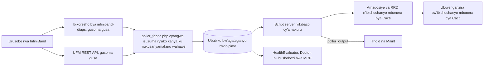

<!-- Source: README.md; SHA256: 79a16fb906f96ee79de2c719f18c38836f555440a7571a4a5ba38c64bb5b099f -->

<!-- translations:start -->
[English](../../../README.md) | [简体中文](../zh-CN/README.md) | [हिन्दी](../hi-IN/README.md) | [Español (España)](../es-ES/README.md) | [Español (Latinoamérica)](../es-419/README.md) | [العربية (السعودية)](../ar-SA/README.md) | [Afrikaans](../af-ZA/README.md) | [አማርኛ](../am-ET/README.md) | [العربية (مصر)](../ar-EG/README.md) | [العربية (المغرب)](../ar-MA/README.md) | [Български](../bg-BG/README.md) | [বাংলা](../bn-BD/README.md) | [Bosanski](../bs-BA/README.md) | [Deutsch](../de-DE/README.md) | [Ελληνικά](../el-GR/README.md) | [فارسی](../fa-IR/README.md) | [Filipino](../fil-PH/README.md) | [Français](../fr-FR/README.md) | [Français (Maroc)](../fr-MA/README.md) | [Français (Sénégal)](../fr-SN/README.md) | [Hausa](../ha-NG/README.md) | [עברית](../he-IL/README.md) | [Hrvatski](../hr-HR/README.md) | [Bahasa Indonesia](../id-ID/README.md) | [Igbo](../ig-NG/README.md) | [Italiano](../it-IT/README.md) | [日本語](../ja-JP/README.md) | [ქართული](../ka-GE/README.md) | [한국어](../ko-KR/README.md) | [Latviešu](../lv-LV/README.md) | [Malagasy](../mg-MG/README.md) | [मराठी](../mr-IN/README.md) | [Bahasa Melayu](../ms-MY/README.md) | [Nederlands](../nl-NL/README.md) | [Polski](../pl-PL/README.md) | [Português (Brasil)](../pt-BR/README.md) | [Português (Portugal)](../pt-PT/README.md) | [Русский](../ru-RU/README.md) | [Kinyarwanda](README.md) | [Soomaali](../so-SO/README.md) | [Српски](../sr-RS/README.md) | [Svenska](../sv-SE/README.md) | [Kiswahili](../sw-KE/README.md) | [தமிழ்](../ta-IN/README.md) | [తెలుగు](../te-IN/README.md) | [ไทย](../th-TH/README.md) | [Türkçe](../tr-TR/README.md) | [Українська](../uk-UA/README.md) | [اردو](../ur-PK/README.md) | [Tiếng Việt](../vi-VN/README.md) | [isiXhosa](../xh-ZA/README.md) | [Yorùbá](../yo-NG/README.md) | [繁體中文](../zh-TW/README.md) | [isiZulu](../zu-ZA/README.md)
<!-- translations:end -->

# plugin_fabric

Umugereka wa Cacti 1.2 (`fabric`, verisiyo `0.1.0-dev`) uzana ibipimo by'ibyambu bya InfiniBand, ubugari n'umuvuduko w'ihuza, n'ibimenyetso by'ubucucike muri Cacti nk'ibikoresho bisanzwe, amasoko y'amakuru, n'ibishushanyo mbonera. Ihuza ryitoje kuri 1X aho kuba 4X rihita rigaragara nk'igishushanyo mbonera n'integuza ya Thold iruhande rwa seriveri ikoresha, munsi y'uburenganzira bwa Cacti, hamwe n'imenya n'ihagarikwa bya Maint.

> **Imiterere: irimo gutunganywa, nta verisiyo irasohoka.** Iri shami rishyira mu bikorwa urufatiro rw'umugereka, ibintu bya Cacti n'integuza, isuzuma ry'umukusanyamakuru riteganyijwe mu nyuma, kwigana amakuru ku bakusanyamakuru bo ku ruhande, uburyo bwa NVIDIA UFM REST bwo gusoma gusa bufite ububiko bw'ibimenyetso byo kwinjira bushimangiwe mu ibanga, imicungire ya CLI ya Configuration-as-Code (CasC), n'ibihuza by'urusobe rwa Cacti (CasC, Doctor, na MCP / Abilities API v2). Rwageragejwe ku bikoresho by'imikino, imiyoboro ya UFM yiganywe, no kuri simulateri y'urusobe ya `ibsim` (rdma-core 50.0), ntabwo rwigeze rugeragezwa ku rusobe nyarwo rwa InfiniBand cyangwa kuri seriveri ya UFM ikora. Isuzuma rikenera ibikoresho nyabyo rikomeza gufungurwa muri [docs/research/](../../research/). Uyu mushinga ntabwo ufite aho uhuriye n'umushinga wa Cacti.

## Ibimaze gukorwa

- **Ubuzima bw'umugereka n'imbonerahamwe (v3)**: gushyiramo, kuvugurura ku buryo budahindura ibisanzwe (idempotent), gukuramo (bigumana imbonerahamwe z'umugereka ku buryo busanzwe), n'ubwirinzi bw'icyemezo cya PHP 8.2 mu gihe amarembo yo kwinjira aguma gusomeka kuri PHP 8.0.
- **Inshingano z'uburenganzira n'impapuro**: inzego za `Fabric View` (`fabric.php`), `Fabric Operator` (`fabric_operator.php`), na `Fabric Admin` (`fabric_admin.php`, `fabric_health.php`), hiyongereyeho agace ka Settings munsi ya **Configuration > Settings > Fabrics**.
- **Uburyo bwo gusuzuma bwo gusoma gusa (`diags`)**: ikoreshwa rishingiye ku rutonde rw'amabwiriza rwuzuye rwa `perfquery`, `ibnetdiscover`, na `iblinkinfo`, ibarura rishingiye kuri GUID hamwe no gutahura amakimbirane y'umwirondoro n'ibitekerezo byo kongera guhuza, isuzuma ry'imiterere y'ihuza, n'isuzuma ry'ibipimo kuri buri pfundiko.
- **Uburyo bwa NVIDIA UFM REST bwo gusoma gusa (`ufm`) n'ububiko bushimangiwe mu ibanga**: umukiriya wa REST ukoresha GET gusa ku miyoboro yemewe (`/ufmRest/resources/ports`, `/ufmRest/resources/systems`, `/ufmRest/monitoring/session/0/data`, n'ibijyanye na `/ufmRestV3/...` mu kwemeza hakoreshejwe token) ugaburira imbonerahamwe zimwe z'ibarura, imiterere y'ihuza, ibyitegererezo, n'ubuzima nk'iza `diags`. Ibimenyetso byo kwinjira (`token` cyangwa `basic`) bibikwa bishimangiwe na AES-256-GCM muri `plugin_fabric_secret` hifashishijwe dosiye y'urufunguzo yo hanze ya bit 256 igengwa na `fabric_vault_key_file`. Amasobe ya UFM ashobora gusobanurwa binyuze muri CasC (`cli/fabric.php`) cyangwa ububiko bw'amakuru; ifishi y'ubuyobozi ku rubuga ubu yerekana imyanya ya `diags`.
- **Ibintu bya Cacti, Thold, na Maint**: inyandikorugero z'ibikoresho, iz'amakuru, n'iz'ibishushanyo mbonera bya Cacti (`templates/fabric-templates.xml`), ikibazo cy'amakuru cya script-server "Fabric Port" (`scripts/ss_fabric_ports.php`, `resource/script_server/fabric_ports.xml`), amasoko y'amakuru y'ibipimo `DERIVE` n'amasoko y'amakuru y'imiterere y'ihuza/igipimo `GAUGE` ku bwa Thold, gukurikirana ihagarara ry'ibipimo, n'ibipimo fatizo byuzuye bitangwa nka `U`. Ihuza rya Maint (`MaintMaintenance`) ribaza `plugin_maint_check_cacti_host()` (ryitabaza igihuza cya `is_device_in_maintenance` igihe bikenewe) kugira ngo pfundiko ziri mu itunganywa rikora zibarirwe ukwazo kandi zikurwe mu miburo y'ubuzima y'isuzuma ritagenze neza n'ibyambu byangiritse.
- **Isuzuma riteganyijwe, igabanyamice, n'abakusanyamakuru bo ku ruhande**: `poller_bottom` itangiza `poller_fabric.php` mu nyuma ku masobe ageze igihe cyo gusuzumwa yoherejwe ku mukusanyamakuru uriho, iruhande rw'isuzuma ry'ako kanya ritangizwa na script server. `INFO` itangaza `remote_collect:1, remote_poller:1`, `poller_fabric.php` ishyigikira igabanyamice rishingiye kuri GUID (`--shard=K/N`), kandi `replicate_out` yigana imirongo itarimo ibanga ya `plugin_fabric_fabric` ku bakusanyamakuru bo ku ruhande (`poller_id >= 2`). Ibiri mu bubiko bw'ibanga (`plugin_fabric_secret`) n'amadosiye y'urufunguzo yo hanze ntibigera byiganwa na rimwe.
- **CLI ya CasC n'ibihuza by'urusobe**: `cli/fabric.php` mu gusohora YAML/XML, kwemeza, gutegura itandukaniro ry'igerageza (dry-run diff), gushyira mu bikorwa bisaba kwemezwa, no gutanga raporo y'ubuzima, hiyongereyeho ibihuza bya `casc_register_providers`, `doctor_register_checks`, na `abilities_register`.

## Inshingano z'uburenganzira

| Urwego | Uburenganzira |
| --- | --- |
| Fabric View | Gukurikirana ibarura n'imigaragarire y'ibyambu (`fabric.php`). |
| Fabric Operator | Uburenganzira bwa View hiyongereyeho urupapuro rwa Operations (`fabric_operator.php`) n'ibyemezo byihariye byo kugenzura ibibazo. |
| Fabric Admin | Uburenganzira bwa Operator hiyongereyeho igenamiterere, ibikorwa by'ubuyobozi (`fabric_admin.php`), n'urupapuro rw'ubuzima (`fabric_health.php`). |

Nyuma yo gukoporora amadosiye avuguruye, fungura urupapuro rwa Plugins nk'umuyobozi kugira ngo wandikishe inzego nshya n'ibihuza. Tanga urwego rwa Operator mu buryo bweruye munsi ya **Configuration > Users** cyangwa mu matsinda y'abakoresha. Ivugurura rigumana indangamuntu n'uburenganzira bisanzwe bya View na Admin. Uburenganzira bwa Admin buragwa ubwa Operator, naho ubwa Operator bukaragwa ubwa View kuri buri busabe; ibi ntibyongera uburenganzira bubitswe ku bakoresha cyangwa amatsinda. Igenamiterere ry'umugereka na ryo risaba uburenganzira bwa Fabric Admin hiyongereyeho uruhushya rwa Settings rwa Cacti.

Uburenganzira bw'ibikoresho bya Cacti bugabanya imirongo n'ibikorwa buri mukoresha yemerewe; ibintu bitarahuza bisaba umuyobozi. Ibimenyetso byo kwinjira, igenamiterere, guhuza, gusiba n'izindi mpinduka z'ubuyobozi biguma ku mpapuro z'ubuyobozi cyangwa muri CLI. Ibyemezo byo kwemera ibibazo bimara gusa igihe cy'isomo ry'umukoresha uriho, mu gihe kitarenze isaha imwe kandi gusa mu gihe cya gipimo kimwe kikiri gishya. Ibipimo bishya cyangwa byahindutse birabitesha agaciro. Ntibishobora na rimwe kwerekana igipimo cyapfuye nk'ikizima cyangwa ngo bihagarike integuza.

## Impamvu

Ihuza rya InfiniBand ryangiritse rikomeza kunyuzamo amakuru. Ihuza rya 4X ryongeye kwitoza kuri 1X risiga icyambu kiri "active", kandi ibishushanyo mbonera by'imiyoboro ya SNMP bya seriveri bigaragara nk'ibisanzwe, ariko imirimo ikorana bya hafi igenda buhoro. Ikimenyetso kiba mu rusobe: buri cyambu gitanga ubugari n'umuvuduko bikora, ibyemerewe, n'ibishoboka, hiyongereyeho ibipimo by'amakosa n'ubucucike. Kubisoma bisaba ibikoresho byo gusuzuma bya InfiniBand cyangwa API y'umuyobozi w'urusobe. Iyo bikoreshejwe n'intoki, bisiga ibyuho bitatu:

- **Nta mateka.** `perfquery` na `iblinkinfo` byerekana ibiriho ubu, bityo ihuza ryangiritse mu cyumweru gishize ntirigaragara.
- **Nta mimerere y'igikoresho.** Ibyambu by'urusobe si ibintu bya Cacti, bityo icyambu ntigishobora gushushanywa iruhande rwa seriveri kigaburira.
- **Nta nzira igana ku nteguza za Cacti.** Thold na Maint bikorera ku masoko y'amakuru n'ibikoresho bya Cacti.

Umugereka ufunga ibi byuho usoma urusobe ukoresheje `infiniband-diags` cyangwa NVIDIA UFM REST API, ukamenya pfundiko n'ibyambu ukoresheje GUID, kandi ugatangaza ibipimo n'imiterere y'ihuza nk'amasoko y'amakuru ya Cacti. Urasoma gusa: ntiwigera usubiza ibipimo ku busa cyangwa ngo uhindure imiterere y'icyambu.

## Imikorere na CLI

### Umukusanyamakuru wo mu nyuma n'isuzuma ry'intoki

`fabric_poller_bottom()` itangiza `poller_fabric.php` mu nyuma kuri buri mukusanyamakuru ku masobe afunguye yoherejwe kuri iyo `poller_id` ageze igihe cyo gusuzumwa. Ushobora no gukoresha mu buryo butaziguye ikora ry'umukusanyamakuru cyangwa isuzuma ry'intoki ku mukusanyamakuru wahawe nk'umukoresha w'umukusanyamakuru (usimbuze `/path/to/cacti` ububiko bwawe bwa Cacti):

```sh
php /path/to/cacti/plugins/fabric/poller_fabric.php [--fabric=ID] [--shard=K/N] [--force] [--debug]
php /path/to/cacti/plugins/fabric/fabric_sweep.php --fabric=ID [--node=GUID] [--force]
```

- `poller_fabric.php` ikoresha amasobe yose ageze igihe ku mukusanyamakuru w'aho hantu (cyangwa urusobe rumwe na `--fabric=ID`), yubahiriza ifungwa ry'inyandiko y'ibikorwa bya Cacti n'amasezerano ya `ClaimRepository` hamwe n'ingengo y'igihe ya `max(30, intdiv(sweep_interval, 2))` amasegonda, kandi ishyigikira `--shard=K/N` (`0 <= K < N`) kugira ngo igabanye mu buryo budahinduka isuzuma ry'ibipimo bya pfundiko `diags` hakurikijwe GUID ya pfundiko.
- `fabric_sweep.php` ikora isuzuma risabwe ako kanya ku rusobe rumwe rufunguye (cyangwa pfundiko imwe na `--node=GUID`) rwoherejwe ku mukusanyamakuru w'aho hantu. `--force` yirengagiza niba urusobe rugeze igihe ariko igakomeza kubahiriza ibyemezo byo gukora (claims).

Nyuma y'aho itahura rya mbere ryujurije ibarura, huza pfundiko n'ibikoresho bya Cacti ku rupapuro rwa Fabric Admin. Gumisha igihe ntarengwa cya script ya Cacti ku masegonda 25 cyangwa hejuru yayo: isuzuma ry'ako kanya ritangijwe no gusoma ikibazo cy'amakuru rigabanya ikoreshwa ry'igikoresho kugeza kuri `script_timeout - 5` amasegonda kugira ngo script server igaruke ku gihe hamwe n'icyitegererezo cyanyuma kibitswe cyangwa `U`.

### Uburyo bwa NVIDIA UFM REST n'ububiko bw'ibimenyetso byo kwinjira

Urusobe rwa `ufm` rusaba URL ya `https://` idafite ibimenyetso byo kwinjira birimo imbere, imirongo y'ibibazo (query strings), cyangwa ibice (fragments). `UfmSocketTransport` ishyiraho igenzura rya TLS peer n'izina rya seriveri, yanga iyoborwa ahandi (redirects), kandi ishyigikira umufuka wa CA wo guhitamo (`ufm_ca_file`) na pini ya SHA-256 SPKI (`ufm_spki_pin`).

Kugira ngo ubike ibimenyetso byo kwinjira bya UFM muri `plugin_fabric_secret`, tunganya `fabric_vault_key_file` munsi ya **Configuration > Settings > Fabrics** hamwe n'inzira yuzuye igana ku dosiye isanzwe ya nyir'umukoresha w'umukusanyamakuru (nta mahuza y'ibimenyetso mu bubiko ubwo ari bwo bwose bubibanziriza, uburyo bwa `0600`, burimo inyuguti za hex 64 nka `openssl rand -hex 32` cyangwa bayite 32 zidasomeka zitoranyijwe mu buryo budasobanutse). Umugereka ntiwigera uhanga cyangwa ngo wandike dosiye y'urufunguzo, kandi `replicate_out` ntiyigera yigana `plugin_fabric_secret` cyangwa amadosiye y'urufunguzo ku bakusanyamakuru bo ku ruhande.

### Configuration-as-Code na CLI y'ubuzima

`cli/fabric.php` icunga igenamiterere ry'umugereka n'ibisobanuro by'urusobe mu buryo bugaragara muri YAML cyangwa XML, kandi itanga raporo y'ubuzima imenya itunganywa idakoze isuzuma rya live:

```sh
php /path/to/cacti/plugins/fabric/cli/fabric.php export [--format=yaml|xml] [--file=PATH]
php /path/to/cacti/plugins/fabric/cli/fabric.php validate --file=PATH [--format=yaml|xml]
php /path/to/cacti/plugins/fabric/cli/fabric.php plan --file=PATH [--format=yaml|xml]
php /path/to/cacti/plugins/fabric/cli/fabric.php apply --file=PATH --confirm=PLAN_HASH [--format=yaml|xml]
php /path/to/cacti/plugins/fabric/cli/fabric.php health [--format=text|json]
```

`export` ihanga amadosiye mashya mu buryo bwa `0600`, ihisha `fabric_vault_key_file` nka `[REDACTED]`, kandi itanga indangamubare zizwi za `ufm_credential_ref` aho gutanga ibanga. `plan` na `apply` byanga agaciro ka `ufm_token`, `ufm_password`, `secret`, na `fabric_vault_key_file` byanditse imbere. `apply` isaba `--confirm=PLAN_HASH` nyayo yatanzwe na `plan`.

### Ibihuza by'urusobe rwa Cacti

Iyo imigereka ya Cacti ijyanye cyangwa ihuza rya seriveri bihari, `setup.php` yandikisha:

- `casc_register_providers`: isohora, yemeza, itegura, kandi igashyira mu bikorwa nyuma yo kwemezwa igenamiterere rya `fabric` (`yaml` na `xml`, schema v1) hamwe no guhisha ibanga.
- `doctor_register_checks`: itanga ibikorwa bine byo kugenzura byo gusoma gusa (`fabric.schema`, `fabric.poller_freshness`, `fabric.identity_conflicts`, `fabric.ufm_vault`).
- `abilities_register`: yandikisha ubushobozi butatu bwo gusoma gusa, budasenya, kandi budahindura ibisanzwe munsi y'icyiciro cya `fabric`, bugengwa n'urwego rwa Fabric View (n'uburenganzira bw'ibikoresho bya Cacti ku makosa y'icyambu): `fabric-list-fabrics`, `fabric-get-health`, na `fabric-list-port-errors`.

## Ibikorwa n'imipaka

Ibitari mu nshingano: guhindura imiterere y'urusobe, gusubiza ibipimo ku busa, gusimbura umuyobozi w'urusobe cyangwa umuyobozi wa subnet, moteri y'integuza yihariye y'umugereka, serivisi yihariye cyangwa porotokole y'urusobe, n'amasobe ya Ethernet cyangwa RoCE.

## Ibisabwa n'ubuhuzabikorwa

| Igice | Intego |
|---|---|
| Cacti | 1.2.31 cyangwa hejuru yayo (`compat = 1.2.31`), nta mpinduka z'umuzi |
| PHP | 8.2 cyangwa hejuru yayo; amarembo yo kwinjira akomeza gusomeka kuri 8.0 kandi akanga gutangira kuri 8.1 kugira ngo sisitemu idashyigikiwe ihakanirwe aho gutera ikibazo imigaragarire ya Cacti |
| Ibikoresho bya InfiniBand | `infiniband-diags` ituruka kuri `rdma-core` (yageragejwe muri CI hamwe na rdma-core 50.0 munsi ya `ibsim`; imiterere y'ibisohoka yagenzuwe ku nkomoko ya v66.0) |
| UFM | NVIDIA UFM Enterprise REST API (imiyoboro yo gusoma gusa ya `ufmRest` na `ufmRestV3`; yageragejwe ku miyoboro yiganywe mu masuzuma y'ibice) |
| Thold, Maint | Nta mpinduka zikenewe; CI ikora isuzuma ryuzuye hamwe na Thold v1.8.2 na Maint v1.3 bidahinduwe |

## Iterambere n'isuzuma

Urugendo rwa CI (`.github/workflows/plugin-ci-workflow.yml`) rugerageza PHP 8.2 kugeza kuri 8.5 kuri Cacti `release/1.2.31` na `1.2.x`, igenzura ry'amarembo yo kwinjira rya PHP 8.0, ihakanwa rya PHP 8.1, PHPStan, iyemeza rya gettext/ubuhinduzi, uruhushya rwa REUSE, igenzura rya workflow, isubiramo ryuzuye rya Thold/Maint, n'iyigana ry'urusobe rwa `ibsim`.

Hamwe n'igikoresho cya Pest cy'umugereka cya Cacti gifunzwe (`CACTI_PEST_BIN`) n'ububiko bw'amakuru bwa Cacti bwo kugeragezaho gusa (disposable):

```sh
# Unit tests
"$CACTI_PEST_BIN" --configuration=phpunit.xml

# Lifecycle integration tests (disposable database only)
CACTI_PATH=/path/to/cacti FABRIC_TEST_DATABASE=disposable "$CACTI_PEST_BIN" --configuration=phpunit-integration.xml

# Static analysis (against Cacti 1.2.31)
CACTI_PATH=/path/to/cacti phpstan analyse -c phpstan.neon --no-progress

# Translation template, catalogs, and localized README checks
sh locales/build_gettext.sh --check

# Simulated ibsim fixture parser check
php tests/bin/check-ibsim-fixtures.php tests/fixtures/ibsim
```

## Igishushanyo

- [docs/PLAN.md](../../PLAN.md) ni igenamigambi ry'imyubakire n'igishushanyo: ukuri kw'urufatiro hamwe n'inkomoko, isuzuma ry'ibikoresho ritararangira, icyitegererezo cy'umwirondoro, amategeko y'ibipimo n'imiterere y'ihuza, imipaka y'umutekano, imibare y'imikorere, isuzuma, n'ibyago.
- [docs/decisions/](../../decisions/) habikwa inyandiko z'ibyemezo by'imyubakire.
- [docs/REQUIREMENTS.md](../../REQUIREMENTS.md) ihuza buri ndangamuntu y'icyifuzo n'ikibazo cyayo.



## Uko akazi gakurikiranwa

- **Intambwe** zikurikiza intambwe z'igenamigambi. Buri yose ifite ikibazo gikuru kigaragaza ibibazo biyigize n'ibimenyetso byo gusohoka.
- **Ibibazo** bitondekanywa hakurikijwe ikirango: `type: requirement`, `type: research`, `type: decision`, `type: epic`. Ibibazo by'ibisabwa bigaragaza ibisabwa bifite inomero kandi bishobora kugeragezwa (`REQ-AREA-NNN`) n'ibipimo byo kwemerwa.
- **Ibirango** na byo bigira `area:`, `phase:`, `priority:`, na `status:`. Reba [CONTRIBUTING.md](../../../CONTRIBUTING.md#labels).
- [Ikibaho cy'umushinga](https://github.com/users/somethingwithproof/projects/8) cyerekana ibibazo byose mu ntambwe zose.

## Gutanga umusanzu

Soma [CONTRIBUTING.md](../../../CONTRIBUTING.md). Ibikorwa byo kubika bisaba umukono wa DCO (`git commit -s`). Ibiganiro ku gishushanyo bibera ku bibazo; ibyemezo bitarafatwa bigira ikirango cya `type: decision`.

## Umutekano

Menyesha intege nke mu ibanga; reba [SECURITY.md](../../../SECURITY.md).

## Uruhushya

GNU General Public License v2.0, uruhushya rumwe n'urwa Cacti n'imigereka yayo. Reba [LICENSE](../../../LICENSE).
