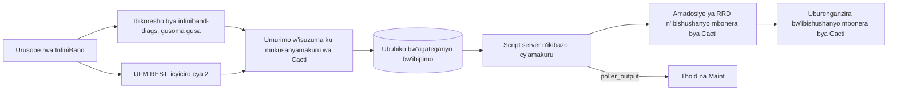

<!-- Source: README.md; SHA256: ce5af61a1bc993ec2aae6d4f22c3885694632f2b1d5eb94e2ce88b8390e96f1e -->

<!-- translations:start -->
[English](../../../README.md) | [简体中文](../zh-CN/README.md) | [हिन्दी](../hi-IN/README.md) | [Español (España)](../es-ES/README.md) | [Español (Latinoamérica)](../es-419/README.md) | [العربية (السعودية)](../ar-SA/README.md) | [Afrikaans](../af-ZA/README.md) | [አማርኛ](../am-ET/README.md) | [العربية (مصر)](../ar-EG/README.md) | [العربية (المغرب)](../ar-MA/README.md) | [বাংলা](../bn-BD/README.md) | [Bosanski](../bs-BA/README.md) | [Deutsch](../de-DE/README.md) | [فارسی](../fa-IR/README.md) | [Filipino](../fil-PH/README.md) | [Français](../fr-FR/README.md) | [Français (Maroc)](../fr-MA/README.md) | [Français (Sénégal)](../fr-SN/README.md) | [Hausa](../ha-NG/README.md) | [עברית](../he-IL/README.md) | [Hrvatski](../hr-HR/README.md) | [Bahasa Indonesia](../id-ID/README.md) | [Igbo](../ig-NG/README.md) | [Italiano](../it-IT/README.md) | [日本語](../ja-JP/README.md) | [한국어](../ko-KR/README.md) | [Malagasy](../mg-MG/README.md) | [मराठी](../mr-IN/README.md) | [Bahasa Melayu](../ms-MY/README.md) | [Nederlands](../nl-NL/README.md) | [Polski](../pl-PL/README.md) | [Português (Brasil)](../pt-BR/README.md) | [Русский](../ru-RU/README.md) | [Kinyarwanda](README.md) | [Soomaali](../so-SO/README.md) | [Српски](../sr-RS/README.md) | [Svenska](../sv-SE/README.md) | [Kiswahili](../sw-KE/README.md) | [தமிழ்](../ta-IN/README.md) | [తెలుగు](../te-IN/README.md) | [ไทย](../th-TH/README.md) | [Türkçe](../tr-TR/README.md) | [Українська](../uk-UA/README.md) | [اردو](../ur-PK/README.md) | [Tiếng Việt](../vi-VN/README.md) | [isiXhosa](../xh-ZA/README.md) | [Yorùbá](../yo-NG/README.md) | [繁體中文](../zh-TW/README.md) | [isiZulu](../zu-ZA/README.md)
<!-- translations:end -->

# plugin_fabric

Umugereka wa Cacti 1.2 uzana ibipimo by'ibyambu bya InfiniBand, ubugari n'umuvuduko w'ihuza, n'ibimenyetso by'ubucucike muri Cacti nk'ibikoresho bisanzwe, amasoko y'amakuru, n'ibishushanyo mbonera. Ihuza ryitoje kuri 1X aho kuba 4X rihita rigaragara nk'igishushanyo mbonera n'integuza ya Thold iruhande rwa seriveri ikoresha, munsi y'uburenganzira bwa Cacti, aho Maint ishobora kuyihagarika.

> **Imiterere: irimo gutunganywa, nta verisiyo irasohoka.** Icyiciro cya 2 (urufatiro) cyashyizwe kuri `main`, naho icyiciro cya 3 (ibintu bya Cacti n'integuza) kirimo gusuzumwa. Icyiciro cya 1 cyemeje igishushanyo hashingiwe ku nyandiko n'inkomoko y'urufatiro (PR #71); ibyavuyemo, hamwe n'inkomoko, biri muri [docs/research/](../../research). Icyiciro cya 2 cyongeramo urufatiro rw'umugereka:
>
> - gushyiramo, kuvugurura, gukuramo, n'ubwirinzi bwa PHP 8.2
> - uburenganzira bwa View, Operator na Admin, n'igenamiterere
> - inyandiko z'urusobe
> - umupaka w'amabwiriza yo gusoma gusa ya `perfquery`, `ibnetdiscover`, na `iblinkinfo`
> - ibarura hashingiwe kuri GUID, hamwe n'amakimbirane y'umwirondoro n'ibitekerezo byo kongera guhuza
> - imiterere y'ihuza n'ububiko bw'agateganyo bw'ikusanya ry'ibipimo
> - impapuro z'ibarura, iz'ubuyobozi, n'iz'ubuzima
>
> Icyiciro cya 3 cyongeramo ibintu bya Cacti:
>
> - inyandikorugero z'ibikoresho, iz'amakuru, n'iz'ibishushanyo mbonera bitangwa nka XML y'inyandikorugero ya Cacti, hamwe n'ikibazo cy'amakuru cya "Fabric Port"
> - guhuza pfundiko n'igikoresho cya Cacti, cyangwa guhanga gishya nyuma yo kubyemeza ([ADR 0010](../../decisions/0010-one-device-per-node.md))
> - amasoko y'amakuru y'ibipimo ku bishushanyo mbonera, hamwe n'amasoko y'amakuru ya GAUGE y'imiterere y'ihuza n'igipimo ku bwa Thold ([ADR 0011](../../decisions/0011-derive-counters-and-gauge-alert-values.md))
> - gukemura ihagarara ry'ibipimo n'ibipimo fatizo byuzuye bisomwa nk'ibitazwi ([ADR 0012](../../decisions/0012-saturated-basic-counters-read-as-unknown.md)), ukuri kw'ibipimo n'imiyoboro y'ibishushanyo mbonera ku rupapuro rw'icyambu, n'urutonde rw'ubucucike
> - isuzuma ryuzuye hamwe na Thold v1.8.2 na Maint v1.3 bidahinduwe, n'umurimo wa CI ukoresha ibikoresho nyabyo by'isuzuma ku rusobe rwiganywe
>
> Urusobe rushobora gusuzumwa gusa biturutse ku mukusanyamakuru mukuru kugeza igihe abakusanyamakuru bo ku ruhande bazashyigikirwa mu cyiciro cya 3. Rwageragejwe ku bikoresho by'imikino no kuri simulateri y'urusobe ya ibsim, ntabwo rwigeze rugeragezwa ku rusobe nyarwo rwa InfiniBand. Isuzuma rikenera urusobe rikomeza gufungurwa mu mbonerahamwe y'isuzuma rya live kuri buri rupapuro rw'ubushakashatsi. Uyu mushinga ntabwo ufite aho uhuriye n'umushinga wa Cacti.

## Inshingano z'uburenganzira

| Urwego | Uburenganzira |
| --- | --- |
| Fabric View | Impapuro zo gukurikirana zisanzwe. |
| Fabric Operator | Gukurikirana hiyongereyeho urupapuro rwa Operations n'ibyemezo byihariye byo kugenzura ibibazo. |
| Fabric Admin | Uburenganzira bwa Operator hiyongereyeho ibikorwa bisanzwe by'igenamiterere n'ubuyobozi. |

Nyuma yo gukoporora amadosiye avuguruye, fungura urupapuro rwa Plugins nk'umuyobozi kugira ngo wandikishe urwego rushya. Tanga uburenganzira bwa Operator mu buryo bweruye munsi ya **Configuration > Users** cyangwa mu matsinda y'abakoresha.
Ivugurura rigumana indangamuntu n'uburenganzira bisanzwe bya View na Admin. Uburenganzira bwa Admin buragwa ubwa Operator, naho ubwa Operator bukaragwa ubwa View kuri buri busabe; ibi ntibyongera uburenganzira bubitswe ku bakoresha cyangwa amatsinda. Igenamiterere ry'umugereka na ryo risaba uburenganzira bwa Fabric Admin hiyongereyeho uruhushya rwa Settings rwa Cacti.

Uburenganzira bw'ibikoresho bya Cacti bukomeza kugabanya imirongo n'ibikorwa buri mukoresha yemerewe; ibintu bitarahuza bisaba umuyobozi.
Ibimenyetso byo kwinjira, igenamiterere, guhuza, gusiba n'izindi mpinduka z'ubuyobozi biguma ku mpapuro z'ubuyobozi. Ibyemezo byo kwemera ibibazo bimara gusa igihe cy'isomo ry'umukoresha uriho, mu gihe kitarenze isaha imwe kandi gusa mu gihe cya gipimo kimwe kikiri gishya. Ibipimo bishya cyangwa byahindutse birabitesha agaciro. Ntibishobora na rimwe kwerekana igipimo cyapfuye nk'ikizima cyangwa ngo bihagarike integuza.

## Impamvu

Ihuza rya InfiniBand ryangiritse rikomeza kunyuzamo amakuru. Ihuza rya 4X ryongeye kwitoza kuri 1X risiga icyambu kiri "active", kandi ibishushanyo mbonera by'imiyoboro ya SNMP bya seriveri bigaragara nk'ibisanzwe, ariko imirimo ikorana bya hafi igenda buhoro. Ikimenyetso kiba mu rusobe: buri cyambu gitanga ubugari n'umuvuduko bikora, ibyemerewe, n'ibishoboka, hiyongereyeho ibipimo by'amakosa n'ubucucike. Kubisoma bisaba ibikoresho byo gusuzuma bya InfiniBand cyangwa API y'umuyobozi w'urusobe. Iyo bikoreshejwe n'intoki, bisiga ibyuho bitatu:

- **Nta mateka.** `perfquery` na `iblinkinfo` byerekana ibiriho ubu, bityo ihuza ryangiritse mu cyumweru gishize ntirigaragara.
- **Nta mimerere y'igikoresho.** Ibyambu by'urusobe si ibintu bya Cacti, bityo icyambu ntigishobora gushushanywa iruhande rwa seriveri kigaburira.
- **Nta nzira igana ku nteguza za Cacti.** Thold na Maint bikorera ku masoko y'amakuru n'ibikoresho bya Cacti.

Umugereka ufunga ibi byuho usoma urusobe ukoresheje ibikoresho byawo byo gusuzuma (nyuma ukazakoresha UFM), ukamenya pfundiko n'ibyambu ukoresheje GUID, kandi ugatangaza ibipimo n'imiterere y'ihuza nk'amasoko y'amakuru ya Cacti. Urasoma gusa: ntiwigera usubiza ibipimo ku busa cyangwa ngo uhindure imiterere y'icyambu.

## Itahura rya mbere

Urusobe rushya nta pfundiko rugira, kandi isuzuma ritangira riturutse kuri script server gusa ku pfundiko rwahujwe n'igikoresho cya Cacti. Itahura rya mbere rero ni intambwe ikorwa n'intoki. Nyuma yo kubika urusobe rufunguye, koresha iri bwiriza rimwe ku mukusanyamakuru urusobe rwoherejweho, ukoresheje konti y'umukusanyamakuru, usimbuze `/path/to/cacti` ububiko bwawe bwa Cacti (inzira zuzuye na zo zikora ziturutse muri cron):

```
php /path/to/cacti/plugins/fabric/fabric_sweep.php --fabric=ID --force
```

Ibarura rihita ryuzura. Huza pfundiko n'ibikoresho bya Cacti ku rupapuro rwa Fabric Admin; isuzuma rikurikiraho ritangirira mu kibazo cy'amakuru. Igihe nta pfundiko ry'urusobe rirahuza, nta kintu kivugurura ibarura ryarwo, bityo ongera ukoreshe iri bwiriza rimwe, uturutse muri cron niba ubishaka, kugira ngo wandike pfundiko nshya cyangwa izabuze. Urupapuro rw'ubuzima rwerekana iri bwiriza ku rusobe rufunguye rutaratahura cyangwa rutagira pfundiko rwahujwe.

## Ibikorwa biteganyijwe

| Icyiciro | Ibikubiyemo | Intambwe |
|---|---|---|
| 0, ubushakashatsi | Imbonerahamwe ya verisiyo, kwemeza imikorere y'urufatiro, imyitwarire y'ibipimo ku byuma, icyitegererezo cy'uburenganzira, ingengo ya MAD, API ya UFM | [M1](https://github.com/somethingwithproof/plugin_fabric/milestone/1) |
| 1, kugenzura | Ibarura kuri GUID, ibikoresho bya Cacti, ikibazo cy'amakuru cy'icyambu, amasoko y'amakuru y'ibipimo n'imiterere y'ihuza, integuza za Thold, ihagarikwa rya Maint, urupapuro rw'ubuzima | [M2](https://github.com/somethingwithproof/plugin_fabric/milestone/2), [M3](https://github.com/somethingwithproof/plugin_fabric/milestone/3), [M4](https://github.com/somethingwithproof/plugin_fabric/milestone/4) |
| 2, UFM | Uburyo bwa UFM REST bwo gusoma gusa, imicungire y'ibimenyetso byo kwinjira, gukomeza umwirondoro hagati y'uburyo | [M5](https://github.com/somethingwithproof/plugin_fabric/milestone/5) |
| 3, kure | Abakusanyamakuru bo ku ruhande, kwigana amakuru, ibikorwa bya `remote_agent`, isuzuma rigabanyijwemo ibice ku masobe manini | [M6](https://github.com/somethingwithproof/plugin_fabric/milestone/6) |

Ibitari mu nshingano: guhindura imiterere y'urusobe, gusimbura umuyobozi w'urusobe cyangwa umuyobozi wa subnet, moteri y'integuza yihariye y'umugereka, serivisi yihariye cyangwa porotokole y'urusobe, n'amasobe ya Ethernet cyangwa RoCE (ubushakashatsi).

## Intego z'ubuhuzabikorwa

| Igice | Intego |
|---|---|
| Cacti | 1.2.31 cyangwa hejuru yayo, nta mpinduka z'umuzi |
| PHP | 8.2 cyangwa hejuru yayo; `setup.php` ikomeza gusomeka kuri 8.0 kugira ngo sisitemu idashyigikiwe ihakanirwe aho gutera ikibazo imigaragarire ya Cacti |
| Ibikoresho bya InfiniBand | infiniband-diags ituruka kuri rdma-core; imiterere y'ibisohoka yagenzuwe ku nkomoko ya v66.0 |
| UFM | UFM Enterprise REST API, icyiciro cya 2; imbonerahamwe ya verisiyo ni ikigomba gutangwa mu ntambwe ya 1 |
| Thold, Maint | Nta mpinduka zikenewe |

Gumisha igihe ntarengwa cya script ya Cacti ku gihe gisanzwe cy'amasegonda 25 cyangwa hejuru yacyo. Isuzuma ritangijwe no gusoma ikibazo cy'amakuru rigabanya ikoreshwa ry'igikoresho kugeza kuri icyo gihe ntarengwa hakuwemo amasegonda atanu, hagateganywa umwanya wo gusoma ububiko bw'agateganyo no gusubiza. Iyo igihe gishize, ikibazo gitanga icyitegererezo cyanyuma kiriho cyangwa ikitazwi; icyiciro gikurikiraho kigera kugerageza isuzuma. Iki gihe ntarengwa kinareba umukusanyamakuru wa PHP. Igihe ntarengwa cy'amasegonda atanu cyangwa munsi yayo ntikigira umwanya wo gutangiza igikoresho.

## Igishushanyo

- [docs/PLAN.md](../../PLAN.md) ni igenamigambi ryuzuye: imyubakire, ukuri kw'urufatiro igenderaho (hamwe n'inkomoko) n'ibitekerezo bigomba kwemezwa, icyitegererezo cy'umwirondoro, amategeko y'ibipimo n'imiterere y'ihuza, imipaka y'umutekano, imibare y'imikorere, isuzuma, n'ibyago.
- [docs/decisions/](../../decisions) habikwa inyandiko z'ibyemezo by'imyubakire ku mahitamo yamaze gukorwa.
- [docs/REQUIREMENTS.md](../../REQUIREMENTS.md) ihuza buri ndangamuntu y'icyifuzo n'ikibazo cyayo.



## Uko akazi gakurikiranwa

- **Intambwe** zikurikiza intambwe z'igenamigambi. Buri yose ifite ikibazo gikuru kigaragaza ibibazo biyigize n'ibimenyetso byo gusohoka.
- **Ibibazo** bitondekanywa hakurikijwe ikirango: `type: requirement`, `type: research`, `type: decision`, `type: epic`. Ibibazo by'ibisabwa bigaragaza ibisabwa bifite inomero kandi bishobora kugeragezwa (`REQ-AREA-NNN`) n'ibipimo byo kwemerwa.
- **Ibirango** na byo bigira `area:`, `phase:`, `priority:`, na `status:`. Reba [CONTRIBUTING.md](../../../CONTRIBUTING.md#labels).
- [Ikibaho cy'umushinga](https://github.com/users/somethingwithproof/projects/8) cyerekana ibibazo byose mu ntambwe zose.

## Gutanga umusanzu

Soma [CONTRIBUTING.md](../../../CONTRIBUTING.md). Ibikorwa byo kubika bisaba umukono wa DCO. Ibiganiro ku gishushanyo bibera ku bibazo; ibyemezo bitarafatwa bigira ikirango cya `type: decision`.

## Umutekano

Menyesha intege nke mu ibanga; reba [SECURITY.md](../../../SECURITY.md).

## Uruhushya

GNU General Public License v2.0, uruhushya rumwe n'urwa Cacti n'imigereka yayo. Reba [LICENSE](../../../LICENSE).
