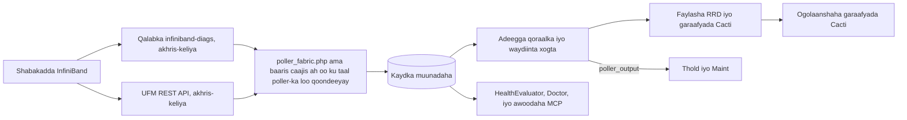

<!-- Source: README.md; SHA256: 79a16fb906f96ee79de2c719f18c38836f555440a7571a4a5ba38c64bb5b099f -->

<!-- translations:start -->
[English](../../../README.md) | [简体中文](../zh-CN/README.md) | [हिन्दी](../hi-IN/README.md) | [Español (España)](../es-ES/README.md) | [Español (Latinoamérica)](../es-419/README.md) | [العربية (السعودية)](../ar-SA/README.md) | [Afrikaans](../af-ZA/README.md) | [አማርኛ](../am-ET/README.md) | [العربية (مصر)](../ar-EG/README.md) | [العربية (المغرب)](../ar-MA/README.md) | [বাংলা](../bn-BD/README.md) | [Bosanski](../bs-BA/README.md) | [Deutsch](../de-DE/README.md) | [فارسی](../fa-IR/README.md) | [Filipino](../fil-PH/README.md) | [Français](../fr-FR/README.md) | [Français (Maroc)](../fr-MA/README.md) | [Français (Sénégal)](../fr-SN/README.md) | [Hausa](../ha-NG/README.md) | [עברית](../he-IL/README.md) | [Hrvatski](../hr-HR/README.md) | [Bahasa Indonesia](../id-ID/README.md) | [Igbo](../ig-NG/README.md) | [Italiano](../it-IT/README.md) | [日本語](../ja-JP/README.md) | [한국어](../ko-KR/README.md) | [Malagasy](../mg-MG/README.md) | [मराठी](../mr-IN/README.md) | [Bahasa Melayu](../ms-MY/README.md) | [Nederlands](../nl-NL/README.md) | [Polski](../pl-PL/README.md) | [Português (Brasil)](../pt-BR/README.md) | [Русский](../ru-RU/README.md) | [Kinyarwanda](../rw-RW/README.md) | [Soomaali](README.md) | [Српски](../sr-RS/README.md) | [Svenska](../sv-SE/README.md) | [Kiswahili](../sw-KE/README.md) | [தமிழ்](../ta-IN/README.md) | [తెలుగు](../te-IN/README.md) | [ไทย](../th-TH/README.md) | [Türkçe](../tr-TR/README.md) | [Українська](../uk-UA/README.md) | [اردو](../ur-PK/README.md) | [Tiếng Việt](../vi-VN/README.md) | [isiXhosa](../xh-ZA/README.md) | [Yorùbá](../yo-NG/README.md) | [繁體中文](../zh-TW/README.md) | [isiZulu](../zu-ZA/README.md)
<!-- translations:end -->

# plugin_fabric

Waa plugin loogu talagalay Cacti 1.2 (`fabric`, nooca `0.1.0-dev`) kaas oo tiriyeyaasha dekedaha InfiniBand, ballaca iyo xawaaraha isku-xirka, iyo tilmaamayaasha ciriiriga u soo gudbiya Cacti iyagoo ah aalado caadi ah, ilo xogeed, iyo garaafyo. Isku-xir ku tababartay 1X halkii uu ka ahaan lahaa 4X wuxuu markaas u soo baxaa sidii garaaf iyo digniin Thold ah oo ku xigta martigeliyaha uu u adeego, iyadoo hoos timaadda ogolaanshaha Cacti, iyadoo leh ogaansho iyo joojin Maint.

> **Xaaladda: waa la horumarinayaa, weli lama soo saarin.** Laantani waxay hirgelisaa aasaaska plugin-ka, walxaha iyo digniinaha Cacti, baarisyada poller ee qorshaysan ee gadaal ka shaqeeya, koobiyaynta xog-ururiyeyaasha fog, nidaamka dambe ee NVIDIA UFM REST ee akhriska-keliya leh kayd aqoonsi sir ah oo qarsoodi ah (encrypted credential vault), maamulka CLI ee Configuration-as-Code (CasC), iyo qabsatooyinka deegaanka Cacti (CasC, Doctor, iyo MCP / Abilities API v2). Waxaa lagu tijaabiyay qalab been-abuur ah, gaadiid UFM oo la sameeyay, iyo jilaaha shabakadda ee `ibsim` (rdma-core 50.0), weligoodna laguma tijaabin shabakad InfiniBand ah oo jirta ama server UFM oo toos ah. Hubinnada u baahan qalab dhab ah waxay weli u furan yihiin [docs/research/](../../research/). Mashruucani xiriir la ma leh mashruuca Cacti.

## Waxa la hirgeliyay

- **Wareegga nolosha iyo qaab-dhismeedka xogta (v3)**: rakibidda, cusboonaysiinta isku-mid-ahaanta (idempotent), ka-saaridda (iyadoo miisaska plugin-ka lagu hayo si caadi ah), iyo ilaalinta shuruudda PHP 8.2 iyadoo meelaha laga soo galo lagu hayo kuwo lagu akhrin karo PHP 8.0.
- **Doorarka ogolaanshaha iyo boggaga**: qaybaha ogolaanshaha ee `Fabric View` (`fabric.php`), `Fabric Operator` (`fabric_operator.php`), iyo `Fabric Admin` (`fabric_admin.php`, `fabric_health.php`), oo lagu daray tabka Settings ee hoos timaadda **Configuration > Settings > Fabrics**.
- **Nidaamka dambe ee ogaanshaha akhriska-keliya (`diags`)**: fulinta adag ee liiska dooda (argument-vector) ee `perfquery`, `ibnetdiscover`, iyo `iblinkinfo`, diiwaanka alaabta ee ku salaysan GUID oo wata ogaanshaha khilaafaadka aqoonsiga iyo soo-jeedinta dib-u-xiridda, qiimaynta xaaladda isku-xirka, iyo baarista tiriyeyaasha noodh kasta.
- **Nidaamka dambe ee NVIDIA UFM REST ee akhriska-keliya (`ufm`) iyo kaydka sirta ah**: macmiilka REST ee GET-keliya oo leh liiska la oggol yahay (`/ufmRest/resources/ports`, `/ufmRest/resources/systems`, `/ufmRest/monitoring/session/0/data`, iyo dhiggooda `/ufmRestV3/...` ee xaqiijinta token) kaas oo quudiya isla miisaska diiwaanka, xaaladda isku-xirka, muunadaha, iyo caafimaadka sida `diags`. Aqoonsiyada sirta ah (`token` ama `basic`) waxaa lagu kaydiyaa iyagoo ku qarsoodi ah AES-256-GCM gudaha `plugin_fabric_secret` iyadoo la adeegsanayo fayl furaha dibadda ah oo 256-bit ah oo lagu habeeyay `fabric_vault_key_file`. Shabakadaha UFM waxaa lagu qeexi karaa iyadoo loo marayo CasC (`cli/fabric.php`) ama kaydadka; foomka maamulka webka hadda wuxuu muujiyaa meelaha `diags`.
- **Walxaha Cacti, Thold, iyo Maint**: qaababka aaladda, xogta, iyo garaafka Cacti (`templates/fabric-templates.xml`), waydiinta xogta adeegga qoraalka ee "Fabric Port" (`scripts/ss_fabric_ports.php`, `resource/script_server/fabric_ports.xml`), ilaha xogta tiriyaha `DERIVE` iyo ilaha xogta xaaladda isku-xirka/heerka `GAUGE` ee Thold, dabagalka kala-go'a, iyo tiriyeyaasha aasaasiga ah ee buuxsamay oo loo soo sheego sidii `U`. Isku-xirka Maint (`MaintMaintenance`) wuxuu waydiiyaa `plugin_maint_check_cacti_host()` (isagoo u laabanaya qabsatada `is_device_in_maintenance` haddii loo baahdo) si noodhadhka ku jira dayactirka firfircoon si gaar ah loo tiriyo loogana saaro digniinaha caafimaadka ee baarista fashilantay iyo dekedda hoos u dhacday.
- **Baarisyada qorshaysan, qaybinta (sharding), iyo xog-ururiyeyaasha fog**: `poller_bottom` wuxuu gadaal ka bilaabaa `poller_fabric.php` shabakadaha waqtigoodu dhacay ee loo qoondeeyay poller-ka hadda jira, iyadoo ay weheliyaan baarisyada caajiska ah (lazy sweeps) ee uu kiciyo adeegga qoraalku. `INFO` waxay ku dhawaaqdaa `remote_collect:1, remote_poller:1`, `poller_fabric.php` waxay taageertaa qaybinta GUID ee go'an (`--shard=K/N`), `replicate_out`-na waxay koobiyaysaa safafka aan sirta ahayn ee `plugin_fabric_fabric` kuna koobiyaysaa xog-ururiyeyaasha fog (`poller_id >= 2`). Gelitaannada kaydka sirta ah (`plugin_fabric_secret`) iyo faylasha furaha dibadda weligood lama koobiyeeyo.
- **CasC CLI iyo qabsatooyinka deegaanka**: `cli/fabric.php` oo loogu talagalay dhoofinta YAML/XML, xaqiijinta, qorshaynta kala duwanaanshaha tijaabada ah (dry-run diff), ku-dhaqanka ku xiran xaqiijinta, iyo ka-warbixinta caafimaadka, oo lagu daray qabsatooyinka `casc_register_providers`, `doctor_register_checks`, iyo `abilities_register`.

## Doorarka ogolaanshaha

| Qaybta Ogolaanshaha | Ogolaanshaha |
| --- | --- |
| Fabric View | Kormeeridda diiwaanka alaabta iyo muuqaallada dekedaha (`fabric.php`). |
| Fabric Operator | Ogolaanshaha View oo lagu daray bogga Operations (`fabric_operator.php`) iyo xaqiijinta kala-saarista shakhsi ahaaneed. |
| Fabric Admin | Ogolaanshaha Operator oo lagu daray dejinta, tallaabooyinka maamulka (`fabric_admin.php`), iyo bogga caafimaadka (`fabric_health.php`). |

Ka dib markaad koobiyayso faylasha cusboonaysiinta, fur bogga Plugins adigoo ah maamule si aad u diiwaangeliso qaybaha ogolaanshaha iyo qabsatooyinka cusub. Si cad ugu qoondee qaybta Operator hoos timaadda **Configuration > Users** ama kooxaha isticmaaleyaasha. Cusboonaysiintu waxay haynayaan aqoonsiyada iyo ogolaanshaha jira ee qaybaha View iyo Admin. Ogolaanshaha Admin wuxuu dhaxlaa ogolaanshaha Operator, ogolaanshaha Operator-na wuxuu dhaxlaa ogolaanshaha View codsi kasta; tani kuma darayso ogolaansho kaydsan isticmaaleyaasha ama kooxaha. Dejinta plugin-ku waxay sidoo kale u baahan tahay ogolaanshaha Fabric Admin marka lagu daro ogolaanshaha Settings ee Cacti.

Ogolaanshaha aaladaha Cacti waxay xaddidaan safafka iyo tallaabooyinka u bannaan isticmaale kasta; walxaha aan la xirin waxay u baahan yihiin maamule. Aqoonsiyada sirta ah, dejinta, isku-xiridda, tirtiridda iyo isbeddellada kale ee maamulka waxay ku sii jiraan boggaga maamulka ama CLI. Xaqiijinta (acknowledgments) waxay jirtaa oo keliya fadhiga hadda jira ee isticmaalaha, ugu badnaan hal saac iyo oo keliya inta isla kormeerkaas uu cusub yahay. Kormeerro cusub ama isbeddelay ayaa buriya. Waligood cabbir fashilmay kuma calaamadiyaan mid caafimaad qaba mana joojiyaan digniinaha.

## Sababta

Isku-xirka InfiniBand ee tayadiisu hoos u dhacday weli wuu gudbiyaa xogta. Isku-xir 4X ah oo dib ugu tababarta 1X wuxuu dekedda uga tagaa mid "active", garaafyada SNMP interface ee martigeliyahana waxay u muuqdaan kuwo caadi ah, laakiin hawlaha isku xiran ee culus way gaabiyaan. Caddayntu waxay ku jirtaa shabakadda: deked kasta waxay soo sheegtaa ballaceeda iyo xawaaraheeda firfircoon, kuwa la hawlgeliyay, iyo kuwa la taageero, oo lagu daray tiriyeyaasha khaladaadka iyo ciriiriga. Akhrintoodu waxay u baahan tahay qalabka ogaanshaha InfiniBand ama API-ga maamulaha shabakadda. Marka gacanta lagu socodsiiyo, waxay ka tagaan saddex goldaloolo:

- **Taariikh ma jirto.** `perfquery` iyo `iblinkinfo` waxay muujiyaan waqtiga hadda jira, markaa isku-xir hoos u dhacay toddobaadkii hore lama arki karo.
- **Xiriir aaladeed ma jiro.** Dekedaha shabakadda ma aha walxo Cacti ah, markaa dekedda laguma sawiri karo garaaf ahaan iyadoo ku xigta martigeliyaha ay quudiso.
- **Waddo loogu galo digniinaha Cacti ma jirto.** Thold iyo Maint waxay ku shaqeeyaan ilaha xogta iyo aaladaha Cacti.

Plugin-ku wuxuu xiraa goldaloolooyinkan isagoo shabakadda ku akhrinaya `infiniband-diags` ama NVIDIA UFM REST API, aqoonsanaya noodhadhka iyo dekedaha iyadoo la adeegsanayo GUID, isla markaana daabacaya tiriyeyaasha iyo xaaladda isku-xirka iyagoo ah ilo xogeed oo Cacti ah. Wuxuu sameeyaa akhris keliya: waligiis dib uma dejiyo tiriyeyaasha mana beddelo xaaladda dekedda.

## Hawlgallada iyo CLI

### Poller-ka gadaasha iyo baarisyada gacanta

`fabric_poller_bottom()` waxay `poller_fabric.php` gadaal ka bilowdaa poller kasta iyadoo u samaynaysa shabakadaha shaqaynaya ee loo qoondeeyay `poller_id`-gaas kuwaas oo baaristoodu waqtigeedu dhacay. Waxaad sidoo kale si toos ah ugu socodsiin kartaa socodsiiyaha poller-ka ama baaris gacanta ah poller-ka loo qoondeeyay adigoo ah isticmaalaha poller-ka (ku beddel `/path/to/cacti` galka Cacti-gaaga):

```sh
php /path/to/cacti/plugins/fabric/poller_fabric.php [--fabric=ID] [--shard=K/N] [--force] [--debug]
php /path/to/cacti/plugins/fabric/fabric_sweep.php --fabric=ID [--node=GUID] [--force]
```

- `poller_fabric.php` waxay socodsiisaa dhammaan shabakadaha waqtigoodu dhacay ee poller-ka maxalliga ah (ama hal shabakad oo leh `--fabric=ID`), waxay dhaqan gelisaa qufulka diiwaanka habka Cacti iyo kirada `ClaimRepository` iyadoo leh miisaaniyad waqti oo ah `max(30, intdiv(sweep_interval, 2))` ilbiriqsi, waxayna taageertaa `--shard=K/N` (`0 <= K < N`) si baarisyada tiriyeyaasha noodhka `diags` si go'an loogu qaybiyo GUID-ga noodhka.
- `fabric_sweep.php` waxay socodsiisaa baaris dalab-ku-xiran oo hal shabakad oo shaqaynaysa (ama hal noodh oo leh `--node=GUID`) oo loo qoondeeyay poller-ka maxalliga ah. `--force` waxay iska indha-tirtaa haddii shabakadda waqtigeedu dhacay iyadoo weli ixtiraamaysa sheegashooyinka (claims).

Ka dib marka baarista koowaad ay buuxiso diiwaanka alaabta, ku xir noodhadhka aaladaha Cacti bogga Fabric Admin. Ku hay waqtiga dhammaadka qoraalka ee Cacti 25 ilbiriqsi ama ka badan: baaris caajis ah oo ay bilowday akhrinta waydiinta xogtu waxay xaddiddaa fulinta qalabka ilaa `script_timeout - 5` ilbiriqsi si adeegga qoraalku ugu soo laabto waqtigiisa isagoo wata muunaddii ugu dambaysay ee la kaydiyay ama `U`.

### Nidaamka dambe ee NVIDIA UFM REST iyo kaydka aqoonsiyada sirta ah

Shabakadda `ufm` waxay u baahan tahay URL `https://` ah oo aan lahayn aqoonsiyo sir ah oo ku dhex jira, xarfaha waydiinta (query strings), ama qaybo (fragments). `UfmSocketTransport` waxay dhaqan gelisaa xaqiijinta TLS peer iyo magaca martigeliyaha, waxay diiddaa dib-u-jiheynta (redirects), waxayna taageertaa xirmo CA oo ikhtiyaari ah (`ufm_ca_file`) iyo biin SHA-256 SPKI (`ufm_spki_pin`).

Si aad ugu kaydiso aqoonsiyada sirta ah ee UFM gudaha `plugin_fabric_secret`, ku habeey `fabric_vault_key_file` hoos timaadda **Configuration > Settings > Fabrics** adigoo gelinaya waddo buuxda oo tagaysa fayl caadi ah oo uu leeyahay isticmaalaha poller-ka (aan lahayn wax symlinks ah galka waalidka midna, qaabka `0600`, oo haya 64 xaraf oo hex ah sida `openssl rand -hex 32` ama 32 bayt oo aan la daabici karin oo aan kala sooc lahayn). Plugin-ku weligiis ma abuuro mana qoro faylka furaha, `replicate_out`-na weligeed ma koobiyayso `plugin_fabric_secret` ama faylasha furaha iyadoo u diraysa pollers fog.

### Configuration-as-Code iyo CLI caafimaadka

`cli/fabric.php` waxay si qeexan ugu maamushaa dejinta plugin-ka iyo qeexitaannada shabakadda qaabka YAML ama XML, waxayna soo sheegtaa caafimaadka og dayactirka iyadoo aan la socodsiin baarisyo toos ah:

```sh
php /path/to/cacti/plugins/fabric/cli/fabric.php export [--format=yaml|xml] [--file=PATH]
php /path/to/cacti/plugins/fabric/cli/fabric.php validate --file=PATH [--format=yaml|xml]
php /path/to/cacti/plugins/fabric/cli/fabric.php plan --file=PATH [--format=yaml|xml]
php /path/to/cacti/plugins/fabric/cli/fabric.php apply --file=PATH --confirm=PLAN_HASH [--format=yaml|xml]
php /path/to/cacti/plugins/fabric/cli/fabric.php health [--format=text|json]
```

`export` waxay abuurtaa faylal cusub oo leh qaabka `0600`, waxay u qarisa `fabric_vault_key_file` sidii `[REDACTED]`, waxayna soo saartaa tixraacyo magac leh oo `ufm_credential_ref` ah halkii ay ka soo saari lahayd siro. `plan` iyo `apply` waxay diidaan qiimayaasha tooska ah ee `ufm_token`, `ufm_password`, `secret`, iyo `fabric_vault_key_file`. `apply` waxay u baahan tahay `--confirm=PLAN_HASH` oo sax ah oo ay soo saartay `plan`.

### Qabsatooyinka deegaanka

Marka ay jiraan plugins-ka Cacti ee u dhigma ama isku-xirka martigeliyaha, `setup.php` waxay diiwaangelisaa:

- `casc_register_providers`: waxay dhoofisaa, xaqiijisaa, qorshaysaa, oo xaqiijin ka dib ku dhaqangalisaa habaynta `fabric` (`yaml` iyo `xml`, schema v1) iyadoo sirta la qarinayo.
- `doctor_register_checks`: waxay bixisaa afar hubin oo ogaansho ah oo akhris-keliya (`fabric.schema`, `fabric.poller_freshness`, `fabric.identity_conflicts`, `fabric.ufm_vault`).
- `abilities_register`: waxay diiwaangelisaa saddex awoodood oo akhris-keliya, aan waxba burburin, isla markaana idempotent ah oo hoos yimaadda qaybta `fabric`, iyagoo lagu xaddido qaybta ogolaanshaha Fabric View (iyo ogolaanshaha aaladaha Cacti ee khaladaadka dekedaha): `fabric-list-fabrics`, `fabric-get-health`, iyo `fabric-list-port-errors`.

## Baaxadda iyo xuduudaha

Waxyaabaha ka baxsan baaxadda: beddelidda xaaladda shabakadda, dib-u-dejinta tiriyeyaasha, beddelidda maamulaha shabakadda ama maamulaha subnet-ka, matoor digniin oo uu leeyahay plugin-ku, daemon gaar ah ama hab-maamuus shabakadeed, iyo shabakadaha Ethernet ama RoCE.

## Shuruudaha iyo ku-habboonaanta

| Qaybta | Bartilmaameedka |
|---|---|
| Cacti | 1.2.31 ama ka dambeeya (`compat = 1.2.31`), iyada oo aan wax isbeddel ah lagu samayn xudunta |
| PHP | 8.2 ama ka dambeeya; meelaha laga soo galo waxay sii ahaadaan kuwo lagu akhrin karo 8.0 waxayna diidaan hawlgelinta 8.1 si deegaan aan la taageerin uu u helo diidmo halkii uu ka heli lahaa Cacti UI jaban |
| Qalabka InfiniBand | `infiniband-diags` oo ka socda `rdma-core` (waxaa lagu tijaabiyay CI iyadoo la adeegsanayo rdma-core 50.0 hoos timaadda `ibsim`; qaababka wax-soo-saarka waxaa lagu hubiyay isha v66.0) |
| UFM | NVIDIA UFM Enterprise REST API (meelaha dhammaadka akhriska-keliya ee `ufmRest` iyo `ufmRestV3`; waxaa lagu tijaabiyay gaadiid la sameeyay tijaabooyinka unugga) |
| Thold, Maint | Looma baahna wax isbeddel ah; CI waxay socodsiisaa tijaabo dhammaad-ka-dhammaad ah oo lala samaynayo Thold v1.8.2 iyo Maint v1.3 oo aan waxba laga beddelin |

## Horumarinta iyo tijaabinta

Socodka shaqada CI (`.github/workflows/plugin-ci-workflow.yml`) wuxuu tijaabiyaa PHP 8.2 ilaa 8.5 isagoo barbar dhigaya Cacti `release/1.2.31` iyo `1.2.x`, hubinta naxwaha meelaha laga soo galo ee PHP 8.0, diidmada PHP 8.1, PHPStan, xaqiijinta gettext/turjumaadaha, shatiga REUSE, hubinta socodka shaqada, ku-celinta dhammaad-ka-dhammaad ee Thold/Maint, iyo jilidda shabakadda `ibsim`.

Iyadoo la adeegsanayo qalabka tijaabada plugin-ka Pest ee la wadaago ee Cacti ee xiran (`CACTI_PEST_BIN`) iyo kayd xogeed Cacti ah oo la tuuri karo (disposable):

```sh
# Unit tests
"$CACTI_PEST_BIN" --configuration=phpunit.xml

# Lifecycle integration tests (disposable database only)
CACTI_PATH=/path/to/cacti FABRIC_TEST_DATABASE=disposable "$CACTI_PEST_BIN" --configuration=phpunit-integration.xml

# Static analysis (against Cacti 1.2.31)
CACTI_PATH=/path/to/cacti phpstan analyse -c phpstan.neon --no-progress

# Translation template, catalogs, and localized README checks
sh locales/build_gettext.sh --check

# Simulated ibsim fixture parser check
php tests/bin/check-ibsim-fixtures.php tests/fixtures/ibsim
```

## Naqshadda

- [docs/PLAN.md](../../PLAN.md) waa qorshaha qaab-dhismeedka iyo naqshadda: xaqiiqooyinka isha rasmiga ah oo wata ilo, hubinnada qalabka ee furan, qaabka aqoonsiga, xeerarka tiriyaha iyo xaaladda isku-xirka, xuduudaha amniga, xisaabinta waxqabadka, tijaabinta, iyo khataraha.
- [docs/decisions/](../../decisions/) wuxuu hayaa diiwaannada go'aannada qaab-dhismeedka.
- [docs/REQUIREMENTS.md](../../REQUIREMENTS.md) wuxuu ku xiraa aqoonsi kasta oo shuruud ah mawduuciisa (issue).



## Sida shaqada loola socdo

- **Marxaladaha** waxay raacaan marxaladaha qorshaha. Mid kasta wuxuu leeyahay mawduuc weyn (epic issue) oo taxaya mawduucyadiisa hoose iyo caddaynta dhammaystirka.
- **Mawduucyada (Issues)** waxaa loo kala saarayaa calaamado: `type: requirement`, `type: research`, `type: decision`, `type: epic`. Mawduucyada shuruuduhu waxay qeexayaan shuruudo tiro leh oo la tijaabin karo (`REQ-AREA-NNN`) iyo shuruudaha oggolaanshaha.
- **Calaamaduhu** waxay sidoo kale xambaarsan yihiin `area:`, `phase:`, `priority:`, iyo `status:`. Eeg [CONTRIBUTING.md](../../../CONTRIBUTING.md#labels).
- [Guddiga mashruuca](https://github.com/users/somethingwithproof/projects/8) wuxuu muujiyaa dhammaan mawduucyada marxaladaha oo dhan.

## Ka-qaybgalka

Akhri [CONTRIBUTING.md](../../../CONTRIBUTING.md). Soo-gudbinta (commits) waxay u baahan yihiin saxiixa DCO (`git commit -s`). Doodda naqshadda waxay ka dhacdaa mawduucyada (issues); go'aannada furan waxay wataan calaamadda `type: decision`.

## Amniga

U soo sheeg dayacannada si qarsoodi ah; eeg [SECURITY.md](../../../SECURITY.md).

## Shatiga

GNU General Public License v2.0, isla shatiga ay leeyihiin Cacti iyo plugins-kiisa. Eeg [LICENSE](../../../LICENSE).
