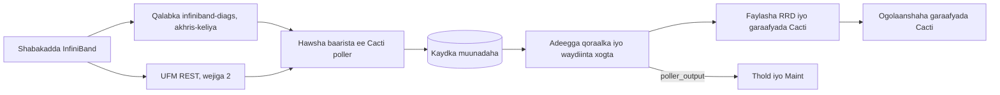

<!-- Source: README.md; SHA256: ce5af61a1bc993ec2aae6d4f22c3885694632f2b1d5eb94e2ce88b8390e96f1e -->

<!-- translations:start -->
[English](../../../README.md) | [简体中文](../zh-CN/README.md) | [हिन्दी](../hi-IN/README.md) | [Español (España)](../es-ES/README.md) | [Español (Latinoamérica)](../es-419/README.md) | [العربية (السعودية)](../ar-SA/README.md) | [Afrikaans](../af-ZA/README.md) | [አማርኛ](../am-ET/README.md) | [العربية (مصر)](../ar-EG/README.md) | [العربية (المغرب)](../ar-MA/README.md) | [বাংলা](../bn-BD/README.md) | [Deutsch](../de-DE/README.md) | [فارسی](../fa-IR/README.md) | [Filipino](../fil-PH/README.md) | [Français](../fr-FR/README.md) | [Français (Maroc)](../fr-MA/README.md) | [Français (Sénégal)](../fr-SN/README.md) | [Hausa](../ha-NG/README.md) | [עברית](../he-IL/README.md) | [Bahasa Indonesia](../id-ID/README.md) | [Igbo](../ig-NG/README.md) | [Italiano](../it-IT/README.md) | [日本語](../ja-JP/README.md) | [한국어](../ko-KR/README.md) | [Malagasy](../mg-MG/README.md) | [मराठी](../mr-IN/README.md) | [Bahasa Melayu](../ms-MY/README.md) | [Nederlands](../nl-NL/README.md) | [Polski](../pl-PL/README.md) | [Português (Brasil)](../pt-BR/README.md) | [Русский](../ru-RU/README.md) | [Kinyarwanda](../rw-RW/README.md) | [Soomaali](README.md) | [Svenska](../sv-SE/README.md) | [Kiswahili](../sw-KE/README.md) | [தமிழ்](../ta-IN/README.md) | [తెలుగు](../te-IN/README.md) | [ไทย](../th-TH/README.md) | [Türkçe](../tr-TR/README.md) | [Українська](../uk-UA/README.md) | [اردو](../ur-PK/README.md) | [Tiếng Việt](../vi-VN/README.md) | [isiXhosa](../xh-ZA/README.md) | [Yorùbá](../yo-NG/README.md) | [繁體中文](../zh-TW/README.md) | [isiZulu](../zu-ZA/README.md)
<!-- translations:end -->

# plugin_fabric

Waa plugin loogu talagalay Cacti 1.2 kaas oo tiriyeyaasha dekedaha InfiniBand, ballaca iyo xawaaraha isku-xirka, iyo tilmaamayaasha ciriiriga u soo gudbiya Cacti iyagoo ah aalado caadi ah, ilo xogeed, iyo garaafyo. Isku-xir ku tababartay 1X halkii uu ka ahaan lahaa 4X wuxuu markaas u soo baxaa sidii garaaf iyo digniin Thold ah oo ku xigta martigeliyaha uu u adeego, iyadoo hoos timaadda ogolaanshaha Cacti, iyadoo Maint ay awood u leedahay inay joojiso digniintaas.

> **Xaaladda: waa la horumarinayaa, weli lama soo saarin.** Marxaladda 2 (aasaaska) waxaa lagu biiriyay `main`, marxaladda 3 (walxaha Cacti iyo digniinaha) na waxay ku jirtaa dib-u-eegis. Marxaladda 1 waxay xaqiijisay naqshadda iyadoo la barbar dhigayo dukumeentiyada iyo isha rasmiga ah ee mashruuca (PR #71); natiijooyinka, oo ay la socdaan ilaha, waxay ku jiraan [docs/research/](../../research). Marxaladda 2 waxay ku daraysaa aasaaska plugin-ka:
>
> - rakibidda, cusboonaysiinta, ka-saaridda, iyo ilaalinta PHP 8.2
> - qaybaha ogolaanshaha (realms) ee View, Operator iyo Admin, iyo dejinta
> - diiwaannada shabakadda (fabric records)
> - xadka amarrada akhriska-keliya ee `perfquery`, `ibnetdiscover`, iyo `iblinkinfo`
> - diiwaanka alaabta (inventory) ee ku salaysan GUID, oo wata khilaafaadka aqoonsiga iyo soo-jeedinta dib-u-xiridda
> - xaaladda isku-xirka iyo kaydka baarista tiriyeyaasha
> - boggaga diiwaanka, maamulka, iyo caafimaadka
>
> Marxaladda 3 waxay ku daraysaa walxaha Cacti:
>
> - qaababka aaladda, xogta, iyo garaafka ee la keeno iyagoo ah Cacti template XML, iyo waydiinta xogta "Fabric Port"
> - ku-xiridda noodh (node) aalad Cacti ah, ama abuurista mid marka la xaqiijiyo ([ADR 0010](../../decisions/0010-one-device-per-node.md))
> - ilaha xogta tiriyeyaasha ee garaafyada, iyo ilaha xogta GAUGE ee xaaladda isku-xirka iyo heerka loogu talagalay Thold ([ADR 0011](../../decisions/0011-derive-counters-and-gauge-alert-values.md))
> - maaraynta kala-go'a (discontinuity) iyo tiriyeyaasha aasaasiga ah ee buuxsamay oo loo akhriyo sidii wax aan la aqoon ([ADR 0012](../../decisions/0012-saturated-basic-counters-read-as-unknown.md)), saxnaanta tiriyaha iyo isku-xirka garaafyada ee bogga dekedda, iyo kala-soocidda ciriiriga
> - tijaabo dhammaad-ka-dhammaad ah oo lala samaynayo Thold v1.8.2 iyo Maint v1.3 oo aan waxba laga beddelin, iyo hawl CI ah oo ku socodsiisa qalabka ogaanshaha dhabta ah shabakad la jilay (simulated fabric)
>
> Shabakadda waxaa laga baari karaa oo keliya poller-ka weyn ilaa xog-ururiyeyaasha fog laga taageero wejiga 3. Waxaa lagu tijaabiyay qalab been-abuur ah iyo jilaaha shabakadda ee ibsim, weligoodna laguma tijaabin shabakad InfiniBand ah oo dhab ah. Hubinnada u baahan shabakad dhab ah waxay weli u furan yihiin shaxda hubinnada tooska ah ee bog kasta oo cilmi-baaris ah. Mashruucani xiriir la ma leh mashruuca Cacti.

## Doorka ogolaanshaha

| Qaybta Ogolaanshaha | Ogolaanshaha |
| --- | --- |
| Fabric View | Boggaga kormeerka ee jira. |
| Fabric Operator | Kormeerka oo lagu daray bogga Hawlgallada iyo xaqiijinta kala-saarista shakhsi ahaaneed. |
| Fabric Admin | Ogolaanshaha Operator oo lagu daray dejinta jirta iyo tallaabooyinka maamulka. |

Ka dib markaad koobiyayso faylasha cusboonaysiinta, fur bogga Plugins adigoo ah maamule si aad u diiwaangeliso qaybta ogolaanshaha cusub. Si cad ugu qoondee qaybta Operator hoos timaadda **Configuration > Users** ama kooxaha isticmaaleyaasha.
Cusboonaysiintu waxay haynayaan aqoonsiyada iyo ogolaanshaha jira ee qaybaha View iyo Admin. Ogolaanshaha Admin wuxuu dhaxlaa ogolaanshaha Operator, ogolaanshaha Operator-na wuxuu dhaxlaa ogolaanshaha View codsi kasta; tani kuma darayso ogolaansho kaydsan isticmaaleyaasha ama kooxaha. Dejinta plugin-ku waxay sidoo kale u baahan tahay ogolaanshaha Fabric Admin marka lagu daro ogolaanshaha Settings ee Cacti.

Ogolaanshaha aaladaha Cacti waxay weli xaddidaan safafka iyo tallaabooyinka u bannaan isticmaale kasta; walxaha aan la xirin waxay u baahan yihiin maamule.
Aqoonsiyada sirta ah (credentials), dejinta, isku-xiridda, tirtiridda iyo isbeddellada kale ee maamulka waxay ku sii jiraan boggaga maamulka. Xaqiijinta (acknowledgments) waxay jirtaa oo keliya fadhiga (session) hadda jira ee isticmaalaha, ugu badnaan hal saac iyo oo keliya inta isla kormeerkaas uu cusub yahay. Kormeerro cusub ama isbeddelay ayaa buriya. Waligood cabbir fashilmay kuma calaamadiyaan mid caafimaad qaba mana joojiyaan digniinaha.

## Sababta

Isku-xirka InfiniBand ee tayadiisu hoos u dhacday weli wuu gudbiyaa xogta. Isku-xir 4X ah oo dib ugu tababarta 1X wuxuu dekedda uga tagaa mid "firfircoon" (active), garaafyada SNMP interface ee martigeliyahana waxay u muuqdaan kuwo caadi ah, laakiin hawlaha isku xiran ee culus way gaabiyaan. Caddayntu waxay ku jirtaa shabakadda: deked kasta waxay soo sheegtaa ballaceeda iyo xawaaraheeda firfircoon, kuwa la hawlgeliyay, iyo kuwa la taageero, oo lagu daray tiriyeyaasha khaladaadka iyo ciriiriga. Akhrintoodu waxay u baahan tahay qalabka ogaanshaha InfiniBand ama API-ga maamulaha shabakadda. Marka gacanta lagu socodsiiyo, waxay ka tagaan saddex goldaloolo:

- **Taariikh ma jirto.** `perfquery` iyo `iblinkinfo` waxay muujiyaan waqtiga hadda jira, markaa isku-xir hoos u dhacay toddobaadkii hore lama arki karo.
- **Xiriir aaladeed ma jiro.** Dekedaha shabakadda ma aha walxo Cacti ah, markaa dekedda laguma sawiri karo garaaf ahaan iyadoo ku xigta martigeliyaha ay quudiso.
- **Waddo loogu galo digniinaha Cacti ma jirto.** Thold iyo Maint waxay ku shaqeeyaan ilaha xogta iyo aaladaha Cacti.

Plugin-ku wuxuu xiraa goldaloolooyinkan isagoo shabakadda ku akhrinaya qalabkiisa ogaanshaha (iyo markii dambe isagoo adeegsanaya UFM), aqoonsanaya noodhadhka iyo dekedaha iyadoo la adeegsanayo GUID, isla markaana daabacaya tiriyeyaasha iyo xaaladda isku-xirka iyagoo ah ilo xogeed oo Cacti ah. Wuxuu sameeyaa akhris keliya: waligiis dib uma dejiyo tiriyeyaasha mana beddelo xaaladda dekedda.

## Baarista koowaad

Shabakad cusub ma laha wax noodhadh ah, baaristuna waxay ka bilaabataa adeegga qoraalka (script server) oo keliya marka noodh lagu xiro aalad Cacti ah. Baarista koowaad sidaas darteed waa tallaabo gacanta laga qabto. Ka dib markaad kaydiso shabakad shaqaynaysa (enabled), tan hal mar ku socodsii poller-ka shabakadda loo qoondeeyay, adigoo adeegsanaya koontada poller-ka, oo ku beddelaya `/path/to/cacti` galka Cacti-gaaga (waddada buuxda sidoo kale waxay ka shaqaysaa cron):

```
php /path/to/cacti/plugins/fabric/fabric_sweep.php --fabric=ID --force
```

Diiwaanka alaabtu markaas wuu buuxsamayaa. Ku xir noodhadhka aaladaha Cacti bogga Fabric Admin; baaritaannada dambe waxay ka bilaaban doonaan waydiinta xogta. Inta aan wax noodh ah oo shabakadda ka tirsan lagu xirin, waxba ma cusboonaysiiyaan diiwaankeeda, markaa isla amarkaas mar kale socodsii, adigoo ka socodsiin kara cron haddii aad rabto, si aad u diiwaangeliso noodhadhka cusub ama kuwa maqan. Bogga caafimaadku wuxuu muujiyaa amarkan marka ay jirto shabakad shaqaynaysa oo aan weli la baarin ama aan lahayn noodh la xiray.

## Baaxadda qorshaysan

| Wejiga | Baaxadda | Marxaladaha |
|---|---|---|
| 0, cilmi-baaris | Shaxda noocyada, xaqiijinta hab-dhaqanka isha rasmiga ah, hab-dhaqanka tiriyaha ee qalabka dhabta ah, qaabka mudnaanta, miisaaniyadda MAD, UFM API | [M1](https://github.com/somethingwithproof/plugin_fabric/milestone/1) |
| 1, kormeerid | Diiwaanka ku salaysan GUID, aaladaha Cacti, waydiinta xogta dekedda, ilaha xogta tiriyaha iyo xaaladda isku-xirka, digniinaha Thold, joojinta Maint, bogga caafimaadka | [M2](https://github.com/somethingwithproof/plugin_fabric/milestone/2), [M3](https://github.com/somethingwithproof/plugin_fabric/milestone/3), [M4](https://github.com/somethingwithproof/plugin_fabric/milestone/4) |
| 2, UFM | Nidaamka dambe ee UFM REST ee akhriska-keliya, maaraynta aqoonsiyada sirta ah, sii-wadidda aqoonsiga ee u dhaxaysa nidaamyada dambe | [M5](https://github.com/somethingwithproof/plugin_fabric/milestone/5) |
| 3, meel fog | Xog-ururiyeyaasha fog, koobiyaynta xogta, tallaabooyinka `remote_agent`, baaris loo qaybiyay shabakadaha waaweyn | [M6](https://github.com/somethingwithproof/plugin_fabric/milestone/6) |

Waxyaabaha ka baxsan baaxadda: beddelidda xaaladda shabakadda, beddelidda maamulaha shabakadda ama maamulaha subnet-ka, matoor digniin oo uu leeyahay plugin-ku, adeeg dambe oo gaar ah (custom daemon) ama hab-maamuus shabakadeed, iyo shabakadaha Ethernet ama RoCE (cilmi-baaris).

## Bartilmaameedyada ku-habboonaanta

| Qaybta | Bartilmaameedka |
|---|---|
| Cacti | 1.2.31 ama ka dambeeya, iyada oo aan wax isbeddel ah lagu samayn xudunta |
| PHP | 8.2 ama ka dambeeya; `setup.php` wuxuu sii ahaadaa mid la akhrin karo (parseable) ee 8.0 si deegaan aan la taageerin uu u helo diidmo halkii uu ka heli lahaa Cacti UI jaban |
| Qalabka InfiniBand | infiniband-diags oo ka socda rdma-core; qaababka wax-soo-saarka waxaa lagu hubiyay isha v66.0 |
| UFM | UFM Enterprise REST API, wejiga 2; shaxda sii-daynta waa wax-soo-saarka marxaladda 1 |
| Thold, Maint | Looma baahna wax isbeddel ah |

Ku hay waqtiga dhammaadka qoraalka (script timeout) ee Cacti qiimihiisa caadiga ah ee 25 ilbiriqsi ama ka badan. Baaris ay bilowday akhrinta waydiinta xogtu waxay xaddiddaa fulinta qalabka ilaa waqtigaas oo laga jaray shan ilbiriqsi, iyadoo loo kaydinayo waqti lagu akhriyo kaydka laguna jawaabo. Marka waqtiga loo qoondeeyay dhammaado, waydiintu waxay soo celisaa muunaddii ugu dambaysay ee hadda jirta ama wax aan la aqoon; wareegga xiga wuxuu isku dayaa baarista mar kale. Xaddidaaddan waxay sidoo kale khusaysaa PHP poller-ka. Waqti dhammaad oo shan ilbiriqsi ah ama ka yar ma reebo wax waqti ah oo qalab lagu bilaabo.

## Naqshadda

- [docs/PLAN.md](../../PLAN.md) waa qorshaha buuxa: qaab-dhismeedka, xaqiiqooyinka isha rasmiga ah ee uu ku tiirsan yahay (oo wata ilo) iyo malo-awaallada weli la xaqiijinayo, qaabka aqoonsiga, xeerarka tiriyaha iyo xaaladda isku-xirka, xuduudaha amniga, xisaabinta waxqabadka, tijaabinta, iyo khataraha.
- [docs/decisions/](../../decisions) wuxuu hayaa diiwaannada go'aannada qaab-dhismeedka ee doorashooyinka hore loo sameeyay.
- [docs/REQUIREMENTS.md](../../REQUIREMENTS.md) wuxuu ku xiraa aqoonsi kasta oo shuruud ah mawduuciisa (issue).



## Sida shaqada loola socdo

- **Marxaladaha** waxay raacaan marxaladaha qorshaha. Mid kasta wuxuu leeyahay mawduuc weyn (epic issue) oo taxaya mawduucyadiisa hoose iyo caddaynta dhammaystirka.
- **Mawduucyada (Issues)** waxaa loo kala saarayaa calaamado: `type: requirement`, `type: research`, `type: decision`, `type: epic`. Mawduucyada shuruuduhu waxay qeexayaan shuruudo tiro leh oo la tijaabin karo (`REQ-AREA-NNN`) iyo shuruudaha oggolaanshaha.
- **Calaamaduhu** waxay sidoo kale xambaarsan yihiin `area:`, `phase:`, `priority:`, iyo `status:`. Eeg [CONTRIBUTING.md](../../../CONTRIBUTING.md#labels).
- [Guddiga mashruuca](https://github.com/users/somethingwithproof/projects/8) wuxuu muujiyaa dhammaan mawduucyada marxaladaha oo dhan.

## Ka-qaybgalka

Akhri [CONTRIBUTING.md](../../../CONTRIBUTING.md). Soo-gudbinta (commits) waxay u baahan yihiin saxiixa DCO (DCO sign-off). Doodda naqshadda waxay ka dhacdaa mawduucyada (issues); go'aannada furan waxay wataan calaamadda `type: decision`.

## Amniga

U soo sheeg dayacannada si qarsoodi ah; eeg [SECURITY.md](../../../SECURITY.md).

## Shatiga

GNU General Public License v2.0, isla shatiga ay leeyihiin Cacti iyo plugins-kiisa. Eeg [LICENSE](../../../LICENSE).
