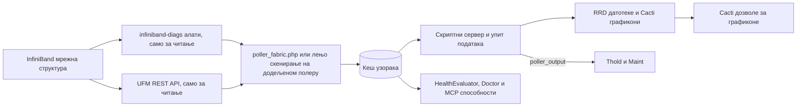

<!-- Source: README.md; SHA256: 79a16fb906f96ee79de2c719f18c38836f555440a7571a4a5ba38c64bb5b099f -->

<!-- translations:start -->
[English](../../../README.md) | [简体中文](../zh-CN/README.md) | [हिन्दी](../hi-IN/README.md) | [Español (España)](../es-ES/README.md) | [Español (Latinoamérica)](../es-419/README.md) | [العربية (السعودية)](../ar-SA/README.md) | [Afrikaans](../af-ZA/README.md) | [አማርኛ](../am-ET/README.md) | [العربية (مصر)](../ar-EG/README.md) | [العربية (المغرب)](../ar-MA/README.md) | [বাংলা](../bn-BD/README.md) | [Bosanski](../bs-BA/README.md) | [Deutsch](../de-DE/README.md) | [فارسی](../fa-IR/README.md) | [Filipino](../fil-PH/README.md) | [Français](../fr-FR/README.md) | [Français (Maroc)](../fr-MA/README.md) | [Français (Sénégal)](../fr-SN/README.md) | [Hausa](../ha-NG/README.md) | [עברית](../he-IL/README.md) | [Hrvatski](../hr-HR/README.md) | [Bahasa Indonesia](../id-ID/README.md) | [Igbo](../ig-NG/README.md) | [Italiano](../it-IT/README.md) | [日本語](../ja-JP/README.md) | [한국어](../ko-KR/README.md) | [Malagasy](../mg-MG/README.md) | [मराठी](../mr-IN/README.md) | [Bahasa Melayu](../ms-MY/README.md) | [Nederlands](../nl-NL/README.md) | [Polski](../pl-PL/README.md) | [Português (Brasil)](../pt-BR/README.md) | [Русский](../ru-RU/README.md) | [Kinyarwanda](../rw-RW/README.md) | [Soomaali](../so-SO/README.md) | [Српски](README.md) | [Svenska](../sv-SE/README.md) | [Kiswahili](../sw-KE/README.md) | [தமிழ்](../ta-IN/README.md) | [తెలుగు](../te-IN/README.md) | [ไทย](../th-TH/README.md) | [Türkçe](../tr-TR/README.md) | [Українська](../uk-UA/README.md) | [اردو](../ur-PK/README.md) | [Tiếng Việt](../vi-VN/README.md) | [isiXhosa](../xh-ZA/README.md) | [Yorùbá](../yo-NG/README.md) | [繁體中文](../zh-TW/README.md) | [isiZulu](../zu-ZA/README.md)
<!-- translations:end -->

# plugin_fabric

Додатак за Cacti 1.2 (`fabric`, верзија `0.1.0-dev`) који у Cacti доноси бројаче InfiniBand портова, ширину и брзину везе, као и показатеље загушења као обичне уређаје, изворе података и графиконе. Веза која се уместо на 4X успоставила на 1X тада се приказује као графикон и Thold упозорење поред рачунара којем служи, у оквиру Cacti дозвола, са препознавањем и потискивањем кроз Maint.

> **Статус: у развоју, још нема издања.** Ова грана имплементира основу додатка, Cacti објекте и упозорења, заказана позадинска скенирања полера, репликацију на удаљене прикупљаче, NVIDIA UFM REST позадински систем само за читање са шифрованим трезором приступних података, управљање путем CLI-ја за Configuration-as-Code (CasC) и куке (hooks) екосистема Cacti (CasC, Doctor и MCP / Abilities API v2). Тестиран је помоћу лажних алата, синтетичких UFM транспорта и симулатора мрежне структуре `ibsim` (rdma-core 50.0), никада на физичкој InfiniBand мрежној структури нити на живом UFM серверу. Провере које захтевају хардвер остају отворене у [docs/research/](../../research/). Овај пројекат није повезан са пројектом Cacti.

## Шта је имплементирано

- **Животни циклус и шема (v3)**: инсталација, идемпотентна надоградња, деинсталација (подразумевано задржава табеле додатка) и провера захтева за PHP 8.2 док улазне тачке остају исправне за парсирање на PHP 8.0.
- **Улоге приступа и странице**: области дозвола `Fabric View` (`fabric.php`), `Fabric Operator` (`fabric_operator.php`) и `Fabric Admin` (`fabric_admin.php`, `fabric_health.php`), уз картицу Settings под **Configuration > Settings > Fabrics**.
- **Дијагностички позадински систем само за читање (`diags`)**: строго извршавање са вектором аргумената за `perfquery`, `ibnetdiscover` и `iblinkinfo`, инвентар по GUID-у са откривањем сукоба идентитета и предлозима поновног повезивања, процена стања везе и скенирање бројача по чвору.
- **NVIDIA UFM REST позадински систем само за читање (`ufm`) и шифровани трезор**: GET-само REST клијент са листом дозвољених путања (`/ufmRest/resources/ports`, `/ufmRest/resources/systems`, `/ufmRest/monitoring/session/0/data` и `/ufmRestV3/...` еквиваленти за аутентификацију токеном) који пуни исте табеле инвентара, стања везе, узорака и исправности као `diags`. Приступни подаци (`token` или `basic`) чувају се шифровани помоћу AES-256-GCM у табели `plugin_fabric_secret` коришћењем екстерне 256-битне датотеке кључа конфигурисане преко `fabric_vault_key_file`. UFM мрежне структуре могу се дефинисати кроз CasC (`cli/fabric.php`) или репозиторијуме; веб-образац за администрацију тренутно приказује поља за `diags`.
- **Cacti објекти, Thold и Maint**: Cacti шаблони уређаја, података и графикона (`templates/fabric-templates.xml`), упит података скриптног сервера "Fabric Port" (`scripts/ss_fabric_ports.php`, `resource/script_server/fabric_ports.xml`), `DERIVE` извори података бројача и `GAUGE` извори података стања везе и стопе за Thold, праћење прекида континуитета и засићени основни бројачи пријављени као `U`. Интеграција са Maint-ом (`MaintMaintenance`) проверава `plugin_maint_check_cacti_host()` (са преласком на куку `is_device_in_maintenance` као резерву) тако да се чворови у активном одржавању броје одвојено и изузимају из упозорења о исправности за неуспела скенирања и деградиране портове.
- **Заказана скенирања, дељење (sharding) и удаљени прикупљачи**: `poller_bottom` покреће `poller_fabric.php` у позадини за доспеле мрежне структуре додељене тренутном полеру, уз лења скенирања која покреће скриптни сервер. `INFO` декларише `remote_collect:1, remote_poller:1`, `poller_fabric.php` подржава детерминистичко дељење по GUID-у (`--shard=K/N`), а `replicate_out` реплицира нетајне редове табеле `plugin_fabric_fabric` на удаљене прикупљаче (`poller_id >= 2`). Ставке трезора (`plugin_fabric_secret`) и екстерне датотеке кључева никада се не реплицирају.
- **CasC CLI и куке екосистема**: `cli/fabric.php` за YAML/XML извоз, валидацију, планирање разлика у пробном режиму (dry-run diff), примену уз потврду и извештавање о исправности, плус куке `casc_register_providers`, `doctor_register_checks` и `abilities_register`.

## Улоге приступа

| Област | Приступ |
| --- | --- |
| Fabric View | Праћење инвентара и приказа портова (`fabric.php`). |
| Fabric Operator | View приступ плус страница Operations (`fabric_operator.php`) и личне потврде увида за тријажу. |
| Fabric Admin | Operator приступ плус конфигурација, административне радње (`fabric_admin.php`) и страница исправности (`fabric_health.php`). |

Након копирања датотека за надоградњу, отворите страницу Plugins као администратор да региструјете нове области и куке. Доделите област Operator изричито под **Configuration > Users** или у корисничким групама. Надоградње задржавају постојеће ID-ове и доделе области View и Admin. Приступ Admin наслеђује приступ Operator, а приступ Operator наслеђује приступ View при сваком захтеву; тиме се корисницима ни групама не додају сачуване доделе. Подешавања додатка такође захтевају приступ Fabric Admin поред Cacti дозволе Settings.

Cacti дозволе за уређаје ограничавају редове и радње доступне сваком кориснику; немапирани објекти захтевају администратора. Приступни подаци, конфигурација, мапирање, брисање и друге административне измене остају на административним страницама или у CLI-ју. Потврде увида трају само у тренутној сесији корисника, највише један сат и само док исто запажање остане свеже. Нова или промењена запажања их поништавају. Оне никада не означавају неуспело мерење као исправно нити потискују упозорења.

## Зашто

Деградирана InfiniBand веза и даље преноси саобраћај. Веза ширине 4X која се поново успостави на 1X оставља порт у стању "active", па SNMP графикони мрежних интерфејса на рачунару изгледају нормално, али чврсто спрегнути послови успоравају. Доказ се налази у самој мрежној структури: сваки порт пријављује своју активну, омогућену и подржану ширину и брзину, уз бројаче грешака и загушења. За њихово читање потребни су InfiniBand дијагностички алати или API управљача мрежне структуре. Када се покрећу ручно, остављају три празнине:

- **Нема историје.** `perfquery` и `iblinkinfo` приказују само тренутно стање, па веза која је била деградирана прошле недеље остаје невидљива.
- **Нема контекста уређаја.** Портови мрежне структуре нису Cacti објекти, па порт не може да се прикаже на графикону поред рачунара који опслужује.
- **Нема пута до Cacti упозорења.** Thold и Maint раде над Cacti изворима података и уређајима.

Додатак попуњава ове празнине читајући мрежну структуру преко `infiniband-diags` или NVIDIA UFM REST API-ја, идентификујући чворове и портове по GUID-у и објављујући бројаче и стање везе као Cacti изворе података. Ради искључиво у режиму читања: никада не ресетује бројаче нити мења стање порта.

## Операције и CLI

### Позадински полер и ручна скенирања

`fabric_poller_bottom()` покреће `poller_fabric.php` у позадини на сваком полеру за омогућене мрежне структуре додељене том `poller_id`-у чије је скенирање доспело. Такође можете покренути извршиоца полера или ручно скенирање директно на додељеном полеру под налогом корисника полера (замењујући `/path/to/cacti` вашим Cacti директоријумом):

```sh
php /path/to/cacti/plugins/fabric/poller_fabric.php [--fabric=ID] [--shard=K/N] [--force] [--debug]
php /path/to/cacti/plugins/fabric/fabric_sweep.php --fabric=ID [--node=GUID] [--force]
```

- `poller_fabric.php` покреће све доспеле мрежне структуре за локални полер (или једну мрежну структуру са `--fabric=ID`), примењује закључавање регистра процеса у Cacti-ју и закупе `ClaimRepository` са временским буџетом од `max(30, intdiv(sweep_interval, 2))` секунди и подржава `--shard=K/N` (`0 <= K < N`) за детерминистичко дељење `diags` скенирања бројача чворова по GUID-у чвора.
- `fabric_sweep.php` покреће скенирање на захтев за једну омогућену мрежну структуру (или један чвор са `--node=GUID`) додељену локалном полеру. `--force` занемарује да ли је мрежна структура доспела, док и даље поштује закупе (claims).

Након што прво откривање попуни инвентар, мапирајте чворове на Cacti уређаје на страници Fabric Admin. Задржите Cacti временско ограничење скрипте на 25 секунди или више: лењо скенирање покренуто читањем упита података ограничава извршавање алата на `script_timeout - 5` секунди тако да скриптни сервер стигне да врати последњи сачувани узорак или `U`.

### NVIDIA UFM REST позадински систем и трезор приступних података

Мрежна структура типа `ufm` захтева `https://` URL без уграђених приступних података, низова упита или фрагмената. `UfmSocketTransport` примењује TLS проверу парњака и имена домаћина, одбија преусмеравања и подржава опциони CA пакет (`ufm_ca_file`) и SHA-256 SPKI пин (`ufm_spki_pin`).

Да бисте сачували UFM приступне податке у `plugin_fabric_secret`, конфигуришите `fabric_vault_key_file` под **Configuration > Settings > Fabrics** са апсолутном путањом до обичне датотеке у власништву корисника полера (без симболичких веза у било ком надређеном директоријуму, режим `0600`, која садржи 64 хексадецимална знака као што је `openssl rand -hex 32` или 32 насумична нештампљива бајта). Додатак никада не креира нити пише датотеку кључа, а `replicate_out` никада не реплицира `plugin_fabric_secret` нити датотеке кључева на удаљене полере.

### Configuration-as-Code и CLI за исправност

`cli/fabric.php` декларативно управља подешавањима додатка и дефиницијама мрежних структура у YAML или XML формату, и извештава о исправности свесној одржавања без покретања скенирања уживо:

```sh
php /path/to/cacti/plugins/fabric/cli/fabric.php export [--format=yaml|xml] [--file=PATH]
php /path/to/cacti/plugins/fabric/cli/fabric.php validate --file=PATH [--format=yaml|xml]
php /path/to/cacti/plugins/fabric/cli/fabric.php plan --file=PATH [--format=yaml|xml]
php /path/to/cacti/plugins/fabric/cli/fabric.php apply --file=PATH --confirm=PLAN_HASH [--format=yaml|xml]
php /path/to/cacti/plugins/fabric/cli/fabric.php health [--format=text|json]
```

`export` креира нове датотеке са режимом `0600`, скрива `fabric_vault_key_file` као `[REDACTED]` и емитује именоване референце `ufm_credential_ref` уместо тајни. `plan` и `apply` одбијају уметнуте вредности `ufm_token`, `ufm_password`, `secret` и уметнуту вредност `fabric_vault_key_file`. `apply` захтева тачан `--confirm=PLAN_HASH` који је произвео `plan`.

### Куке екосистема

Када су присутни одговарајући Cacti додаци или интеграције домаћина, `setup.php` региструје:

- `casc_register_providers`: извози, валидира, планира и примењује уз потврду конфигурацију `fabric` (`yaml` и `xml`, шема v1) са сакривањем тајни.
- `doctor_register_checks`: пружа четири дијагностичке провере само за читање (`fabric.schema`, `fabric.poller_freshness`, `fabric.identity_conflicts`, `fabric.ufm_vault`).
- `abilities_register`: региструје три идемпотентне, недеструктивне способности само за читање у категорији `fabric`, ограничене облашћу приступа Fabric View (и Cacti дозволама за уређаје за грешке портова): `fabric-list-fabrics`, `fabric-get-health` и `fabric-list-port-errors`.

## Опсег и границе

Изван опсега: измена стања мрежне структуре, ресетовање бројача, замена управљача мрежне структуре или подмреже, сопствени систем за упозорења унутар додатка, посебан демон или мрежни протокол, као и Ethernet или RoCE мрежне структуре.

## Захтеви и компатибилност

| Компонента | Циљ |
|---|---|
| Cacti | 1.2.31 или новији (`compat = 1.2.31`), без измена језгра |
| PHP | 8.2 или новији; улазне тачке остају исправне за парсирање на 8.0 и одбијају активацију на 8.1 како би неподржано окружење добило одбијање уместо неисправног Cacti интерфејса |
| InfiniBand алати | `infiniband-diags` из `rdma-core` (тестирано у CI са rdma-core 50.0 под `ibsim`; формати излаза проверени према изворном коду v66.0) |
| UFM | NVIDIA UFM Enterprise REST API (крајње тачке само за читање `ufmRest` и `ufmRestV3`; тестирано према синтетичким транспортима у јединичним тестовима) |
| Thold, Maint | Нису потребне измене; CI покреће тест од почетка до краја са неизмењеним Thold v1.8.2 и Maint v1.3 |

## Развој и тестирање

CI ток рада (`.github/workflows/plugin-ci-workflow.yml`) тестира PHP од 8.2 до 8.5 на Cacti `release/1.2.31` и `1.2.x`, проверу синтаксе улазних тачака за PHP 8.0, одбијање за PHP 8.1, PHPStan, проверу gettext/превода, REUSE лиценцирање, проверу тока рада, Thold/Maint репродукцију од почетка до краја и `ibsim` симулацију мрежне структуре.

Са закључаним дељеним Pest окружењем за тестирање Cacti додатака (`CACTI_PEST_BIN`) и привременом Cacti базом података:

```sh
# Unit tests
"$CACTI_PEST_BIN" --configuration=phpunit.xml

# Lifecycle integration tests (disposable database only)
CACTI_PATH=/path/to/cacti FABRIC_TEST_DATABASE=disposable "$CACTI_PEST_BIN" --configuration=phpunit-integration.xml

# Static analysis (against Cacti 1.2.31)
CACTI_PATH=/path/to/cacti phpstan analyse -c phpstan.neon --no-progress

# Translation template, catalogs, and localized README checks
sh locales/build_gettext.sh --check

# Simulated ibsim fixture parser check
php tests/bin/check-ibsim-fixtures.php tests/fixtures/ibsim
```

## Дизајн

- [docs/PLAN.md](../../PLAN.md) је план архитектуре и дизајна: чињенице о узводним системима са изворима, отворене хардверске провере, модел идентитета, правила за бројаче и стање везе, безбедносне границе, прорачуни перформанси, тестирање и ризици.
- [docs/decisions/](../../decisions/) садржи записе о архитектонским одлукама.
- [docs/REQUIREMENTS.md](../../REQUIREMENTS.md) повезује сваки ID захтева са његовим задатком.



## Како се прати рад

- **Прекретнице** прате прекретнице из плана. Свака има кровни задатак (epic) који наводи подзадатке и доказе о завршетку.
- **Задаци** су означени према типу: `type: requirement`, `type: research`, `type: decision`, `type: epic`. Задаци захтева наводе нумерисане, проверљиве захтеве (`REQ-AREA-NNN`) и критеријуме прихватања.
- **Ознаке** такође садрже `area:`, `phase:`, `priority:` и `status:`. Погледајте [CONTRIBUTING.md](../../../CONTRIBUTING.md#labels).
- [Табла пројекта](https://github.com/users/somethingwithproof/projects/8) приказује све задатке кроз све прекретнице.

## Допринос

Прочитајте [CONTRIBUTING.md](../../../CONTRIBUTING.md). Commit-ови захтевају DCO потпис (`git commit -s`). Расправе о дизајну воде се у задацима; отворене одлуке носе ознаку `type: decision`.

## Безбедност

Рањивости пријављујте приватно; погледајте [SECURITY.md](../../../SECURITY.md).

## Лиценца

GNU General Public License v2.0, иста лиценца као Cacti и његови додаци. Погледајте [LICENSE](../../../LICENSE).
