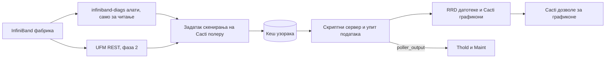

<!-- Source: README.md; SHA256: ce5af61a1bc993ec2aae6d4f22c3885694632f2b1d5eb94e2ce88b8390e96f1e -->

<!-- translations:start -->
[English](../../../README.md) | [简体中文](../zh-CN/README.md) | [हिन्दी](../hi-IN/README.md) | [Español (España)](../es-ES/README.md) | [Español (Latinoamérica)](../es-419/README.md) | [العربية (السعودية)](../ar-SA/README.md) | [Afrikaans](../af-ZA/README.md) | [አማርኛ](../am-ET/README.md) | [العربية (مصر)](../ar-EG/README.md) | [العربية (المغرب)](../ar-MA/README.md) | [বাংলা](../bn-BD/README.md) | [Bosanski](../bs-BA/README.md) | [Deutsch](../de-DE/README.md) | [فارسی](../fa-IR/README.md) | [Filipino](../fil-PH/README.md) | [Français](../fr-FR/README.md) | [Français (Maroc)](../fr-MA/README.md) | [Français (Sénégal)](../fr-SN/README.md) | [Hausa](../ha-NG/README.md) | [עברית](../he-IL/README.md) | [Hrvatski](../hr-HR/README.md) | [Bahasa Indonesia](../id-ID/README.md) | [Igbo](../ig-NG/README.md) | [Italiano](../it-IT/README.md) | [日本語](../ja-JP/README.md) | [한국어](../ko-KR/README.md) | [Malagasy](../mg-MG/README.md) | [मराठी](../mr-IN/README.md) | [Bahasa Melayu](../ms-MY/README.md) | [Nederlands](../nl-NL/README.md) | [Polski](../pl-PL/README.md) | [Português (Brasil)](../pt-BR/README.md) | [Русский](../ru-RU/README.md) | [Kinyarwanda](../rw-RW/README.md) | [Soomaali](../so-SO/README.md) | [Српски](README.md) | [Svenska](../sv-SE/README.md) | [Kiswahili](../sw-KE/README.md) | [தமிழ்](../ta-IN/README.md) | [తెలుగు](../te-IN/README.md) | [ไทย](../th-TH/README.md) | [Türkçe](../tr-TR/README.md) | [Українська](../uk-UA/README.md) | [اردو](../ur-PK/README.md) | [Tiếng Việt](../vi-VN/README.md) | [isiXhosa](../xh-ZA/README.md) | [Yorùbá](../yo-NG/README.md) | [繁體中文](../zh-TW/README.md) | [isiZulu](../zu-ZA/README.md)
<!-- translations:end -->

# plugin_fabric

Додатак за Cacti 1.2 који у Cacti доноси бројаче InfiniBand портова, ширину и брзину везе, као и показатеље загушења као обичне уређаје, изворе података и графиконе. Веза која се уместо на 4X успоставила на 1X тада се приказује као графикон и Thold упозорење поред рачунара којем служи, у оквиру Cacti дозвола, при чему Maint може да га потисне.

> **Статус: у развоју, још нема издања.** Прекретница 2 (основа) је спојена у грану `main`, а прекретница 3 (Cacti објекти и упозорења) налази се на прегледу. Прекретница 1 је потврдила дизајн на основу документације и изворног кода узводних пројеката (PR #71); резултати са изворима налазе се у [docs/research/](../../../docs/research/). Прекретница 2 додаје основу додатка:
>
> - инсталацију, надоградњу, деинсталацију и проверу верзије PHP 8.2
> - области дозвола View, Operator и Admin, као и подешавања
> - записе фабрике
> - границу команди само за читање за `perfquery`, `ibnetdiscover` и `iblinkinfo`
> - инвентар по GUID-у, са сукобима идентитета и предлозима поновног повезивања
> - стање везе и кеш скенирања бројача
> - странице инвентара, администрације и исправности
>
> Прекретница 3 додаје Cacti објекте:
>
> - шаблоне уређаја, података и графикона испоручене као Cacti XML шаблони, као и упит података "Fabric Port"
> - мапирање чвора на Cacti уређај или креирање новог након потврде ([ADR 0010](../../../docs/decisions/0010-one-device-per-node.md))
> - изворе података бројача за графиконе, као и GAUGE изворе података за стање везе и стопе за Thold ([ADR 0011](../../../docs/decisions/0011-derive-counters-and-gauge-alert-values.md))
> - обраду прекида континуитета и очитавање засићених основних бројача као непознатих ([ADR 0012](../../../docs/decisions/0012-saturated-basic-counters-read-as-unknown.md)), исправност бројача и везе графикона на страници порта, као и ранг-листу загушења
> - тестирање од почетка до краја са неизмењеним Thold v1.8.2 и Maint v1.3, као и CI задатак који покреће стварне дијагностичке алате над симулираном фабриком
>
> Фабрика може да се скенира само са главног полера док се у фази 3 не дода подршка за удаљене прикупљаче података. Додатак је тестиран са лажним алатима и симулатором фабрике ibsim, али никада на стварној InfiniBand фабрици. Провере које захтевају стварну фабрику остају отворене у табели провера уживо на свакој истраживачкој страници. Овај пројекат није повезан са пројектом Cacti.

## Улоге приступа

| Област | Приступ |
| --- | --- |
| Fabric View | Постојеће странице за надзор. |
| Fabric Operator | Надзор плус страница Операције и личне потврде увида за тријажу. |
| Fabric Admin | Приступ оператера плус постојеће радње конфигурисања и администрације. |

Након копирања датотека за надоградњу, отворите страницу Додаци као администратор да региструјете нову област. Доделите област Operator изричито под **Configuration > Users** или у корисничким групама. Надоградње задржавају постојеће ID-ове и доделе области View и Admin. Приступ Admin наслеђује приступ Operator, а приступ Operator наслеђује приступ View при сваком захтеву; тиме се корисницима ни групама не додају трајне доделе. Подешавања додатка такође захтевају приступ Fabric Admin поред Cacti дозволе за подешавања.

Cacti дозволе за уређаје и даље ограничавају редове и радње доступне сваком кориснику; немапирани објекти захтевају администратора. Приступни подаци, конфигурација, мапирање, брисање и друге административне измене остају на административним страницама. Потврде увида трају само у тренутној сесији корисника, највише један сат и само док исто запажање остане свеже. Нова или промењена запажања их поништавају. Оне никада не означавају неуспело мерење као исправно нити потискују упозорења.

## Зашто

Деградирана InfiniBand веза и даље преноси саобраћај. Веза ширине 4X која се поново успостави на 1X оставља порт у стању "active", па SNMP графикони мрежних интерфејса на рачунару изгледају нормално, али чврсто спрегнути послови успоравају. Доказ се налази у самој фабрици: сваки порт пријављује своју активну, омогућену и подржану ширину и брзину, уз бројаче грешака и загушења. За њихово читање потребни су InfiniBand дијагностички алати или API управљача фабрике. Када се покрећу ручно, остављају три празнине:

- **Нема историје.** `perfquery` и `iblinkinfo` приказују само тренутно стање, па веза која је била деградирана прошле недеље остаје невидљива.
- **Нема контекста уређаја.** Портови фабрике нису Cacti објекти, па порт не може да се прикаже на графикону поред рачунара који опслужује.
- **Нема пута до Cacti упозорења.** Thold и Maint раде над Cacti изворима података и уређајима.

Додатак попуњава ове празнине читајући фабрику преко њених дијагностичких алата (а касније и преко UFM-а), идентификујући чворове и портове по GUID-у и објављујући бројаче и стање везе као Cacti изворе података. Ради искључиво у режиму читања: никада не ресетује бројаче нити мења стање порта.

## Прво откривање

Нова фабрика нема чворова, а скенирања са скриптног сервера покрећу се само за чвор мапиран на Cacti уређај. Прво откривање је зато ручни корак. Након што сачувате омогућену фабрику, покрените ову команду једном на полеру којем је фабрика додељена, под налогом полера, при чему `/path/to/cacti` замењујете својим Cacti директоријумом (апсолутна путања ради и из cron-а):

```
php /path/to/cacti/plugins/fabric/fabric_sweep.php --fabric=ID --force
```

Инвентар се тада попуњава. Мапирајте чворове на Cacti уређаје на страници Fabric администрација; каснија скенирања покрећу се из упита података. Док ниједан чвор фабрике није мапиран, ништа не освежава њен инвентар, па по жељи поново покрените исту команду, на пример преко cron-а, да бисте забележили нове или недостајуће чворове. Страница исправности приказује ову команду за сваку омогућену фабрику која још није откривена или нема мапиран чвор.

## Планирани опсег

| Фаза | Опсег | Прекретнице |
|---|---|---|
| 0, истраживање | Матрица верзија, потврда понашања узводних пројеката, понашање бројача на хардверу, модел привилегија, MAD буџет, UFM API | [M1](https://github.com/somethingwithproof/plugin_fabric/milestone/1) |
| 1, посматрање | Инвентар по GUID-у, Cacti уређаји, упит података за портове, извори података за бројаче и стање везе, Thold упозорења, Maint потискивање, страница исправности | [M2](https://github.com/somethingwithproof/plugin_fabric/milestone/2), [M3](https://github.com/somethingwithproof/plugin_fabric/milestone/3), [M4](https://github.com/somethingwithproof/plugin_fabric/milestone/4) |
| 2, UFM | UFM REST позадински систем само за читање, управљање приступним подацима, континуитет идентитета између позадинских система | [M5](https://github.com/somethingwithproof/plugin_fabric/milestone/5) |
| 3, удаљени рад | Удаљени прикупљачи података, репликација, `remote_agent` радње, подељена скенирања за велике фабрике | [M6](https://github.com/somethingwithproof/plugin_fabric/milestone/6) |

Изван опсега: измена стања фабрике, замена управљача фабрике или подмреже, сопствени систем за упозорења унутар додатка, посебан демон или мрежни протокол, као и Ethernet или RoCE фабрике (истраживање).

## Циљеви компатибилности

| Компонента | Циљ |
|---|---|
| Cacti | 1.2.31 или новији, без измена језгра |
| PHP | 8.2 или новији; `setup.php` остаје исправан за парсирање на 8.0 како би неподржано окружење добило одбијање уместо неисправног Cacti интерфејса |
| InfiniBand алати | infiniband-diags из rdma-core; формати излаза проверени према изворном коду v66.0 |
| UFM | UFM Enterprise REST API, фаза 2; матрица издања је испорука прекретнице 1 |
| Thold, Maint | Нису потребне измене |

Задржите Cacti временско ограничење скрипте на подразумеваној вредности од 25 секунди или више. Скенирање покренуто читањем упита података ограничава извршавање алата на то временско ограничење умањено за пет секунди, чувајући време за читање кеша и одговор. Када буџет истекне, упит враћа последњи актуелни узорак или непознату вредност; следећи циклус поново покушава скенирање. Ово ограничење важи и за PHP полер. Временско ограничење од пет секунди или мање не оставља време за покретање алата.

## Дизајн

- [docs/PLAN.md](../../../docs/PLAN.md) садржи потпун план: архитектуру, чињенице о узводним системима на које се ослања (са изворима) и претпоставке које тек треба потврдити, модел идентитета, правила за бројаче и стање везе, безбедносне границе, прорачуне перформанси, тестирање и ризике.
- [docs/decisions/](../../../docs/decisions/) садржи записе о архитектонским одлукама (ADR) за већ донете изборе.
- [docs/REQUIREMENTS.md](../../../docs/REQUIREMENTS.md) повезује сваки ID захтева са његовим задатком.



## Како се прати рад

- **Прекретнице** прате прекретнице из плана. Свака има кровни задатак (epic) који наводи подзадатке и доказе о завршетку.
- **Задаци** су означени према типу: `type: requirement`, `type: research`, `type: decision`, `type: epic`. Задаци захтева наводе нумерисане, проверљиве захтеве (`REQ-AREA-NNN`) и критеријуме прихватања.
- **Ознаке** такође садрже `area:`, `phase:`, `priority:` и `status:`. Погледајте [CONTRIBUTING.md](../../../CONTRIBUTING.md#labels).
- [Табла пројекта](https://github.com/users/somethingwithproof/projects/8) приказује све задатке кроз све прекретнице.

## Допринос

Прочитајте [CONTRIBUTING.md](../../../CONTRIBUTING.md). Commit-ови захтевају DCO потпис. Расправе о дизајну воде се у задацима; отворене одлуке носе ознаку `type: decision`.

## Безбедност

Рањивости пријављујте приватно; погледајте [SECURITY.md](../../../SECURITY.md).

## Лиценца

GNU General Public License v2.0, иста лиценца као Cacti и његови додаци. Погледајте [LICENSE](../../../LICENSE).
