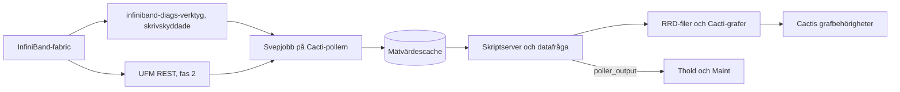

<!-- Source: README.md; SHA256: ce5af61a1bc993ec2aae6d4f22c3885694632f2b1d5eb94e2ce88b8390e96f1e -->

<!-- translations:start -->
[English](../../../README.md) | [简体中文](../zh-CN/README.md) | [हिन्दी](../hi-IN/README.md) | [Español (España)](../es-ES/README.md) | [Español (Latinoamérica)](../es-419/README.md) | [العربية (السعودية)](../ar-SA/README.md) | [Afrikaans](../af-ZA/README.md) | [አማርኛ](../am-ET/README.md) | [العربية (مصر)](../ar-EG/README.md) | [العربية (المغرب)](../ar-MA/README.md) | [বাংলা](../bn-BD/README.md) | [Bosanski](../bs-BA/README.md) | [Deutsch](../de-DE/README.md) | [فارسی](../fa-IR/README.md) | [Filipino](../fil-PH/README.md) | [Français](../fr-FR/README.md) | [Français (Maroc)](../fr-MA/README.md) | [Français (Sénégal)](../fr-SN/README.md) | [Hausa](../ha-NG/README.md) | [עברית](../he-IL/README.md) | [Hrvatski](../hr-HR/README.md) | [Bahasa Indonesia](../id-ID/README.md) | [Igbo](../ig-NG/README.md) | [Italiano](../it-IT/README.md) | [日本語](../ja-JP/README.md) | [한국어](../ko-KR/README.md) | [Malagasy](../mg-MG/README.md) | [मराठी](../mr-IN/README.md) | [Bahasa Melayu](../ms-MY/README.md) | [Nederlands](../nl-NL/README.md) | [Polski](../pl-PL/README.md) | [Português (Brasil)](../pt-BR/README.md) | [Русский](../ru-RU/README.md) | [Kinyarwanda](../rw-RW/README.md) | [Soomaali](../so-SO/README.md) | [Српски](../sr-RS/README.md) | [Svenska](README.md) | [Kiswahili](../sw-KE/README.md) | [தமிழ்](../ta-IN/README.md) | [తెలుగు](../te-IN/README.md) | [ไทย](../th-TH/README.md) | [Türkçe](../tr-TR/README.md) | [Українська](../uk-UA/README.md) | [اردو](../ur-PK/README.md) | [Tiếng Việt](../vi-VN/README.md) | [isiXhosa](../xh-ZA/README.md) | [Yorùbá](../yo-NG/README.md) | [繁體中文](../zh-TW/README.md) | [isiZulu](../zu-ZA/README.md)
<!-- translations:end -->

# plugin_fabric

Ett Cacti 1.2-insticksprogram som hämtar InfiniBand-porträknare, länkbredd och länkhastighet samt trängselindikatorer till Cacti som vanliga enheter, datakällor och grafer. En länk som har förhandlats till 1X i stället för 4X visas då som en graf och en Thold-varning intill värden den betjänar, under Cactis behörigheter, där Maint kan dämpa den.

> **Status: under utveckling, ingen utgåva ännu.** Milstolpe 2 (grunden) är sammanslagen i `main`, och milstolpe 3 (Cacti-objekt och varningar) granskas. Milstolpe 1 bekräftade designen mot dokumentation och uppströms källkod (PR #71); resultaten, med källor, finns i [docs/research/](../../research). Milstolpe 2 lägger till grunden för insticksprogrammet:
>
> - installation, uppgradering, avinstallation och PHP 8.2-spärren
> - behörighetsområdena View, Operator och Admin samt inställningar
> - fabric-poster
> - den skrivskyddade kommandogränsen för `perfquery`, `ibnetdiscover` och `iblinkinfo`
> - inventering per GUID, med identitetskonflikter och förslag på återlänkning
> - länktillstånd och cache för räknaresvep
> - sidor för inventering, administration och hälsostatus
>
> Milstolpe 3 lägger till Cacti-objekten:
>
> - enhets-, data- och grafmallar som levereras som Cacti-mall-XML samt datafrågan "Fabric Port"
> - mappning av en nod till en Cacti-enhet, eller skapande av en vid bekräftelse ([ADR 0010](../../decisions/0010-one-device-per-node.md))
> - räknares datakällor för grafer samt GAUGE-datakällor för länktillstånd och hastighet för Thold ([ADR 0011](../../decisions/0011-derive-counters-and-gauge-alert-values.md))
> - hantering av diskontinuiteter och mättade grundräknare som läses som okända ([ADR 0012](../../decisions/0012-saturated-basic-counters-read-as-unknown.md)), räknargiltighet och graflänkar på portsidan samt en trängselrankning
> - ett helhetstest med oförändrade Thold v1.8.2 och Maint v1.3 samt ett CI-jobb som kör de riktiga diagnostikverktygen mot ett simulerat fabric
>
> Ett fabric kan bara svepas från huvudpollern tills fjärrdatainsamlare stöds i fas 3. Det har testats mot simulerade verktyg och fabric-simulatorn ibsim, aldrig på ett riktigt InfiniBand-fabric. Kontroller som kräver ett fabric står kvar som öppna i respektive forskningssidas tabell för livekontroller. Detta projekt är inte knutet till Cacti-projektet.

## Åtkomstroller

| Behörighetsområde | Åtkomst |
| --- | --- |
| Fabric View | Befintliga övervakningssidor. |
| Fabric Operator | Övervakning samt sidan Operations och personliga bekräftelser för gallring. |
| Fabric Admin | Operator-åtkomst samt befintliga konfigurations- och administrationsåtgärder. |

När uppgraderingsfilerna har kopierats öppnar du sidan Plugins som administratör för att registrera det nya behörighetsområdet. Tilldela Operator-behörighetsområdet uttryckligen under **Configuration > Users** eller användargrupper. Uppgraderingar behåller befintliga View- och Admin-behörighets-ID:n och tilldelningar. Admin-åtkomst ärver Operator-åtkomst, och Operator-åtkomst ärver View-åtkomst vid varje begäran; detta lägger inte till lagrade behörigheter för användare eller grupper. Inställningar för insticksprogrammet kräver också Fabric Admin-åtkomst utöver Cactis Settings-behörighet.

Cactis enhetsbehörigheter begränsar fortfarande vilka rader och åtgärder som är tillgängliga för varje användare; omappade objekt kräver en administratör. Autentiseringsuppgifter, konfiguration, mappning, borttagning och andra administrativa ändringar finns kvar på administrationssidorna. Bekräftelser gäller bara i den aktuella användarens session, i högst en timme och endast så länge samma observation är aktuell. Nya eller ändrade observationer gör dem ogiltiga. De markerar aldrig en misslyckad mätning som felfri och dämpar inte varningar.

## Varför

En degraderad InfiniBand-länk släpper fortfarande igenom trafik. En 4X-länk som omförhandlas till 1X lämnar porten som "active", och värdens SNMP-gränssnittsgrafer ser normala ut, men tätt kopplade jobb går långsammare. Bevisen finns i fabric:et: varje port rapporterar sin aktiva, aktiverade och stödda bredd och hastighet, samt fel- och trängselräknare. För att läsa dem krävs InfiniBands diagnostikverktyg eller ett API från en fabric-hanterare. När de körs manuellt kvarstår tre luckor:

- **Ingen historik.** `perfquery` och `iblinkinfo` visar nuläget, så en länk som degraderades förra veckan syns inte.
- **Ingen enhetskontext.** Fabric-portar är inte Cacti-objekt, så en port kan inte ritas som graf bredvid den värd den matar.
- **Ingen väg in i Cactis varningssystem.** Thold och Maint arbetar mot Cactis datakällor och enheter.

Insticksprogrammet fyller dessa luckor genom att läsa av fabric:et via sina egna diagnostikverktyg (och senare via UFM), identifiera noder och portar med GUID och publicera räknare och länktillstånd som Cacti-datakällor. Det läser enbart: det återställer aldrig räknare och ändrar aldrig porttillstånd.

## Första upptäckt

Ett nytt fabric har inga noder, och svep startas från skriptservern endast för en nod som är mappad till en Cacti-enhet. Den första upptäckten är därför ett manuellt steg. När du har sparat ett aktiverat fabric kör du detta en gång på den poller som fabric:et är tilldelat till, som pollerns konto, med `/path/to/cacti` ersatt av din Cacti-katalog (den absoluta sökvägen fungerar även från cron):

```
php /path/to/cacti/plugins/fabric/fabric_sweep.php --fabric=ID --force
```

Inventeringen fylls då i. Mappa noder till Cacti-enheter på sidan Fabric Admin; senare svep startar från datafrågan. Så länge ingen nod i ett fabric är mappad uppdaterar ingenting dess inventering, så kör samma kommando igen, gärna från cron, för att registrera nya eller saknade noder. Hälsosidan visar detta kommando för ett aktiverat fabric som inte har upptäckts eller inte har någon mappad nod.

## Planerad omfattning

| Fas | Omfattning | Milstolpar |
|---|---|---|
| 0, efterforskning | Versionsmatris, bekräftelse av uppströms beteende, räknares beteende på hårdvara, behörighetsmodell, MAD-budget, UFM API | [M1](https://github.com/somethingwithproof/plugin_fabric/milestone/1) |
| 1, observera | Inventering per GUID, Cacti-enheter, portdatafråga, datakällor för räknare och länktillstånd, Thold-varningar, Maint-dämpning, hälsosida | [M2](https://github.com/somethingwithproof/plugin_fabric/milestone/2), [M3](https://github.com/somethingwithproof/plugin_fabric/milestone/3), [M4](https://github.com/somethingwithproof/plugin_fabric/milestone/4) |
| 2, UFM | Skrivskyddad UFM REST-bakände, hantering av autentiseringsuppgifter, identitetskontinuitet mellan bakändar | [M5](https://github.com/somethingwithproof/plugin_fabric/milestone/5) |
| 3, fjärrinsamling | Fjärrdatainsamlare, replikering, `remote_agent`-åtgärder, uppdelade svep för stora fabric | [M6](https://github.com/somethingwithproof/plugin_fabric/milestone/6) |

Utanför omfattningen: att ändra fabric-tillstånd, att ersätta en fabric-hanterare eller subnätshanterare, en egen varningsmotor i insticksprogrammet, en anpassad daemon eller ett nätverksprotokoll samt Ethernet- eller RoCE-fabric (efterforskning).

## Kompatibilitetsmål

| Komponent | Mål |
|---|---|
| Cacti | 1.2.31 eller senare, inga patchar i kärnan |
| PHP | 8.2 eller senare; `setup.php` förblir tolkbar på 8.0 så att en körtidsmiljö som inte stöds får ett avvisande i stället för ett trasigt Cacti-gränssnitt |
| InfiniBand-verktyg | infiniband-diags från rdma-core; utdataformat kontrollerade mot källkoden för v66.0 |
| UFM | UFM Enterprise REST API, fas 2; utgåvematrisen är en leverans i milstolpe 1 |
| Thold, Maint | Inga ändringar krävs |

Behåll Cactis skript-timeout på standardvärdet 25 sekunder eller högre. Ett svep som startas av en datafrågeläsning begränsar verktygskörningen till den timeouten minus fem sekunder, vilket reserverar tid för att läsa cachen och svara. När tidsbudgeten löper ut returnerar frågan det senaste aktuella mätvärdet eller okänt; nästa cykel försöker köra svepet igen. Denna gräns gäller även PHP-pollern. En timeout på fem sekunder eller mindre lämnar ingen tid för att starta ett verktyg.

## Design

- [docs/PLAN.md](../../PLAN.md) är den fullständiga planen: arkitektur, uppströms fakta som den bygger på (med källor) och antaganden som återstår att bekräfta, identitetsmodell, regler för räknare och länktillstånd, säkerhetsgränser, prestandaberäkningar, testning och risker.
- [docs/decisions/](../../decisions) innehåller arkitekturbeslut (ADR) för val som redan har gjorts.
- [docs/REQUIREMENTS.md](../../REQUIREMENTS.md) mappar varje krav-ID till dess ärende.



## Hur arbetet spåras

- **Milstolpar** följer planens milstolpar. Varje milstolpe har ett övergripande ärende (epic) som listar dess delärenden och avslutningsbevis.
- **Ärenden** kategoriseras med etiketter: `type: requirement`, `type: research`, `type: decision`, `type: epic`. Kravärenden anger numrerade, testbara krav (`REQ-AREA-NNN`) och acceptanskriterier.
- **Etiketter** anger även `area:`, `phase:`, `priority:` och `status:`. Se [CONTRIBUTING.md](../../../CONTRIBUTING.md#labels).
- [Projekttavlan](https://github.com/users/somethingwithproof/projects/8) visar alla ärenden över milstolparna.

## Bidra

Läs [CONTRIBUTING.md](../../../CONTRIBUTING.md). Commits kräver en DCO-signering. Designdiskussioner förs i ärenden; öppna beslut har etiketten `type: decision`.

## Säkerhet

Rapportera sårbarheter privat; se [SECURITY.md](../../../SECURITY.md).

## Licens

GNU General Public License v2.0, samma licens som Cacti och dess insticksprogram. Se [LICENSE](../../../LICENSE).
