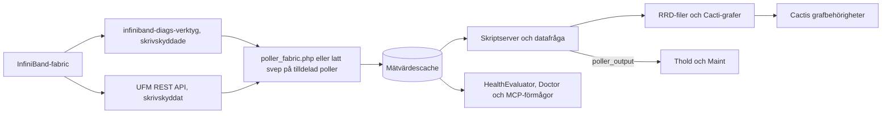

<!-- Source: README.md; SHA256: 79a16fb906f96ee79de2c719f18c38836f555440a7571a4a5ba38c64bb5b099f -->

<!-- translations:start -->
[English](../../../README.md) | [简体中文](../zh-CN/README.md) | [हिन्दी](../hi-IN/README.md) | [Español (España)](../es-ES/README.md) | [Español (Latinoamérica)](../es-419/README.md) | [العربية (السعودية)](../ar-SA/README.md) | [Afrikaans](../af-ZA/README.md) | [አማርኛ](../am-ET/README.md) | [العربية (مصر)](../ar-EG/README.md) | [العربية (المغرب)](../ar-MA/README.md) | [বাংলা](../bn-BD/README.md) | [Bosanski](../bs-BA/README.md) | [Deutsch](../de-DE/README.md) | [فارسی](../fa-IR/README.md) | [Filipino](../fil-PH/README.md) | [Français](../fr-FR/README.md) | [Français (Maroc)](../fr-MA/README.md) | [Français (Sénégal)](../fr-SN/README.md) | [Hausa](../ha-NG/README.md) | [עברית](../he-IL/README.md) | [Hrvatski](../hr-HR/README.md) | [Bahasa Indonesia](../id-ID/README.md) | [Igbo](../ig-NG/README.md) | [Italiano](../it-IT/README.md) | [日本語](../ja-JP/README.md) | [한국어](../ko-KR/README.md) | [Malagasy](../mg-MG/README.md) | [मराठी](../mr-IN/README.md) | [Bahasa Melayu](../ms-MY/README.md) | [Nederlands](../nl-NL/README.md) | [Polski](../pl-PL/README.md) | [Português (Brasil)](../pt-BR/README.md) | [Русский](../ru-RU/README.md) | [Kinyarwanda](../rw-RW/README.md) | [Soomaali](../so-SO/README.md) | [Српски](../sr-RS/README.md) | [Svenska](README.md) | [Kiswahili](../sw-KE/README.md) | [தமிழ்](../ta-IN/README.md) | [తెలుగు](../te-IN/README.md) | [ไทย](../th-TH/README.md) | [Türkçe](../tr-TR/README.md) | [Українська](../uk-UA/README.md) | [اردو](../ur-PK/README.md) | [Tiếng Việt](../vi-VN/README.md) | [isiXhosa](../xh-ZA/README.md) | [Yorùbá](../yo-NG/README.md) | [繁體中文](../zh-TW/README.md) | [isiZulu](../zu-ZA/README.md)
<!-- translations:end -->

# plugin_fabric

Ett Cacti 1.2-insticksprogram (`fabric`, version `0.1.0-dev`) som hämtar InfiniBand-porträknare, länkbredd och länkhastighet samt trängselindikatorer till Cacti som vanliga enheter, datakällor och grafer. En länk som har förhandlats till 1X i stället för 4X visas då som en graf och en Thold-varning intill värden den betjänar, under Cactis behörigheter, med medvetenhet och dämpning via Maint.

> **Status: under utveckling, ingen utgåva ännu.** Den här grenen implementerar insticksprogrammets grund, Cacti-objekt och varningar, schemalagda bakgrundssvep i pollern, replikering till fjärrdatainsamlare, en skrivskyddad NVIDIA UFM REST-bakände med ett krypterat valv för autentiseringsuppgifter, Configuration-as-Code (CasC) CLI-hantering samt krokar för Cactis ekosystem (CasC, Doctor och MCP / Abilities API v2). Den har testats mot simulerade verktyg, syntetiska UFM-transporter och fabric-simulatorn `ibsim` (rdma-core 50.0), aldrig på ett fysiskt InfiniBand-fabric eller en skarp UFM-server. Kontroller som kräver hårdvara står kvar som öppna i [docs/research/](../../research/). Detta projekt är inte knutet till Cacti-projektet.

## Vad som är implementerat

- **Livscykel och schema (v3)**: installation, idempotent uppgradering, avinstallation (där insticksprogrammets tabeller behålls som standard) samt en spärr för PHP 8.2-kravet medan startpunkter förblir tolkbara på PHP 8.0.
- **Åtkomstroller och sidor**: behörighetsområdena `Fabric View` (`fabric.php`), `Fabric Operator` (`fabric_operator.php`) och `Fabric Admin` (`fabric_admin.php`, `fabric_health.php`), samt en flik under **Configuration > Settings > Fabrics**.
- **Skrivskyddad diagnostikbakände (`diags`)**: strikt argumentvektorexekvering av `perfquery`, `ibnetdiscover` och `iblinkinfo`, inventering nycklad per GUID med identifiering av identitetskonflikter och förslag på återlänkning, utvärdering av länktillstånd samt räknaresvep per nod.
- **Skrivskyddad NVIDIA UFM REST-bakände (`ufm`) och krypterat valv**: REST-klient med enbart GET mot tillåtna sökvägar (`/ufmRest/resources/ports`, `/ufmRest/resources/systems`, `/ufmRest/monitoring/session/0/data` samt motsvarigheter under `/ufmRestV3/...` för token-autentisering) som matar samma tabeller för inventering, länktillstånd, mätvärden och hälsostatus som `diags`. Autentiseringsuppgifter (`token` eller `basic`) lagras krypterade med AES-256-GCM i `plugin_fabric_secret` med en extern 256-bitars nyckelfil konfigurerad via `fabric_vault_key_file`. UFM-fabric kan definieras via CasC (`cli/fabric.php`) eller arkiven (repositories); webbadministrationsformuläret exponerar för närvarande fält för `diags`.
- **Cacti-objekt, Thold och Maint**: enhets-, data- och grafmallar för Cacti (`templates/fabric-templates.xml`), skriptserverns datafråga "Fabric Port" (`scripts/ss_fabric_ports.php`, `resource/script_server/fabric_ports.xml`), `DERIVE`-datakällor för räknare och `GAUGE`-datakällor för länktillstånd/hastighet för Thold, spårning av diskontinuiteter och mättade grundräknare som rapporteras som `U`. Maint-integration (`MaintMaintenance`) anropar `plugin_maint_check_cacti_host()` (med återgång till kroken `is_device_in_maintenance`) så att noder i aktivt underhåll räknas separat och undantas från hälsovarningar för misslyckade svep och degraderade portar.
- **Schemalagda svep, uppdelning och fjärrdatainsamlare**: `poller_bottom` startar `poller_fabric.php` i bakgrunden för fabric som står på tur och är tilldelade aktuell poller, vid sidan av lata svep som utlöses av skriptservern. `INFO` deklarerar `remote_collect:1, remote_poller:1`, `poller_fabric.php` stöder deterministisk GUID-uppdelning (`--shard=K/N`), och `replicate_out` replikerar icke-hemliga rader i `plugin_fabric_fabric` till fjärrdatainsamlare (`poller_id >= 2`). Valvposter (`plugin_fabric_secret`) och externa nyckelfiler replikeras aldrig.
- **CasC CLI och ekosystemkrokar**: `cli/fabric.php` för YAML/XML-export, validering, dry-run diff-planering, bekräftelsestyrd tillämpning och hälsorapportering, samt krokarna `casc_register_providers`, `doctor_register_checks` och `abilities_register`.

## Åtkomstroller

| Behörighetsområde | Åtkomst |
| --- | --- |
| Fabric View | Övervakning av inventerings- och portvyer (`fabric.php`). |
| Fabric Operator | View-åtkomst samt sidan Operations (`fabric_operator.php`) och personliga bekräftelser för gallring. |
| Fabric Admin | Operator-åtkomst samt konfiguration, administrationsåtgärder (`fabric_admin.php`) och hälsosidan (`fabric_health.php`). |

När uppgraderingsfilerna har kopierats öppnar du sidan Plugins som administratör för att registrera nya behörighetsområden och krokar. Tilldela Operator-behörighetsområdet uttryckligen under **Configuration > Users** eller användargrupper. Uppgraderingar behåller befintliga View- och Admin-behörighets-ID:n och tilldelningar. Admin-åtkomst ärver Operator-åtkomst, och Operator-åtkomst ärver View-åtkomst vid varje begäran; detta lägger inte till lagrade behörigheter för användare eller grupper. Inställningar för insticksprogrammet kräver också Fabric Admin-åtkomst utöver Cactis Settings-behörighet.

Cactis enhetsbehörigheter begränsar vilka rader och åtgärder som är tillgängliga för varje användare; omappade objekt kräver en administratör. Autentiseringsuppgifter, konfiguration, mappning, borttagning och andra administrativa ändringar finns kvar på administrationssidorna eller i CLI. Bekräftelser gäller bara i den aktuella användarens session, i högst en timme och endast så länge samma observation är aktuell. Nya eller ändrade observationer gör dem ogiltiga. De markerar aldrig en misslyckad mätning som felfri och dämpar inte varningar.

## Varför

En degraderad InfiniBand-länk släpper fortfarande igenom trafik. En 4X-länk som omförhandlas till 1X lämnar porten som "active", och värdens SNMP-gränssnittsgrafer ser normala ut, men tätt kopplade jobb går långsammare. Bevisen finns i fabric:et: varje port rapporterar sin aktiva, aktiverade och stödda bredd och hastighet, samt fel- och trängselräknare. För att läsa dem krävs InfiniBands diagnostikverktyg eller ett API från en fabric-hanterare. När de körs manuellt kvarstår tre luckor:

- **Ingen historik.** `perfquery` och `iblinkinfo` visar nuläget, så en länk som degraderades förra veckan syns inte.
- **Ingen enhetskontext.** Fabric-portar är inte Cacti-objekt, så en port kan inte ritas som graf bredvid den värd den matar.
- **Ingen väg in i Cactis varningssystem.** Thold och Maint arbetar mot Cactis datakällor och enheter.

Insticksprogrammet fyller dessa luckor genom att läsa av fabric:et via `infiniband-diags` eller NVIDIA UFM REST API, identifiera noder och portar med GUID och publicera räknare och länktillstånd som Cacti-datakällor. Det läser enbart: det återställer aldrig räknare och ändrar aldrig porttillstånd.

## Drift och CLI

### Bakgrundspoller och manuella svep

`fabric_poller_bottom()` startar `poller_fabric.php` i bakgrunden på varje poller för aktiverade fabric tilldelade det `poller_id` vars svep står på tur. Du kan också köra poller-köraren eller ett manuellt svep direkt på den tilldelade pollern som pollerns användare (ersätt `/path/to/cacti` med din Cacti-katalog):

```sh
php /path/to/cacti/plugins/fabric/poller_fabric.php [--fabric=ID] [--shard=K/N] [--force] [--debug]
php /path/to/cacti/plugins/fabric/fabric_sweep.php --fabric=ID [--node=GUID] [--force]
```

- `poller_fabric.php` kör alla fabric som står på tur för den lokala pollern (eller ett fabric med `--fabric=ID`), upprätthåller Cactis processregisterlås och `ClaimRepository`-lån med en tidsbudget på `max(30, intdiv(sweep_interval, 2))` sekunder samt stöder `--shard=K/N` (`0 <= K < N`) för att deterministiskt dela upp `diags`-svep av nodräknare efter nodens GUID.
- `fabric_sweep.php` kör ett svep på begäran för ett aktiverat fabric (eller en nod med `--node=GUID`) som är tilldelat den lokala pollern. `--force` bortser från om fabric:et står på tur samtidigt som lånen (claims) fortfarande respekteras.

När den första upptäckten har fyllt inventeringen mappar du noder till Cacti-enheter på sidan Fabric Admin. Behåll Cactis skript-timeout på 25 sekunder eller högre: ett latt svep som startas av en datafrågeläsning begränsar verktygskörningen till `script_timeout - 5` sekunder så att skriptservern hinner svara i tid med det senast lagrade mätvärdet eller `U`.

### NVIDIA UFM REST-bakände och valv för autentiseringsuppgifter

Ett `ufm`-fabric kräver en `https://`-URL utan inbäddade autentiseringsuppgifter, frågesträngar eller fragment. `UfmSocketTransport` genomdriver verifiering av TLS-motpart och värdnamn, avvisar omdirigeringar och stöder ett valfritt CA-paket (`ufm_ca_file`) samt SHA-256 SPKI-pinning (`ufm_spki_pin`).

För att lagra UFM-autentiseringsuppgifter i `plugin_fabric_secret` konfigurerar du `fabric_vault_key_file` under **Configuration > Settings > Fabrics** med en absolut sökväg till en vanlig fil som ägs av poller-användaren (inga symboliska länkar i någon överordnad katalog, rättighetsläge `0600`, innehållande 64 hexadecimala tecken såsom `openssl rand -hex 32` eller 32 slumpmässiga icke-utskrivbara byte). Insticksprogrammet skapar eller skriver aldrig nyckelfilen, och `replicate_out` replikerar aldrig `plugin_fabric_secret` eller nyckelfiler till fjärrpollers.

### Configuration-as-Code och hälso-CLI

`cli/fabric.php` hanterar insticksprogrammets inställningar och fabric-definitioner deklarativt i YAML eller XML samt rapporterar underhållsmedveten hälsostatus utan att köra direkta svep:

```sh
php /path/to/cacti/plugins/fabric/cli/fabric.php export [--format=yaml|xml] [--file=PATH]
php /path/to/cacti/plugins/fabric/cli/fabric.php validate --file=PATH [--format=yaml|xml]
php /path/to/cacti/plugins/fabric/cli/fabric.php plan --file=PATH [--format=yaml|xml]
php /path/to/cacti/plugins/fabric/cli/fabric.php apply --file=PATH --confirm=PLAN_HASH [--format=yaml|xml]
php /path/to/cacti/plugins/fabric/cli/fabric.php health [--format=text|json]
```

`export` skapar nya filer med rättighetsläget `0600`, maskerar `fabric_vault_key_file` som `[REDACTED]` och matar ut namngivna `ufm_credential_ref`-referenser i stället för hemligheter. `plan` och `apply` avvisar direktinbäddade värden för `ufm_token`, `ufm_password`, `secret` och `fabric_vault_key_file`. `apply` kräver den exakta `--confirm=PLAN_HASH` som skapades av `plan`.

### Ekosystemkrokar

När motsvarande Cacti-insticksprogram eller värdintegrationer finns tillgängliga registrerar `setup.php`:

- `casc_register_providers`: exporterar, validerar, planerar och tillämpar efter bekräftelse konfiguration för `fabric` (`yaml` och `xml`, schema v1) med maskering av hemligheter.
- `doctor_register_checks`: tillhandahåller fyra skrivskyddade diagnostikkontroller (`fabric.schema`, `fabric.poller_freshness`, `fabric.identity_conflicts`, `fabric.ufm_vault`).
- `abilities_register`: registrerar tre skrivskyddade, icke-destruktiva och idempotenta förmågor under kategorin `fabric`, skyddade av behörighetsområdet Fabric View (samt Cactis enhetsbehörigheter för portfel): `fabric-list-fabrics`, `fabric-get-health` och `fabric-list-port-errors`.

## Omfattning och gränser

Utanför omfattningen: att ändra fabric-tillstånd, återställa räknare, ersätta en fabric-hanterare eller subnätshanterare, en egen varningsmotor i insticksprogrammet, en anpassad daemon eller ett nätverksprotokoll samt Ethernet- eller RoCE-fabric.

## Krav och kompatibilitet

| Komponent | Mål |
|---|---|
| Cacti | 1.2.31 eller senare (`compat = 1.2.31`), inga patchar i kärnan |
| PHP | 8.2 eller senare; startpunkter förblir tolkbara på 8.0 och nekar aktivering på 8.1 så att en körtidsmiljö som inte stöds får ett avvisande i stället för ett trasigt Cacti-gränssnitt |
| InfiniBand-verktyg | `infiniband-diags` från `rdma-core` (testat i CI med rdma-core 50.0 under `ibsim`; utdataformat kontrollerade mot källkoden för v66.0) |
| UFM | NVIDIA UFM Enterprise REST API (skrivskyddade ändpunkter `ufmRest` och `ufmRestV3`; testat mot syntetiska transporter i enhetstester) |
| Thold, Maint | Inga ändringar krävs; CI kör ett helhetstest med oförändrade Thold v1.8.2 och Maint v1.3 |

## Utveckling och testning

CI-arbetsflödet (`.github/workflows/plugin-ci-workflow.yml`) testar PHP 8.2 till och med 8.5 mot Cacti `release/1.2.31` och `1.2.x`, syntaxkontroll av startpunkter i PHP 8.0, avvisande i PHP 8.1, PHPStan, verifiering av gettext/översättningar, REUSE-licensiering, arbetsflödeskontroll, helhetsuppspelning av Thold/Maint samt `ibsim`-simulering av fabric.

Med Cactis låsta delade Pest-testramverk för insticksprogram (`CACTI_PEST_BIN`) och en temporär Cacti-databas:

```sh
# Unit tests
"$CACTI_PEST_BIN" --configuration=phpunit.xml

# Lifecycle integration tests (disposable database only)
CACTI_PATH=/path/to/cacti FABRIC_TEST_DATABASE=disposable "$CACTI_PEST_BIN" --configuration=phpunit-integration.xml

# Static analysis (against Cacti 1.2.31)
CACTI_PATH=/path/to/cacti phpstan analyse -c phpstan.neon --no-progress

# Translation template, catalogs, and localized README checks
sh locales/build_gettext.sh --check

# Simulated ibsim fixture parser check
php tests/bin/check-ibsim-fixtures.php tests/fixtures/ibsim
```

## Design

- [docs/PLAN.md](../../PLAN.md) är arkitektur- och designplanen: uppströms fakta med källor, öppna hårdvarukontroller, identitetsmodell, regler för räknare och länktillstånd, säkerhetsgränser, prestandaberäkningar, testning och risker.
- [docs/decisions/](../../decisions/) innehåller arkitekturbeslut.
- [docs/REQUIREMENTS.md](../../REQUIREMENTS.md) mappar varje krav-ID till dess ärende.



## Hur arbetet spåras

- **Milstolpar** följer planens milstolpar. Varje milstolpe har ett övergripande ärende (epic) som listar dess delärenden och avslutningsbevis.
- **Ärenden** kategoriseras med etiketter: `type: requirement`, `type: research`, `type: decision`, `type: epic`. Kravärenden anger numrerade, testbara krav (`REQ-AREA-NNN`) och acceptanskriterier.
- **Etiketter** anger även `area:`, `phase:`, `priority:` och `status:`. Se [CONTRIBUTING.md](../../../CONTRIBUTING.md#labels).
- [Projekttavlan](https://github.com/users/somethingwithproof/projects/8) visar alla ärenden över milstolparna.

## Bidra

Läs [CONTRIBUTING.md](../../../CONTRIBUTING.md). Commits kräver en DCO-signering (`git commit -s`). Designdiskussioner förs i ärenden; öppna beslut har etiketten `type: decision`.

## Säkerhet

Rapportera sårbarheter privat; se [SECURITY.md](../../../SECURITY.md).

## Licens

GNU General Public License v2.0, samma licens som Cacti och dess insticksprogram. Se [LICENSE](../../../LICENSE).
