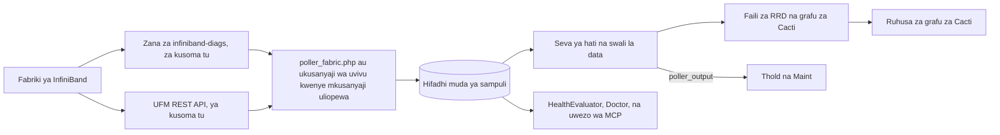

<!-- Source: README.md; SHA256: 79a16fb906f96ee79de2c719f18c38836f555440a7571a4a5ba38c64bb5b099f -->

<!-- translations:start -->
[English](../../../README.md) | [简体中文](../zh-CN/README.md) | [हिन्दी](../hi-IN/README.md) | [Español (España)](../es-ES/README.md) | [Español (Latinoamérica)](../es-419/README.md) | [العربية (السعودية)](../ar-SA/README.md) | [Afrikaans](../af-ZA/README.md) | [አማርኛ](../am-ET/README.md) | [العربية (مصر)](../ar-EG/README.md) | [العربية (المغرب)](../ar-MA/README.md) | [Български](../bg-BG/README.md) | [বাংলা](../bn-BD/README.md) | [Bosanski](../bs-BA/README.md) | [Deutsch](../de-DE/README.md) | [Ελληνικά](../el-GR/README.md) | [فارسی](../fa-IR/README.md) | [Filipino](../fil-PH/README.md) | [Français](../fr-FR/README.md) | [Français (Maroc)](../fr-MA/README.md) | [Français (Sénégal)](../fr-SN/README.md) | [Hausa](../ha-NG/README.md) | [עברית](../he-IL/README.md) | [Hrvatski](../hr-HR/README.md) | [Bahasa Indonesia](../id-ID/README.md) | [Igbo](../ig-NG/README.md) | [Italiano](../it-IT/README.md) | [日本語](../ja-JP/README.md) | [ქართული](../ka-GE/README.md) | [한국어](../ko-KR/README.md) | [Latviešu](../lv-LV/README.md) | [Malagasy](../mg-MG/README.md) | [मराठी](../mr-IN/README.md) | [Bahasa Melayu](../ms-MY/README.md) | [Nederlands](../nl-NL/README.md) | [Polski](../pl-PL/README.md) | [Português (Brasil)](../pt-BR/README.md) | [Português (Portugal)](../pt-PT/README.md) | [Русский](../ru-RU/README.md) | [Kinyarwanda](../rw-RW/README.md) | [Soomaali](../so-SO/README.md) | [Српски](../sr-RS/README.md) | [Svenska](../sv-SE/README.md) | [Kiswahili](README.md) | [தமிழ்](../ta-IN/README.md) | [తెలుగు](../te-IN/README.md) | [ไทย](../th-TH/README.md) | [Türkçe](../tr-TR/README.md) | [Українська](../uk-UA/README.md) | [اردو](../ur-PK/README.md) | [Tiếng Việt](../vi-VN/README.md) | [isiXhosa](../xh-ZA/README.md) | [Yorùbá](../yo-NG/README.md) | [繁體中文](../zh-TW/README.md) | [isiZulu](../zu-ZA/README.md)
<!-- translations:end -->

# plugin_fabric

Programu-jalizi ya Cacti 1.2 (`fabric`, toleo `0.1.0-dev`) inayowaleta vihesabio vya bandari vya InfiniBand, upana na kasi ya kiungo, na viashiria vya msongamano ndani ya Cacti kama vifaa vya kawaida, vyanzo vya data, na grafu. Kiungo kilichounganishwa kwa 1X badala ya 4X kisha huonekana kama grafu na tahadhari ya Thold kando ya seva pangishi kinachohudumia, chini ya ruhusa za Cacti, huku Maint ikiweza kukitambua na kukizuia.

> **Hali: bado iko katika maendeleo, hakuna toleo rasmi bado.** Tawi hili linatekeleza msingi wa programu-jalizi, vipengee vya Cacti na utoaji wa tahadhari, ukusanyaji uliopangwa wa chinichini, urudufishaji kwa wakusanyaji wa mbali, mfumo wa nyuma wa kusoma tu wa NVIDIA UFM REST ulio na hifadhi salama ya vitambulisho vya siri iliyosimbwa kwa njia fiche, usimamizi wa CLI kwa Configuration-as-Code (CasC), na ndoano za mfumo ikolojia wa Cacti (CasC, Doctor, na MCP / Abilities API v2). Imejaribiwa dhidi ya zana bandia, mifumo bandia ya usafirishaji wa UFM, na kiigaji cha fabriki cha `ibsim` (rdma-core 50.0), kamwe si kwenye fabriki halisi ya InfiniBand au seva halisi ya UFM. Ukaguzi unaohitaji maunzi bado uko wazi katika [docs/research/](../../research/). Mradi huu hauhusiani na mradi wa Cacti.

## Kilichotekelezwa

- **Mzunguko wa maisha na muundo wa hifadhidata (v3)**: kusakinisha, kuboresha bila mabadiliko ya ziada yanapojirudia, kuondoa (ikihifadhi majedwali ya programu-jalizi kwa chaguo-msingi), na ulinzi wa mahitaji ya PHP 8.2 huku sehemu za kuingilia zikibaki zinazoweza kusomeka kwenye PHP 8.0.
- **Majukumu ya ufikiaji na kurasa**: nyanja za `Fabric View` (`fabric.php`), `Fabric Operator` (`fabric_operator.php`), na `Fabric Admin` (`fabric_admin.php`, `fabric_health.php`), pamoja na kichupo cha mipangilio chini ya **Configuration > Settings > Fabrics**.
- **Mfumo wa nyuma wa uchunguzi wa kusoma tu (`diags`)**: utekelezaji mkali wa vekta ya hoja za `perfquery`, `ibnetdiscover`, na `iblinkinfo`, orodha ya vifaa kwa GUID yenye ugunduzi wa migongano ya utambulisho na mapendekezo ya kuunganisha tena, tathmini ya hali ya kiungo, na ukusanyaji wa vihesabio kwa kila nodi.
- **Mfumo wa nyuma wa kusoma tu wa NVIDIA UFM REST (`ufm`) na hifadhi salama iliyosimbwa kwa njia fiche**: mteja wa REST wa GET pekee uliowekwa kwenye orodha ya ruhusa (`/ufmRest/resources/ports`, `/ufmRest/resources/systems`, `/ufmRest/monitoring/session/0/data`, na njia sawa za `/ufmRestV3/...` kwa uthibitishaji wa tokeni) unaolisha majedwali yale yale ya orodha ya vifaa, hali ya kiungo, sampuli, na afya kama `diags`. Vitambulisho (`token` au `basic`) huhifadhiwa vikiwa vimesimbwa kwa AES-256-GCM katika `plugin_fabric_secret` kwa kutumia faili ya nje ya ufunguo wa biti 256 iliyosanidiwa na `fabric_vault_key_file`. Fabriki za UFM zinaweza kufafanuliwa kupitia CasC (`cli/fabric.php`) au hazina; fomu ya usimamizi wa wavuti kwa sasa huonyesha sehemu za `diags`.
- **Vipengee vya Cacti, Thold, na Maint**: violezo vya vifaa, data, na grafu vya Cacti (`templates/fabric-templates.xml`), swali la data la seva ya hati la "Fabric Port" (`scripts/ss_fabric_ports.php`, `resource/script_server/fabric_ports.xml`), vyanzo vya data vya vihesabio vya `DERIVE` na vyanzo vya data vya hali ya kiungo/kiwango vya `GAUGE` kwa Thold, ufuatiliaji wa kukatika kwa mfululizo, na vihesabio vya msingi vilivyojaa kuripotiwa kama `U`. Muunganisho wa Maint (`MaintMaintenance`) huuliza `plugin_maint_check_cacti_host()` (ukirejea kwenye ndoano ya `is_device_in_maintenance`) ili nodi zilizo katika matengenezo yanayoendelea zihesabiwe kando na ziondolewe kwenye maonyo ya afya ya ukusanyaji ulioshindwa na bandari zilizoharibika.
- **Ukusanyaji uliopangwa, ugawaji wa vipande, na wakusanyaji wa mbali**: `poller_bottom` huanzisha `poller_fabric.php` chinichini kwa fabriki zilizofika muda wake zilizopewa mkusanyaji wa sasa, sambamba na ukusanyaji wa uvivu unaoanzishwa na seva ya hati. `INFO` hutangaza `remote_collect:1, remote_poller:1`, `poller_fabric.php` inaunga mkono ugawaji wa GUID wa kubainika (`--shard=K/N`), na `replicate_out` hurudufisha safu mlalo zisizo za siri za `plugin_fabric_fabric` kwa wakusanyaji wa mbali (`poller_id >= 2`). Maingizo ya hifadhi salama (`plugin_fabric_secret`) na faili za nje za funguo hazirudufishwi kamwe.
- **CasC CLI na ndoano za mfumo ikolojia**: `cli/fabric.php` kwa kuhamisha YAML/XML, kuthibitisha, kupanga tofauti bila kutekeleza, kutekeleza baada ya uthibitisho, na kuripoti afya, pamoja na ndoano za `casc_register_providers`, `doctor_register_checks`, na `abilities_register`.

## Majukumu ya ufikiaji

| Nyanja | Ufikiaji |
| --- | --- |
| Fabric View | Mionekano ya kufuatilia orodha ya vifaa na bandari (`fabric.php`). |
| Fabric Operator | Ufikiaji wa View pamoja na ukurasa wa Operations (`fabric_operator.php`) na uthibitisho wa kibinafsi wa uchambuzi wa matatizo. |
| Fabric Admin | Ufikiaji wa Operator pamoja na usanidi, vitendo vya kiutawala (`fabric_admin.php`), na ukurasa wa afya (`fabric_health.php`). |

Baada ya kunakili faili za uboreshaji, fungua ukurasa wa Plugins kama msimamizi ili kusajili nyanja na ndoano mpya. Gawa nyanja ya Operator moja kwa moja chini ya **Configuration > Users** au vikundi vya watumiaji. Uboreshaji huhifadhi vitambulisho na ruhusa zilizopo za nyanja za View na Admin. Ufikiaji wa Admin hurithi ufikiaji wa Operator, na ufikiaji wa Operator hurithi ufikiaji wa View kwa kila ombi; hii haiongezi ruhusa zilizohifadhiwa kwa watumiaji au vikundi. Mipangilio ya programu-jalizi pia inahitaji ufikiaji wa Fabric Admin pamoja na ruhusa ya Settings ya Cacti.

Ruhusa za vifaa vya Cacti zinadhibiti safu mlalo na vitendo vinavyopatikana kwa kila mtumiaji; vipengee visivyohusishwa vinahitaji msimamizi. Vitambulisho vya siri, usanidi, uhusishaji, ufutaji, na mabadiliko mengine ya kiutawala hubaki katika kurasa za kiutawala au CLI. Uthibitisho wa upokeaji hudumu tu katika kipindi cha sasa cha mtumiaji, kwa muda usiozidi saa moja na tu wakati uchunguzi huo huo bado ni mpya. Uchunguzi mpya au uliobadilika huubatilisha. Kamwe haufanyi kipimo kilichoshindwa kuonekana kuwa kizima au kuzuia tahadhari.

## Kwa nini

Kiungo cha InfiniBand kilichoharibika bado hupitisha data. Kiungo cha 4X kinachofunzwa tena kwa 1X huacha bandari ikiwa "active", na grafu za kiolesura cha SNMP za seva pangishi huonekana za kawaida, lakini kazi zinazotegemeana kwa karibu hupungua kasi. Ushahidi uko kwenye fabriki: kila bandari huripoti upana na kasi yake inayotumika, iliyowezeshwa, na inayoauniwa, pamoja na vihesabio vya makosa na msongamano. Kusoma taarifa hii kunahitaji zana za uchunguzi za InfiniBand au API ya msimamizi wa fabriki. Zinapoendeshwa kwa mkono, huacha mapengo matatu:

- **Hakuna historia.** `perfquery` na `iblinkinfo` huonyesha hali ya sasa pekee, hivyo kiungo kilichoharibika wiki iliyopita hakionekani.
- **Hakuna muktadha wa kifaa.** Bandari za fabriki si vipengee vya Cacti, hivyo bandari haiwezi kuchorwa kwenye grafu kando ya seva pangishi inayohudumiwa.
- **Hakuna njia ya kuingia kwenye tahadhari za Cacti.** Thold na Maint hufanya kazi kwenye vyanzo vya data na vifaa vya Cacti.

Programu-jalizi inaziba mapengo haya kwa kusoma fabriki kupitia `infiniband-diags` au NVIDIA UFM REST API, kutambua nodi na bandari kwa GUID, na kuchapisha vihesabio na hali ya kiungo kama vyanzo vya data vya Cacti. Husoma tu: kamwe haifuti vihesabio wala kubadilisha hali ya bandari.

## Uendeshaji na CLI

### Mkusanyaji wa chinichini na ukusanyaji wa mikono

`fabric_poller_bottom()` huanzisha `poller_fabric.php` chinichini kwenye kila mkusanyaji kwa fabriki zilizowezeshwa zilizopewa `poller_id` hiyo ambazo muda wake wa ukusanyaji umefika. Unaweza pia kuendesha kiendeshaji cha mkusanyaji au ukusanyaji wa mikono moja kwa moja kwenye mkusanyaji uliopewa kazi kama mtumiaji wa mkusanyaji (ukibadilisha `/path/to/cacti` na saraka yako ya Cacti):

```sh
php /path/to/cacti/plugins/fabric/poller_fabric.php [--fabric=ID] [--shard=K/N] [--force] [--debug]
php /path/to/cacti/plugins/fabric/fabric_sweep.php --fabric=ID [--node=GUID] [--force]
```

- `poller_fabric.php` huendesha fabriki zote zilizofika muda wake kwa mkusanyaji wa ndani (au fabriki moja na `--fabric=ID`), hutekeleza kufuli ya usajili wa michakato ya Cacti na mikataba ya `ClaimRepository` yenye bajeti ya muda ya sekunde `max(30, intdiv(sweep_interval, 2))`, na inaunga mkono `--shard=K/N` (`0 <= K < N`) ili kugawa ukusanyaji wa vihesabio vya nodi za `diags` kwa uthabiti kupitia GUID ya nodi.
- `fabric_sweep.php` huendesha ukusanyaji unapohitajika wa fabriki moja iliyowezeshwa (au nodi moja na `--node=GUID`) iliyopewa mkusanyaji wa ndani. `--force` hupuuza iwapo fabriki imefika muda wake huku bado ikiheshimu madai ya ufikiaji.

Baada ya ugunduzi wa kwanza kujaza orodha ya vifaa, husisha nodi na vifaa vya Cacti kwenye ukurasa wa Fabric Admin. Weka muda wa mwisho wa hati ya Cacti katika sekunde 25 au zaidi: ukusanyaji wa uvivu ulioanzishwa na usomaji wa swali la data hupunguza utekelezaji wa zana hadi sekunde `script_timeout - 5` ili seva ya hati irudi kwa wakati ikiwa na sampuli ya mwisho iliyohifadhiwa au `U`.

### Mfumo wa nyuma wa NVIDIA UFM REST na hifadhi salama ya vitambulisho

Fabriki ya `ufm` inahitaji URL ya `https://` isiyo na vitambulisho vilivyopachikwa, mfuatano wa hoja, au vipande vya kiungo. `UfmSocketTransport` hutekeleza uthibitishaji wa mshirika wa TLS na jina la seva pangishi, hukataa uelekezaji upya, na inaunga mkono kifurushi cha hiari cha CA (`ufm_ca_file`) na pini ya SHA-256 SPKI (`ufm_spki_pin`).

Ili kuhifadhi vitambulisho vya UFM katika `plugin_fabric_secret`, sanidi `fabric_vault_key_file` chini ya **Configuration > Settings > Fabrics** kwa njia kamili ya faili ya kawaida inayomilikiwa na mtumiaji wa mkusanyaji (bila viungo vya ishara katika saraka yoyote mzazi, ruhusa `0600`, yenye herufi 64 za heksadesimali kama vile `openssl rand -hex 32` au baiti 32 nasibu zisizochapishika). Programu-jalizi kamwe haiundi au kuandika faili ya ufunguo, na `replicate_out` kamwe hairudufishi `plugin_fabric_secret` au faili za funguo kwa wakusanyaji wa mbali.

### Configuration-as-Code na CLI ya afya

`cli/fabric.php` husimamia mipangilio ya programu-jalizi na ufafanuzi wa fabriki kwa njia ya tamko katika YAML au XML, na huripoti afya inayozingatia matengenezo bila kuendesha ukusanyaji wa moja kwa moja:

```sh
php /path/to/cacti/plugins/fabric/cli/fabric.php export [--format=yaml|xml] [--file=PATH]
php /path/to/cacti/plugins/fabric/cli/fabric.php validate --file=PATH [--format=yaml|xml]
php /path/to/cacti/plugins/fabric/cli/fabric.php plan --file=PATH [--format=yaml|xml]
php /path/to/cacti/plugins/fabric/cli/fabric.php apply --file=PATH --confirm=PLAN_HASH [--format=yaml|xml]
php /path/to/cacti/plugins/fabric/cli/fabric.php health [--format=text|json]
```

`export` huunda faili mpya zenye ruhusa `0600`, huficha `fabric_vault_key_file` kama `[REDACTED]`, na hutoa marejeleo yenye majina ya `ufm_credential_ref` badala ya siri. `plan` na `apply` hukataa thamani za ndani za `ufm_token`, `ufm_password`, `secret`, na thamani za ndani za `fabric_vault_key_file`. `apply` inahitaji `--confirm=PLAN_HASH` kamili iliyotolewa na `plan`.

### Ndoano za mfumo ikolojia

Wakati programu-jalizi za Cacti zinazolingana au miunganisho ya seva pangishi ipo, `setup.php` husajili:

- `casc_register_providers`: huhamisha, kuthibitisha, kupanga, na kutekeleza kwa uthibitisho usanidi wa `fabric` (`yaml` na `xml`, muundo v1) pamoja na kuficha siri.
- `doctor_register_checks`: hutoa ukaguzi nne wa uchunguzi wa kusoma tu (`fabric.schema`, `fabric.poller_freshness`, `fabric.identity_conflicts`, `fabric.ufm_vault`).
- `abilities_register`: husajili uwezo tatu wa kusoma tu, usioharibu, na usioathiriwa na marudio chini ya kategoria ya `fabric`, ukidhibitiwa na nyanja ya Fabric View (na ruhusa za vifaa vya Cacti kwa makosa ya bandari): `fabric-list-fabrics`, `fabric-get-health`, na `fabric-list-port-errors`.

## Wigo na mipaka

Nje ya wigo: kubadilisha hali ya fabriki, kuweka upya vihesabio, kuchukua nafasi ya msimamizi wa fabriki au msimamizi wa subnet, injini ya tahadhari inayomilikiwa na programu-jalizi, huduma maalum ya chinichini au itifaki ya mtandao, na fabriki za Ethernet au RoCE.

## Mahitaji na uoanifu

| Kipengele | Lengo |
|---|---|
| Cacti | 1.2.31 au mpya zaidi (`compat = 1.2.31`), bila viraka vya msingi |
| PHP | 8.2 au mpya zaidi; sehemu za kuingilia hubaki zinazoweza kusomeka kwenye 8.0 na hukataa kuwashwa kwenye 8.1 ili mazingira yasiyoauniwa yapate kukataliwa badala ya kuharibu kiolesura cha Cacti |
| Zana za InfiniBand | `infiniband-diags` kutoka `rdma-core` (imejaribiwa katika CI na rdma-core 50.0 chini ya `ibsim`; miundo ya matokeo imekaguliwa dhidi ya msimbo chanzo wa v66.0) |
| UFM | NVIDIA UFM Enterprise REST API (sehemu za mwisho za kusoma tu za `ufmRest` na `ufmRestV3`; imejaribiwa dhidi ya usafirishaji bandia katika majaribio ya vitengo) |
| Thold, Maint | Hakuna mabadiliko yanayohitajika; CI huendesha jaribio la mwisho-hadi-mwisho na Thold v1.8.2 na Maint v1.3 zisizobadilishwa |

## Maendeleo na majaribio

Mtiririko wa kazi wa CI (`.github/workflows/plugin-ci-workflow.yml`) hujaribu PHP 8.2 hadi 8.5 dhidi ya Cacti `release/1.2.31` na `1.2.x`, ukaguzi wa sintaksia ya sehemu za kuingilia za PHP 8.0, kukataliwa kwa PHP 8.1, PHPStan, uthibitishaji wa gettext/tafsiri, leseni ya REUSE, ukaguzi wa mtiririko wa kazi, marudio ya mwisho-hadi-mwisho ya Thold/Maint, na uigaji wa fabriki wa `ibsim`.

Kwa kutumia mfumo wa majaribio wa programu-jalizi wa Pest uliofungwa wa pamoja wa Cacti (`CACTI_PEST_BIN`) na hifadhidata ya Cacti inayoweza kutupwa:

```sh
# Unit tests
"$CACTI_PEST_BIN" --configuration=phpunit.xml

# Lifecycle integration tests (disposable database only)
CACTI_PATH=/path/to/cacti FABRIC_TEST_DATABASE=disposable "$CACTI_PEST_BIN" --configuration=phpunit-integration.xml

# Static analysis (against Cacti 1.2.31)
CACTI_PATH=/path/to/cacti phpstan analyse -c phpstan.neon --no-progress

# Translation template, catalogs, and localized README checks
sh locales/build_gettext.sh --check

# Simulated ibsim fixture parser check
php tests/bin/check-ibsim-fixtures.php tests/fixtures/ibsim
```

## Muundo

- [docs/PLAN.md](../../PLAN.md) ndio mpango wa usanifu na muundo: ukweli wa msimbo wa juu pamoja na vyanzo, ukaguzi wa maunzi ulio wazi, muundo wa utambulisho, sheria za vihesabio na hali ya kiungo, mipaka ya usalama, hesabu za utendaji, majaribio, na hatari.
- [docs/decisions/](../../decisions/) ina rekodi za maamuzi ya usanifu.
- [docs/REQUIREMENTS.md](../../REQUIREMENTS.md) inahusisha kila kitambulisho cha hitaji na suala lake.



## Jinsi kazi inavyofuatiliwa

- **Hatua muhimu** zinafuata hatua muhimu za mpango. Kila moja ina suala kuu linaloorodhesha masuala madogo na ushahidi wa kukamilika.
- **Masuala** yanaainishwa kwa lebo: `type: requirement`, `type: research`, `type: decision`, `type: epic`. Masuala ya mahitaji yanaeleza mahitaji yenye nambari na yanayoweza kupimwa (`REQ-AREA-NNN`) na vigezo vya kukubalika.
- **Lebo** pia hubeba `area:`, `phase:`, `priority:`, na `status:`. Tazama [CONTRIBUTING.md](../../../CONTRIBUTING.md#labels).
- [Bodi ya mradi](https://github.com/users/somethingwithproof/projects/8) inaonyesha masuala yote katika hatua zote muhimu.

## Kuchangia

Soma [CONTRIBUTING.md](../../../CONTRIBUTING.md). Ahadi zinahitaji saini ya DCO (`git commit -s`). Majadiliano ya muundo hufanyika kwenye masuala; maamuzi yaliyo wazi hubeba lebo ya `type: decision`.

## Usalama

Ripoti udhaifu wa kiusalama kwa faragha; tazama [SECURITY.md](../../../SECURITY.md).

## Leseni

GNU General Public License v2.0, leseni ile ile kama Cacti na programu-jalizi zake. Tazama [LICENSE](../../../LICENSE).
