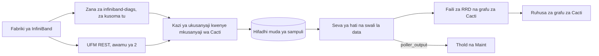

<!-- Source: README.md; SHA256: ce5af61a1bc993ec2aae6d4f22c3885694632f2b1d5eb94e2ce88b8390e96f1e -->

<!-- translations:start -->
[English](../../../README.md) | [简体中文](../zh-CN/README.md) | [हिन्दी](../hi-IN/README.md) | [Español (España)](../es-ES/README.md) | [Español (Latinoamérica)](../es-419/README.md) | [العربية (السعودية)](../ar-SA/README.md) | [Afrikaans](../af-ZA/README.md) | [አማርኛ](../am-ET/README.md) | [العربية (مصر)](../ar-EG/README.md) | [العربية (المغرب)](../ar-MA/README.md) | [বাংলা](../bn-BD/README.md) | [Deutsch](../de-DE/README.md) | [فارسی](../fa-IR/README.md) | [Filipino](../fil-PH/README.md) | [Français](../fr-FR/README.md) | [Français (Maroc)](../fr-MA/README.md) | [Français (Sénégal)](../fr-SN/README.md) | [Hausa](../ha-NG/README.md) | [עברית](../he-IL/README.md) | [Bahasa Indonesia](../id-ID/README.md) | [Igbo](../ig-NG/README.md) | [Italiano](../it-IT/README.md) | [日本語](../ja-JP/README.md) | [한국어](../ko-KR/README.md) | [Malagasy](../mg-MG/README.md) | [मराठी](../mr-IN/README.md) | [Bahasa Melayu](../ms-MY/README.md) | [Nederlands](../nl-NL/README.md) | [Polski](../pl-PL/README.md) | [Português (Brasil)](../pt-BR/README.md) | [Русский](../ru-RU/README.md) | [Kinyarwanda](../rw-RW/README.md) | [Soomaali](../so-SO/README.md) | [Svenska](../sv-SE/README.md) | [Kiswahili](README.md) | [தமிழ்](../ta-IN/README.md) | [తెలుగు](../te-IN/README.md) | [ไทย](../th-TH/README.md) | [Türkçe](../tr-TR/README.md) | [Українська](../uk-UA/README.md) | [اردو](../ur-PK/README.md) | [Tiếng Việt](../vi-VN/README.md) | [isiXhosa](../xh-ZA/README.md) | [Yorùbá](../yo-NG/README.md) | [繁體中文](../zh-TW/README.md) | [isiZulu](../zu-ZA/README.md)
<!-- translations:end -->

# plugin_fabric

Programu-jalizi ya Cacti 1.2 inayowaleta vihesabio vya bandari vya InfiniBand, upana na kasi ya kiungo, na viashiria vya msongamano ndani ya Cacti kama vifaa vya kawaida, vyanzo vya data, na grafu. Kiungo kilichounganishwa kwa 1X badala ya 4X kisha huonekana kama grafu na tahadhari ya Thold kando ya seva pangishi kinachohudumia, chini ya ruhusa za Cacti, huku Maint ikiweza kuizuia.

> **Hali: bado iko katika maendeleo, hakuna toleo bado.** Hatua ya 2 (msingi) imeunganishwa kwenye `main`, na hatua ya 3 (vipengee vya Cacti na utoaji tahadhari) iko kwenye ukaguzi. Hatua ya 1 ilithibitisha muundo dhidi ya nyaraka na msimbo chanzo wa juu (PR #71); matokeo, pamoja na vyanzo vyake, yako katika [docs/research/](../../research). Hatua ya 2 inaongeza msingi wa programu-jalizi:
>
> - kusakinisha, kuboresha, kuondoa, na ulinzi wa PHP 8.2
> - nyanja za View, Operator na Admin, na mipangilio
> - rekodi za fabriki
> - mpaka wa amri za kusoma tu kwa `perfquery`, `ibnetdiscover`, na `iblinkinfo`
> - orodha ya vifaa kwa GUID, pamoja na migongano ya utambulisho na mapendekezo ya kuunganisha tena
> - hali ya kiungo na hifadhi muda ya ukusanyaji wa vihesabio
> - kurasa za orodha ya vifaa, usimamizi, na afya
>
> Hatua ya 3 inaongeza vipengee vya Cacti:
>
> - violezo vya vifaa, data, na grafu vilivyopakiwa kama XML ya kiolezo cha Cacti, na swali la data la "Fabric Port"
> - kuhusisha nodi na kifaa cha Cacti, au kuunda kimoja baada ya uthibitisho ([ADR 0010](../../decisions/0010-one-device-per-node.md))
> - vyanzo vya data vya vihesabio kwa grafu, na hali ya kiungo ya GAUGE na vyanzo vya data vya kiwango kwa Thold ([ADR 0011](../../decisions/0011-derive-counters-and-gauge-alert-values.md))
> - ushughulikiaji wa kukatika kwa mfululizo na vihesabio vya msingi vilivyojaa kusomwa kama visivyojulikana ([ADR 0012](../../decisions/0012-saturated-basic-counters-read-as-unknown.md)), uhalali wa vihesabio na viungo vya grafu kwenye ukurasa wa bandari, na upangaji wa kiwango cha msongamano
> - jaribio la mwisho-hadi-mwisho na Thold v1.8.2 na Maint v1.3 zisizobadilishwa, na kazi ya CI inayoendesha zana halisi za uchunguzi dhidi ya fabriki iliyoigizwa
>
> Fabriki inaweza kukusanywa kutoka kwa mkusanyaji mkuu pekee hadi wakusanyaji wa data wa mbali watakapoauniwa katika awamu ya 3. Imejaribiwa dhidi ya zana bandia na kiigaji cha fabriki cha ibsim, kamwe si kwenye fabriki halisi ya InfiniBand. Ukaguzi unaohitaji fabriki bado uko wazi katika jedwali la ukaguzi wa moja kwa moja wa kila ukurasa wa utafiti. Mradi huu hauhusiani na mradi wa Cacti.

## Majukumu ya ufikiaji

| Nyanja | Ufikiaji |
| --- | --- |
| Fabric View | Kurasa zilizopo za ufuatiliaji. |
| Fabric Operator | Ufuatiliaji pamoja na ukurasa wa Operesheni na uthibitisho wa kibinafsi wa uchambuzi wa matatizo. |
| Fabric Admin | Ufikiaji wa Operator pamoja na usanidi uliopo na vitendo vya kiutawala. |

Baada ya kunakili faili za uboreshaji, fungua ukurasa wa Plugins kama msimamizi ili kusajili
nyanja mpya. Gawa nyanja ya Operator moja kwa moja chini ya **Configuration > Users** au vikundi vya watumiaji.
Uboreshaji huhifadhi vitambulisho na ruhusa zilizopo za nyanja za View na Admin. Ufikiaji wa Admin
hurithi ufikiaji wa Operator, na ufikiaji wa Operator hurithi ufikiaji wa View kwa kila ombi;
hii haiongezi ruhusa zilizohifadhiwa kwa watumiaji au vikundi. Mipangilio ya programu-jalizi pia inahitaji
ufikiaji wa Fabric Admin pamoja na ruhusa ya Settings ya Cacti.

Ruhusa za vifaa vya Cacti bado zinadhibiti safu mlalo na vitendo vinavyopatikana kwa kila mtumiaji; vipengee visivyohusishwa vinahitaji msimamizi.
Vitambulisho vya siri, usanidi, uhusishaji, ufutaji na mabadiliko mengine ya kiutawala
hubaki katika kurasa za kiutawala. Uthibitisho wa upokeaji hudumu tu katika kipindi cha sasa
cha mtumiaji, kwa muda usiozidi saa moja na tu wakati uchunguzi huo huo bado
ni mpya. Uchunguzi mpya au uliobadilika huubatilisha. Kamwe haufanyi kipimo kilichoshindwa
kuonekana kuwa kizima au kuzuia tahadhari.

## Kwa nini

Kiungo cha InfiniBand kilichoharibika bado hupitisha data. Kiungo cha 4X kinachofunzwa tena kwa 1X huacha bandari ikiwa "active", na grafu za kiolesura cha SNMP za seva pangishi huonekana za kawaida, lakini kazi zinazotegemeana kwa karibu hupungua kasi. Ushahidi uko kwenye fabriki: kila bandari huripoti upana na kasi yake inayotumika, iliyowezeshwa, na inayoauniwa, pamoja na vihesabio vya makosa na msongamano. Kusoma taarifa hii kunahitaji zana za uchunguzi za InfiniBand au API ya msimamizi wa fabriki. Zinapoendeshwa kwa mkono, huacha mapengo matatu:

- **Hakuna historia.** `perfquery` na `iblinkinfo` huonyesha hali ya sasa pekee, hivyo kiungo kilichoharibika wiki iliyopita hakionekani.
- **Hakuna muktadha wa kifaa.** Bandari za fabriki si vipengee vya Cacti, hivyo bandari haiwezi kuchorwa kwenye grafu kando ya seva pangishi inayohudumiwa.
- **Hakuna njia ya kuingia kwenye tahadhari za Cacti.** Thold na Maint hufanya kazi kwenye vyanzo vya data na vifaa vya Cacti.

Programu-jalizi inaziba mapengo haya kwa kusoma fabriki kupitia zana zake za uchunguzi (na baadaye kupitia UFM), kutambua nodi na bandari kwa GUID, na kuchapisha vihesabio na hali ya kiungo kama vyanzo vya data vya Cacti. Husoma tu: kamwe haifuti vihesabio wala kubadilisha hali ya bandari.

## Ugunduzi wa kwanza

Fabriki mpya haina nodi zozote, na ukusanyaji huanza kutoka kwa seva ya hati tu kwa nodi ambayo imehusishwa na kifaa cha Cacti. Kwa hivyo ugunduzi wa kwanza ni hatua ya kufanywa kwa mkono. Baada ya kuhifadhi fabriki iliyowezeshwa, endesha amri hii mara moja kwenye mkusanyaji ambao fabriki imepewa, ukitumia akaunti ya mkusanyaji huyo, huku `/path/to/cacti` ikibadilishwa na saraka yako ya Cacti (njia kamili pia hufanya kazi kutoka kwa cron):

```
php /path/to/cacti/plugins/fabric/fabric_sweep.php --fabric=ID --force
```

Kisha orodha ya vifaa hujazwa. Husisha nodi na vifaa vya Cacti kwenye ukurasa wa Fabric Admin; ukusanyaji unaofuata huanza kutoka kwa swali la data. Wakati hakuna nodi ya fabriki iliyohusishwa, hakuna kinachosasisha orodha yake, kwa hivyo endesha amri hiyo tena, kutoka kwa cron ukipenda, ili kurekodi nodi mpya au zinazokosekana. Ukurasa wa afya huonyesha amri hii kwa fabriki iliyowezeshwa ambayo haijagunduliwa au haina nodi iliyohusishwa.

## Wigo uliopangwa

| Awamu | Wigo | Hatua muhimu |
|---|---|---|
| 0, utafiti | Jedwali la matoleo, uthibitisho wa tabia ya msimbo wa juu, tabia ya vihesabio kwenye maunzi, muundo wa ruhusa, bajeti ya MAD, API ya UFM | [M1](https://github.com/somethingwithproof/plugin_fabric/milestone/1) |
| 1, uchunguzi | Orodha ya vifaa kwa GUID, vifaa vya Cacti, swali la data la bandari, vyanzo vya data vya vihesabio na hali ya kiungo, tahadhari za Thold, kuzuia kwa Maint, ukurasa wa afya | [M2](https://github.com/somethingwithproof/plugin_fabric/milestone/2), [M3](https://github.com/somethingwithproof/plugin_fabric/milestone/3), [M4](https://github.com/somethingwithproof/plugin_fabric/milestone/4) |
| 2, UFM | Mfumo wa nyuma wa UFM REST wa kusoma tu, ushughulikiaji wa vitambulisho vya siri, mwendelezo wa utambulisho kati ya mifumo ya nyuma | [M5](https://github.com/somethingwithproof/plugin_fabric/milestone/5) |
| 3, mbali | Wakusanyaji wa data wa mbali, urudufishaji, vitendo vya `remote_agent`, ukusanyaji uliogawanywa kwa fabriki kubwa | [M6](https://github.com/somethingwithproof/plugin_fabric/milestone/6) |

Nje ya wigo: kubadilisha hali ya fabriki, kuchukua nafasi ya msimamizi wa fabriki au msimamizi wa subnet, injini ya tahadhari inayomilikiwa na programu-jalizi, huduma maalum ya chinichini au itifaki ya mtandao, na fabriki za Ethernet au RoCE (utafiti).

## Malengo ya uoanifu

| Kipengele | Lengo |
|---|---|
| Cacti | 1.2.31 au mpya zaidi, bila viraka vya msingi |
| PHP | 8.2 au mpya zaidi; `setup.php` hubaki inayoweza kusomwa kwenye 8.0 ili mazingira yasiyoauniwa yapate kukataliwa badala ya kuharibu kiolesura cha Cacti |
| Zana za InfiniBand | infiniband-diags kutoka rdma-core; miundo ya matokeo imekaguliwa dhidi ya msimbo chanzo wa v66.0 |
| UFM | UFM Enterprise REST API, awamu ya 2; jedwali la matoleo ni zao la hatua ya 1 |
| Thold, Maint | Hakuna mabadiliko yanayohitajika |

Weka muda wa mwisho wa hati ya Cacti katika chaguo-msingi la sekunde 25 au zaidi. Ukusanyaji ulioanzishwa na usomaji wa swali la data hupunguza muda wa utekelezaji wa zana hadi muda huo wa mwisho ukitoa sekunde tano, ili kuhifadhi muda wa kusoma hifadhi muda na kujibu. Bajeti inapoisha, swali hutoa sampuli ya mwisho ya sasa au thamani isiyojulikana; mzunguko unaofuata hujaribu tena ukusanyaji. Kikomo hiki pia kinatumika kwa mkusanyaji wa PHP. Muda wa mwisho wa sekunde tano au chini hauachi muda wa kuanzisha zana.

## Muundo

- [docs/PLAN.md](../../PLAN.md) ndio mpango kamili: usanifu, ukweli wa msimbo wa juu unaotegemewa (pamoja na vyanzo) na dhana zinazohitaji kuthibitishwa, muundo wa utambulisho, sheria za vihesabio na hali ya kiungo, mipaka ya usalama, hesabu za utendaji, majaribio, na hatari.
- [docs/decisions/](../../decisions) ina rekodi za maamuzi ya usanifu kwa chaguo ambazo tayari zimefanywa.
- [docs/REQUIREMENTS.md](../../REQUIREMENTS.md) inahusisha kila kitambulisho cha hitaji na suala lake.



## Jinsi kazi inavyofuatiliwa

- **Hatua muhimu** zinafuata hatua muhimu za mpango. Kila moja ina suala kuu linaloorodhesha masuala madogo na ushahidi wa kukamilika.
- **Masuala** yanaainishwa kwa lebo: `type: requirement`, `type: research`, `type: decision`, `type: epic`. Masuala ya mahitaji yanaeleza mahitaji yenye nambari na yanayoweza kupimwa (`REQ-AREA-NNN`) na vigezo vya kukubalika.
- **Lebo** pia hubeba `area:`, `phase:`, `priority:`, na `status:`. Tazama [CONTRIBUTING.md](../../../CONTRIBUTING.md#labels).
- [Bodi ya mradi](https://github.com/users/somethingwithproof/projects/8) inaonyesha masuala yote katika hatua zote muhimu.

## Kuchangia

Soma [CONTRIBUTING.md](../../../CONTRIBUTING.md). Ahadi zinahitaji saini ya DCO. Majadiliano ya muundo hufanyika kwenye masuala; maamuzi yaliyo wazi hubeba lebo ya `type: decision`.

## Usalama

Ripoti udhaifu wa kiusalama kwa faragha; tazama [SECURITY.md](../../../SECURITY.md).

## Leseni

GNU General Public License v2.0, leseni ile ile kama Cacti na programu-jalizi zake. Tazama [LICENSE](../../../LICENSE).
