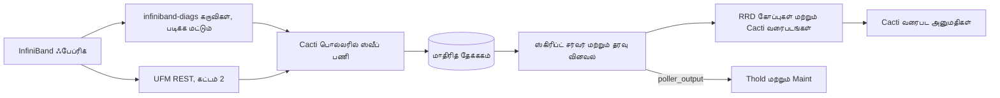

<!-- Source: README.md; SHA256: ce5af61a1bc993ec2aae6d4f22c3885694632f2b1d5eb94e2ce88b8390e96f1e -->

<!-- translations:start -->
[English](../../../README.md) | [简体中文](../zh-CN/README.md) | [हिन्दी](../hi-IN/README.md) | [Español (España)](../es-ES/README.md) | [Español (Latinoamérica)](../es-419/README.md) | [العربية (السعودية)](../ar-SA/README.md) | [Afrikaans](../af-ZA/README.md) | [አማርኛ](../am-ET/README.md) | [العربية (مصر)](../ar-EG/README.md) | [العربية (المغرب)](../ar-MA/README.md) | [বাংলা](../bn-BD/README.md) | [Deutsch](../de-DE/README.md) | [فارسی](../fa-IR/README.md) | [Filipino](../fil-PH/README.md) | [Français](../fr-FR/README.md) | [Français (Maroc)](../fr-MA/README.md) | [Français (Sénégal)](../fr-SN/README.md) | [Hausa](../ha-NG/README.md) | [עברית](../he-IL/README.md) | [Bahasa Indonesia](../id-ID/README.md) | [Igbo](../ig-NG/README.md) | [Italiano](../it-IT/README.md) | [日本語](../ja-JP/README.md) | [한국어](../ko-KR/README.md) | [Malagasy](../mg-MG/README.md) | [मराठी](../mr-IN/README.md) | [Bahasa Melayu](../ms-MY/README.md) | [Nederlands](../nl-NL/README.md) | [Polski](../pl-PL/README.md) | [Português (Brasil)](../pt-BR/README.md) | [Русский](../ru-RU/README.md) | [Kinyarwanda](../rw-RW/README.md) | [Soomaali](../so-SO/README.md) | [Svenska](../sv-SE/README.md) | [Kiswahili](../sw-KE/README.md) | [தமிழ்](README.md) | [తెలుగు](../te-IN/README.md) | [ไทย](../th-TH/README.md) | [Türkçe](../tr-TR/README.md) | [Українська](../uk-UA/README.md) | [اردو](../ur-PK/README.md) | [Tiếng Việt](../vi-VN/README.md) | [isiXhosa](../xh-ZA/README.md) | [Yorùbá](../yo-NG/README.md) | [繁體中文](../zh-TW/README.md) | [isiZulu](../zu-ZA/README.md)
<!-- translations:end -->

# plugin_fabric

InfiniBand போர்ட் கவுன்ட்டர்கள், இணைப்பு அகலம் மற்றும் வேகம், மற்றும் நெரிசல் குறிகாட்டிகளை சாதாரண சாதனங்கள், தரவு மூலங்கள் மற்றும் வரைபடங்களாக Cacti-க்குள் கொண்டுவரும் ஒரு Cacti 1.2 செருகுநிரல். 4X-க்குப் பதிலாக 1X-இல் பயிற்சி பெற்ற ஒரு இணைப்பு, அது சேவை செய்யும் ஹோஸ்டிற்கு அருகிலேயே Cacti-இன் அனுமதிகளுக்கு உட்பட்டு ஒரு வரைபடமாகவும் Thold எச்சரிக்கையாகவும் தோன்றும்; மேலும் Maint மூலம் அதனை அடக்க முடியும்.

> **நிலை: உருவாக்கத்தில் உள்ளது, இன்னும் வெளியீடு இல்லை.** மைல்கல் 2 (அடித்தளம்) `main` கிளையில் இணைக்கப்பட்டுள்ளது, மேலும் மைல்கல் 3 (Cacti பொருள்கள் மற்றும் எச்சரிக்கை) மதிப்பாய்வில் உள்ளது. மைல்கல் 1 ஆவணங்கள் மற்றும் அப்ஸ்ட்ரீம் மூலக் குறியீட்டுடன் வடிவமைப்பை உறுதிப்படுத்தியது (PR #71); அதற்கான முடிவுகள், ஆதாரங்களுடன் [docs/research/](../../research) கோப்பகத்தில் உள்ளன. மைல்கல் 2 செருகுநிரல் அடித்தளத்தைச் சேர்க்கிறது:
>
> - நிறுவல், மேம்படுத்தல், நீக்கம் மற்றும் PHP 8.2 பாதுகாப்பு
> - View, Operator மற்றும் Admin பகுதிகளும் அமைப்புகளும்
> - ஃபேப்ரிக் பதிவுகள்
> - `perfquery`, `ibnetdiscover` மற்றும் `iblinkinfo` ஆகியவற்றிற்கான படிக்க மட்டுமேயான கட்டளை எல்லை
> - அடையாள முரண்பாடுகள் மற்றும் மறு-இணைப்புப் பரிந்துரைகளுடன் GUID அடிப்படையிலான சரக்குப் பட்டியல்
> - இணைப்பு நிலை மற்றும் கவுன்ட்டர் ஸ்வீப் தேக்ககம்
> - சரக்குப் பட்டியல், நிர்வாகம் மற்றும் நலப் பக்கங்கள்
>
> மைல்கல் 3 Cacti பொருள்களைச் சேர்க்கிறது:
>
> - Cacti வார்ப்புரு XML ஆக வழங்கப்படும் சாதனம், தரவு மற்றும் வரைபட வார்ப்புருக்கள், மற்றும் "Fabric Port" தரவு வினவல்
> - ஒரு முனையை Cacti சாதனத்துடன் பொருத்துதல், அல்லது உறுதிப்படுத்தலின் பேரில் ஒன்றை உருவாக்குதல் ([ADR 0010](../../decisions/0010-one-device-per-node.md))
> - வரைபடங்களுக்கான கவுன்ட்டர் தரவு மூலங்கள், மற்றும் Thold-க்கான GAUGE இணைப்பு நிலை மற்றும் வீதத் தரவு மூலங்கள் ([ADR 0011](../../decisions/0011-derive-counters-and-gauge-alert-values.md))
> - தொடர்ச்சியின்மைக் கையாளுதல் மற்றும் நிரம்பிய அடிப்படைக் கவுன்ட்டர்களைத் தெரியாததாகப் படித்தல் ([ADR 0012](../../decisions/0012-saturated-basic-counters-read-as-unknown.md)), போர்ட் பக்கத்தில் கவுன்ட்டர் செல்லுபடியாகும் தன்மை மற்றும் வரைபட இணைப்புகள், மற்றும் நெரிசல் தரவரிசை
> - மாற்றப்படாத Thold v1.8.2 மற்றும் Maint v1.3 உடனான முழுமையான சோதனை, மற்றும் உருவகப்படுத்தப்பட்ட ஃபேப்ரிக்கிற்கு எதிராக உண்மையான கண்டறியும் கருவிகளை இயக்கும் CI பணி
>
> கட்டம் 3-இல் தொலைநிலைத் தரவு சேகரிப்பான்கள் ஆதரிக்கப்படும் வரை, முதன்மைப் பொல்லரிலிருந்து மட்டுமே ஒரு ஃபேப்ரிக்கை ஸ்வீப் செய்ய முடியும். இது போலி கருவிகள் மற்றும் ibsim ஃபேப்ரிக் உருவகப்படுத்திக்கு எதிராகவே சோதிக்கப்பட்டுள்ளது; ஒருபோதும் உண்மையான InfiniBand ஃபேப்ரிக்கில் சோதிக்கப்படவில்லை. ஃபேப்ரிக் தேவைப்படும் சோதனைகள் ஒவ்வொரு ஆய்வுப் பக்கத்தின் நேரடிச் சோதனை அட்டவணையிலும் திறந்த நிலையிலேயே உள்ளன. இந்தத் திட்டம் Cacti திட்டத்துடன் இணைக்கப்பட்டது அல்ல.

## அணுகல் பாத்திரங்கள்

| அதிகார வரம்பு | அணுகல் |
| --- | --- |
| Fabric View | ஏற்கனவே உள்ள கண்காணிப்புப் பக்கங்கள். |
| Fabric Operator | கண்காணிப்புடன் செயல்பாடுகள் பக்கம் மற்றும் தனிப்பட்ட முன்னுரிமை ஒப்புதல்கள். |
| Fabric Admin | Operator அணுகலுடன் ஏற்கனவே உள்ள உள்ளமைவு மற்றும் நிர்வாகச் செயல்கள். |

மேம்படுத்தல் கோப்புகளை நகலெடுத்த பிறகு, புதிய அதிகார வரம்பைப் பதிவுசெய்ய நிர்வாகியாக Plugins பக்கத்தைத் திறக்கவும். **Configuration > Users** அல்லது பயனர் குழுக்களின் கீழ் Operator அதிகார வரம்பை வெளிப்படையாக ஒதுக்கவும். மேம்படுத்தல்கள் ஏற்கனவே உள்ள View மற்றும் Admin அதிகார வரம்பு அடையாள எண்களையும் அனுமதிகளையும் தக்கவைக்கும். ஒவ்வொரு கோரிக்கையிலும் Admin அணுகல் Operator அணுகலையும், Operator அணுகல் View அணுகலையும் மரபுரிமையாகப் பெறுகிறது; இது பயனர்கள் அல்லது குழுக்களுக்குச் சேமிக்கப்பட்ட அனுமதிகளைச் சேர்ப்பதில்லை. செருகுநிரல் அமைப்புகளுக்கு Cacti-இன் Settings அனுமதியுடன் கூடுதலாக Fabric Admin அணுகலும் தேவை.

ஒவ்வொரு பயனருக்கும் கிடைக்கும் வரிசைகளையும் செயல்களையும் Cacti சாதன அனுமதிகள் தொடர்ந்து கட்டுப்படுத்துகின்றன; பொருத்தப்படாத பொருள்களுக்கு நிர்வாகி தேவை. நற்சான்றிதழ்கள், உள்ளமைவு, பொருத்துதல், நீக்குதல் மற்றும் பிற நிர்வாக மாற்றங்கள் நிர்வாகப் பக்கங்களிலேயே இருக்கும். ஒப்புதல்கள் தற்போதைய பயனரின் அமர்வில் மட்டுமே, அதிகபட்சம் ஒரு மணி நேரம் வரை மற்றும் அதே கவனிப்பு புதிதாக இருக்கும் வரை மட்டுமே நீடிக்கும். புதிய அல்லது மாற்றப்பட்ட கவனிப்புகள் அவற்றைச் செல்லாததாக்கும். அவை ஒருபோதும் தோல்வியுற்ற அளவீட்டை ஆரோக்கியமானதாகக் குறிக்கவோ எச்சரிக்கைகளை அடக்கவோ மாட்டா.

## ஏன்

தரம் குறைந்த InfiniBand இணைப்பும் தரவுப் போக்குவரத்தைத் தொடர்ந்து கடத்தும். 1X-இல் மீண்டும் இணையும் ஒரு 4X இணைப்பு போர்ட்டை "active" நிலையிலேயே வைத்திருக்கும், மேலும் ஹோஸ்டின் SNMP இடைமுக வரைபடங்களும் இயல்பாகவே தோன்றும்; ஆனால் நெருக்கமாக இணைக்கப்பட்ட பணிகள் மெதுவாகும். அதற்கான சான்று ஃபேப்ரிக்கில் உள்ளது: ஒவ்வொரு போர்ட்டும் அதன் செயலில் உள்ள, இயக்கப்பட்ட மற்றும் ஆதரிக்கப்படும் அகலம் மற்றும் வேகத்தையும், பிழை மற்றும் நெரிசல் கவுன்ட்டர்களையும் தெரிவிக்கிறது. இதைப் படிக்க InfiniBand கண்டறியும் கருவிகள் அல்லது ஃபேப்ரிக் மேலாளர் API தேவை. கைமுறையாக இயக்கப்படும்போது, அவை மூன்று இடைவெளிகளை விட்டுச்செல்கின்றன:

- **வரலாறு இல்லை.** `perfquery` மற்றும் `iblinkinfo` நிகழ்காலத்தை மட்டுமே காட்டுகின்றன, எனவே கடந்த வாரம் தரம் குறைந்த இணைப்பு தெரியாமல் போகும்.
- **சாதனச் சூழல் இல்லை.** ஃபேப்ரிக் போர்ட்கள் Cacti பொருள்கள் அல்ல, எனவே ஒரு போர்ட் அது சேவை செய்யும் ஹோஸ்டிற்கு அருகில் வரைபடமாக்கப்பட முடியாது.
- **Cacti எச்சரிக்கைக்குள் பாதை இல்லை.** Thold மற்றும் Maint ஆகியவை Cacti தரவு மூலங்கள் மற்றும் சாதனங்களில் செயல்படுகின்றன.

இந்தச் செருகுநிரல் தன் சொந்த கண்டறியும் கருவிகள் மூலமாகவும் (மற்றும் பின்னர் UFM மூலமாகவும்) ஃபேப்ரிக்கைப் படித்து, GUID மூலம் முனைகளையும் போர்ட்களையும் அடையாளம் கண்டு, கவுன்ட்டர்கள் மற்றும் இணைப்பு நிலையை Cacti தரவு மூலங்களாக வெளியிடுவதன் மூலம் இந்த இடைவெளிகளை நிரப்புகிறது. இது படிக்க மட்டுமே செய்யும்: கவுன்ட்டர்களை மீட்டமைக்கவோ போர்ட் நிலையை மாற்றவோ ஒருபோதும் செய்யாது.

## முதல் கண்டறிதல்

புதிய ஃபேப்ரிக்கில் முனைகள் எதுவும் இருக்காது, மேலும் Cacti சாதனத்துடன் பொருத்தப்பட்ட ஒரு முனைக்கு மட்டுமே ஸ்கிரிப்ட் சர்வரில் இருந்து ஸ்வீப்கள் தொடங்கும். எனவே முதல் கண்டறிதல் ஒரு கைமுறைப் படியாகும். இயக்கப்பட்ட ஃபேப்ரிக்கைச் சேமித்த பிறகு, `/path/to/cacti` என்பதை உங்கள் Cacti கோப்பகத்தால் மாற்றி, அந்த ஃபேப்ரிக் ஒதுக்கப்பட்ட பொல்லரில், பொல்லரின் கணக்காக இதனை ஒருமுறை இயக்கவும் (முழுப் பாதை cron-இலிருந்தும் செயல்படும்):

```
php /path/to/cacti/plugins/fabric/fabric_sweep.php --fabric=ID --force
```

பின்னர் சரக்குப் பட்டியல் நிரம்பும். Fabric Admin பக்கத்தில் முனைகளை Cacti சாதனங்களுடன் பொருத்தவும்; பிந்தைய ஸ்வீப்கள் தரவு வினவலில் இருந்து தொடங்கும். ஒரு ஃபேப்ரிக்கின் எந்த முனையும் பொருத்தப்படாமல் இருக்கும்போது அதன் சரக்குப் பட்டியலை எதுவும் புதுப்பிக்காது; எனவே புதிய அல்லது காணாமல் போன முனைகளைப் பதிவுசெய்ய, விரும்பினால் cron-இலிருந்து அதே கட்டளையை மீண்டும் இயக்கவும். கண்டறியப்படாத அல்லது பொருத்தப்பட்ட முனை இல்லாத இயக்கப்பட்ட ஃபேப்ரிக்கிற்கு நலப் பக்கம் இந்தக் கட்டளையைக் காட்டும்.

## திட்டமிடப்பட்ட வரம்பு

| கட்டம் | வரம்பு | மைல்கற்கள் |
|---|---|---|
| 0, ஆய்வு | பதிப்பு அட்டவணை, அப்ஸ்ட்ரீம் நடத்தை உறுதிப்படுத்தல், வன்பொருளில் கவுன்ட்டர் நடத்தை, சிறப்புரிமை மாதிரி, MAD வரவுசெலவு, UFM API | [M1](https://github.com/somethingwithproof/plugin_fabric/milestone/1) |
| 1, கவனிப்பு | GUID அடிப்படையிலான சரக்குப் பட்டியல், Cacti சாதனங்கள், போர்ட் தரவு வினவல், கவுன்ட்டர் மற்றும் இணைப்பு-நிலைத் தரவு மூலங்கள், Thold எச்சரிக்கை, Maint அடக்குதல், நலப் பக்கம் | [M2](https://github.com/somethingwithproof/plugin_fabric/milestone/2), [M3](https://github.com/somethingwithproof/plugin_fabric/milestone/3), [M4](https://github.com/somethingwithproof/plugin_fabric/milestone/4) |
| 2, UFM | படிக்க மட்டுமேயான UFM REST பின்புலம், நற்சான்றிதழ் கையாளுதல், பின்புலங்களுக்கு இடையேயான அடையாளத் தொடர்ச்சி | [M5](https://github.com/somethingwithproof/plugin_fabric/milestone/5) |
| 3, தொலைநிலை | தொலைநிலைத் தரவு சேகரிப்பான்கள், நகலெடுத்தல், `remote_agent` செயல்கள், பெரிய ஃபேப்ரிக்குகளுக்கான பிரித்தளிக்கப்பட்ட ஸ்வீப்கள் | [M6](https://github.com/somethingwithproof/plugin_fabric/milestone/6) |

வரம்புக்கு அப்பாற்பட்டவை: ஃபேப்ரிக் நிலையை மாற்றுதல், ஃபேப்ரிக் மேலாளர் அல்லது சப்நெட் மேலாளரை மாற்றியமைத்தல், செருகுநிரலுக்குச் சொந்தமான எச்சரிக்கைப் பொறி, தனிப்பயன் டீமான் அல்லது பிணைய நெறிமுறை, மற்றும் Ethernet அல்லது RoCE ஃபேப்ரிக்குகள் (ஆய்வு).

## இணக்கத்தன்மை இலக்குகள்

| கூறு | இலக்கு |
|---|---|
| Cacti | 1.2.31 அல்லது அதற்குப் பிந்தையது, மையத் திருத்தங்கள் இல்லை |
| PHP | 8.2 அல்லது அதற்குப் பிந்தையது; ஆதரிக்கப்படாத இயக்கநேரம் உடைந்த Cacti பயனர் இடைமுகத்திற்குப் பதிலாக மறுப்பைப் பெறும்படி, `setup.php` 8.0-இலும் பாகுபடுத்தக்கூடியதாக இருக்கும் |
| InfiniBand கருவிகள் | rdma-core-இல் இருந்து infiniband-diags; வெளியீட்டு வடிவங்கள் v66.0 மூலக் குறியீட்டுடன் சரிபார்க்கப்பட்டன |
| UFM | UFM Enterprise REST API, கட்டம் 2; வெளியீட்டு அட்டவணை மைல்கல் 1 வழங்கலாகும் |
| Thold, Maint | மாற்றங்கள் தேவையில்லை |

Cacti-இன் ஸ்கிரிப்ட் காலாவதி நேரத்தை அதன் இயல்புநிலையான 25 வினாடிகள் அல்லது அதற்கு மேல் வைத்திருக்கவும். தரவு-வினவல் படிப்பால் தொடங்கப்படும் ஒரு ஸ்வீப், தேக்ககத்தைப் படித்து பதிலளிக்க நேரம் ஒதுக்கி, அந்தக் காலாவதி நேரத்திலிருந்து ஐந்து வினாடிகளைக் கழித்து கருவி இயக்கத்தைக் கட்டுப்படுத்துகிறது. கால வரம்பு முடிவடையும்போது, வினவல் கடைசி நடப்பு மாதிரியை அல்லது தெரியாததை வழங்கும்; அடுத்த சுழற்சி ஸ்வீப்பை மீண்டும் முயற்சிக்கும். இந்த வரம்பு PHP பொல்லருக்கும் பொருந்தும். ஐந்து வினாடிகள் அல்லது அதற்கும் குறைவான காலாவதி நேரம் ஒரு கருவியைத் தொடங்க நேரத்தை விட்டுவைக்காது.

## வடிவமைப்பு

- [docs/PLAN.md](../../PLAN.md) முழுத் திட்டமாகும்: கட்டமைப்பு, அது சார்ந்துள்ள அப்ஸ்ட்ரீம் உண்மைகள் (ஆதாரங்களுடன்) மற்றும் இன்னும் உறுதிப்படுத்த வேண்டிய அனுமானங்கள், அடையாள மாதிரி, கவுன்ட்டர் மற்றும் இணைப்பு-நிலை விதிகள், பாதுகாப்பு எல்லைகள், செயல்திறன் கணக்கீடுகள், சோதனை மற்றும் இடர்கள்.
- [docs/decisions/](../../decisions) ஏற்கனவே எடுக்கப்பட்ட முடிவுகளுக்கான கட்டமைப்பு முடிவுப் பதிவுகளைக் கொண்டுள்ளது.
- [docs/REQUIREMENTS.md](../../REQUIREMENTS.md) ஒவ்வொரு தேவை அடையாள எண்ணையும் அதன் சிக்கலுடன் பொருத்துகிறது.



## பணிகள் எவ்வாறு கண்காணிக்கப்படுகின்றன

- **மைல்கற்கள்** திட்டத்தின் மைல்கற்களைப் பின்பற்றுகின்றன. ஒவ்வொன்றும் அதன் துணைச் சிக்கல்களையும் வெளியேறுதல் சான்றுகளையும் பட்டியலிடும் ஒரு எபிக் சிக்கலைக் கொண்டுள்ளது.
- **சிக்கல்கள்** சிட்டை மூலம் வகைப்படுத்தப்படுகின்றன: `type: requirement`, `type: research`, `type: decision`, `type: epic`. தேவைச் சிக்கல்கள் எண்ணிடப்பட்ட, சோதிக்கக்கூடிய தேவைகளையும் (`REQ-AREA-NNN`) ஏற்பு அளவுகோல்களையும் குறிப்பிடுகின்றன.
- **சிட்டைகள்** `area:`, `phase:`, `priority:` மற்றும் `status:` ஆகியவற்றையும் கொண்டுள்ளன. [CONTRIBUTING.md](../../../CONTRIBUTING.md#labels) ஐப் பார்க்கவும்.
- [திட்டப் பலகை](https://github.com/users/somethingwithproof/projects/8) மைல்கற்கள் முழுவதும் உள்ள அனைத்துச் சிக்கல்களையும் காட்டுகிறது.

## பங்களித்தல்

[CONTRIBUTING.md](../../../CONTRIBUTING.md) ஐப் படிக்கவும். கமிட்களுக்கு DCO ஒப்பம் தேவை. வடிவமைப்பு விவாதம் சிக்கல்களில் நடைபெறுகிறது; திறந்த முடிவுகள் `type: decision` சிட்டையைக் கொண்டுள்ளன.

## பாதுகாப்பு

பாதுகாப்புக் குறைபாடுகளைத் தனிப்பட்ட முறையில் புகாரளிக்கவும்; [SECURITY.md](../../../SECURITY.md) ஐப் பார்க்கவும்.

## உரிமம்

GNU General Public License v2.0, இது Cacti மற்றும் அதன் செருகுநிரல்களின் அதே உரிமமாகும். [LICENSE](../../../LICENSE) ஐப் பார்க்கவும்.
