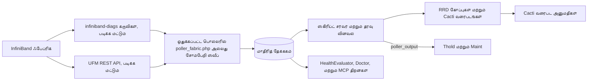

<!-- Source: README.md; SHA256: 79a16fb906f96ee79de2c719f18c38836f555440a7571a4a5ba38c64bb5b099f -->

<!-- translations:start -->
[English](../../../README.md) | [简体中文](../zh-CN/README.md) | [हिन्दी](../hi-IN/README.md) | [Español (España)](../es-ES/README.md) | [Español (Latinoamérica)](../es-419/README.md) | [العربية (السعودية)](../ar-SA/README.md) | [Afrikaans](../af-ZA/README.md) | [አማርኛ](../am-ET/README.md) | [العربية (مصر)](../ar-EG/README.md) | [العربية (المغرب)](../ar-MA/README.md) | [বাংলা](../bn-BD/README.md) | [Bosanski](../bs-BA/README.md) | [Deutsch](../de-DE/README.md) | [فارسی](../fa-IR/README.md) | [Filipino](../fil-PH/README.md) | [Français](../fr-FR/README.md) | [Français (Maroc)](../fr-MA/README.md) | [Français (Sénégal)](../fr-SN/README.md) | [Hausa](../ha-NG/README.md) | [עברית](../he-IL/README.md) | [Hrvatski](../hr-HR/README.md) | [Bahasa Indonesia](../id-ID/README.md) | [Igbo](../ig-NG/README.md) | [Italiano](../it-IT/README.md) | [日本語](../ja-JP/README.md) | [한국어](../ko-KR/README.md) | [Malagasy](../mg-MG/README.md) | [मराठी](../mr-IN/README.md) | [Bahasa Melayu](../ms-MY/README.md) | [Nederlands](../nl-NL/README.md) | [Polski](../pl-PL/README.md) | [Português (Brasil)](../pt-BR/README.md) | [Русский](../ru-RU/README.md) | [Kinyarwanda](../rw-RW/README.md) | [Soomaali](../so-SO/README.md) | [Српски](../sr-RS/README.md) | [Svenska](../sv-SE/README.md) | [Kiswahili](../sw-KE/README.md) | [தமிழ்](README.md) | [తెలుగు](../te-IN/README.md) | [ไทย](../th-TH/README.md) | [Türkçe](../tr-TR/README.md) | [Українська](../uk-UA/README.md) | [اردو](../ur-PK/README.md) | [Tiếng Việt](../vi-VN/README.md) | [isiXhosa](../xh-ZA/README.md) | [Yorùbá](../yo-NG/README.md) | [繁體中文](../zh-TW/README.md) | [isiZulu](../zu-ZA/README.md)
<!-- translations:end -->

# plugin_fabric

InfiniBand போர்ட் கவுன்ட்டர்கள், இணைப்பு அகலம் மற்றும் வேகம், மற்றும் நெரிசல் குறிகாட்டிகளை சாதாரண சாதனங்கள், தரவு மூலங்கள் மற்றும் வரைபடங்களாக Cacti-க்குள் கொண்டுவரும் ஒரு Cacti 1.2 செருகுநிரல் (`fabric`, பதிப்பு `0.1.0-dev`). 4X-க்குப் பதிலாக 1X-இல் பயிற்சி பெற்ற ஒரு இணைப்பு, அது சேவை செய்யும் ஹோஸ்டிற்கு அருகிலேயே Cacti-இன் அனுமதிகளுக்கு உட்பட்டு ஒரு வரைபடமாகவும் Thold எச்சரிக்கையாகவும் தோன்றும்; மேலும் Maint விழிப்புணர்வு மற்றும் அடக்குதலுடன் செயல்படும்.

> **நிலை: உருவாக்கத்தில் உள்ளது, இன்னும் வெளியீடு இல்லை.** இந்தக் கிளை செருகுநிரல் அடித்தளம், Cacti பொருள்கள் மற்றும் எச்சரிக்கை, திட்டமிடப்பட்ட பின்னணி பொல்லர் ஸ்வீப்கள், தொலைநிலைக் கலெக்டர் நகலெடுத்தல், மறைகுறியாக்கப்பட்ட நற்சான்றிதழ் பெட்டகத்துடன் கூடிய படிக்க மட்டுமேயான NVIDIA UFM REST பின்புலம், Configuration-as-Code (CasC) CLI மேலாண்மை, மற்றும் Cacti சூழலமைப்பு கொக்கிகள் (CasC, Doctor, மற்றும் MCP / Abilities API v2) ஆகியவற்றைச் செயல்படுத்துகிறது. இது போலி கருவிகள், செயற்கை UFM பரிமாற்றங்கள் மற்றும் `ibsim` ஃபேப்ரிக் உருவகப்படுத்தி (rdma-core 50.0) ஆகியவற்றிற்கு எதிராகச் சோதிக்கப்பட்டுள்ளது; ஒருபோதும் உண்மையான InfiniBand ஃபேப்ரிக்கிலோ நேரடி UFM சேவையகத்திலோ சோதிக்கப்படவில்லை. வன்பொருள் தேவைப்படும் சோதனைகள் [docs/research/](../../research/) கோப்பகத்தில் திறந்த நிலையிலேயே உள்ளன. இந்தத் திட்டம் Cacti திட்டத்துடன் இணைக்கப்பட்டது அல்ல.

## செயல்படுத்தப்பட்டுள்ளவை

- **வாழ்க்கைச் சுழற்சி மற்றும் தரவுத்தள அமைப்பு (v3)**: நிறுவல், பலமுறை இயக்கினாலும் மாறாத மேம்படுத்தல், நீக்கம் (இயல்புநிலையாகச் செருகுநிரல் அட்டவணைகளைத் தக்கவைத்தல்), மற்றும் நுழைவுப் புள்ளிகள் PHP 8.0-இல் பாகுபடுத்தக்கூடியதாக இருக்கும் நிலையில் PHP 8.2 தேவைப் பாதுகாப்பு.
- **அணுகல் பாத்திரங்கள் மற்றும் பக்கங்கள்**: `Fabric View` (`fabric.php`), `Fabric Operator` (`fabric_operator.php`), மற்றும் `Fabric Admin` (`fabric_admin.php`, `fabric_health.php`) அதிகார வரம்புகள், மேலும் **Configuration > Settings > Fabrics** கீழ் ஒரு Settings தாவல்.
- **படிக்க மட்டுமேயான கண்டறிதல் பின்புலம் (`diags`)**: `perfquery`, `ibnetdiscover` மற்றும் `iblinkinfo` ஆகியவற்றின் கண்டிப்பான அளவுரு-வெக்டர் இயக்கம், அடையாள முரண்பாடு கண்டறிதல் மற்றும் மறு-இணைப்புப் பரிந்துரைகளுடன் GUID அடிப்படையிலான சரக்குப் பட்டியல், இணைப்பு-நிலை மதிப்பீடு, மற்றும் ஒவ்வொரு முனைக்குமான கவுன்ட்டர் ஸ்வீப்கள்.
- **படிக்க மட்டுமேயான NVIDIA UFM REST பின்புலம் (`ufm`) மற்றும் மறைகுறியாக்கப்பட்ட பெட்டகம்**: `diags` போன்ற அதே சரக்குப் பட்டியல், இணைப்பு-நிலை, மாதிரி மற்றும் நல அட்டவணைகளுக்குத் தரவை வழங்கும் GET மட்டுமேயான அனுமதிப்பட்டியல் கொண்ட REST கிளையன்ட் (`/ufmRest/resources/ports`, `/ufmRest/resources/systems`, `/ufmRest/monitoring/session/0/data`, மற்றும் டோக்கன் அங்கீகாரத்திற்கான `/ufmRestV3/...` சமமானவை). நற்சான்றிதழ்கள் (`token` அல்லது `basic`) `fabric_vault_key_file` மூலம் உள்ளமைக்கப்பட்ட வெளிப்புற 256-பிட் திறவுகோல் கோப்பைப் பயன்படுத்தி AES-256-GCM உடன் `plugin_fabric_secret` அட்டவணையில் மறைகுறியாக்கப்பட்டு சேமிக்கப்படுகின்றன. UFM ஃபேப்ரிக்குகளை CasC (`cli/fabric.php`) அல்லது களஞ்சியங்கள் வழியாக வரையறுக்கலாம்; வலை நிர்வாகப் படிவம் தற்போது `diags` புலங்களைக் காட்டுகிறது.
- **Cacti பொருள்கள், Thold, மற்றும் Maint**: Cacti சாதனம், தரவு மற்றும் வரைபட வார்ப்புருக்கள் (`templates/fabric-templates.xml`), "Fabric Port" ஸ்கிரிப்ட்-சர்வர் தரவு வினவல் (`scripts/ss_fabric_ports.php`, `resource/script_server/fabric_ports.xml`), Thold-க்கான `DERIVE` கவுன்ட்டர் தரவு மூலங்கள் மற்றும் `GAUGE` இணைப்பு-நிலை/வீத தரவு மூலங்கள், தொடர்ச்சியின்மைக் கண்காணிப்பு, மற்றும் `U` எனப் புகாரளிக்கப்படும் நிரம்பிய அடிப்படைக் கவுன்ட்டர்கள். Maint ஒருங்கிணைப்பு (`MaintMaintenance`) `plugin_maint_check_cacti_host()` ஐ வினவுகிறது (இல்லையெனில் `is_device_in_maintenance` கொக்கிக்குச் செல்லும்), இதனால் செயலில் உள்ள பராமரிப்பில் உள்ள முனைகள் தனித்தனியாக எண்ணப்பட்டு தோல்வியுற்ற-ஸ்வீப் மற்றும் தரம் குறைந்த-போர்ட் நல எச்சரிக்கைகளிலிருந்து விலக்கப்படுகின்றன.
- **திட்டமிடப்பட்ட ஸ்வீப்கள், பிரித்தளிப்பு (sharding), மற்றும் தொலைநிலைக் கலெக்டர்கள்**: ஸ்கிரிப்ட் சர்வரால் தூண்டப்படும் சோம்பேறி ஸ்வீப்களுடன் சேர்ந்து, தற்போதைய பொல்லருக்கு ஒதுக்கப்பட்ட உரிய நேரத்தை அடைந்த ஃபேப்ரிக்குகளுக்காகப் பின்னணியில் `poller_fabric.php` ஐ `poller_bottom` தொடங்குகிறது. `INFO` ஆனது `remote_collect:1, remote_poller:1` என அறிவிக்கிறது, `poller_fabric.php` ஆனது உறுதிசெய்யக்கூடிய GUID பிரித்தளிப்பை (`--shard=K/N`) ஆதரிக்கிறது, மேலும் `replicate_out` ஆனது ரகசியமற்ற `plugin_fabric_fabric` வரிசைகளைத் தொலைநிலைக் கலெக்டர்களுக்கு (`poller_id >= 2`) நகலெடுக்கிறது. பெட்டகப் பதிவுகள் (`plugin_fabric_secret`) மற்றும் வெளிப்புறத் திறவுகோல் கோப்புகள் ஒருபோதும் நகலெடுக்கப்படுவதில்லை.
- **CasC CLI மற்றும் சூழலமைப்பு கொக்கிகள்**: YAML/XML ஏற்றுமதி, சரிபார்ப்பு, ஒத்திகை வேறுபாடு திட்டமிடல், உறுதிப்படுத்தல்-கட்டுப்படுத்தப்பட்ட பயன்பாடு, மற்றும் நல அறிக்கையிடலுக்கான `cli/fabric.php`, மேலும் `casc_register_providers`, `doctor_register_checks`, மற்றும் `abilities_register` கொக்கிகள்.

## அணுகல் பாத்திரங்கள்

| அதிகார வரம்பு | அணுகல் |
| --- | --- |
| Fabric View | சரக்குப் பட்டியல் மற்றும் போர்ட் காட்சிகளைக் கண்காணித்தல் (`fabric.php`). |
| Fabric Operator | View அணுகலுடன் Operations பக்கம் (`fabric_operator.php`) மற்றும் தனிப்பட்ட முன்னுரிமை ஒப்புதல்கள். |
| Fabric Admin | Operator அணுகலுடன் உள்ளமைவு, நிர்வாகச் செயல்கள் (`fabric_admin.php`), மற்றும் நலப் பக்கம் (`fabric_health.php`). |

மேம்படுத்தல் கோப்புகளை நகலெடுத்த பிறகு, புதிய அதிகார வரம்புகளையும் கொக்கிகளையும் பதிவுசெய்ய நிர்வாகியாக Plugins பக்கத்தைத் திறக்கவும். **Configuration > Users** அல்லது பயனர் குழுக்களின் கீழ் Operator அதிகார வரம்பை வெளிப்படையாக ஒதுக்கவும். மேம்படுத்தல்கள் ஏற்கனவே உள்ள View மற்றும் Admin அதிகார வரம்பு அடையாள எண்களையும் அனுமதிகளையும் தக்கவைக்கும். ஒவ்வொரு கோரிக்கையிலும் Admin அணுகல் Operator அணுகலையும், Operator அணுகல் View அணுகலையும் மரபுரிமையாகப் பெறுகிறது; இது பயனர்கள் அல்லது குழுக்களுக்குச் சேமிக்கப்பட்ட அனுமதிகளைச் சேர்ப்பதில்லை. செருகுநிரல் அமைப்புகளுக்கு Cacti-இன் Settings அனுமதியுடன் கூடுதலாக Fabric Admin அணுகலும் தேவை.

ஒவ்வொரு பயனருக்கும் கிடைக்கும் வரிசைகளையும் செயல்களையும் Cacti சாதன அனுமதிகள் கட்டுப்படுத்துகின்றன; பொருத்தப்படாத பொருள்களுக்கு நிர்வாகி தேவை. நற்சான்றிதழ்கள், உள்ளமைவு, பொருத்துதல், நீக்குதல் மற்றும் பிற நிர்வாக மாற்றங்கள் நிர்வாகப் பக்கங்களிலோ CLI-இலோ இருக்கும். ஒப்புதல்கள் தற்போதைய பயனரின் அமர்வில் மட்டுமே, அதிகபட்சம் ஒரு மணி நேரம் வரை மற்றும் அதே கவனிப்பு புதிதாக இருக்கும் வரை மட்டுமே நீடிக்கும். புதிய அல்லது மாற்றப்பட்ட கவனிப்புகள் அவற்றைச் செல்லாததாக்கும். அவை ஒருபோதும் தோல்வியுற்ற அளவீட்டை ஆரோக்கியமானதாகக் குறிக்கவோ எச்சரிக்கைகளை அடக்கவோ மாட்டா.

## ஏன்

தரம் குறைந்த InfiniBand இணைப்பும் தரவுப் போக்குவரத்தைத் தொடர்ந்து கடத்தும். 1X-இல் மீண்டும் இணையும் ஒரு 4X இணைப்பு போர்ட்டை "active" நிலையிலேயே வைத்திருக்கும், மேலும் ஹோஸ்டின் SNMP இடைமுக வரைபடங்களும் இயல்பாகவே தோன்றும்; ஆனால் நெருக்கமாக இணைக்கப்பட்ட பணிகள் மெதுவாகும். அதற்கான சான்று ஃபேப்ரிக்கில் உள்ளது: ஒவ்வொரு போர்ட்டும் அதன் செயலில் உள்ள, இயக்கப்பட்ட மற்றும் ஆதரிக்கப்படும் அகலம் மற்றும் வேகத்தையும், பிழை மற்றும் நெரிசல் கவுன்ட்டர்களையும் தெரிவிக்கிறது. இதைப் படிக்க InfiniBand கண்டறியும் கருவிகள் அல்லது ஃபேப்ரிக் மேலாளர் API தேவை. கைமுறையாக இயக்கப்படும்போது, அவை மூன்று இடைவெளிகளை விட்டுச்செல்கின்றன:

- **வரலாறு இல்லை.** `perfquery` மற்றும் `iblinkinfo` நிகழ்காலத்தை மட்டுமே காட்டுகின்றன, எனவே கடந்த வாரம் தரம் குறைந்த இணைப்பு தெரியாமல் போகும்.
- **சாதனச் சூழல் இல்லை.** ஃபேப்ரிக் போர்ட்கள் Cacti பொருள்கள் அல்ல, எனவே ஒரு போர்ட் அது சேவை செய்யும் ஹோஸ்டிற்கு அருகில் வரைபடமாக்கப்பட முடியாது.
- **Cacti எச்சரிக்கைக்குள் பாதை இல்லை.** Thold மற்றும் Maint ஆகியவை Cacti தரவு மூலங்கள் மற்றும் சாதனங்களில் செயல்படுகின்றன.

இந்தச் செருகுநிரல் `infiniband-diags` அல்லது NVIDIA UFM REST API மூலம் ஃபேப்ரிக்கைப் படித்து, GUID மூலம் முனைகளையும் போர்ட்களையும் அடையாளம் கண்டு, கவுன்ட்டர்கள் மற்றும் இணைப்பு நிலையை Cacti தரவு மூலங்களாக வெளியிடுவதன் மூலம் இந்த இடைவெளிகளை நிரப்புகிறது. இது படிக்க மட்டுமே செய்யும்: கவுன்ட்டர்களை மீட்டமைக்கவோ போர்ட் நிலையை மாற்றவோ ஒருபோதும் செய்யாது.

## செயல்பாடுகள் மற்றும் CLI

### பின்னணி பொல்லர் மற்றும் கைமுறை ஸ்வீப்கள்

`fabric_poller_bottom()` ஆனது `poller_id` க்கு ஒதுக்கப்பட்ட மற்றும் ஸ்வீப் நேரம் வந்த இயக்கப்பட்ட ஃபேப்ரிக்குகளுக்காக ஒவ்வொரு பொல்லரிலும் பின்னணியில் `poller_fabric.php` ஐத் தொடங்குகிறது. `/path/to/cacti` என்பதை உங்கள் Cacti கோப்பகத்தால் மாற்றி, ஒதுக்கப்பட்ட பொல்லரில் பொல்லர் பயனராகப் பொல்லர் இயக்கியையோ கைமுறை ஸ்வீப்பையோ நேரடியாகவும் இயக்கலாம்:

```sh
php /path/to/cacti/plugins/fabric/poller_fabric.php [--fabric=ID] [--shard=K/N] [--force] [--debug]
php /path/to/cacti/plugins/fabric/fabric_sweep.php --fabric=ID [--node=GUID] [--force]
```

- `poller_fabric.php` ஆனது உள்ளூர் பொல்லருக்கான அனைத்து உரிய ஃபேப்ரிக்குகளையும் (அல்லது `--fabric=ID` உடன் ஒரு ஃபேப்ரிக்கை) இயக்குகிறது, Cacti-இன் செயல்முறைப் பதிவுப் பூட்டையும் `ClaimRepository` குத்தகைகளையும் `max(30, intdiv(sweep_interval, 2))` வினாடிகள் நேர வரம்புடன் செயல்படுத்துகிறது, மேலும் முனை GUID மூலம் `diags` முனை கவுன்ட்டர் ஸ்வீப்களை உறுதியாகப் பிரிக்க `--shard=K/N` (`0 <= K < N`) ஐ ஆதரிக்கிறது.
- `fabric_sweep.php` ஆனது உள்ளூர் பொல்லருக்கு ஒதுக்கப்பட்ட ஒரு இயக்கப்பட்ட ஃபேப்ரிக்கின் (அல்லது `--node=GUID` உடன் ஒரு முனையின்) தேவைக்கேற்ப ஸ்வீப்பை இயக்குகிறது. `--force` ஆனது குத்தகைக் கோரிக்கைகளை மதிக்கும் அதே வேளையில் ஃபேப்ரிக்கின் நேரம் வந்துவிட்டதா என்பதைப் புறக்கணிக்கிறது.

முதல் கண்டறிதல் சரக்குப் பட்டியலை நிரப்பிய பிறகு, Fabric Admin பக்கத்தில் முனைகளை Cacti சாதனங்களுடன் பொருத்தவும். Cacti-இன் ஸ்கிரிப்ட் காலாவதி நேரத்தை 25 வினாடிகள் அல்லது அதற்கு மேல் வைத்திருக்கவும்: தரவு-வினவல் படிப்பால் தொடங்கப்படும் சோம்பேறி ஸ்வீப், கடைசியாகச் சேமிக்கப்பட்ட மாதிரி அல்லது `U` உடன் ஸ்கிரிப்ட் சர்வர் சரியான நேரத்தில் திரும்பும் வகையில் கருவி இயக்கத்தை `script_timeout - 5` வினாடிகளுக்குக் கட்டுப்படுத்துகிறது.

### NVIDIA UFM REST பின்புலம் மற்றும் நற்சான்றிதழ் பெட்டகம்

ஒரு `ufm` ஃபேப்ரிக்கிற்கு உட்பொதிக்கப்பட்ட நற்சான்றிதழ்கள், வினவல் சரங்கள் அல்லது துண்டுகள் இல்லாத `https://` URL தேவை. `UfmSocketTransport` ஆனது TLS சக மற்றும் ஹோஸ்ட் பெயர் சரிபார்ப்பைச் செயல்படுத்துகிறது, வழிமாற்றல்களை நிராகரிக்கிறது, மேலும் விருப்பத்தேர்வு CA தொகுப்பு (`ufm_ca_file`) மற்றும் SHA-256 SPKI பின் (`ufm_spki_pin`) ஆகியவற்றை ஆதரிக்கிறது.

`plugin_fabric_secret` அட்டவணையில் UFM நற்சான்றிதழ்களைச் சேமிக்க, **Configuration > Settings > Fabrics** கீழ் `fabric_vault_key_file` ஐப் பொல்லர் பயனருக்குச் சொந்தமான ஒரு வழக்கமான கோப்பிற்கான முழுப் பாதையுடன் உள்ளமைக்கவும் (எந்தப் பெற்றோர் கோப்பகத்திலும் symlink-கள் இல்லாமல், `0600` அனுமதி முறையில், `openssl rand -hex 32` போன்ற 64 ஹெக்ஸ் எழுத்துகள் அல்லது 32 சீரற்ற அச்சிட முடியாத பைட்டுகளைக் கொண்டிருக்க வேண்டும்). செருகுநிரல் ஒருபோதும் திறவுகோல் கோப்பை உருவாக்கவோ எழுதவோ செய்யாது, மேலும் `replicate_out` ஆனது `plugin_fabric_secret` அல்லது திறவுகோல் கோப்புகளைத் தொலைநிலைப் பொல்லர்களுக்கு ஒருபோதும் நகலெடுக்காது.

### Configuration-as-Code மற்றும் நல CLI

`cli/fabric.php` ஆனது செருகுநிரல் அமைப்புகளையும் ஃபேப்ரிக் வரையறைகளையும் YAML அல்லது XML-இல் அறிவிப்பு முறையில் நிர்வகிக்கிறது, மேலும் நேரடி ஸ்வீப்களை இயக்காமல் பராமரிப்பு-விழிப்புணர்வு கொண்ட நலத்தை அறிக்கையிடுகிறது:

```sh
php /path/to/cacti/plugins/fabric/cli/fabric.php export [--format=yaml|xml] [--file=PATH]
php /path/to/cacti/plugins/fabric/cli/fabric.php validate --file=PATH [--format=yaml|xml]
php /path/to/cacti/plugins/fabric/cli/fabric.php plan --file=PATH [--format=yaml|xml]
php /path/to/cacti/plugins/fabric/cli/fabric.php apply --file=PATH --confirm=PLAN_HASH [--format=yaml|xml]
php /path/to/cacti/plugins/fabric/cli/fabric.php health [--format=text|json]
```

`export` ஆனது `0600` அனுமதி முறையுடன் புதிய கோப்புகளை உருவாக்குகிறது, `fabric_vault_key_file` ஐ `[REDACTED]` என மறைக்கிறது, மேலும் ரகசியங்களுக்குப் பதிலாகப் பெயரிடப்பட்ட `ufm_credential_ref` குறிப்புகளை வெளியிடுகிறது. `plan` மற்றும் `apply` ஆகியவை வரிக்குள் உள்ள `ufm_token`, `ufm_password`, `secret`, மற்றும் வரிக்குள் உள்ள `fabric_vault_key_file` மதிப்புகளை நிராகரிக்கின்றன. `apply` க்கு `plan` உருவாக்கிய சரியான `--confirm=PLAN_HASH` தேவை.

### சூழலமைப்பு கொக்கிகள்

தொடர்புடைய Cacti செருகுநிரல்கள் அல்லது ஹோஸ்ட் ஒருங்கிணைப்புகள் இருக்கும்போது, `setup.php` இவற்றைப் பதிவுசெய்கிறது:

- `casc_register_providers`: ரகசிய மறைப்புடன் `fabric` உள்ளமைவை (`yaml` மற்றும் `xml`, அமைப்பு v1) ஏற்றுமதி செய்கிறது, சரிபார்க்கிறது, திட்டமிடுகிறது மற்றும் உறுதிப்படுத்தலுடன் பயன்படுத்துகிறது.
- `doctor_register_checks`: நான்கு படிக்க மட்டுமேயான கண்டறியும் சோதனைகளை வழங்குகிறது (`fabric.schema`, `fabric.poller_freshness`, `fabric.identity_conflicts`, `fabric.ufm_vault`).
- `abilities_register`: Fabric View அதிகார வரம்பால் (மற்றும் போர்ட் பிழைகளுக்கு Cacti சாதன அனுமதிகளால்) கட்டுப்படுத்தப்படும், `fabric` வகையின் கீழ் மூன்று படிக்க மட்டுமேயான, சேதமில்லாத, பலமுறை இயக்கினாலும் மாறாத திறன்களைப் பதிவுசெய்கிறது: `fabric-list-fabrics`, `fabric-get-health`, மற்றும் `fabric-list-port-errors`.

## வரம்பும் எல்லைகளும்

வரம்புக்கு அப்பாற்பட்டவை: ஃபேப்ரிக் நிலையை மாற்றுதல், கவுன்ட்டர்களை மீட்டமைத்தல், ஃபேப்ரிக் மேலாளர் அல்லது சப்நெட் மேலாளரை மாற்றியமைத்தல், செருகுநிரலுக்குச் சொந்தமான எச்சரிக்கைப் பொறி, தனிப்பயன் டீமான் அல்லது பிணைய நெறிமுறை, மற்றும் Ethernet அல்லது RoCE ஃபேப்ரிக்குகள்.

## தேவைகளும் இணக்கத்தன்மையும்

| கூறு | இலக்கு |
|---|---|
| Cacti | 1.2.31 அல்லது அதற்குப் பிந்தையது (`compat = 1.2.31`), மையத் திருத்தங்கள் இல்லை |
| PHP | 8.2 அல்லது அதற்குப் பிந்தையது; ஆதரிக்கப்படாத இயக்கநேரம் உடைந்த Cacti பயனர் இடைமுகத்திற்குப் பதிலாக மறுப்பைப் பெறும்படி, நுழைவுப் புள்ளிகள் 8.0-இல் பாகுபடுத்தக்கூடியதாக இருக்கும் மற்றும் 8.1-இல் செயல்படுத்தலை மறுக்கும் |
| InfiniBand கருவிகள் | `rdma-core` இலிருந்து `infiniband-diags` (`ibsim` கீழ் rdma-core 50.0 உடன் CI-இல் சோதிக்கப்பட்டது; வெளியீட்டு வடிவங்கள் v66.0 மூலக் குறியீட்டுடன் சரிபார்க்கப்பட்டன) |
| UFM | NVIDIA UFM Enterprise REST API (`ufmRest` மற்றும் `ufmRestV3` படிக்க மட்டுமேயான முனைப்புள்ளிகள்; அலகுச் சோதனைகளில் செயற்கை பரிமாற்றங்களுக்கு எதிராகச் சோதிக்கப்பட்டது) |
| Thold, Maint | மாற்றங்கள் தேவையில்லை; மாற்றப்படாத Thold v1.8.2 மற்றும் Maint v1.3 உடன் CI ஒரு முழுமையான சோதனையை இயக்குகிறது |

## மேம்பாடும் சோதனையும்

CI பணிப்பாய்வு (`.github/workflows/plugin-ci-workflow.yml`) ஆனது Cacti `release/1.2.31` மற்றும் `1.2.x` ஆகியவற்றிற்கு எதிராக PHP 8.2 முதல் 8.5 வரை, PHP 8.0 நுழைவுப் புள்ளி இலக்கணச் சரிபார்ப்பு, PHP 8.1 மறுப்பு, PHPStan, gettext/மொழிபெயர்ப்புச் சரிபார்ப்பு, REUSE உரிமச் சரிபார்ப்பு, பணிப்பாய்வு இலக்கணச் சரிபார்ப்பு, Thold/Maint முழுமையான மறுஇயக்கம், மற்றும் `ibsim` ஃபேப்ரிக் உருவகப்படுத்துதல் ஆகியவற்றைச் சோதிக்கிறது.

Cacti-இன் பூட்டப்பட்ட பகிரப்பட்ட Pest செருகுநிரல் அமைப்பு (`CACTI_PEST_BIN`) மற்றும் ஒருமுறை பயன்படுத்தி நீக்கக்கூடிய Cacti தரவுத்தளத்துடன்:

```sh
# Unit tests
"$CACTI_PEST_BIN" --configuration=phpunit.xml

# Lifecycle integration tests (disposable database only)
CACTI_PATH=/path/to/cacti FABRIC_TEST_DATABASE=disposable "$CACTI_PEST_BIN" --configuration=phpunit-integration.xml

# Static analysis (against Cacti 1.2.31)
CACTI_PATH=/path/to/cacti phpstan analyse -c phpstan.neon --no-progress

# Translation template, catalogs, and localized README checks
sh locales/build_gettext.sh --check

# Simulated ibsim fixture parser check
php tests/bin/check-ibsim-fixtures.php tests/fixtures/ibsim
```

## வடிவமைப்பு

- [docs/PLAN.md](../../PLAN.md) என்பது கட்டமைப்பு மற்றும் வடிவமைப்புத் திட்டமாகும்: ஆதாரங்களுடன் கூடிய அப்ஸ்ட்ரீம் உண்மைகள், திறந்த வன்பொருள் சோதனைகள், அடையாள மாதிரி, கவுன்ட்டர் மற்றும் இணைப்பு-நிலை விதிகள், பாதுகாப்பு எல்லைகள், செயல்திறன் கணக்கீடுகள், சோதனை மற்றும் இடர்கள்.
- [docs/decisions/](../../decisions/) கட்டமைப்பு முடிவுப் பதிவுகளைக் கொண்டுள்ளது.
- [docs/REQUIREMENTS.md](../../REQUIREMENTS.md) ஒவ்வொரு தேவை அடையாள எண்ணையும் அதன் சிக்கலுடன் பொருத்துகிறது.



## பணிகள் எவ்வாறு கண்காணிக்கப்படுகின்றன

- **மைல்கற்கள்** திட்டத்தின் மைல்கற்களைப் பின்பற்றுகின்றன. ஒவ்வொன்றும் அதன் துணைச் சிக்கல்களையும் வெளியேறுதல் சான்றுகளையும் பட்டியலிடும் ஒரு எபிக் சிக்கலைக் கொண்டுள்ளது.
- **சிக்கல்கள்** சிட்டை மூலம் வகைப்படுத்தப்படுகின்றன: `type: requirement`, `type: research`, `type: decision`, `type: epic`. தேவைச் சிக்கல்கள் எண்ணிடப்பட்ட, சோதிக்கக்கூடிய தேவைகளையும் (`REQ-AREA-NNN`) ஏற்பு அளவுகோல்களையும் குறிப்பிடுகின்றன.
- **சிட்டைகள்** `area:`, `phase:`, `priority:` மற்றும் `status:` ஆகியவற்றையும் கொண்டுள்ளன. [CONTRIBUTING.md](../../../CONTRIBUTING.md#labels) ஐப் பார்க்கவும்.
- [திட்டப் பலகை](https://github.com/users/somethingwithproof/projects/8) மைல்கற்கள் முழுவதும் உள்ள அனைத்துச் சிக்கல்களையும் காட்டுகிறது.

## பங்களித்தல்

[CONTRIBUTING.md](../../../CONTRIBUTING.md) ஐப் படிக்கவும். கமிட்களுக்கு DCO ஒப்பம் (`git commit -s`) தேவை. வடிவமைப்பு விவாதம் சிக்கல்களில் நடைபெறுகிறது; திறந்த முடிவுகள் `type: decision` சிட்டையைக் கொண்டுள்ளன.

## பாதுகாப்பு

பாதுகாப்புக் குறைபாடுகளைத் தனிப்பட்ட முறையில் புகாரளிக்கவும்; [SECURITY.md](../../../SECURITY.md) ஐப் பார்க்கவும்.

## உரிமம்

GNU General Public License v2.0, இது Cacti மற்றும் அதன் செருகுநிரல்களின் அதே உரிமமாகும். [LICENSE](../../../LICENSE) ஐப் பார்க்கவும்.
