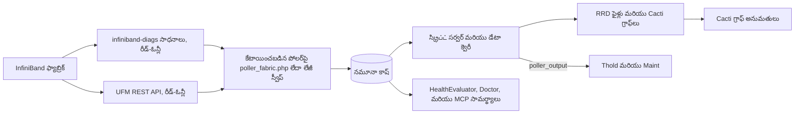

<!-- Source: README.md; SHA256: 79a16fb906f96ee79de2c719f18c38836f555440a7571a4a5ba38c64bb5b099f -->

<!-- translations:start -->
[English](../../../README.md) | [简体中文](../zh-CN/README.md) | [हिन्दी](../hi-IN/README.md) | [Español (España)](../es-ES/README.md) | [Español (Latinoamérica)](../es-419/README.md) | [العربية (السعودية)](../ar-SA/README.md) | [Afrikaans](../af-ZA/README.md) | [አማርኛ](../am-ET/README.md) | [العربية (مصر)](../ar-EG/README.md) | [العربية (المغرب)](../ar-MA/README.md) | [বাংলা](../bn-BD/README.md) | [Bosanski](../bs-BA/README.md) | [Deutsch](../de-DE/README.md) | [فارسی](../fa-IR/README.md) | [Filipino](../fil-PH/README.md) | [Français](../fr-FR/README.md) | [Français (Maroc)](../fr-MA/README.md) | [Français (Sénégal)](../fr-SN/README.md) | [Hausa](../ha-NG/README.md) | [עברית](../he-IL/README.md) | [Hrvatski](../hr-HR/README.md) | [Bahasa Indonesia](../id-ID/README.md) | [Igbo](../ig-NG/README.md) | [Italiano](../it-IT/README.md) | [日本語](../ja-JP/README.md) | [한국어](../ko-KR/README.md) | [Malagasy](../mg-MG/README.md) | [मराठी](../mr-IN/README.md) | [Bahasa Melayu](../ms-MY/README.md) | [Nederlands](../nl-NL/README.md) | [Polski](../pl-PL/README.md) | [Português (Brasil)](../pt-BR/README.md) | [Русский](../ru-RU/README.md) | [Kinyarwanda](../rw-RW/README.md) | [Soomaali](../so-SO/README.md) | [Српски](../sr-RS/README.md) | [Svenska](../sv-SE/README.md) | [Kiswahili](../sw-KE/README.md) | [தமிழ்](../ta-IN/README.md) | [తెలుగు](README.md) | [ไทย](../th-TH/README.md) | [Türkçe](../tr-TR/README.md) | [Українська](../uk-UA/README.md) | [اردو](../ur-PK/README.md) | [Tiếng Việt](../vi-VN/README.md) | [isiXhosa](../xh-ZA/README.md) | [Yorùbá](../yo-NG/README.md) | [繁體中文](../zh-TW/README.md) | [isiZulu](../zu-ZA/README.md)
<!-- translations:end -->

# plugin_fabric

InfiniBand పోర్ట్ కౌంటర్లు, లింక్ వెడల్పు మరియు వేగం, ఇంకా కంజెషన్ సూచికలను సాధారణ పరికరాలు, డేటా సోర్సులు మరియు గ్రాఫ్‌లుగా Cacti లోకి తీసుకువచ్చే Cacti 1.2 ప్లగిన్ (`fabric`, వెర్షన్ `0.1.0-dev`). 4X బదులుగా 1X వద్ద ట్రెయిన్ అయిన లింక్, అది సేవ అందించే హోస్ట్ పక్కనే Cacti అనుమతుల క్రింద ఒక గ్రాఫ్‌గా మరియు Thold అలర్ట్‌గా కనిపిస్తుంది; Maint అవగాహన మరియు సప్రెషన్‌తో పనిచేస్తుంది.

> **స్థితి: అభివృద్ధిలో ఉంది, ఇంకా విడుదల లేదు.** ఈ బ్రాంచ్ ప్లగిన్ పునాది, Cacti ఆబ్జెక్ట్‌లు మరియు అలర్టింగ్, షెడ్యూల్డ్ బ్యాక్‌గ్రౌండ్ పోలర్ స్వీప్‌లు, రిమోట్ కలెక్టర్ రెప్లికేషన్, ఎన్‌క్రిప్ట్ చేసిన క్రెడెన్షియల్ వాల్ట్‌తో కూడిన రీడ్-ఓన్లీ NVIDIA UFM REST బ్యాకెండ్, Configuration-as-Code (CasC) CLI నిర్వహణ, మరియు Cacti ఎకోసిస్టమ్ హుక్‌లు (CasC, Doctor, మరియు MCP / Abilities API v2) అమలు చేస్తుంది. ఇది నకిలీ సాధనాలు, సింథటిక్ UFM ట్రాన్స్‌పోర్ట్‌లు మరియు `ibsim` ఫ్యాబ్రిక్ సిమ్యులేటర్ (rdma-core 50.0) పై పరీక్షించబడింది; భౌతిక InfiniBand ఫ్యాబ్రిక్ లేదా లైవ్ UFM సర్వర్‌పై ఎప్పుడూ పరీక్షించబడలేదు. హార్డ్‌వేర్ అవసరమయ్యే తనిఖీలు [docs/research/](../../research/) లో తెరిచి ఉన్నాయి. ఈ ప్రాజెక్ట్ Cacti ప్రాజెక్ట్‌తో అనుబంధించబడలేదు.

## ఏమి అమలు చేయబడింది

- **జీవితచక్రం మరియు స్కీమా (v3)**: ఇన్‌స్టాల్, పునరావృతమైనా ఫలితం మారని అప్‌గ్రేడ్, అన్‌ఇన్‌స్టాల్ (డిఫాల్ట్‌గా ప్లగిన్ పట్టికలను ఉంచుతుంది), మరియు ఎంట్రీ పాయింట్‌లు PHP 8.0 పై పార్స్ చేయదగినవిగా ఉంటూనే PHP 8.2 అవసర గార్డ్.
- **యాక్సెస్ పాత్రలు మరియు పేజీలు**: `Fabric View` (`fabric.php`), `Fabric Operator` (`fabric_operator.php`), మరియు `Fabric Admin` (`fabric_admin.php`, `fabric_health.php`) రెల్మ్‌లు, అలాగే **Configuration > Settings > Fabrics** క్రింద ఒక Settings ట్యాబ్.
- **రీడ్-ఓన్లీ డయాగ్నస్టిక్స్ బ్యాకెండ్ (`diags`)**: `perfquery`, `ibnetdiscover`, మరియు `iblinkinfo` ల యొక్క కఠినమైన ఆర్గ్యుమెంట్-వెక్టర్ అమలు, గుర్తింపు వైరుధ్యాల గుర్తింపు మరియు రీ-లింక్ ప్రతిపాదనలతో GUID-కీడ్ ఇన్వెంటరీ, లింక్-స్థితి మూల్యాంకనం, మరియు ప్రతి-నోడ్ కౌంటర్ స్వీప్‌లు.
- **రీడ్-ఓన్లీ NVIDIA UFM REST బ్యాకెండ్ (`ufm`) మరియు ఎన్‌క్రిప్ట్ చేసిన వాల్ట్**: `diags` వలె అదే ఇన్వెంటరీ, లింక్-స్థితి, నమూనా మరియు హెల్త్ పట్టికలకు డేటా అందించే GET-ఓన్లీ అనుమతి జాబితా REST క్లయింట్ (`/ufmRest/resources/ports`, `/ufmRest/resources/systems`, `/ufmRest/monitoring/session/0/data`, మరియు టోకెన్ ఆథరైజేషన్ కోసం `/ufmRestV3/...` సమానమైనవి). `fabric_vault_key_file` ద్వారా కాన్ఫిగర్ చేయబడిన బాహ్య 256-బిట్ కీఫైల్‌ను ఉపయోగించి క్రెడెన్షియల్స్ (`token` లేదా `basic`) AES-256-GCM తో `plugin_fabric_secret` లో ఎన్‌క్రిప్ట్ చేసి నిల్వ చేయబడతాయి. UFM ఫ్యాబ్రిక్‌లను CasC (`cli/fabric.php`) లేదా రిపోజిటరీల ద్వారా నిర్వచించవచ్చు; వెబ్ అడ్మిన్ ఫారమ్ ప్రస్తుతం `diags` ఫీల్డ్‌లను చూపుతుంది.
- **Cacti ఆబ్జెక్ట్‌లు, Thold, మరియు Maint**: Cacti పరికరం, డేటా మరియు గ్రాఫ్ టెంప్లేట్‌లు (`templates/fabric-templates.xml`), "Fabric Port" స్క్రిప్ట్-సర్వర్ డేటా క్వెరీ (`scripts/ss_fabric_ports.php`, `resource/script_server/fabric_ports.xml`), Thold కోసం `DERIVE` కౌంటర్ డేటా సోర్సులు మరియు `GAUGE` లింక్-స్థితి/రేట్ డేటా సోర్సులు, డిస్కంటిన్యుటీ ట్రాకింగ్, మరియు `U` గా నివేదించబడే శాచురేటెడ్ ప్రాథమిక కౌంటర్లు. Maint ఇంటిగ్రేషన్ (`MaintMaintenance`) `plugin_maint_check_cacti_host()` ని క్వెరీ చేస్తుంది (`is_device_in_maintenance` హుక్‌కు ఫాల్‌బ్యాక్ అవుతుంది), కాబట్టి క్రియాశీల నిర్వహణలో ఉన్న నోడ్‌లు విడిగా లెక్కించబడతాయి మరియు విఫలమైన-స్వీప్ మరియు క్షీణించిన-పోర్ట్ హెల్త్ హెచ్చరికల నుండి మినహాయించబడతాయి.
- **షెడ్యూల్డ్ స్వీప్‌లు, షార్డింగ్, మరియు రిమోట్ కలెక్టర్లు**: స్క్రిప్ట్ సర్వర్ ద్వారా ట్రిగ్గర్ చేయబడే లేజీ స్వీప్‌లతో పాటు, ప్రస్తుత పోలర్‌కు కేటాయించబడిన సమయం ఆసన్నమైన ఫ్యాబ్రిక్‌ల కోసం `poller_bottom` నేపథ్యంలో `poller_fabric.php` ని ప్రారంభిస్తుంది. `INFO` `remote_collect:1, remote_poller:1` ని ప్రకటిస్తుంది, `poller_fabric.php` నిర్దిష్టమైన GUID షార్డింగ్ (`--shard=K/N`) కు మద్దతు ఇస్తుంది, మరియు `replicate_out` రహస్యేతర `plugin_fabric_fabric` వరుసలను రిమోట్ కలెక్టర్లకు (`poller_id >= 2`) రెప్లికేట్ చేస్తుంది. వాల్ట్ ఎంట్రీలు (`plugin_fabric_secret`) మరియు బాహ్య కీఫైళ్లు ఎప్పుడూ రెప్లికేట్ చేయబడవు.
- **CasC CLI మరియు ఎకోసిస్టమ్ హుక్‌లు**: YAML/XML ఎగుమతి, ధ్రువీకరణ, డ్రై-రన్ డిఫ్ ప్రణాళిక, నిర్ధారణ-ఆధారిత అప్లై, మరియు హెల్త్ రిపోర్టింగ్ కోసం `cli/fabric.php`, అలాగే `casc_register_providers`, `doctor_register_checks`, మరియు `abilities_register` హుక్‌లు.

## యాక్సెస్ పాత్రలు

| రెల్మ్ | యాక్సెస్ |
| --- | --- |
| Fabric View | ఇన్వెంటరీ మరియు పోర్ట్ వీక్షణలను పర్యవేక్షించడం (`fabric.php`). |
| Fabric Operator | View యాక్సెస్‌తో పాటు Operations పేజీ (`fabric_operator.php`) మరియు వ్యక్తిగత ట్రయాజ్ అక్నాలెడ్జ్‌మెంట్లు. |
| Fabric Admin | Operator యాక్సెస్‌తో పాటు కాన్ఫిగరేషన్, పరిపాలనా చర్యలు (`fabric_admin.php`), మరియు హెల్త్ పేజీ (`fabric_health.php`). |

అప్‌గ్రేడ్ ఫైళ్లను కాపీ చేసిన తర్వాత, కొత్త రెల్మ్‌లు మరియు హుక్‌లను నమోదు చేయడానికి అడ్మినిస్ట్రేటర్‌గా Plugins పేజీని తెరవండి. **Configuration > Users** లేదా యూజర్ గ్రూపుల క్రింద Operator రెల్మ్‌ను స్పష్టంగా కేటాయించండి. అప్‌గ్రేడ్‌లు ఇప్పటికే ఉన్న View మరియు Admin రెల్మ్ ID లు మరియు గ్రాంట్‌లను నిలుపుకుంటాయి. ప్రతి అభ్యర్థనపై Admin యాక్సెస్ Operator యాక్సెస్‌ను వారసత్వంగా పొందుతుంది, మరియు Operator యాక్సెస్ View యాక్సెస్‌ను వారసత్వంగా పొందుతుంది; ఇది యూజర్లకు లేదా గ్రూపులకు నిల్వ చేసిన గ్రాంట్‌లను జోడించదు. ప్లగిన్ సెట్టింగ్‌లకు Cacti యొక్క Settings అనుమతితో పాటు Fabric Admin యాక్సెస్ కూడా అవసరం.

Cacti పరికర అనుమతులు ప్రతి యూజర్‌కు అందుబాటులో ఉన్న వరుసలు మరియు చర్యలను పరిమితం చేస్తాయి; మ్యాప్ చేయని ఆబ్జెక్ట్‌లకు అడ్మినిస్ట్రేటర్ అవసరం. క్రెడెన్షియల్స్, కాన్ఫిగరేషన్, మ్యాపింగ్, తొలగింపు మరియు ఇతర పరిపాలనా మార్పులు పరిపాలనా పేజీలలో లేదా CLI లో ఉంటాయి. అక్నాలెడ్జ్‌మెంట్లు ప్రస్తుత యూజర్ సెషన్‌లో మాత్రమే, గరిష్టంగా ఒక గంట పాటు మరియు అదే పరిశీలన తాజాగా ఉన్నంత వరకు మాత్రమే ఉంటాయి. కొత్త లేదా మారిన పరిశీలనలు వాటిని చెల్లుబాటు కాకుండా చేస్తాయి. అవి విఫలమైన కొలతను ఎప్పటికీ ఆరోగ్యకరమైనదిగా గుర్తించవు లేదా అలర్ట్‌లను సప్రెస్ చేయవు.

## ఎందుకు

క్షీణించిన InfiniBand లింక్ ఇప్పటికీ ట్రాఫిక్‌ను పంపుతుంది. 1X వద్ద రీట్రెయిన్ అయిన 4X లింక్ పోర్ట్‌ను "active" గానే ఉంచుతుంది, మరియు హోస్ట్ యొక్క SNMP ఇంటర్‌ఫేస్ గ్రాఫ్‌లు సాధారణంగా కనిపిస్తాయి, కానీ గట్టిగా అనుసంధానించబడిన జాబ్‌లు నెమ్మదిస్తాయి. సాక్ష్యం ఫ్యాబ్రిక్‌లో ఉంటుంది: ప్రతి పోర్ట్ దాని యాక్టివ్, ఎనేబుల్డ్ మరియు సపోర్టెడ్ వెడల్పు మరియు వేగంతో పాటు లోపం మరియు కంజెషన్ కౌంటర్లను నివేదిస్తుంది. దీనిని చదవడానికి InfiniBand డయాగ్నస్టిక్ సాధనాలు లేదా ఫ్యాబ్రిక్ మేనేజర్ API అవసరం. చేతితో అమలు చేసినప్పుడు, అవి మూడు అంతరాలను వదిలివేస్తాయి:

- **చరిత్ర లేదు.** `perfquery` మరియు `iblinkinfo` ప్రస్తుత స్థితిని చూపుతాయి, కాబట్టి గత వారం క్షీణించిన లింక్ కనిపించదు.
- **పరికర సందర్భం లేదు.** ఫ్యాబ్రిక్ పోర్ట్‌లు Cacti ఆబ్జెక్ట్‌లు కావు, కాబట్టి ఒక పోర్ట్‌ను అది ఫీడ్ చేసే హోస్ట్ పక్కన గ్రాఫ్ చేయలేము.
- **Cacti అలర్టింగ్‌లోకి మార్గం లేదు.** Thold మరియు Maint Cacti డేటా సోర్సులు మరియు పరికరాలపై పనిచేస్తాయి.

ఈ ప్లగిన్ `infiniband-diags` లేదా NVIDIA UFM REST API ద్వారా ఫ్యాబ్రిక్‌ను చదవడం ద్వారా, GUID ద్వారా నోడ్‌లు మరియు పోర్ట్‌లను గుర్తించడం ద్వారా, మరియు కౌంటర్లు మరియు లింక్ స్థితిని Cacti డేటా సోర్సులుగా ప్రచురించడం ద్వారా ఈ అంతరాలను పూడుస్తుంది. ఇది చదవడానికి మాత్రమే: ఇది ఎప్పుడూ కౌంటర్లను రీసెట్ చేయదు లేదా పోర్ట్ స్థితిని మార్చదు.

## ఆపరేషన్స్ మరియు CLI

### బ్యాక్‌గ్రౌండ్ పోలర్ మరియు మాన్యువల్ స్వీప్‌లు

`fabric_poller_bottom()` ఆ `poller_id` కి కేటాయించబడిన మరియు స్వీప్ సమయం ఆసన్నమైన ఎనేబుల్ చేసిన ఫ్యాబ్రిక్‌ల కోసం ప్రతి పోలర్‌పై నేపథ్యంలో `poller_fabric.php` ని ప్రారంభిస్తుంది. మీరు కేటాయించబడిన పోలర్‌పై పోలర్ యూజర్‌గా నేరుగా పోలర్ రన్నర్‌ను లేదా మాన్యువల్ స్వీప్‌ను కూడా అమలు చేయవచ్చు (`/path/to/cacti` ని మీ Cacti డైరెక్టరీతో భర్తీ చేస్తూ):

```sh
php /path/to/cacti/plugins/fabric/poller_fabric.php [--fabric=ID] [--shard=K/N] [--force] [--debug]
php /path/to/cacti/plugins/fabric/fabric_sweep.php --fabric=ID [--node=GUID] [--force]
```

- `poller_fabric.php` స్థానిక పోలర్ కోసం సమయం ఆసన్నమైన అన్ని ఫ్యాబ్రిక్‌లను (లేదా `--fabric=ID` తో ఒక ఫ్యాబ్రిక్‌ను) అమలు చేస్తుంది, `max(30, intdiv(sweep_interval, 2))` సెకన్ల సమయ బడ్జెట్‌తో Cacti యొక్క ప్రాసెస్ రిజిస్ట్రీ లాక్ మరియు `ClaimRepository` లీజులను అమలు చేస్తుంది, మరియు నోడ్ GUID ద్వారా `diags` నోడ్ కౌంటర్ స్వీప్‌లను ఖచ్చితంగా షార్డ్ చేయడానికి `--shard=K/N` (`0 <= K < N`) కు మద్దతు ఇస్తుంది.
- `fabric_sweep.php` స్థానిక పోలర్‌కు కేటాయించబడిన ఒక ఎనేబుల్ చేసిన ఫ్యాబ్రిక్ (లేదా `--node=GUID` తో ఒక నోడ్) యొక్క ఆన్-డిమాండ్ స్వీప్‌ను అమలు చేస్తుంది. `--force` క్లెయిమ్‌లను గౌరవిస్తూనే ఫ్యాబ్రిక్ సమయం ఆసన్నమైందో లేదో విస్మరిస్తుంది.

మొదటి ఆవిష్కరణ ఇన్వెంటరీని నింపిన తర్వాత, Fabric Admin పేజీలో నోడ్‌లను Cacti పరికరాలకు మ్యాప్ చేయండి. Cacti స్క్రిప్ట్ టైమ్‌అవుట్‌ను 25 సెకన్లు లేదా అంతకంటే ఎక్కువ ఉంచండి: డేటా-క్వెరీ రీడ్ ద్వారా ప్రారంభించబడిన లేజీ స్వీప్, స్క్రిప్ట్ సర్వర్ చివరిగా నిల్వ చేసిన నమూనా లేదా `U` తో సమయానికి తిరిగి రావడానికి సాధన అమలును `script_timeout - 5` సెకన్లకు పరిమితం చేస్తుంది.

### NVIDIA UFM REST బ్యాకెండ్ మరియు క్రెడెన్షియల్ వాల్ట్

ఒక `ufm` ఫ్యాబ్రిక్‌కు ఎంబెడెడ్ క్రెడెన్షియల్స్, క్వెరీ స్ట్రింగ్‌లు లేదా ఫ్రాగ్మెంట్‌లు లేని `https://` URL అవసరం. `UfmSocketTransport` TLS పీర్ మరియు హోస్ట్‌నేమ్ ధృవీకరణను అమలు చేస్తుంది, రీడైరెక్ట్‌లను తిరస్కరిస్తుంది, మరియు ఐచ్ఛిక CA బండిల్ (`ufm_ca_file`) మరియు SHA-256 SPKI పిన్ (`ufm_spki_pin`) కు మద్దతు ఇస్తుంది.

`plugin_fabric_secret` లో UFM క్రెడెన్షియల్స్‌ను నిల్వ చేయడానికి, పోలర్ యూజర్ యాజమాన్యంలోని సాధారణ ఫైల్‌కు సంపూర్ణ మార్గంతో **Configuration > Settings > Fabrics** క్రింద `fabric_vault_key_file` ని కాన్ఫిగర్ చేయండి (ఏ పేరెంట్ డైరెక్టరీలోనూ సిమ్‌లింక్‌లు లేకుండా, మోడ్ `0600`, `openssl rand -hex 32` వంటి 64 హెక్స్ అక్షరాలు లేదా 32 యాదృచ్ఛిక ప్రింట్ చేయలేని బైట్‌లను కలిగి ఉండాలి). ప్లగిన్ ఎప్పుడూ కీఫైల్‌ను సృష్టించదు లేదా వ్రాయదు, మరియు `replicate_out` ఎప్పుడూ `plugin_fabric_secret` లేదా కీఫైళ్లను రిమోట్ పోలర్‌లకు రెప్లికేట్ చేయదు.

### Configuration-as-Code మరియు హెల్త్ CLI

`cli/fabric.php` ప్లగిన్ సెట్టింగ్‌లు మరియు ఫ్యాబ్రిక్ నిర్వచనాలను YAML లేదా XML లో డిక్లరేటివ్‌గా నిర్వహిస్తుంది, మరియు లైవ్ స్వీప్‌లను అమలు చేయకుండా నిర్వహణ-అవగాహనతో కూడిన హెల్త్‌ను నివేదిస్తుంది:

```sh
php /path/to/cacti/plugins/fabric/cli/fabric.php export [--format=yaml|xml] [--file=PATH]
php /path/to/cacti/plugins/fabric/cli/fabric.php validate --file=PATH [--format=yaml|xml]
php /path/to/cacti/plugins/fabric/cli/fabric.php plan --file=PATH [--format=yaml|xml]
php /path/to/cacti/plugins/fabric/cli/fabric.php apply --file=PATH --confirm=PLAN_HASH [--format=yaml|xml]
php /path/to/cacti/plugins/fabric/cli/fabric.php health [--format=text|json]
```

`export` మోడ్ `0600` తో కొత్త ఫైళ్లను సృష్టిస్తుంది, `fabric_vault_key_file` ని `[REDACTED]` గా మరుగుపరుస్తుంది, మరియు రహస్యాలకు బదులుగా పేరున్న `ufm_credential_ref` సూచనలను ఇస్తుంది. `plan` మరియు `apply` ఇన్‌లైన్ `ufm_token`, `ufm_password`, `secret`, మరియు ఇన్‌లైన్ `fabric_vault_key_file` విలువలను తిరస్కరిస్తాయి. `apply` కి `plan` ఉత్పత్తి చేసిన ఖచ్చితమైన `--confirm=PLAN_HASH` అవసరం.

### ఎకోసిస్టమ్ హుక్‌లు

సంబంధిత Cacti ప్లగిన్‌లు లేదా హోస్ట్ ఇంటిగ్రేషన్‌లు ఉన్నప్పుడు, `setup.php` వీటిని నమోదు చేస్తుంది:

- `casc_register_providers`: రహస్య మరుగుపరుపుతో `fabric` కాన్ఫిగరేషన్ (`yaml` మరియు `xml`, స్కీమా v1) ను ఎగుమతి చేస్తుంది, ధ్రువీకరిస్తుంది, ప్లాన్ చేస్తుంది మరియు నిర్ధారణతో వర్తింపజేస్తుంది.
- `doctor_register_checks`: నాలుగు రీడ్-ఓన్లీ డయాగ్నస్టిక్ తనిఖీలను అందిస్తుంది (`fabric.schema`, `fabric.poller_freshness`, `fabric.identity_conflicts`, `fabric.ufm_vault`).
- `abilities_register`: Fabric View రెల్మ్ (మరియు పోర్ట్ లోపాల కోసం Cacti పరికర అనుమతులు) ద్వారా నియంత్రించబడే `fabric` వర్గం క్రింద మూడు రీడ్-ఓన్లీ, నాన్-డిస్ట్రక్టివ్, ఐడెంపోటెంట్ సామర్థ్యాలను నమోదు చేస్తుంది: `fabric-list-fabrics`, `fabric-get-health`, మరియు `fabric-list-port-errors`.

## పరిధి మరియు సరిహద్దులు

పరిధి వెలుపల ఉన్నవి: ఫ్యాబ్రిక్ స్థితిని మార్చడం, కౌంటర్లను రీసెట్ చేయడం, ఫ్యాబ్రిక్ మేనేజర్ లేదా సబ్‌నెట్ మేనేజర్‌ను భర్తీ చేయడం, ప్లగిన్-సొంత అలర్టింగ్ ఇంజిన్, కస్టమ్ డీమన్ లేదా నెట్‌వర్క్ ప్రోటోకాల్, మరియు Ethernet లేదా RoCE ఫ్యాబ్రిక్‌లు.

## అవసరాలు మరియు అనుకూలత

| భాగం | లక్ష్యం |
|---|---|
| Cacti | 1.2.31 లేదా ఆపై (`compat = 1.2.31`), కోర్ ప్యాచ్‌లు లేవు |
| PHP | 8.2 లేదా ఆపై; మద్దతు లేని రన్‌టైమ్ విరిగిన Cacti UI కి బదులుగా తిరస్కరణను పొందేలా ఎంట్రీ పాయింట్‌లు 8.0 పై పార్స్ చేయదగినవిగా ఉంటాయి మరియు 8.1 పై యాక్టివేషన్‌ను తిరస్కరిస్తాయి |
| InfiniBand సాధనాలు | `rdma-core` నుండి `infiniband-diags` (`ibsim` క్రింద rdma-core 50.0 తో CI లో పరీక్షించబడింది; v66.0 సోర్స్ ఆధారంగా అవుట్‌పుట్ ఫార్మాట్‌లు తనిఖీ చేయబడ్డాయి) |
| UFM | NVIDIA UFM Enterprise REST API (`ufmRest` మరియు `ufmRestV3` రీడ్-ఓన్లీ ఎండ్‌పాయింట్‌లు; యూనిట్ పరీక్షలలో సింథటిక్ ట్రాన్స్‌పోర్ట్‌లపై పరీక్షించబడింది) |
| Thold, Maint | మార్పులు అవసరం లేదు; మార్పులేని Thold v1.8.2 మరియు Maint v1.3 తో CI ఎండ్-టు-ఎండ్ పరీక్షను అమలు చేస్తుంది |

## అభివృద్ధి మరియు పరీక్ష

CI వర్క్‌ఫ్లో (`.github/workflows/plugin-ci-workflow.yml`) Cacti `release/1.2.31` మరియు `1.2.x` లపై PHP 8.2 నుండి 8.5 వరకు, PHP 8.0 ఎంట్రీ-పాయింట్ లింటింగ్, PHP 8.1 తిరస్కరణ, PHPStan, gettext/అనువాద ధృవీకరణ, REUSE లైసెన్సింగ్, వర్క్‌ఫ్లో లింటింగ్, Thold/Maint ఎండ్-టు-ఎండ్ రీప్లే, మరియు `ibsim` ఫ్యాబ్రిక్ సిమ్యులేషన్‌ను పరీక్షిస్తుంది.

Cacti యొక్క లాక్ చేయబడిన భాగస్వామ్య Pest ప్లగిన్ హార్నెస్ (`CACTI_PEST_BIN`) మరియు డిస్పోజబుల్ Cacti డేటాబేస్‌తో:

```sh
# Unit tests
"$CACTI_PEST_BIN" --configuration=phpunit.xml

# Lifecycle integration tests (disposable database only)
CACTI_PATH=/path/to/cacti FABRIC_TEST_DATABASE=disposable "$CACTI_PEST_BIN" --configuration=phpunit-integration.xml

# Static analysis (against Cacti 1.2.31)
CACTI_PATH=/path/to/cacti phpstan analyse -c phpstan.neon --no-progress

# Translation template, catalogs, and localized README checks
sh locales/build_gettext.sh --check

# Simulated ibsim fixture parser check
php tests/bin/check-ibsim-fixtures.php tests/fixtures/ibsim
```

## డిజైన్

- [docs/PLAN.md](../../PLAN.md) ఆర్కిటెక్చర్ మరియు డిజైన్ ప్లాన్: మూలాలతో కూడిన అప్‌స్ట్రీమ్ వాస్తవాలు, తెరిచి ఉన్న హార్డ్‌వేర్ తనిఖీలు, గుర్తింపు నమూనా, కౌంటర్ మరియు లింక్-స్థితి నియమాలు, భద్రతా సరిహద్దులు, పనితీరు గణనలు, పరీక్షలు మరియు ప్రమాదాలు.
- [docs/decisions/](../../decisions/) ఆర్కిటెక్చర్ నిర్ణయ రికార్డులను కలిగి ఉంటుంది.
- [docs/REQUIREMENTS.md](../../REQUIREMENTS.md) ప్రతి అవసర ID ని దాని సమస్యకు మ్యాప్ చేస్తుంది.



## పని ఎలా ట్రాక్ చేయబడుతుంది

- **మైలురాళ్ళు** ప్రణాళిక యొక్క మைలురాళ్ళను అనుసరిస్తాయి. ప్రతి దానికి దాని ఉప-సమస్యలు మరియు నిష్క్రమణ సాక్ష్యాలను జాబితా చేసే ఎపిక్ సమస్య ఉంటుంది.
- **సమస్యలు** లేబుల్ ద్వారా టైప్ చేయబడతాయి: `type: requirement`, `type: research`, `type: decision`, `type: epic`. అవసర సమస్యలు సంఖ్యాబద్ధమైన, పరీక్షించదగిన అవసరాలు (`REQ-AREA-NNN`) మరియు అంగీకార ప్రమాణాలను పేర్కొంటాయి.
- **లేబుల్స్** `area:`, `phase:`, `priority:`, మరియు `status:` లను కూడా కలిగి ఉంటాయి. [CONTRIBUTING.md](../../../CONTRIBUTING.md#labels) చూడండి.
- [ప్రాజెక్ట్ బోర్డ్](https://github.com/users/somethingwithproof/projects/8) మైలురాళ్ళలోని అన్ని సమస్యలను చూపుతుంది.

## సహకారం

[CONTRIBUTING.md](../../../CONTRIBUTING.md) చదవండి. కమిట్‌లకు DCO సైన్-ఆఫ్ (`git commit -s`) అవసరం. డిజైన్ చర్చ సమస్యలపై జరుగుతుంది; తెరిచి ఉన్న నిర్ణయాలకు `type: decision` లేబుల్ ఉంటుంది.

## భద్రత

దుర్బలత్వాలను ప్రైవేట్‌గా నివేదించండి; [SECURITY.md](../../../SECURITY.md) చూడండి.

## లైసెన్స్

GNU General Public License v2.0, Cacti మరియు దాని ప్లగిన్‌ల వలె అదే లైసెన్స్. [LICENSE](../../../LICENSE) చూడండి.
