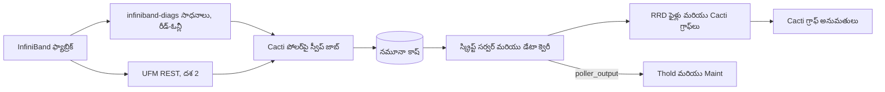

<!-- Source: README.md; SHA256: ce5af61a1bc993ec2aae6d4f22c3885694632f2b1d5eb94e2ce88b8390e96f1e -->

<!-- translations:start -->
[English](../../../README.md) | [简体中文](../zh-CN/README.md) | [हिन्दी](../hi-IN/README.md) | [Español (España)](../es-ES/README.md) | [Español (Latinoamérica)](../es-419/README.md) | [العربية (السعودية)](../ar-SA/README.md) | [Afrikaans](../af-ZA/README.md) | [አማርኛ](../am-ET/README.md) | [العربية (مصر)](../ar-EG/README.md) | [العربية (المغرب)](../ar-MA/README.md) | [বাংলা](../bn-BD/README.md) | [Bosanski](../bs-BA/README.md) | [Deutsch](../de-DE/README.md) | [فارسی](../fa-IR/README.md) | [Filipino](../fil-PH/README.md) | [Français](../fr-FR/README.md) | [Français (Maroc)](../fr-MA/README.md) | [Français (Sénégal)](../fr-SN/README.md) | [Hausa](../ha-NG/README.md) | [עברית](../he-IL/README.md) | [Hrvatski](../hr-HR/README.md) | [Bahasa Indonesia](../id-ID/README.md) | [Igbo](../ig-NG/README.md) | [Italiano](../it-IT/README.md) | [日本語](../ja-JP/README.md) | [한국어](../ko-KR/README.md) | [Malagasy](../mg-MG/README.md) | [मराठी](../mr-IN/README.md) | [Bahasa Melayu](../ms-MY/README.md) | [Nederlands](../nl-NL/README.md) | [Polski](../pl-PL/README.md) | [Português (Brasil)](../pt-BR/README.md) | [Русский](../ru-RU/README.md) | [Kinyarwanda](../rw-RW/README.md) | [Soomaali](../so-SO/README.md) | [Српски](../sr-RS/README.md) | [Svenska](../sv-SE/README.md) | [Kiswahili](../sw-KE/README.md) | [தமிழ்](../ta-IN/README.md) | [తెలుగు](README.md) | [ไทย](../th-TH/README.md) | [Türkçe](../tr-TR/README.md) | [Українська](../uk-UA/README.md) | [اردو](../ur-PK/README.md) | [Tiếng Việt](../vi-VN/README.md) | [isiXhosa](../xh-ZA/README.md) | [Yorùbá](../yo-NG/README.md) | [繁體中文](../zh-TW/README.md) | [isiZulu](../zu-ZA/README.md)
<!-- translations:end -->

# plugin_fabric

InfiniBand పోర్ట్ కౌంటర్లు, లింక్ వెడల్పు మరియు వేగం, ఇంకా కంజెషన్ సూచికలను సాధారణ పరికరాలు, డేటా సోర్సులు మరియు గ్రాఫ్‌లుగా Cacti లోకి తీసుకువచ్చే Cacti 1.2 ప్లగిన్. 4X బదులుగా 1X వద్ద ట్రెయిన్ అయిన లింక్, అది సేవ అందించే హోస్ట్ పక్కనే Cacti అనుమతుల క్రింద ఒక గ్రాఫ్‌గా మరియు Thold అలర్ట్‌గా కనిపిస్తుంది; Maint దానిని సప్రెస్ చేయగలదు.

> **స్థితి: అభివృద్ధిలో ఉంది, ఇంకా విడుదల లేదు.** మైలురాయి 2 (పునాది) `main` పై విలీనం చేయబడింది, మరియు మైలురాయి 3 (Cacti ఆబ్జెక్ట్‌లు మరియు అలర్టింగ్) సమీక్షలో ఉంది. మైలురాయి 1 డాక్యుమెంటేషన్ మరియు అప్‌స్ట్రీమ్ సోర్స్ (PR #71) ఆధారంగా డిజైన్‌ను నిర్ధారించింది; మూలాలతో కూడిన ఫలితాలు [docs/research/](../../research) లో ఉన్నాయి. మైలురాయి 2 ప్లగిన్ పునాదిని జోడిస్తుంది:
>
> - ఇన్‌స్టాల్, అప్‌గ్రేడ్, అన్‌ఇన్‌స్టాల్ మరియు PHP 8.2 గార్డ్
> - View, Operator మరియు Admin రెల్మ్‌లు, మరియు సెట్టింగ్‌లు
> - ఫ్యాబ్రిక్ రికార్డులు
> - `perfquery`, `ibnetdiscover`, మరియు `iblinkinfo` కోసం రీడ్-ఓన్లీ కమాండ్ సరిహద్దు
> - గుర్తింపు వైరుధ్యాలు మరియు రీ-లింక్ ప్రతిపాదనలతో GUID ద్వారా ఇన్వెంటరీ
> - లింక్ స్థితి మరియు కౌంటర్ స్వీప్ కాష్
> - ఇన్వెంటరీ, అడ్మిన్ మరియు హెల్త్ పేజీలు
>
> మైలురాయి 3 Cacti ఆబ్జెక్ట్‌లను జోడిస్తుంది:
>
> - Cacti టెంప్లేట్ XML గా అందించబడిన పరికరం, డేటా మరియు గ్రాఫ్ టెంప్లేట్‌లు, మరియు "Fabric Port" డేటా క్వెరీ
> - ఒక నోడ్‌ను Cacti పరికరానికి మ్యాప్ చేయడం, లేదా నిర్ధారణపై ఒకదానిని సృష్టించడం ([ADR 0010](../../decisions/0010-one-device-per-node.md))
> - గ్రాఫ్‌ల కోసం కౌంటర్ డేటా సోర్సులు, మరియు Thold కోసం GAUGE లింక్ స్థితి మరియు రేట్ డేటా సోర్సులు ([ADR 0011](../../decisions/0011-derive-counters-and-gauge-alert-values.md))
> - డిస్కంటిన్యుటీ నిర్వహణ మరియు తెలియనివిగా చదవబడే శాచురేటెడ్ ప్రాథమిక కౌంటర్లు ([ADR 0012](../../decisions/0012-saturated-basic-counters-read-as-unknown.md)), పోర్ట్ పేజీపై కౌంటర్ చెల్లుబాటు మరియు గ్రాఫ్ లింక్‌లు, మరియు కంజెషన్ ర్యాంకింగ్
> - మార్పులేని Thold v1.8.2 మరియు Maint v1.3 తో ఎండ్-టు-ఎండ్ పరీక్ష, మరియు అనుకరించిన ఫ్యాబ్రిక్‌పై నిజమైన డయాగ్నస్టిక్ సాధనాలను అమలు చేసే CI జాబ్
>
> దశ 3 లో రిమోట్ డేటా కలెక్టర్‌లకు మద్దతు ఇచ్చే వరకు ప్రధాన పోలర్ నుండి మాత్రమే ఫ్యాబ్రిక్‌ను స్వీప్ చేయవచ్చు. ఇది నకిలీ సాధనాలు మరియు ibsim ఫ్యాబ్రిక్ సిమ్యులేటర్‌పై పరీక్షించబడింది, నిజమైన InfiniBand ఫ్యాబ్రిక్‌పై ఎప్పుడూ పరీక్షించబడలేదు. ఫ్యాబ్రిక్ అవసరమయ్యే తనిఖీలు ప్రతి పరిశోధన పేజీ యొక్క లైవ్-చెక్స్ పట్టికలో తెరిచి ఉంటాయి. ఈ ప్రాజెక్ట్ Cacti ప్రాజెక్ట్‌తో అనుబంధించబడలేదు.

## యాక్సెస్ పాత్రలు

| రెల్మ్ | యాక్సెస్ |
| --- | --- |
| Fabric View | ఇప్పటికే ఉన్న పర్యవేక్షణ పేజీలు. |
| Fabric Operator | పర్యవేక్షణతో పాటు Operations పేజీ మరియు వ్యక్తిగత ట్రయాజ్ అక్నాలెడ్జ్‌మెంట్లు. |
| Fabric Admin | Operator యాక్సెస్‌తో పాటు ఇప్పటికే ఉన్న కాన్ఫిగరేషన్ మరియు పరిపాలనా చర్యలు. |

అప్‌గ్రేడ్ ఫైళ్లను కాపీ చేసిన తర్వాత, కొత్త రెల్మ్‌ను నమోదు చేయడానికి అడ్మినిస్ట్రేటర్‌గా Plugins పేజీని తెరవండి. **Configuration > Users** లేదా యూజర్ గ్రూపుల క్రింద Operator రెల్మ్‌ను స్పష్టంగా కేటాయించండి.
అప్‌గ్రేడ్‌లు ఇప్పటికే ఉన్న View మరియు Admin రెల్మ్ ID లు మరియు గ్రాంట్‌లను నిలుపుకుంటాయి. Admin యాక్సెస్ ప్రతి అభ్యర్థనపై Operator యాక్సెస్‌ను వారసత్వంగా పొందుతుంది, మరియు Operator యాక్సెస్ View యాక్సెస్‌ను వారసత్వంగా పొందుతుంది; ఇది యూజర్లకు లేదా గ్రూపులకు నిల్వ చేసిన గ్రాంట్‌లను జోడించదు. ప్లగిన్ సెట్టింగ్‌లకు Cacti యొక్క Settings అనుమతితో పాటు Fabric Admin యాక్సెస్ కూడా అవసరం.

Cacti పరికర అనుమతులు ఇప్పటికీ ప్రతి యూజర్‌కు అందుబాటులో ఉన్న వరుసలు మరియు చర్యలను పరిమితం చేస్తాయి; మ్యాప్ చేయని ఆబ్జెక్ట్‌లకు అడ్మినిస్ట్రేటర్ అవసరం.
క్రెడెన్షియల్స్, కాన్ఫిగరేషన్, మ్యాపింగ్, తొలగింపు మరియు ఇతర పరిపాలనా మార్పులు పరిపాలనా పేజీలలోనే ఉంటాయి. అక్నాలెడ్జ్‌మెంట్లు ప్రస్తుత యూజర్ సెషన్‌లో మాత్రమే, గరిష్టంగా ఒక గంట పాటు మరియు అదే పరిశీలన తాజాగా ఉన్నంత వరకు మాత్రమే ఉంటాయి. కొత్త లేదా మారిన పరిశీలనలు వాటిని చెల్లుబాటు కాకుండా చేస్తాయి. అవి విఫలమైన కొలతను ఎప్పటికీ ఆరోగ్యకరమైనదిగా గుర్తించవు లేదా అలర్ట్‌లను సప్రెస్ చేయవు.

## ఎందుకు

క్షీణించిన InfiniBand లింక్ ఇప్పటికీ ట్రాఫిక్‌ను పంపుతుంది. 1X వద్ద రీట్రెయిన్ అయిన 4X లింక్ పోర్ట్‌ను "యాక్టివ్" గానే ఉంచుతుంది, మరియు హోస్ట్ యొక్క SNMP ఇంటర్‌ఫేస్ గ్రాఫ్‌లు సాధారణంగా కనిపిస్తాయి, కానీ గట్టిగా అనుసంధానించబడిన జాబ్‌లు నెమ్మదిస్తాయి. సాక్ష్యం ఫ్యాబ్రిక్‌లో ఉంటుంది: ప్రతి పోర్ట్ దాని యాక్టివ్, ఎనేబుల్డ్ మరియు సపోర్టెడ్ వెడల్పు మరియు వేగంతో పాటు లోపం మరియు కంజెషన్ కౌంటర్లను నివేదిస్తుంది. దీనిని చదవడానికి InfiniBand డయాగ్నస్టిక్ సాధనాలు లేదా ఫ్యాబ్రిక్ మేనేజర్ API అవసరం. చేతితో అమలు చేసినప్పుడు, అవి మూడు అంతరాలను వదిలివేస్తాయి:

- **చరిత్ర లేదు.** `perfquery` మరియు `iblinkinfo` ప్రస్తుత స్థితిని చూపుతాయి, కాబట్టి గత వారం క్షీణించిన లింక్ కనిపించదు.
- **పరికర సందర్భం లేదు.** ఫ్యాబ్రిక్ పోర్ట్‌లు Cacti ఆబ్జెక్ట్‌లు కావు, కాబట్టి ఒక పోర్ట్‌ను అది ఫీడ్ చేసే హోస్ట్ పక్కన గ్రాఫ్ చేయలేము.
- **Cacti అలర్టింగ్‌లోకి మార్గం లేదు.** Thold మరియు Maint Cacti డేటా సోర్సులు మరియు పరికరాలపై పనిచేస్తాయి.

ఈ ప్లగిన్ తన స్వంత డయాగ్నస్టిక్ సాధనాల ద్వారా (మరియు తర్వాత UFM ద్వారా) ఫ్యాబ్రిక్‌ను చదవడం ద్వారా, GUID ద్వారా నోడ్‌లు మరియు పోర్ట్‌లను గుర్తించడం ద్వారా, మరియు కౌంటర్లు మరియు లింక్ స్థితిని Cacti డేటా సోర్సులుగా ప్రచురించడం ద్వారా ఈ అంతరాలను పూడుస్తుంది. ఇది చదవడానికి మాత్రమే: ఇది ఎప్పుడూ కౌంటర్లను రీసెట్ చేయదు లేదా పోర్ట్ స్థితిని మార్చదు.

## మొదటి ఆవిష్కరణ

కొత్త ఫ్యాబ్రిక్‌లో నోడ్‌లు ఉండవు, మరియు Cacti పరికరానికి మ్యాప్ చేయబడిన నోడ్ కోసం మాత్రమే స్క్రిప్ట్ సర్వర్ నుండి స్వీప్‌లు ప్రారంభమవుతాయి. అందువల్ల మొదటి ఆవిష్కరణ ఒక మాన్యువల్ దశ. ఎనేబుల్ చేసిన ఫ్యాబ్రిక్‌ను సేవ్ చేసిన తర్వాత, ఫ్యాబ్రిక్ కేటాయించబడిన పోలర్‌పై, పోలర్ ఖాతాగా, `/path/to/cacti` ని మీ Cacti డైరెక్టరీతో భర్తీ చేసి దీనిని ఒకసారి అమలు చేయండి (సంపూర్ణ మార్గం cron నుండి కూడా పనిచేస్తుంది):

```
php /path/to/cacti/plugins/fabric/fabric_sweep.php --fabric=ID --force
```

అప్పుడు ఇన్వెంటరీ నిండుతుంది. Fabric Admin పేజీలో నోడ్‌లను Cacti పరికరాలకు మ్యాప్ చేయండి; తదుపరి స్వీప్‌లు డేటా క్వెరీ నుండి ప్రారంభమవుతాయి. ఫ్యాబ్రిక్ యొక్క ఏ నోడ్ కూడా మ్యాప్ చేయబడనప్పుడు, దాని ఇన్వెంటరీని ఏదీ రిఫ్రెష్ చేయదు, కాబట్టి కొత్త లేదా తప్పిపోయిన నోడ్‌లను రికార్డ్ చేయడానికి, మీరు కావాలనుకుంటే cron నుండి, అదే కమాండ్‌ను మళ్లీ అమలు చేయండి. ఇంకా కనుగొనబడని లేదా మ్యాప్ చేసిన నోడ్ లేని ఎనేబుల్ చేసిన ఫ్యాబ్రిక్ కోసం హెల్త్ పేజీ ఈ కమాండ్‌ను చూపుతుంది.

## ప్రణాళికాబద్ధమైన పరిధి

| దశ | పరిధి | మైలురాళ్ళు |
|---|---|---|
| 0, పరిశోధన | వెర్షన్ మ్యాట్రిక్స్, అప్‌స్ట్రీమ్ ప్రవర్తన నిర్ధారణ, హార్డ్‌వేర్‌పై కౌంటర్ ప్రవర్తన, ప్రత్యేక హక్కుల నమూనా, MAD బడ్జెట్, UFM API | [M1](https://github.com/somethingwithproof/plugin_fabric/milestone/1) |
| 1, పరిశీలన | GUID ద్వారా ఇన్వెంటరీ, Cacti పరికరాలు, పోర్ట్ డేటా క్వెరీ, కౌంటర్ మరియు లింక్-స్టేట్ డేటా సోర్సులు, Thold అలర్టింగ్, Maint సప్రెషన్, హెల్త్ పేజీ | [M2](https://github.com/somethingwithproof/plugin_fabric/milestone/2), [M3](https://github.com/somethingwithproof/plugin_fabric/milestone/3), [M4](https://github.com/somethingwithproof/plugin_fabric/milestone/4) |
| 2, UFM | రీడ్-ఓన్లీ UFM REST బ్యాకెండ్, క్రెడెన్షియల్ నిర్వహణ, బ్యాకెండ్‌ల మధ్య గుర్తింపు కొనసాగింపు | [M5](https://github.com/somethingwithproof/plugin_fabric/milestone/5) |
| 3, రిమోట్ | రిమోట్ డేటా కలెక్టర్‌లు, రెప్లికేషన్, `remote_agent` చర్యలు, పెద్ద ఫ్యాబ్రిక్‌ల కోసం షార్డెడ్ స్వీప్‌లు | [M6](https://github.com/somethingwithproof/plugin_fabric/milestone/6) |

పరిధి వెలుపల ఉన్నవి: ఫ్యాబ్రిక్ స్థితిని మార్చడం, ఫ్యాబ్రిక్ మేనేజర్ లేదా సబ్‌నెట్ మేనేజర్‌ను భర్తీ చేయడం, ప్లగిన్-సొంత అలర్టింగ్ ఇంజిన్, కస్టమ్ డీమన్ లేదా నెట్‌వర్క్ ప్రోటోకాల్, మరియు Ethernet లేదా RoCE ఫ్యాబ్రిక్‌లు (పరిశోధన).

## అనుకూలత లక్ష్యాలు

| భాగం | లక్ష్యం |
|---|---|
| Cacti | 1.2.31 లేదా ఆపై, కోర్ ప్యాచ్‌లు లేవు |
| PHP | 8.2 లేదా ఆపై; మద్దతు లేని రన్‌టైమ్ విరిగిన Cacti UI కి బదులుగా తిరస్కరణను పొందేలా `setup.php` 8.0 పై పార్స్ చేయదగినదిగా ఉంటుంది |
| InfiniBand సాధనాలు | rdma-core నుండి infiniband-diags; v66.0 సోర్స్ ఆధారంగా అవుట్‌పుట్ ఫార్మాట్‌లు తనిఖీ చేయబడ్డాయి |
| UFM | UFM Enterprise REST API, దశ 2; విడుదల మ్యాట్రిక్స్ మైలురాయి 1 డెలివరబుల్ |
| Thold, Maint | మార్పులు అవసరం లేదు |

Cacti స్క్రిప్ట్ టైమ్‌అవుట్‌ను దాని డిఫాల్ట్ 25 సెకన్లు లేదా అంతకంటే ఎక్కువ ఉంచండి. డేటా-క్వెరీ రీడ్ ద్వారా ప్రారంభించబడిన స్వీప్, కాష్‌ను చదివి ప్రత్యుత్తరం ఇవ్వడానికి సమయాన్ని కేటాయిస్తూ, సాధన అమలును ఆ టైమ్‌అవుట్ మైనస్ ఐదు సెకన్లకు పరిమితం చేస్తుంది. బడ్జెట్ గడువు ముగిసినప్పుడు, క్వెరీ చివరి ప్రస్తుత నమూనాను లేదా తెలియని దానిని అందిస్తుంది; తదుపరి చక్రం స్వీప్‌ను మళ్లీ ప్రయత్నిస్తుంది. ఈ పరిమితి PHP పోలర్‌కు కూడా వర్తిస్తుంది. ఐదు సెకన్లు లేదా అంతకంటే తక్కువ టైమ్‌అవుట్ సాధనాన్ని ప్రారంభించడానికి సమయాన్ని వదలదు.

## డిజైన్

- [docs/PLAN.md](../../PLAN.md) పూర్తి ప్రణాళిక: ఆర్కిటెక్చర్, అది ఆధారపడే అప్‌స్ట్రీమ్ వాస్తవాలు (మూలాలతో) మరియు ఇంకా నిర్ధారించాల్సిన అంచనాలు, గుర్తింపు నమూనా, కౌంటర్ మరియు లింక్-స్టేట్ నియమాలు, భద్రతా సరిహద్దులు, పనితీరు గణనలు, పరీక్షలు మరియు ప్రమాదాలు.
- [docs/decisions/](../../decisions) ఇప్పటికే తీసుకున్న ఎంపికల కోసం ఆర్కిటెక్చర్ నిర్ణయ రికార్డులను కలిగి ఉంటుంది.
- [docs/REQUIREMENTS.md](../../REQUIREMENTS.md) ప్రతి అవసర ID ని దాని సమస్యకు మ్యాప్ చేస్తుంది.



## పని ఎలా ట్రాక్ చేయబడుతుంది

- **మైలురాళ్ళు** ప్రణాళిక యొక్క మైలురాళ్ళను అనుసరిస్తాయి. ప్రతి దానికి దాని ఉప-సమస్యలు మరియు నిష్క్రమణ సాక్ష్యాలను జాబితా చేసే ఎపిక్ సమస్య ఉంటుంది.
- **సమస్యలు** లేబుల్ ద్వారా టైప్ చేయబడతాయి: `type: requirement`, `type: research`, `type: decision`, `type: epic`. అవసర సమస్యలు సంఖ్యాబద్ధమైన, పరీక్షించదగిన అవసరాలు (`REQ-AREA-NNN`) మరియు అంగీకార ప్రమాణాలను పేర్కొంటాయి.
- **లేబుల్స్** `area:`, `phase:`, `priority:`, మరియు `status:` లను కూడా కలిగి ఉంటాయి. [CONTRIBUTING.md](../../../CONTRIBUTING.md#labels) చూడండి.
- [ప్రాజెక్ట్ బోర్డ్](https://github.com/users/somethingwithproof/projects/8) మైలురాళ్ళలోని అన్ని సమస్యలను చూపుతుంది.

## సహకారం

[CONTRIBUTING.md](../../../CONTRIBUTING.md) చదవండి. కమిట్‌లకు DCO సైన్-ఆఫ్ అవసరం. డిజైన్ చర్చ సమస్యలపై జరుగుతుంది; తెరిచి ఉన్న నిర్ణయాలకు `type: decision` లేబుల్ ఉంటుంది.

## భద్రత

దుర్బలత్వాలను ప్రైవేట్‌గా నివేదించండి; [SECURITY.md](../../../SECURITY.md) చూడండి.

## లైసెన్స్

GNU General Public License v2.0, Cacti మరియు దాని ప్లగిన్‌ల వలె అదే లైసెన్స్. [LICENSE](../../../LICENSE) చూడండి.
