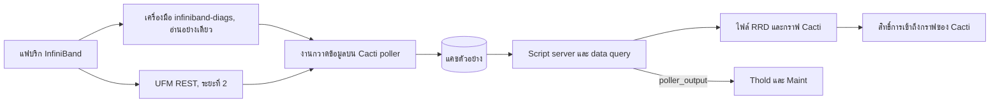

<!-- Source: README.md; SHA256: ce5af61a1bc993ec2aae6d4f22c3885694632f2b1d5eb94e2ce88b8390e96f1e -->

<!-- translations:start -->
[English](../../../README.md) | [简体中文](../zh-CN/README.md) | [हिन्दी](../hi-IN/README.md) | [Español (España)](../es-ES/README.md) | [Español (Latinoamérica)](../es-419/README.md) | [العربية (السعودية)](../ar-SA/README.md) | [Afrikaans](../af-ZA/README.md) | [አማርኛ](../am-ET/README.md) | [العربية (مصر)](../ar-EG/README.md) | [العربية (المغرب)](../ar-MA/README.md) | [বাংলা](../bn-BD/README.md) | [Bosanski](../bs-BA/README.md) | [Deutsch](../de-DE/README.md) | [فارسی](../fa-IR/README.md) | [Filipino](../fil-PH/README.md) | [Français](../fr-FR/README.md) | [Français (Maroc)](../fr-MA/README.md) | [Français (Sénégal)](../fr-SN/README.md) | [Hausa](../ha-NG/README.md) | [עברית](../he-IL/README.md) | [Hrvatski](../hr-HR/README.md) | [Bahasa Indonesia](../id-ID/README.md) | [Igbo](../ig-NG/README.md) | [Italiano](../it-IT/README.md) | [日本語](../ja-JP/README.md) | [한국어](../ko-KR/README.md) | [Malagasy](../mg-MG/README.md) | [मराठी](../mr-IN/README.md) | [Bahasa Melayu](../ms-MY/README.md) | [Nederlands](../nl-NL/README.md) | [Polski](../pl-PL/README.md) | [Português (Brasil)](../pt-BR/README.md) | [Русский](../ru-RU/README.md) | [Kinyarwanda](../rw-RW/README.md) | [Soomaali](../so-SO/README.md) | [Српски](../sr-RS/README.md) | [Svenska](../sv-SE/README.md) | [Kiswahili](../sw-KE/README.md) | [தமிழ்](../ta-IN/README.md) | [తెలుగు](../te-IN/README.md) | [ไทย](README.md) | [Türkçe](../tr-TR/README.md) | [Українська](../uk-UA/README.md) | [اردو](../ur-PK/README.md) | [Tiếng Việt](../vi-VN/README.md) | [isiXhosa](../xh-ZA/README.md) | [Yorùbá](../yo-NG/README.md) | [繁體中文](../zh-TW/README.md) | [isiZulu](../zu-ZA/README.md)
<!-- translations:end -->

# plugin_fabric

ปลั๊กอินสำหรับ Cacti 1.2 ที่นำตัวนับพอร์ต (port counters) ความกว้างและความเร็วของลิงก์ รวมถึงตัวบ่งชี้ความแออัดของ InfiniBand เข้ามาใน Cacti ในรูปแบบของอุปกรณ์ (devices) แหล่งข้อมูล (data sources) และกราฟทั่วไป ลิงก์ที่เชื่อมต่อ (train) ด้วยความเร็วระดับ 1X แทนที่จะเป็น 4X จะปรากฏเป็นกราฟและการแจ้งเตือนของ Thold ข้างโฮสต์ที่ลิงก์นั้นให้บริการ ภายใต้สิทธิ์การเข้าถึงของ Cacti โดย Maint สามารถระงับการแจ้งเตือนดังกล่าวได้

> **สถานะ: อยู่ระหว่างการพัฒนา ยังไม่มีรุ่นเผยแพร่** Milestone 2 (โครงสร้างพื้นฐาน) ถูกรวมเข้าสู่ `main` แล้ว และ Milestone 3 (ออบเจ็กต์ของ Cacti และการแจ้งเตือน) อยู่ระหว่างการตรวจสอบ Milestone 1 ได้ยืนยันการออกแบบเทียบกับเอกสารและซอร์สโค้ดต้นน้ำ (PR #71) แล้ว โดยผลลัพธ์พร้อมแหล่งอ้างอิงอยู่ใน [docs/research/](../../research) ส่วน Milestone 2 เพิ่มโครงสร้างพื้นฐานของปลั๊กอินดังนี้:
>
> - การติดตั้ง การอัปเกรด การถอนการติดตั้ง และการตรวจสอบเวอร์ชัน PHP 8.2
> - ขอบเขตสิทธิ์ (realms) แบบ View, Operator และ Admin และการตั้งค่า
> - ระเบียนข้อมูลของแฟบริก (fabric records)
> - ขอบเขตคำสั่งแบบอ่านอย่างเดียวสำหรับ `perfquery`, `ibnetdiscover` และ `iblinkinfo`
> - รายการอุปกรณ์คงคลังตาม GUID พร้อมการจัดการความขัดแย้งของตัวตนและข้อเสนอการเชื่อมโยงใหม่
> - สถานะลิงก์และแคชการกวาดข้อมูลตัวนับ
> - หน้ารายการอุปกรณ์คงคลัง หน้าผู้ดูแลระบบ และหน้าสถานะสุขภาพ
>
> Milestone 3 เพิ่มออบเจ็กต์ของ Cacti ดังนี้:
>
> - เทมเพลตอุปกรณ์ ข้อมูล และกราฟที่จัดส่งในรูปแบบ XML เทมเพลตของ Cacti และ data query ชื่อ "Fabric Port"
> - การจับคู่โหนดกับอุปกรณ์ Cacti หรือการสร้างอุปกรณ์ใหม่เมื่อยืนยัน ([ADR 0010](../../decisions/0010-one-device-per-node.md))
> - แหล่งข้อมูลตัวนับสำหรับกราฟ และแหล่งข้อมูลสถานะลิงก์และอัตราแบบ GAUGE สำหรับ Thold ([ADR 0011](../../decisions/0011-derive-counters-and-gauge-alert-values.md))
> - การจัดการความไม่ต่อเนื่องและการอ่านตัวนับพื้นฐานที่อิ่มตัวเป็นค่า unknown ([ADR 0012](../../decisions/0012-saturated-basic-counters-read-as-unknown.md)), ความถูกต้องของตัวนับและลิงก์กราฟในหน้าพอร์ต รวมถึงการจัดอันดับความแออัด
> - การทดสอบแบบ end-to-end ร่วมกับ Thold v1.8.2 และ Maint v1.3 ที่ไม่ได้แก้ไข และงาน CI ที่รันเครื่องมือวินิจฉัยจริงกับแฟบริกจำลอง
>
> สามารถกวาดข้อมูลแฟบริกได้จากตัวสำรวจหลัก (main poller) เท่านั้นจนกว่าจะรองรับตัวรวบรวมข้อมูลระยะไกล (remote data collectors) ในระยะที่ 3 ปลั๊กอินนี้ได้รับการทดสอบกับเครื่องมือจำลองและตัวจำลองแฟบริก ibsim เท่านั้น ยังไม่เคยทดสอบบนแฟบริก InfiniBand จริง การตรวจสอบที่ต้องใช้แฟบริกจริงยังคงเปิดค้างอยู่ในตาราง live-checks ของเอกสารวิจัยแต่ละหน้า โครงการนี้ไม่มีส่วนเกี่ยวข้องกับโครงการ Cacti

## บทบาทการเข้าถึง

| ขอบเขตสิทธิ์ (Realm) | การเข้าถึง |
| --- | --- |
| Fabric View | หน้าการเฝ้าติดตามที่มีอยู่ |
| Fabric Operator | การเฝ้าติดตาม รวมถึงหน้า Operations และการรับทราบปัญหา (acknowledgments) เพื่อคัดกรองส่วนบุคคล |
| Fabric Admin | สิทธิ์ของ Operator รวมถึงการตั้งค่าและการดำเนินการดูแลระบบที่มีอยู่ |

หลังจากคัดลอกไฟล์อัปเกรดแล้ว ให้เปิดหน้า Plugins ในฐานะผู้ดูแลระบบเพื่อลงทะเบียนขอบเขตสิทธิ์ใหม่
กำหนดขอบเขตสิทธิ์ Operator อย่างชัดเจนภายใต้ **Configuration > Users** หรือกลุ่มผู้ใช้
การอัปเกรดจะยังคงรหัสและสิทธิ์ของขอบเขตสิทธิ์ View และ Admin ที่มีอยู่เดิมไว้ สิทธิ์ Admin จะสืบทอดสิทธิ์ของ Operator และสิทธิ์ Operator จะสืบทอดสิทธิ์ของ View ในแต่ละคำขอ
โดยไม่เพิ่มสิทธิ์ที่จัดเก็บไว้ให้กับผู้ใช้หรือกลุ่ม การตั้งค่าปลั๊กอินยังต้องใช้สิทธิ์ Fabric Admin นอกเหนือจากสิทธิ์ Settings ของ Cacti ด้วย

สิทธิ์ของอุปกรณ์ Cacti ยังคงจำกัดแถวและการดำเนินการที่ผู้ใช้แต่ละคนเข้าถึงได้ ออบเจ็กต์ที่ยังไม่ได้จับคู่จะต้องดำเนินการโดยผู้ดูแลระบบ
ข้อมูลประจำตัว การตั้งค่า การจับคู่ การลบ และการเปลี่ยนแปลงเชิงบริหารอื่นๆ ยังคงอยู่ในหน้าการดูแลระบบ
การรับทราบปัญหาจะมีผลเฉพาะในเซสชันของผู้ใช้ปัจจุบัน เป็นเวลาสูงสุดหนึ่งชั่วโมง และเฉพาะในขณะที่ค่าสังเกตเดิมยังคงเป็นปัจจุบัน
ค่าสังเกตใหม่หรือที่เปลี่ยนแปลงไปจะทำให้การรับทราบเป็นโมฆะ การรับทราบเหล่านี้จะไม่ทำเครื่องหมายว่าการวัดที่ล้มเหลวเป็นปกติ หรือระงับการแจ้งเตือนแต่อย่างใด

## เหตุผลและที่มา

ลิงก์ InfiniBand ที่เสื่อมสภาพยังคงส่งผ่านทราฟฟิกได้ ลิงก์แบบ 4X ที่ปรับการเชื่อมต่อใหม่ (retrain) เหลือ 1X จะยังคงทำให้พอร์ตอยู่ในสถานะ "active" และกราฟอินเทอร์เฟซ SNMP ของโฮสต์จะดูเป็นปกติ แต่งานที่ทำงานประสานกันอย่างใกล้ชิด (tightly coupled jobs) จะช้าลง หลักฐานจะปรากฏอยู่ในแฟบริก: แต่ละพอร์ตจะรายงานความกว้างและความเร็วที่ใช้งานอยู่ (active) ที่เปิดใช้งาน (enabled) และที่รองรับ (supported) รวมถึงตัวนับข้อผิดพลาดและความแออัด การอ่านค่าเหล่านี้ต้องใช้เครื่องมือวินิจฉัย InfiniBand หรือ API ของตัวจัดการแฟบริก ซึ่งเมื่อรันด้วยตนเองจะเกิดช่องว่างสามประการ:

- **ไม่มีประวัติย้อนหลัง** `perfquery` และ `iblinkinfo` แสดงเฉพาะสถานะปัจจุบัน ดังนั้นลิงก์ที่เสื่อมสภาพไปเมื่อสัปดาห์ที่แล้วจะมองไม่เห็น
- **ไม่มีบริบทของอุปกรณ์** พอร์ตของแฟบริกไม่ได้เป็นออบเจ็กต์ของ Cacti จึงไม่สามารถสร้างกราฟพอร์ตเคียงข้างกับโฮสต์ที่พอร์ตนั้นเชื่อมต่ออยู่ได้
- **ไม่มีเส้นทางเข้าสู่ระบบแจ้งเตือนของ Cacti** Thold และ Maint ทำงานบนแหล่งข้อมูลและอุปกรณ์ของ Cacti

ปลั๊กอินนี้ปิดช่องว่างเหล่านี้โดยการอ่านข้อมูลแฟบริกผ่านเครื่องมือวินิจฉัยของตนเอง (และผ่าน UFM ในภายหลัง) ระบุโหนดและพอร์ตด้วย GUID และเผยแพร่ตัวนับและสถานะลิงก์เป็นแหล่งข้อมูลของ Cacti โดยเป็นการอ่านข้อมูลอย่างเดียว: ปลั๊กอินจะไม่รีเซ็ตตัวนับหรือเปลี่ยนสถานะพอร์ตเลย

## การค้นพบครั้งแรก

แฟบริกใหม่จะยังไม่มีโหนดใดๆ และการกวาดข้อมูลจะเริ่มจาก script server เฉพาะสำหรับโหนดที่ถูกจับคู่กับอุปกรณ์ Cacti แล้วเท่านั้น ดังนั้นการค้นพบครั้งแรกจึงเป็นขั้นตอนที่ต้องทำด้วยตนเอง หลังจากบันทึกแฟบริกที่เปิดใช้งานแล้ว ให้รันคำสั่งนี้หนึ่งครั้งบน poller ที่แฟบริกถูกกำหนดไว้ โดยใช้บัญชีของ poller และแทนที่ `/path/to/cacti` ด้วยไดเรกทอรี Cacti ของคุณ (พาธแบบสัมบูรณ์ใช้ได้จาก cron เช่นกัน):

```
php /path/to/cacti/plugins/fabric/fabric_sweep.php --fabric=ID --force
```

จากนั้นรายการอุปกรณ์คงคลังจะถูกเติมข้อมูล จับคู่โหนดกับอุปกรณ์ Cacti ในหน้า Fabric Admin และการกวาดข้อมูลในภายหลังจะเริ่มจาก data query โดยอัตโนมัติ ตราบใดที่ยังไม่มีโหนดใดของแฟบริกถูกจับคู่ จะไม่มีกระบวนการใดรีเฟรชรายการอุปกรณ์คงคลัง ดังนั้นให้รันคำสั่งเดิมอีกครั้ง หรือตั้งผ่าน cron หากต้องการ เพื่อบันทึกโหนดใหม่หรือโหนดที่หายไป หน้าสถานะสุขภาพจะแสดงคำสั่งนี้สำหรับแฟบริกที่เปิดใช้งานซึ่งยังไม่ได้รับการค้นพบหรือยังไม่มีโหนดที่ถูกจับคู่

## ขอบเขตตามแผน

| ระยะ | ขอบเขต | ไมล์สโตน |
|---|---|---|
| 0, การวิจัย | เมทริกซ์เวอร์ชัน, การยืนยันพฤติกรรมต้นน้ำ, พฤติกรรมตัวนับบนฮาร์ดแวร์, โมเดลสิทธิ์, งบประมาณ MAD, UFM API | [M1](https://github.com/somethingwithproof/plugin_fabric/milestone/1) |
| 1, การสังเกตการณ์ | รายการอุปกรณ์คงคลังตาม GUID, อุปกรณ์ Cacti, data query ของพอร์ต, แหล่งข้อมูลตัวนับและสถานะลิงก์, การแจ้งเตือน Thold, การระงับด้วย Maint, หน้าสถานะสุขภาพ | [M2](https://github.com/somethingwithproof/plugin_fabric/milestone/2), [M3](https://github.com/somethingwithproof/plugin_fabric/milestone/3), [M4](https://github.com/somethingwithproof/plugin_fabric/milestone/4) |
| 2, UFM | แบ็กเอนด์ UFM REST แบบอ่านอย่างเดียว, การจัดการข้อมูลประจำตัว, ความต่อเนื่องของตัวตนระหว่างแบ็กเอนด์ | [M5](https://github.com/somethingwithproof/plugin_fabric/milestone/5) |
| 3, ระยะไกล | ตัวรวบรวมข้อมูลระยะไกล, การทำซ้ำข้อมูล, การดำเนินการ `remote_agent`, การกวาดข้อมูลแบบแบ่งส่วนสำหรับแฟบริกขนาดใหญ่ | [M6](https://github.com/somethingwithproof/plugin_fabric/milestone/6) |

นอกเหนือขอบเขต: การเปลี่ยนแปลงสถานะแฟบริก, การแทนที่ตัวจัดการแฟบริกหรือตัวจัดการซับเน็ต, เอ็นจินแจ้งเตือนของปลั๊กอินเอง, ดีมอนหรือโปรโตคอลเครือข่ายแบบกำหนดเอง และแฟบริก Ethernet หรือ RoCE (อยู่ในขั้นตอนวิจัย)

## เป้าหมายความเข้ากันได้

| องค์ประกอบ | เป้าหมาย |
|---|---|
| Cacti | 1.2.31 หรือใหม่กว่า โดยไม่ต้องแพตช์คอร์ของระบบ |
| PHP | 8.2 หรือใหม่กว่า; `setup.php` ยังคงรองรับการพาร์สบน 8.0 เพื่อให้อินเทอร์เฟซแสดงการปฏิเสธอย่างเหมาะสมแทนที่ UI ของ Cacti จะเสียหายเมื่อรันบนเวอร์ชันที่ไม่รองรับ |
| เครื่องมือ InfiniBand | infiniband-diags จาก rdma-core; ตรวจสอบรูปแบบเอาต์พุตเทียบกับซอร์สโค้ด v66.0 |
| UFM | UFM Enterprise REST API ในระยะที่ 2; เมทริกซ์รุ่นเป็นผลงานส่งมอบในไมล์สโตน 1 |
| Thold, Maint | ไม่จำเป็นต้องแก้ไขโค้ด |

กำหนดค่า script timeout ของ Cacti ไว้ที่ค่าเริ่มต้น 25 วินาทีหรือสูงกว่า การกวาดข้อมูลที่เริ่มจากการอ่าน data-query จะจำกัดเวลาการทำงานของเครื่องมือไว้ที่ค่า timeout ดังกล่าวลบด้วย 5 วินาที เพื่อสำรองเวลาไว้สำหรับการอ่านแคชและส่งคำตอบ เมื่อครบกำหนดเวลา query จะส่งคืนค่าตัวอย่างล่าสุดที่มีอยู่หรือค่า unknown แล้วรอบถัดไปจึงจะลองกวาดข้อมูลใหม่ ข้อจำกัดนี้ใช้กับ PHP poller ด้วยเช่นกัน การตั้งค่า timeout ที่ 5 วินาทีหรือน้อยกว่าจะไม่เหลือเวลาพอให้เริ่มรันเครื่องมือ

## การออกแบบ

- [docs/PLAN.md](../../PLAN.md) คือแผนฉบับสมบูรณ์: สถาปัตยกรรม, ข้อเท็จจริงต้นน้ำที่ระบบพึ่งพา (พร้อมแหล่งอ้างอิง) และสมมติฐานที่ยังต้องยืนยัน, โมเดลตัวตน, กฎของตัวนับและสถานะลิงก์, ขอบเขตความปลอดภัย, การคำนวณประสิทธิภาพ, การทดสอบ และความเสี่ยง
- [docs/decisions/](../../decisions) เก็บบันทึกการตัดสินใจทางสถาปัตยกรรมสำหรับทางเลือกที่ได้ตัดสินใจแล้ว
- [docs/REQUIREMENTS.md](../../REQUIREMENTS.md) จับคู่รหัสข้อกำหนดแต่ละรายการเข้ากับ issue ที่เกี่ยวข้อง



## การติดตามงาน

- **ไมล์สโตน (Milestones)** เป็นไปตามไมล์สโตนในแผนงาน โดยแต่ละรายการจะมี epic issue ที่ระบุ sub-issues และหลักฐานการปิดงาน
- **Issues** ถูกจัดประเภทด้วยป้ายกำกับ: `type: requirement`, `type: research`, `type: decision`, `type: epic` โดย issue ประเภท requirement จะระบุข้อกำหนดที่มีหมายเลขและทดสอบได้ (`REQ-AREA-NNN`) พร้อมเกณฑ์การยอมรับ
- **ป้ายกำกับ (Labels)** ยังระบุ `area:`, `phase:`, `priority:` และ `status:` ด้วย ดูรายละเอียดที่ [CONTRIBUTING.md](../../../CONTRIBUTING.md#labels)
- [บอร์ดโครงการ](https://github.com/users/somethingwithproof/projects/8) แสดง issue ทั้งหมดในทุกไมล์สโตน

## การมีส่วนร่วม

อ่าน [CONTRIBUTING.md](../../../CONTRIBUTING.md) คอมมิตจำเป็นต้องมีการลงนาม DCO sign-off การอภิปรายด้านการออกแบบจะเกิดขึ้นใน issues ส่วนการตัดสินใจที่ยังเปิดอยู่จะมีป้ายกำกับ `type: decision`

## ความปลอดภัย

รายงานช่องโหว่แบบส่วนตัว ดูรายละเอียดที่ [SECURITY.md](../../../SECURITY.md)

## สัญญาอนุญาต

GNU General Public License v2.0 ซึ่งเป็นสัญญาอนุญาตเดียวกับ Cacti และปลั๊กอินของ Cacti ดูรายละเอียดที่ [LICENSE](../../../LICENSE)
