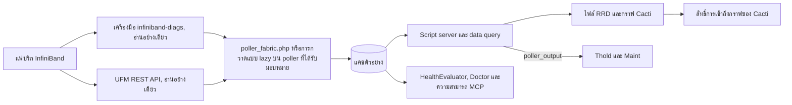

<!-- Source: README.md; SHA256: 79a16fb906f96ee79de2c719f18c38836f555440a7571a4a5ba38c64bb5b099f -->

<!-- translations:start -->
[English](../../../README.md) | [简体中文](../zh-CN/README.md) | [हिन्दी](../hi-IN/README.md) | [Español (España)](../es-ES/README.md) | [Español (Latinoamérica)](../es-419/README.md) | [العربية (السعودية)](../ar-SA/README.md) | [Afrikaans](../af-ZA/README.md) | [አማርኛ](../am-ET/README.md) | [العربية (مصر)](../ar-EG/README.md) | [العربية (المغرب)](../ar-MA/README.md) | [বাংলা](../bn-BD/README.md) | [Bosanski](../bs-BA/README.md) | [Deutsch](../de-DE/README.md) | [فارسی](../fa-IR/README.md) | [Filipino](../fil-PH/README.md) | [Français](../fr-FR/README.md) | [Français (Maroc)](../fr-MA/README.md) | [Français (Sénégal)](../fr-SN/README.md) | [Hausa](../ha-NG/README.md) | [עברית](../he-IL/README.md) | [Hrvatski](../hr-HR/README.md) | [Bahasa Indonesia](../id-ID/README.md) | [Igbo](../ig-NG/README.md) | [Italiano](../it-IT/README.md) | [日本語](../ja-JP/README.md) | [한국어](../ko-KR/README.md) | [Malagasy](../mg-MG/README.md) | [मराठी](../mr-IN/README.md) | [Bahasa Melayu](../ms-MY/README.md) | [Nederlands](../nl-NL/README.md) | [Polski](../pl-PL/README.md) | [Português (Brasil)](../pt-BR/README.md) | [Русский](../ru-RU/README.md) | [Kinyarwanda](../rw-RW/README.md) | [Soomaali](../so-SO/README.md) | [Српски](../sr-RS/README.md) | [Svenska](../sv-SE/README.md) | [Kiswahili](../sw-KE/README.md) | [தமிழ்](../ta-IN/README.md) | [తెలుగు](../te-IN/README.md) | [ไทย](README.md) | [Türkçe](../tr-TR/README.md) | [Українська](../uk-UA/README.md) | [اردو](../ur-PK/README.md) | [Tiếng Việt](../vi-VN/README.md) | [isiXhosa](../xh-ZA/README.md) | [Yorùbá](../yo-NG/README.md) | [繁體中文](../zh-TW/README.md) | [isiZulu](../zu-ZA/README.md)
<!-- translations:end -->

# plugin_fabric

ปลั๊กอินสำหรับ Cacti 1.2 (`fabric`, เวอร์ชัน `0.1.0-dev`) ที่นำตัวนับพอร์ต (port counters) ความกว้างและความเร็วของลิงก์ รวมถึงตัวบ่งชี้ความแออัดของ InfiniBand เข้ามาใน Cacti ในรูปแบบของอุปกรณ์ (devices) แหล่งข้อมูล (data sources) และกราฟทั่วไป ลิงก์ที่เชื่อมต่อ (train) ด้วยความเร็วระดับ 1X แทนที่จะเป็น 4X จะปรากฏเป็นกราฟและการแจ้งเตือนของ Thold ข้างโฮสต์ที่ลิงก์นั้นให้บริการ ภายใต้สิทธิ์การเข้าถึงของ Cacti พร้อมการรับรู้และการระงับการแจ้งเตือนจาก Maint

> **สถานะ: อยู่ระหว่างการพัฒนา ยังไม่มีรุ่นเผยแพร่** สาขานี้ได้พัฒนาโครงสร้างพื้นฐานของปลั๊กอิน ออบเจ็กต์และการแจ้งเตือนของ Cacti การกวาดข้อมูลเบื้องหลังตามกำหนดเวลาของ poller การทำซ้ำข้อมูลไปยังตัวรวบรวมระยะไกล แบ็กเอนด์ NVIDIA UFM REST แบบอ่านอย่างเดียวพร้อมห้องนิรภัยเก็บข้อมูลประจำตัวที่เข้ารหัส การจัดการ CLI แบบ Configuration-as-Code (CasC) และ hook ของระบบนิเวศ Cacti (CasC, Doctor และ MCP / Abilities API v2) โดยได้รับการทดสอบกับเครื่องมือจำลอง, transport จำลองของ UFM และตัวจำลองแฟบริก `ibsim` (rdma-core 50.0) เท่านั้น ไม่เคยทดสอบบนแฟบริก InfiniBand จริงหรือเซิร์ฟเวอร์ UFM จริง การตรวจสอบที่ต้องใช้ฮาร์ดแวร์ยังคงเปิดค้างอยู่ใน [docs/research/](../../research/) โครงการนี้ไม่มีส่วนเกี่ยวข้องกับโครงการ Cacti

## สิ่งที่ได้พัฒนาแล้ว

- **วงจรชีวิตและสคีมา (v3)**: การติดตั้ง การอัปเกรดแบบ idempotent การถอนการติดตั้ง (คงตารางของปลั๊กอินไว้เป็นค่าเริ่มต้น) และการตรวจสอบเงื่อนไข PHP 8.2 โดยยังคงให้จุดเริ่มต้น (entry points) สามารถพาร์สบน PHP 8.0 ได้
- **บทบาทการเข้าถึงและหน้าเว็บ**: ขอบเขตสิทธิ์ `Fabric View` (`fabric.php`), `Fabric Operator` (`fabric_operator.php`) และ `Fabric Admin` (`fabric_admin.php`, `fabric_health.php`) รวมถึงแท็บการตั้งค่าภายใต้ **Configuration > Settings > Fabrics**
- **แบ็กเอนด์การวินิจฉัยแบบอ่านอย่างเดียว (`diags`)**: การรัน `perfquery`, `ibnetdiscover` และ `iblinkinfo` แบบกำหนดอาร์กิวเมนต์เวกเตอร์อย่างเข้มงวด รายการอุปกรณ์คงคลังตาม GUID พร้อมการตรวจจับความขัดแย้งของตัวตนและข้อเสนอการเชื่อมโยงใหม่ การประเมินสถานะลิงก์ และการกวาดข้อมูลตัวนับรายโหนด
- **แบ็กเอนด์ NVIDIA UFM REST แบบอ่านอย่างเดียว (`ufm`) และห้องนิรภัยที่เข้ารหัส**: ไคลเอนต์ REST แบบ GET เท่านั้นที่อนุญาตเฉพาะเส้นทางที่กำหนด (`/ufmRest/resources/ports`, `/ufmRest/resources/systems`, `/ufmRest/monitoring/session/0/data` และเส้นทางเทียบเท่า `/ufmRestV3/...` สำหรับการยืนยันตัวตนด้วยโทเค็น) ซึ่งส่งข้อมูลเข้าสู่ตารางรายการอุปกรณ์คงคลัง สถานะลิงก์ ตัวอย่าง และสถานะสุขภาพชุดเดียวกับ `diags` ข้อมูลประจำตัว (`token` หรือ `basic`) จะถูกเข้ารหัสด้วย AES-256-GCM และจัดเก็บไว้ใน `plugin_fabric_secret` โดยใช้ไฟล์คีย์ภายนอกขนาด 256 บิตที่กำหนดค่าผ่าน `fabric_vault_key_file` แฟบริกแบบ UFM สามารถกำหนดผ่าน CasC (`cli/fabric.php`) หรือคลังโค้ดได้ ส่วนแบบฟอร์มผู้ดูแลระบบบนเว็บในปัจจุบันแสดงเฉพาะฟิลด์ของ `diags`
- **ออบเจ็กต์ของ Cacti, Thold และ Maint**: เทมเพลตอุปกรณ์ ข้อมูล และกราฟของ Cacti (`templates/fabric-templates.xml`), data query ของ script server ชื่อ "Fabric Port" (`scripts/ss_fabric_ports.php`, `resource/script_server/fabric_ports.xml`), แหล่งข้อมูลตัวนับแบบ `DERIVE` และแหล่งข้อมูลสถานะลิงก์/อัตราแบบ `GAUGE` สำหรับ Thold การติดตามความไม่ต่อเนื่อง และการรายงานตัวนับพื้นฐานที่อิ่มตัวเป็นค่า `U` การผสานรวมกับ Maint (`MaintMaintenance`) จะเรียกใช้ `plugin_maint_check_cacti_host()` (และย้อนกลับไปใช้ hook `is_device_in_maintenance` หากไม่มี) เพื่อให้นับโหนดที่อยู่ระหว่างการบำรุงรักษาแยกต่างหากและยกเว้นจากคำเตือนสุขภาพของการกวาดข้อมูลที่ล้มเหลวและพอร์ตที่เสื่อมสภาพ
- **การกวาดข้อมูลตามกำหนดเวลา การแบ่งส่วน และตัวรวบรวมระยะไกล**: `poller_bottom` จะเปิดการทำงานของ `poller_fabric.php` ในพื้นหลังสำหรับแฟบริกที่ถึงกำหนดเวลาและได้รับมอบหมายให้ poller ปัจจุบัน ควบคู่ไปกับการกวาดข้อมูลแบบ lazy ที่ทริกเกอร์โดย script server ส่วน `INFO` ประกาศ `remote_collect:1, remote_poller:1`, `poller_fabric.php` รองรับการแบ่งส่วนตาม GUID แบบกำหนดผลลัพธ์ได้ (`--shard=K/N`) และ `replicate_out` ทำซ้ำแถวข้อมูลที่ไม่เป็นความลับใน `plugin_fabric_fabric` ไปยังตัวรวบรวมระยะไกล (`poller_id >= 2`) รายการในห้องนิรภัย (`plugin_fabric_secret`) และไฟล์คีย์ภายนอกจะไม่ถูกทำซ้ำเลย
- **CasC CLI และ hook ของระบบนิเวศ**: `cli/fabric.php` สำหรับการส่งออก YAML/XML การตรวจสอบความถูกต้อง การวางแผนดูความแตกต่างแบบ dry-run การนำไปใช้ที่ต้องมีการยืนยัน และการรายงานสถานะสุขภาพ รวมถึง hook `casc_register_providers`, `doctor_register_checks` และ `abilities_register`

## บทบาทการเข้าถึง

| ขอบเขตสิทธิ์ | การเข้าถึง |
| --- | --- |
| Fabric View | มุมมองการเฝ้าติดตามรายการอุปกรณ์คงคลังและพอร์ต (`fabric.php`) |
| Fabric Operator | สิทธิ์ของ View รวมถึงหน้า Operations (`fabric_operator.php`) และการรับทราบปัญหาเพื่อคัดกรองส่วนบุคคล |
| Fabric Admin | สิทธิ์ของ Operator รวมถึงการตั้งค่า การดำเนินการดูแลระบบ (`fabric_admin.php`) และหน้าสถานะสุขภาพ (`fabric_health.php`) |

หลังจากคัดลอกไฟล์อัปเกรดแล้ว ให้เปิดหน้า Plugins ในฐานะผู้ดูแลระบบเพื่อลงทะเบียนขอบเขตสิทธิ์และ hook ใหม่ กำหนดขอบเขตสิทธิ์ Operator อย่างชัดเจนภายใต้ **Configuration > Users** หรือกลุ่มผู้ใช้ การอัปเกรดจะยังคงรหัสและสิทธิ์ของขอบเขตสิทธิ์ View และ Admin ที่มีอยู่เดิมไว้ สิทธิ์ Admin จะสืบทอดสิทธิ์ของ Operator และสิทธิ์ Operator จะสืบทอดสิทธิ์ของ View ในแต่ละคำขอ โดยไม่เพิ่มสิทธิ์ที่จัดเก็บไว้ให้กับผู้ใช้หรือกลุ่ม การตั้งค่าปลั๊กอินยังต้องใช้สิทธิ์ Fabric Admin นอกเหนือจากสิทธิ์ Settings ของ Cacti ด้วย

สิทธิ์ของอุปกรณ์ Cacti จำกัดแถวและการดำเนินการที่ผู้ใช้แต่ละคนเข้าถึงได้ ออบเจ็กต์ที่ยังไม่ได้จับคู่จะต้องดำเนินการโดยผู้ดูแลระบบ ข้อมูลประจำตัว การตั้งค่า การจับคู่ การลบ และการเปลี่ยนแปลงเชิงบริหารอื่นๆ ยังคงอยู่ในหน้าการดูแลระบบหรือ CLI การรับทราบปัญหาจะมีผลเฉพาะในเซสชันของผู้ใช้ปัจจุบัน เป็นเวลาสูงสุดหนึ่งชั่วโมง และเฉพาะในขณะที่ค่าสังเกตเดิมยังคงเป็นปัจจุบัน ค่าสังเกตใหม่หรือที่เปลี่ยนแปลงไปจะทำให้การรับทราบเป็นโมฆะ การรับทราบเหล่านี้จะไม่ทำเครื่องหมายว่าการวัดที่ล้มเหลวเป็นปกติ หรือระงับการแจ้งเตือนแต่อย่างใด

## เหตุผลและที่มา

ลิงก์ InfiniBand ที่เสื่อมสภาพยังคงส่งผ่านทราฟฟิกได้ ลิงก์แบบ 4X ที่ปรับการเชื่อมต่อใหม่ (retrain) เหลือ 1X จะยังคงทำให้พอร์ตอยู่ในสถานะ "active" และกราฟอินเทอร์เฟซ SNMP ของโฮสต์จะดูเป็นปกติ แต่งานที่ทำงานประสานกันอย่างใกล้ชิด (tightly coupled jobs) จะช้าลง หลักฐานจะปรากฏอยู่ในแฟบริก: แต่ละพอร์ตจะรายงานความกว้างและความเร็วที่ใช้งานอยู่ (active) ที่เปิดใช้งาน (enabled) และที่รองรับ (supported) รวมถึงตัวนับข้อผิดพลาดและความแออัด การอ่านค่าเหล่านี้ต้องใช้เครื่องมือวินิจฉัย InfiniBand หรือ API ของตัวจัดการแฟบริก ซึ่งเมื่อรันด้วยตนเองจะเกิดช่องว่างสามประการ:

- **ไม่มีประวัติย้อนหลัง** `perfquery` และ `iblinkinfo` แสดงเฉพาะสถานะปัจจุบัน ดังนั้นลิงก์ที่เสื่อมสภาพไปเมื่อสัปดาห์ที่แล้วจะมองไม่เห็น
- **ไม่มีบริบทของอุปกรณ์** พอร์ตของแฟบริกไม่ได้เป็นออบเจ็กต์ของ Cacti จึงไม่สามารถสร้างกราฟพอร์ตเคียงข้างกับโฮสต์ที่พอร์ตนั้นเชื่อมต่ออยู่ได้
- **ไม่มีเส้นทางเข้าสู่ระบบแจ้งเตือนของ Cacti** Thold และ Maint ทำงานบนแหล่งข้อมูลและอุปกรณ์ของ Cacti

ปลั๊กอินนี้ปิดช่องว่างเหล่านี้โดยการอ่านข้อมูลแฟบริกผ่าน `infiniband-diags` หรือ NVIDIA UFM REST API ระบุโหนดและพอร์ตด้วย GUID และเผยแพร่ตัวนับและสถานะลิงก์เป็นแหล่งข้อมูลของ Cacti โดยเป็นการอ่านข้อมูลอย่างเดียว: ปลั๊กอินจะไม่รีเซ็ตตัวนับหรือเปลี่ยนสถานะพอร์ตเลย

## การปฏิบัติการและ CLI

### Poller เบื้องหลังและการกวาดข้อมูลด้วยตนเอง

`fabric_poller_bottom()` จะเริ่มต้น `poller_fabric.php` ในพื้นหลังบนแต่ละ poller สำหรับแฟบริกที่เปิดใช้งานซึ่งได้รับมอบหมายให้กับ `poller_id` นั้นและถึงกำหนดเวลาการกวาดข้อมูลแล้ว คุณยังสามารถรันตัวทำงานของ poller หรือสั่งกวาดข้อมูลด้วยตนเองโดยตรงบน poller ที่ได้รับมอบหมายในฐานะผู้ใช้ของ poller (โดยแทนที่ `/path/to/cacti` ด้วยไดเรกทอรี Cacti ของคุณ):

```sh
php /path/to/cacti/plugins/fabric/poller_fabric.php [--fabric=ID] [--shard=K/N] [--force] [--debug]
php /path/to/cacti/plugins/fabric/fabric_sweep.php --fabric=ID [--node=GUID] [--force]
```

- `poller_fabric.php` จะรันแฟบริกทั้งหมดที่ถึงกำหนดเวลาสำหรับ poller ในเครื่อง (หรือแฟบริกเดียวด้วย `--fabric=ID`), บังคับใช้การล็อกทะเบียนโปรเซสของ Cacti และการเช่าสิทธิ์ของ `ClaimRepository` ด้วยงบประมาณเวลา `max(30, intdiv(sweep_interval, 2))` วินาที และรองรับ `--shard=K/N` (`0 <= K < N`) เพื่อแบ่งส่วนการกวาดตัวนับโหนดของ `diags` แบบกำหนดผลลัพธ์ได้ตาม GUID ของโหนด
- `fabric_sweep.php` จะรันการกวาดข้อมูลตามคำขอของแฟบริกที่เปิดใช้งานหนึ่งรายการ (หรือหนึ่งโหนดด้วย `--node=GUID`) ที่ได้รับมอบหมายให้ poller ในเครื่อง โดย `--force` จะข้ามการตรวจสอบว่าถึงกำหนดเวลาของแฟบริกหรือไม่ แต่ยังคงเคารพสิทธิ์การถือครอง (claims)

หลังจากการค้นพบครั้งแรกเติมข้อมูลรายการอุปกรณ์คงคลังแล้ว ให้จับคู่โหนดกับอุปกรณ์ Cacti ในหน้า Fabric Admin กำหนดค่า script timeout ของ Cacti ไว้ที่ 25 วินาทีหรือสูงกว่า: การกวาดข้อมูลแบบ lazy ที่เริ่มจากการอ่าน data query จะจำกัดเวลาการทำงานของเครื่องมือไว้ที่ `script_timeout - 5` วินาที เพื่อส่งให้ script server ตอบกลับได้ทันเวลาพร้อมค่าตัวอย่างล่าสุดที่จัดเก็บไว้หรือค่า `U`

### แบ็กเอนด์ NVIDIA UFM REST และห้องนิรภัยเก็บข้อมูลประจำตัว

แฟบริกแบบ `ufm` ต้องใช้ URL แบบ `https://` ที่ไม่มีข้อมูลประจำตัวฝังอยู่ ไม่มี query string และไม่มี fragment โดย `UfmSocketTransport` จะบังคับใช้การตรวจสอบ TLS peer และ hostname, ปฏิเสธการเปลี่ยนเส้นทาง (redirects) และรองรับ CA bundle เพิ่มเติม (`ufm_ca_file`) รวมถึงการปักหมุด SHA-256 SPKI (`ufm_spki_pin`)

หากต้องการจัดเก็บข้อมูลประจำตัวของ UFM ไว้ใน `plugin_fabric_secret` ให้กำหนดค่า `fabric_vault_key_file` ภายใต้ **Configuration > Settings > Fabrics** ด้วยพาธแบบสัมบูรณ์ไปยังไฟล์ปกติที่มีผู้ใช้ของ poller เป็นเจ้าของ (ต้องไม่มี symlink ในไดเรกทอรีแม่ใดๆ, โหมด `0600`, บรรจุอักขระเลขฐานสิบหก 64 ตัว เช่นจากคำสั่ง `openssl rand -hex 32` หรือไบต์สุ่มที่พิมพ์ไม่ได้จำนวน 32 ไบต์) ปลั๊กอินจะไม่สร้างหรือเขียนลงในไฟล์คีย์เลย และ `replicate_out` จะไม่ทำซ้ำ `plugin_fabric_secret` หรือไฟล์คีย์ไปยัง poller ระยะไกล

### Configuration-as-Code และ CLI สถานะสุขภาพ

`cli/fabric.php` จัดการการตั้งค่าปลั๊กอินและนิยามของแฟบริกแบบประกาศ (declarative) ในรูปแบบ YAML หรือ XML และรายงานสถานะสุขภาพโดยคำนึงถึงการบำรุงรักษาโดยไม่ต้องรันการกวาดข้อมูลจริง:

```sh
php /path/to/cacti/plugins/fabric/cli/fabric.php export [--format=yaml|xml] [--file=PATH]
php /path/to/cacti/plugins/fabric/cli/fabric.php validate --file=PATH [--format=yaml|xml]
php /path/to/cacti/plugins/fabric/cli/fabric.php plan --file=PATH [--format=yaml|xml]
php /path/to/cacti/plugins/fabric/cli/fabric.php apply --file=PATH --confirm=PLAN_HASH [--format=yaml|xml]
php /path/to/cacti/plugins/fabric/cli/fabric.php health [--format=text|json]
```

`export` จะสร้างไฟล์ใหม่ด้วยโหมด `0600`, ปิดบัง `fabric_vault_key_file` เป็น `[REDACTED]` และส่งออกการอ้างอิง `ufm_credential_ref` ที่มีชื่อแทนข้อมูลลับ ส่วน `plan` และ `apply` จะปฏิเสธค่า `ufm_token`, `ufm_password`, `secret` และ `fabric_vault_key_file` ที่ใส่มาในไฟล์โดยตรง และ `apply` ต้องระบุ `--confirm=PLAN_HASH` ให้ตรงกับที่ `plan` สร้างขึ้นทุกประการ

### Hook ของระบบนิเวศ

เมื่อมีปลั๊กอินของ Cacti หรือการผสานรวมของโฮสต์ที่เกี่ยวข้องอยู่ `setup.php` จะลงทะเบียน:

- `casc_register_providers`: ส่งออก ตรวจสอบความถูกต้อง วางแผน และนำการกำหนดค่า `fabric` (`yaml` และ `xml`, สคีมา v1) ไปใช้เมื่อมีการยืนยัน พร้อมการปิดบังข้อมูลลับ
- `doctor_register_checks`: ให้บริการการตรวจสอบวินิจฉัยแบบอ่านอย่างเดียวสี่รายการ (`fabric.schema`, `fabric.poller_freshness`, `fabric.identity_conflicts`, `fabric.ufm_vault`)
- `abilities_register`: ลงทะเบียนความสามารถแบบอ่านอย่างเดียว ไม่ทำลายข้อมูล และ idempotent สามรายการภายใต้หมวดหมู่ `fabric` โดยจำกัดสิทธิ์ตามขอบเขตสิทธิ์ Fabric View (และสิทธิ์อุปกรณ์ Cacti สำหรับข้อผิดพลาดของพอร์ต): `fabric-list-fabrics`, `fabric-get-health` และ `fabric-list-port-errors`

## ขอบเขตและข้อจำกัด

นอกเหนือขอบเขต: การเปลี่ยนแปลงสถานะแฟบริก การรีเซ็ตตัวนับ การแทนที่ตัวจัดการแฟบริกหรือตัวจัดการซับเน็ต เอ็นจินแจ้งเตือนของปลั๊กอินเอง ดีมอนหรือโปรโตคอลเครือข่ายแบบกำหนดเอง และแฟบริก Ethernet หรือ RoCE

## ข้อกำหนดและความเข้ากันได้

| องค์ประกอบ | เป้าหมาย |
|---|---|
| Cacti | 1.2.31 หรือใหม่กว่า (`compat = 1.2.31`) โดยไม่ต้องแพตช์คอร์ของระบบ |
| PHP | 8.2 หรือใหม่กว่า; จุดเริ่มต้น (entry points) ยังคงพาร์สได้บน 8.0 และปฏิเสธการเปิดใช้งานบน 8.1 เพื่อให้อินเทอร์เฟซแสดงการปฏิเสธอย่างเหมาะสมแทนที่ UI ของ Cacti จะเสียหายเมื่อรันบนเวอร์ชันที่ไม่รองรับ |
| เครื่องมือ InfiniBand | `infiniband-diags` จาก `rdma-core` (ทดสอบใน CI ด้วย rdma-core 50.0 ภายใต้ `ibsim`; ตรวจสอบรูปแบบเอาต์พุตเทียบกับซอร์สโค้ด v66.0) |
| UFM | NVIDIA UFM Enterprise REST API (จุดปลายทางแบบอ่านอย่างเดียวของ `ufmRest` และ `ufmRestV3`; ทดสอบกับ transport จำลองในการทดสอบระดับยูนิต) |
| Thold, Maint | ไม่จำเป็นต้องแก้ไขโค้ด; CI รันการทดสอบแบบ end-to-end ร่วมกับ Thold v1.8.2 และ Maint v1.3 ที่ไม่ได้แก้ไข |

## การพัฒนาและการทดสอบ

เวิร์กโฟลว์ CI (`.github/workflows/plugin-ci-workflow.yml`) ทดสอบ PHP 8.2 ถึง 8.5 กับ Cacti `release/1.2.31` และ `1.2.x`, การตรวจสอบไวยากรณ์จุดเริ่มต้นบน PHP 8.0, การปฏิเสธ PHP 8.1, PHPStan, การตรวจสอบ gettext/คำแปล, การตรวจสอบสิทธิ์การใช้งาน REUSE, การตรวจสอบไวยากรณ์เวิร์กโฟลว์, การเล่นซ้ำแบบ end-to-end ของ Thold/Maint และการจำลองแฟบริก `ibsim`

เมื่อใช้งานร่วมกับชุดทดสอบปลั๊กอิน Pest แบบใช้ร่วมกันที่ล็อกเวอร์ชันของ Cacti (`CACTI_PEST_BIN`) และฐานข้อมูล Cacti แบบใช้แล้วทิ้ง:

```sh
# Unit tests
"$CACTI_PEST_BIN" --configuration=phpunit.xml

# Lifecycle integration tests (disposable database only)
CACTI_PATH=/path/to/cacti FABRIC_TEST_DATABASE=disposable "$CACTI_PEST_BIN" --configuration=phpunit-integration.xml

# Static analysis (against Cacti 1.2.31)
CACTI_PATH=/path/to/cacti phpstan analyse -c phpstan.neon --no-progress

# Translation template, catalogs, and localized README checks
sh locales/build_gettext.sh --check

# Simulated ibsim fixture parser check
php tests/bin/check-ibsim-fixtures.php tests/fixtures/ibsim
```

## การออกแบบ

- [docs/PLAN.md](../../PLAN.md) คือแผนสถาปัตยกรรมและการออกแบบ: ข้อเท็จจริงต้นน้ำพร้อมแหล่งอ้างอิง การตรวจสอบฮาร์ดแวร์ที่ยังเปิดค้างอยู่ โมเดลตัวตน กฎของตัวนับและสถานะลิงก์ ขอบเขตความปลอดภัย การคำนวณประสิทธิภาพ การทดสอบ และความเสี่ยง
- [docs/decisions/](../../decisions/) เก็บบันทึกการตัดสินใจทางสถาปัตยกรรม
- [docs/REQUIREMENTS.md](../../REQUIREMENTS.md) จับคู่รหัสข้อกำหนดแต่ละรายการเข้ากับ issue ที่เกี่ยวข้อง



## การติดตามงาน

- **ไมล์สโตน (Milestones)** เป็นไปตามไมล์สโตนในแผนงาน โดยแต่ละรายการจะมี epic issue ที่ระบุ sub-issues และหลักฐานการปิดงาน
- **Issues** ถูกจัดประเภทด้วยป้ายกำกับ: `type: requirement`, `type: research`, `type: decision`, `type: epic` โดย issue ประเภท requirement จะระบุข้อกำหนดที่มีหมายเลขและทดสอบได้ (`REQ-AREA-NNN`) พร้อมเกณฑ์การยอมรับ
- **ป้ายกำกับ (Labels)** ยังระบุ `area:`, `phase:`, `priority:` และ `status:` ด้วย ดูรายละเอียดที่ [CONTRIBUTING.md](../../../CONTRIBUTING.md#labels)
- [บอร์ดโครงการ](https://github.com/users/somethingwithproof/projects/8) แสดง issue ทั้งหมดในทุกไมล์สโตน

## การมีส่วนร่วม

อ่าน [CONTRIBUTING.md](../../../CONTRIBUTING.md) คอมมิตจำเป็นต้องมีการลงนาม DCO sign-off (`git commit -s`) การอภิปรายด้านการออกแบบจะเกิดขึ้นใน issues ส่วนการตัดสินใจที่ยังเปิดอยู่จะมีป้ายกำกับ `type: decision`

## ความปลอดภัย

รายงานช่องโหว่แบบส่วนตัว ดูรายละเอียดที่ [SECURITY.md](../../../SECURITY.md)

## สัญญาอนุญาต

GNU General Public License v2.0 ซึ่งเป็นสัญญาอนุญาตเดียวกับ Cacti และปลั๊กอินของ Cacti ดูรายละเอียดที่ [LICENSE](../../../LICENSE)
