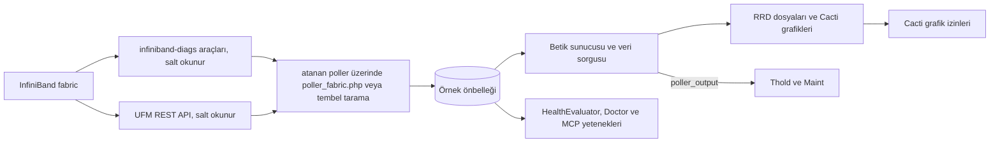

<!-- Source: README.md; SHA256: 79a16fb906f96ee79de2c719f18c38836f555440a7571a4a5ba38c64bb5b099f -->

<!-- translations:start -->
[English](../../../README.md) | [简体中文](../zh-CN/README.md) | [हिन्दी](../hi-IN/README.md) | [Español (España)](../es-ES/README.md) | [Español (Latinoamérica)](../es-419/README.md) | [العربية (السعودية)](../ar-SA/README.md) | [Afrikaans](../af-ZA/README.md) | [አማርኛ](../am-ET/README.md) | [العربية (مصر)](../ar-EG/README.md) | [العربية (المغرب)](../ar-MA/README.md) | [বাংলা](../bn-BD/README.md) | [Bosanski](../bs-BA/README.md) | [Deutsch](../de-DE/README.md) | [فارسی](../fa-IR/README.md) | [Filipino](../fil-PH/README.md) | [Français](../fr-FR/README.md) | [Français (Maroc)](../fr-MA/README.md) | [Français (Sénégal)](../fr-SN/README.md) | [Hausa](../ha-NG/README.md) | [עברית](../he-IL/README.md) | [Hrvatski](../hr-HR/README.md) | [Bahasa Indonesia](../id-ID/README.md) | [Igbo](../ig-NG/README.md) | [Italiano](../it-IT/README.md) | [日本語](../ja-JP/README.md) | [한국어](../ko-KR/README.md) | [Malagasy](../mg-MG/README.md) | [मराठी](../mr-IN/README.md) | [Bahasa Melayu](../ms-MY/README.md) | [Nederlands](../nl-NL/README.md) | [Polski](../pl-PL/README.md) | [Português (Brasil)](../pt-BR/README.md) | [Русский](../ru-RU/README.md) | [Kinyarwanda](../rw-RW/README.md) | [Soomaali](../so-SO/README.md) | [Српски](../sr-RS/README.md) | [Svenska](../sv-SE/README.md) | [Kiswahili](../sw-KE/README.md) | [தமிழ்](../ta-IN/README.md) | [తెలుగు](../te-IN/README.md) | [ไทย](../th-TH/README.md) | [Türkçe](README.md) | [Українська](../uk-UA/README.md) | [اردو](../ur-PK/README.md) | [Tiếng Việt](../vi-VN/README.md) | [isiXhosa](../xh-ZA/README.md) | [Yorùbá](../yo-NG/README.md) | [繁體中文](../zh-TW/README.md) | [isiZulu](../zu-ZA/README.md)
<!-- translations:end -->

# plugin_fabric

InfiniBand port sayaçlarını, bağlantı genişliği ile hızını ve tıkanıklık göstergelerini Cacti içine sıradan aygıtlar, veri kaynakları ve grafikler olarak getiren bir Cacti 1.2 eklentisidir (`fabric`, sürüm `0.1.0-dev`). 4X yerine 1X hızında eğitilmiş bir bağlantı, Cacti izinleri altında hizmet verdiği ana bilgisayarın yanında bir grafik ve bir Thold uyarısı olarak görünür ve Maint farkındalığı ile bastırılabilir.

> **Durum: geliştirme aşamasında, henüz sürüm yayımlanmadı.** Bu dal; eklenti temelini, Cacti nesnelerini ve uyarı mekanizmasını, zamanlanmış arka plan poller taramalarını, uzak toplayıcı çoğaltmasını, şifrelenmiş kimlik bilgisi kasasına sahip salt okunur NVIDIA UFM REST arka ucunu, Configuration-as-Code (CasC) CLI yönetimini ve Cacti ekosistem kancalarını (CasC, Doctor ve MCP / Abilities API v2) uygular. Sahte araçlara, sentetik UFM aktarım katmanlarına ve `ibsim` fabric simülatörüne (rdma-core 50.0) karşı test edilmiştir; fiziksel bir InfiniBand fabric veya canlı bir UFM sunucusu üzerinde hiç test edilmemiştir. Donanım gerektiren denetimler [docs/research/](../../research/) dizininde açık durumdadır. Bu projenin Cacti projesiyle bir bağlantısı yoktur.

## Neler uygulandı

- **Yaşam döngüsü ve şema (v3)**: kurulum, yinelenebilir yükseltme, kaldırma (varsayılan olarak eklenti tablolarını korur) ve giriş noktalarını PHP 8.0 üzerinde ayrıştırılabilir tutarken PHP 8.2 gereksinim denetimi.
- **Erişim rolleri ve sayfalar**: `Fabric View` (`fabric.php`), `Fabric Operator` (`fabric_operator.php`) ve `Fabric Admin` (`fabric_admin.php`, `fabric_health.php`) yetki alanları ile **Configuration > Settings > Fabrics** altında bir Settings sekmesi.
- **Salt okunur tanılama arka ucu (`diags`)**: `perfquery`, `ibnetdiscover` ve `iblinkinfo` için katı argüman vektörü yürütmesi, kimlik çakışması tespiti ve yeniden bağlama önerileriyle GUID anahtarlı envanter, bağlantı durumu değerlendirmesi ve düğüm başına sayaç taramaları.
- **Salt okunur NVIDIA UFM REST arka ucu (`ufm`) ve şifrelenmiş kasa**: `diags` ile aynı envanter, bağlantı durumu, örnek ve sağlık tablolarını besleyen yalnızca GET izinli REST istemcisi (`/ufmRest/resources/ports`, `/ufmRest/resources/systems`, `/ufmRest/monitoring/session/0/data` ve belirteç kimlik doğrulaması için `/ufmRestV3/...` eşdeğerleri). Kimlik bilgileri (`token` veya `basic`), `fabric_vault_key_file` ile yapılandırılan harici 256 bit anahtar dosyası kullanılarak `plugin_fabric_secret` içinde AES-256-GCM ile şifrelenmiş olarak saklanır. UFM fabric'leri CasC (`cli/fabric.php`) veya depolar üzerinden tanımlanabilir; web yönetim formu şu anda `diags` alanlarını sunar.
- **Cacti nesneleri, Thold ve Maint**: Cacti aygıt, veri ve grafik şablonları (`templates/fabric-templates.xml`), "Fabric Port" betik sunucusu veri sorgusu (`scripts/ss_fabric_ports.php`, `resource/script_server/fabric_ports.xml`), Thold için `DERIVE` sayaç veri kaynakları ve `GAUGE` bağlantı durumu/hız veri kaynakları, süreklilik kesintisi takibi ve `U` olarak bildirilen doygunluğa ulaşmış temel sayaçlar. Maint entegrasyonu (`MaintMaintenance`), `plugin_maint_check_cacti_host()` işlevini sorgular (yoksa `is_device_in_maintenance` kancasına geri döner), böylece etkin bakımdaki düğümler ayrı sayılır ve başarısız tarama ile bozulmuş port sağlık uyarılarından hariç tutulur.
- **Zamanlanmış taramalar, parçalama (sharding) ve uzak toplayıcılar**: `poller_bottom`, betik sunucusu tarafından tetiklenen tembel taramaların yanı sıra geçerli poller'a atanmış ve zamanı gelmiş fabric'ler için arka planda `poller_fabric.php` dosyasını başlatır. `INFO`, `remote_collect:1, remote_poller:1` bildirir; `poller_fabric.php` deterministik GUID parçalamayı (`--shard=K/N`) destekler ve `replicate_out`, gizli olmayan `plugin_fabric_fabric` satırlarını uzak toplayıcılara (`poller_id >= 2`) çoğaltır. Kasa kayıtları (`plugin_fabric_secret`) ve harici anahtar dosyaları hiçbir zaman çoğaltılmaz.
- **CasC CLI ve ekosistem kancaları**: YAML/XML dışa aktarma, doğrulama, deneme çalıştırması (dry-run) fark planlama, onay kapılı uygulama ve sağlık raporlaması için `cli/fabric.php` ile `casc_register_providers`, `doctor_register_checks` ve `abilities_register` kancaları.

## Erişim rolleri

| Yetki Alanı | Erişim |
| --- | --- |
| Fabric View | Envanter ve port görünümlerini izleme (`fabric.php`). |
| Fabric Operator | View erişimine ek olarak Operations sayfası (`fabric_operator.php`) ve kişisel önceliklendirme onayları. |
| Fabric Admin | Operator erişimine ek olarak yapılandırma, yönetim eylemleri (`fabric_admin.php`) ve sağlık sayfası (`fabric_health.php`). |

Yükseltme dosyalarını kopyaladıktan sonra yeni yetki alanlarını ve kancaları kaydetmek için yönetici olarak Plugins sayfasını açın. Operator yetki alanını **Configuration > Users** veya kullanıcı grupları altında açıkça atayın. Yükseltmeler mevcut View ve Admin yetki alanı kimliklerini ve yetkilerini korur. Admin erişimi her istekte Operator erişimini, Operator erişimi ise View erişimini devralır; bu işlem kullanıcılara veya gruplara kalıcı yetkiler eklemez. Eklenti ayarları ayrıca Cacti'nin Settings iznine ek olarak Fabric Admin erişimi gerektirir.

Cacti aygıt izinleri her kullanıcının erişebileceği satırları ve işlemleri sınırlar; eşlenmemiş nesneler için yönetici yetkisi gerekir. Kimlik bilgileri, yapılandırma, eşleme, silme ve diğer yönetim değişiklikleri yönetim sayfalarında veya CLI'da kalır. Onaylar yalnızca geçerli kullanıcının oturumunda, en fazla bir saat boyunca ve yalnızca aynı gözlem güncelliğini koruduğu sürece geçerlidir. Yeni veya değişmiş gözlemler bunları geçersiz kılar. Başarısız bir ölçümü hiçbir zaman sağlıklı olarak işaretlemez veya uyarıları bastırmazlar.

## Neden

Bozulmuş bir InfiniBand bağlantısı trafik geçirmeye devam eder. 1X hızında yeniden eğitilen bir 4X bağlantı, portu "active" durumunda bırakır ve ana bilgisayarın SNMP arayüz grafikleri normal görünür; ancak sıkı bağlı (tightly coupled) işler yavaşlar. Kanıt fabric içindedir: her port etkin, etkinleştirilmiş ve desteklenen genişlik ve hızının yanı sıra hata ve tıkanıklık sayaçlarını raporlar. Bunları okumak için InfiniBand tanılama araçları veya bir fabric yöneticisi API'si gerekir. Elle çalıştırıldıklarında üç boşluk bırakırlar:

- **Geçmiş yoktur.** `perfquery` ve `iblinkinfo` yalnızca o anki durumu gösterir; bu nedenle geçen hafta bozulan bir bağlantı görünmez.
- **Aygıt bağlamı yoktur.** Fabric portları Cacti nesnesi değildir; bu nedenle bir port beslediği ana bilgisayarın yanında grafikle gösterilemez.
- **Cacti uyarı sistemine giden bir yol yoktur.** Thold ve Maint, Cacti veri kaynakları ve aygıtları üzerinde çalışır.

Eklenti; `infiniband-diags` veya NVIDIA UFM REST API aracılığıyla fabric'i okuyarak, düğümleri ve portları GUID'ye göre tanımlayarak ve sayaçlar ile bağlantı durumunu Cacti veri kaynakları olarak yayımlayarak bu boşlukları kapatır. Yalnızca okuma yapar: sayaçları hiçbir zaman sıfırlamaz veya port durumunu değiştirmez.

## İşlemler ve CLI

### Arka plan poller ve elle taramalar

`fabric_poller_bottom()`, her poller üzerinde o `poller_id` değerine atanmış ve tarama zamanı gelmiş etkin fabric'ler için arka planda `poller_fabric.php` dosyasını başlatır. Ayrıca poller çalıştırıcısını veya elle bir taramayı doğrudan atanmış poller üzerinde poller kullanıcısı olarak çalıştırabilirsiniz (`/path/to/cacti` kısmını Cacti dizininizle değiştirin):

```sh
php /path/to/cacti/plugins/fabric/poller_fabric.php [--fabric=ID] [--shard=K/N] [--force] [--debug]
php /path/to/cacti/plugins/fabric/fabric_sweep.php --fabric=ID [--node=GUID] [--force]
```

- `poller_fabric.php` yerel poller için zamanı gelmiş tüm fabric'leri (veya `--fabric=ID` ile tek bir fabric'i) çalıştırır, `max(30, intdiv(sweep_interval, 2))` saniyelik bir zaman bütçesiyle Cacti süreç kayıt defteri kilidini ve `ClaimRepository` kiralamalarını uygular ve `diags` düğüm sayaç taramalarını düğüm GUID'sine göre deterministik biçimde parçalamak için `--shard=K/N` (`0 <= K < N`) seçeneğini destekler.
- `fabric_sweep.php` yerel poller'a atanmış etkin bir fabric'in (veya `--node=GUID` ile tek bir düğümün) isteğe bağlı taramasını çalıştırır. `--force` kiralamalara uymaya devam ederken fabric'in zamanının gelip gelmediğini yok sayar.

İlk keşif envanteri doldurduktan sonra düğümleri Fabric Admin sayfasında Cacti aygıtlarıyla eşleyin. Cacti'nin betik zaman aşımını (script timeout) 25 saniye veya daha yüksek tutun: bir veri sorgusu okumasıyla başlatılan tembel tarama, betik sunucusunun son saklanan örnekle veya `U` ile zamanında yanıt verebilmesi için araç yürütmesini `script_timeout - 5` saniyeyle sınırlar.

### NVIDIA UFM REST arka ucu ve kimlik bilgisi kasası

Bir `ufm` fabric, içinde gömülü kimlik bilgisi, sorgu dizesi veya parça (fragment) bulunmayan bir `https://` URL'si gerektirir. `UfmSocketTransport`, TLS eş ve ana bilgisayar adı doğrulamasını uygular, yönlendirmeleri reddeder ve isteğe bağlı CA paketini (`ufm_ca_file`) ile SHA-256 SPKI sabitlemesini (`ufm_spki_pin`) destekler.

UFM kimlik bilgilerini `plugin_fabric_secret` içinde saklamak için **Configuration > Settings > Fabrics** altındaki `fabric_vault_key_file` ayarını poller kullanıcısına ait normal bir dosyanın mutlak yoluyla yapılandırın (hiçbir üst dizinde sembolik bağlantı olmamalı, izin kipi `0600` olmalı ve `openssl rand -hex 32` gibi 64 onaltılık karakter veya 32 rastgele yazdırılamaz bayt içermelidir). Eklenti anahtar dosyasını hiçbir zaman oluşturmaz veya yazmaz ve `replicate_out` hiçbir zaman `plugin_fabric_secret` veya anahtar dosyalarını uzak poller'lara çoğaltmaz.

### Configuration-as-Code ve sağlık CLI

`cli/fabric.php`, eklenti ayarlarını ve fabric tanımlarını YAML veya XML biçiminde bildirimsel olarak yönetir ve canlı tarama çalıştırmadan bakım farkındalıklı sağlık durumunu raporlar:

```sh
php /path/to/cacti/plugins/fabric/cli/fabric.php export [--format=yaml|xml] [--file=PATH]
php /path/to/cacti/plugins/fabric/cli/fabric.php validate --file=PATH [--format=yaml|xml]
php /path/to/cacti/plugins/fabric/cli/fabric.php plan --file=PATH [--format=yaml|xml]
php /path/to/cacti/plugins/fabric/cli/fabric.php apply --file=PATH --confirm=PLAN_HASH [--format=yaml|xml]
php /path/to/cacti/plugins/fabric/cli/fabric.php health [--format=text|json]
```

`export` yeni dosyaları `0600` kipiyle oluşturur, `fabric_vault_key_file` değerini `[REDACTED]` olarak sansürler ve gizli bilgiler yerine adlandırılmış `ufm_credential_ref` başvuruları üretir. `plan` ve `apply`, satır içi `ufm_token`, `ufm_password`, `secret` ve satır içi `fabric_vault_key_file` değerlerini reddeder. `apply`, `plan` tarafından üretilen tam `--confirm=PLAN_HASH` değerini gerektirir.

### Ekosistem kancaları

İlgili Cacti eklentileri veya ana bilgisayar entegrasyonları mevcut olduğunda `setup.php` şunları kaydeder:

- `casc_register_providers`: gizli bilgi sansürlemesiyle birlikte `fabric` yapılandırmasını (`yaml` ve `xml`, şema v1) dışa aktarır, doğrular, planlar ve onay ile uygular.
- `doctor_register_checks`: dört salt okunur tanılama denetimi sağlar (`fabric.schema`, `fabric.poller_freshness`, `fabric.identity_conflicts`, `fabric.ufm_vault`).
- `abilities_register`: Fabric View yetki alanı (ve port hataları için Cacti aygıt izinleri) tarafından denetlenen `fabric` kategorisi altında üç salt okunur, yıkıcı olmayan, idempotent yetenek kaydeder: `fabric-list-fabrics`, `fabric-get-health` ve `fabric-list-port-errors`.

## Kapsam ve sınırlar

Kapsam dışı: fabric durumunu değiştirme, sayaçları sıfırlama, bir fabric yöneticisinin veya alt ağ yöneticisinin (subnet manager) yerini alma, eklentiye özgü bir uyarı motoru, özel bir arka plan servisi (daemon) veya ağ protokolü ve Ethernet veya RoCE fabric'leri.

## Gereksinimler ve uyumluluk

| Bileşen | Hedef |
|---|---|
| Cacti | 1.2.31 veya üzeri (`compat = 1.2.31`), çekirdek yaması yok |
| PHP | 8.2 veya üzeri; desteklenmeyen bir çalışma zamanının bozuk bir Cacti arayüzü yerine ret mesajı alabilmesi için giriş noktaları 8.0 üzerinde ayrıştırılabilir kalır ve 8.1 üzerinde etkinleştirmeyi reddeder |
| InfiniBand araçları | `rdma-core` içinden `infiniband-diags` (`ibsim` altında rdma-core 50.0 ile CI'da test edildi; çıktı biçimleri v66.0 kaynak koduna göre denetlendi) |
| UFM | NVIDIA UFM Enterprise REST API (`ufmRest` ve `ufmRestV3` salt okunur uç noktaları; birim testlerinde sentetik aktarım katmanlarına karşı test edildi) |
| Thold, Maint | Değişiklik gerekmez; CI değiştirilmemiş Thold v1.8.2 ve Maint v1.3 ile uçtan uca test çalıştırır |

## Geliştirme ve test

CI iş akışı (`.github/workflows/plugin-ci-workflow.yml`); Cacti `release/1.2.31` ve `1.2.x` sürümlerine karşı PHP 8.2 ile 8.5 arasını, PHP 8.0 giriş noktası sözdizimi denetimini, PHP 8.1 reddini, PHPStan'i, gettext/çeviri doğrulamasını, REUSE lisanslamasını, iş akışı sözdizimi denetimini, Thold/Maint uçtan uca tekrar oynatmasını ve `ibsim` fabric simülasyonunu test eder.

Cacti'nin kilitli paylaşılan Pest eklenti test düzeneği (`CACTI_PEST_BIN`) ve tek kullanımlık bir Cacti veritabanı ile:

```sh
# Unit tests
"$CACTI_PEST_BIN" --configuration=phpunit.xml

# Lifecycle integration tests (disposable database only)
CACTI_PATH=/path/to/cacti FABRIC_TEST_DATABASE=disposable "$CACTI_PEST_BIN" --configuration=phpunit-integration.xml

# Static analysis (against Cacti 1.2.31)
CACTI_PATH=/path/to/cacti phpstan analyse -c phpstan.neon --no-progress

# Translation template, catalogs, and localized README checks
sh locales/build_gettext.sh --check

# Simulated ibsim fixture parser check
php tests/bin/check-ibsim-fixtures.php tests/fixtures/ibsim
```

## Tasarım

- [docs/PLAN.md](../../PLAN.md) mimari ve tasarım planıdır: kaynaklarıyla birlikte üst kaynak gerçekleri, açık donanım denetimleri, kimlik modeli, sayaç ve bağlantı durumu kuralları, güvenlik sınırları, performans hesaplamaları, testler ve riskler.
- [docs/decisions/](../../decisions/) mimari karar kayıtlarını içerir.
- [docs/REQUIREMENTS.md](../../REQUIREMENTS.md) her gereksinim kimliğini ilgili sorunuyla eşler.



## Çalışma nasıl takip edilir

- **Aşamalar** planın aşamalarını izler. Her birinin alt sorunlarını ve çıkış kanıtlarını listeleyen bir epic sorunu vardır.
- **Sorunlar** etiketlerle türlere ayrılır: `type: requirement`, `type: research`, `type: decision`, `type: epic`. Gereksinim sorunları numaralandırılmış, test edilebilir gereksinimleri (`REQ-AREA-NNN`) ve kabul ölçütlerini belirtir.
- **Etiketler** ayrıca `area:`, `phase:`, `priority:` ve `status:` bilgilerini taşır. Bkz. [CONTRIBUTING.md](../../../CONTRIBUTING.md#labels).
- [proje panosu](https://github.com/users/somethingwithproof/projects/8) tüm aşamalardaki sorunları gösterir.

## Katkıda bulunma

[CONTRIBUTING.md](../../../CONTRIBUTING.md) dosyasını okuyun. Commit'lerde DCO sign-off (`git commit -s`) bulunmalıdır. Tasarım tartışmaları sorunlar üzerinde yapılır; açık kararlar `type: decision` etiketini taşır.

## Güvenlik

Güvenlik açıklarını gizli olarak bildirin; bkz. [SECURITY.md](../../../SECURITY.md).

## Lisans

Cacti ve eklentileriyle aynı lisans olan GNU General Public License v2.0. Bkz. [LICENSE](../../../LICENSE).
