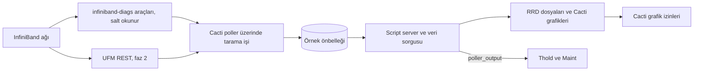

<!-- Source: README.md; SHA256: ce5af61a1bc993ec2aae6d4f22c3885694632f2b1d5eb94e2ce88b8390e96f1e -->

<!-- translations:start -->
[English](../../../README.md) | [简体中文](../zh-CN/README.md) | [हिन्दी](../hi-IN/README.md) | [Español (España)](../es-ES/README.md) | [Español (Latinoamérica)](../es-419/README.md) | [العربية (السعودية)](../ar-SA/README.md) | [Afrikaans](../af-ZA/README.md) | [አማርኛ](../am-ET/README.md) | [العربية (مصر)](../ar-EG/README.md) | [العربية (المغرب)](../ar-MA/README.md) | [বাংলা](../bn-BD/README.md) | [Bosanski](../bs-BA/README.md) | [Deutsch](../de-DE/README.md) | [فارسی](../fa-IR/README.md) | [Filipino](../fil-PH/README.md) | [Français](../fr-FR/README.md) | [Français (Maroc)](../fr-MA/README.md) | [Français (Sénégal)](../fr-SN/README.md) | [Hausa](../ha-NG/README.md) | [עברית](../he-IL/README.md) | [Hrvatski](../hr-HR/README.md) | [Bahasa Indonesia](../id-ID/README.md) | [Igbo](../ig-NG/README.md) | [Italiano](../it-IT/README.md) | [日本語](../ja-JP/README.md) | [한국어](../ko-KR/README.md) | [Malagasy](../mg-MG/README.md) | [मराठी](../mr-IN/README.md) | [Bahasa Melayu](../ms-MY/README.md) | [Nederlands](../nl-NL/README.md) | [Polski](../pl-PL/README.md) | [Português (Brasil)](../pt-BR/README.md) | [Русский](../ru-RU/README.md) | [Kinyarwanda](../rw-RW/README.md) | [Soomaali](../so-SO/README.md) | [Српски](../sr-RS/README.md) | [Svenska](../sv-SE/README.md) | [Kiswahili](../sw-KE/README.md) | [தமிழ்](../ta-IN/README.md) | [తెలుగు](../te-IN/README.md) | [ไทย](../th-TH/README.md) | [Türkçe](README.md) | [Українська](../uk-UA/README.md) | [اردو](../ur-PK/README.md) | [Tiếng Việt](../vi-VN/README.md) | [isiXhosa](../xh-ZA/README.md) | [Yorùbá](../yo-NG/README.md) | [繁體中文](../zh-TW/README.md) | [isiZulu](../zu-ZA/README.md)
<!-- translations:end -->

# plugin_fabric

InfiniBand port sayaçlarını, bağlantı genişliği ile hızını ve tıkanıklık göstergelerini Cacti içine sıradan aygıtlar, veri kaynakları ve grafikler olarak getiren bir Cacti 1.2 eklentisidir. 4X yerine 1X hızında eğitilmiş bir bağlantı, Cacti izinleri altında hizmet verdiği ana bilgisayarın yanında bir grafik ve bir Thold uyarısı olarak görünür ve Maint ile bastırılabilir.

> **Durum: geliştirme aşamasında, henüz sürüm yayımlanmadı.** Aşama 2 (temel altyapı) `main` dalına birleştirildi ve aşama 3 (Cacti nesneleri ve uyarı mekanizması) inceleme aşamasında. Aşama 1, tasarımı belgelere ve üst kaynak koduna karşı doğruladı (PR #71); kaynaklarıyla birlikte sonuçlar [docs/research/](../../research) dizinindedir. Aşama 2 şu eklenti temelini ekler:
>
> - kurulum, yükseltme, kaldırma ve PHP 8.2 denetimi
> - View, Operator ve Admin yetki alanları ve ayarlar
> - fabric kayıtları
> - `perfquery`, `ibnetdiscover` ve `iblinkinfo` için salt okunur komut sınırı
> - GUID'ye göre envanter, kimlik çakışmaları ve yeniden bağlama önerileri
> - bağlantı durumu ve sayaç tarama önbelleği
> - envanter, yönetim ve sağlık sayfaları
>
> Aşama 3 ise Cacti nesnelerini ekler:
>
> - Cacti şablon XML'i olarak sunulan aygıt, veri ve grafik şablonları ile "Fabric Port" veri sorgusu
> - bir düğümü bir Cacti aygıtıyla eşleme veya onay üzerine yeni bir aygıt oluşturma ([ADR 0010](../../decisions/0010-one-device-per-node.md))
> - grafikler için sayaç veri kaynakları ve Thold için GAUGE bağlantı durumu ve hız veri kaynakları ([ADR 0011](../../decisions/0011-derive-counters-and-gauge-alert-values.md))
> - kesinti yönetimi ve doygunluğa ulaşmış temel sayaçların bilinmeyen (unknown) olarak okunması ([ADR 0012](../../decisions/0012-saturated-basic-counters-read-as-unknown.md)), port sayfasında sayaç geçerliliği ile grafik bağlantıları ve bir tıkanıklık sıralaması
> - değiştirilmemiş Thold v1.8.2 ve Maint v1.3 ile uçtan uca test ve gerçek tanılama araçlarını simüle edilmiş bir fabric üzerinde çalıştıran bir CI işi
>
> 3. fazda uzak veri toplayıcıları desteklenene kadar bir fabric yalnızca ana poller üzerinden taranabilir. Şimdiye kadar sahte araçlar ve ibsim fabric simülatörü üzerinde test edilmiştir; gerçek bir InfiniBand fabric üzerinde hiç test edilmemiştir. Gerçek bir fabric gerektiren denetimler, her araştırma sayfasının canlı denetim tablosunda açık durumda kalmaya devam etmektedir. Bu projenin Cacti projesiyle bir bağlantısı yoktur.

## Erişim rolleri

| Yetki Alanı | Erişim |
| --- | --- |
| Fabric View | Mevcut izleme sayfaları. |
| Fabric Operator | İzleme sayfalarına ek olarak İşlemler sayfası ve kişisel önceliklendirme onayları. |
| Fabric Admin | Operator erişimine ek olarak mevcut yapılandırma ve yönetim işlemleri. |

Yükseltme dosyalarını kopyaladıktan sonra yeni yetki alanını kaydetmek için
yönetici olarak Eklentiler (Plugins) sayfasını açın. Operator yetki alanını **Configuration > Users** veya kullanıcı grupları altında açıkça atayın.
Yükseltmeler mevcut View ve Admin yetki alanı kimliklerini ve yetkilerini korur. Admin erişimi
Operator erişimini, Operator erişimi ise her istekte View erişimini devralır;
bu işlem kullanıcılara veya gruplara kalıcı yetkiler eklemez. Eklenti ayarları ayrıca
Cacti'nin Settings iznine ek olarak Fabric Admin erişimi gerektirir.

Cacti aygıt izinleri her kullanıcının erişebileceği satırları ve işlemleri sınırlamaya devam eder; eşlenmemiş nesneler için yönetici yetkisi gerekir.
Kimlik bilgileri, yapılandırma, eşleme, silme ve diğer yönetim değişiklikleri
yönetim sayfalarında kalır. Onaylar yalnızca geçerli kullanıcının oturumunda,
en fazla bir saat boyunca ve yalnızca aynı gözlem güncelliğini koruduğu
sürece geçerlidir. Yeni veya değişmiş gözlemler bunları geçersiz kılar. Başarısız bir
ölçümü hiçbir zaman sağlıklı olarak işaretlemez veya uyarıları bastırmazlar.

## Neden

Bozulmuş bir InfiniBand bağlantısı trafik geçirmeye devam eder. 1X hızında yeniden eğitilen bir 4X bağlantı, portu "active" durumunda bırakır ve ana bilgisayarın SNMP arayüz grafikleri normal görünür; ancak sıkı bağlı (tightly coupled) işler yavaşlar. Kanıt fabric içindedir: her port etkin, etkinleştirilmiş ve desteklenen genişlik ve hızının yanı sıra hata ve tıkanıklık sayaçlarını raporlar. Bunları okumak için InfiniBand tanılama araçları veya bir fabric yöneticisi API'si gerekir. Elle çalıştırıldıklarında üç boşluk bırakırlar:

- **Geçmiş yoktur.** `perfquery` ve `iblinkinfo` yalnızca o anki durumu gösterir; bu nedenle geçen hafta bozulan bir bağlantı görünmez.
- **Aygıt bağlamı yoktur.** Fabric portları Cacti nesnesi değildir; bu nedenle bir port beslediği ana bilgisayarın yanında grafikle gösterilemez.
- **Cacti uyarı sistemine giden bir yol yoktur.** Thold ve Maint, Cacti veri kaynakları ve aygıtları üzerinde çalışır.

Eklenti; kendi tanılama araçları (ve daha sonra UFM) aracılığıyla fabric'i okuyarak, düğümleri ve portları GUID'ye göre tanımlayarak ve sayaçlar ile bağlantı durumunu Cacti veri kaynakları olarak yayımlayarak bu boşlukları kapatır. Yalnızca okuma yapar: sayaçları hiçbir zaman sıfırlamaz veya port durumunu değiştirmez.

## İlk keşif

Yeni bir fabric'in düğümü yoktur ve taramalar script server tarafından yalnızca bir Cacti aygıtıyla eşlenmiş bir düğüm için başlatılır. Bu nedenle ilk keşif elle yapılan bir adımdır. Etkinleştirilmiş bir fabric'i kaydettikten sonra, fabric'in atandığı poller üzerinde poller hesabıyla bu komutu bir kez çalıştırın; `/path/to/cacti` kısmını Cacti dizininizle değiştirin (mutlak yol cron'dan da çalışır):

```
php /path/to/cacti/plugins/fabric/fabric_sweep.php --fabric=ID --force
```

Bunun ardından envanter doldurulur. Düğümleri Fabric Admin sayfasında Cacti aygıtlarıyla eşleyin; sonraki taramalar veri sorgusundan başlatılır. Bir fabric'in hiçbir düğümü eşlenmediği sürece envanteri hiçbir şey yenilemez; bu nedenle yeni veya eksik düğümleri kaydetmek için isterseniz cron üzerinden aynı komutu yeniden çalıştırın. Sağlık sayfası, keşfedilmemiş veya eşlenmiş düğümü olmayan etkinleştirilmiş bir fabric için bu komutu gösterir.

## Planlanan kapsam

| Faz | Kapsam | Aşamalar |
|---|---|---|
| 0, araştırma | Sürüm matrisi, üst kaynak davranış doğrulaması, donanım üzerinde sayaç davranışı, yetki modeli, MAD bütçesi, UFM API | [M1](https://github.com/somethingwithproof/plugin_fabric/milestone/1) |
| 1, gözlem | GUID'ye göre envanter, Cacti aygıtları, port veri sorgusu, sayaç ve bağlantı durumu veri kaynakları, Thold uyarısı, Maint bastırma, sağlık sayfası | [M2](https://github.com/somethingwithproof/plugin_fabric/milestone/2), [M3](https://github.com/somethingwithproof/plugin_fabric/milestone/3), [M4](https://github.com/somethingwithproof/plugin_fabric/milestone/4) |
| 2, UFM | Salt okunur UFM REST arka ucu, kimlik bilgisi yönetimi, arka uçlar arası kimlik sürekliliği | [M5](https://github.com/somethingwithproof/plugin_fabric/milestone/5) |
| 3, uzak | Uzak veri toplayıcılar, çoğaltma, `remote_agent` eylemleri, büyük fabric'ler için parçalı (sharded) taramalar | [M6](https://github.com/somethingwithproof/plugin_fabric/milestone/6) |

Kapsam dışı: fabric durumunu değiştirme, bir fabric yöneticisinin veya alt ağ yöneticisinin (subnet manager) yerini alma, eklentiye özgü bir uyarı motoru, özel bir arka plan servisi (daemon) veya ağ protokolü ve Ethernet veya RoCE fabric'leri (araştırma).

## Uyumluluk hedefleri

| Bileşen | Hedef |
|---|---|
| Cacti | 1.2.31 veya üzeri, çekirdek yaması gerektirmez |
| PHP | 8.2 veya üzeri; desteklenmeyen bir çalışma zamanının bozuk bir Cacti arayüzü yerine ret mesajı alabilmesi için `setup.php` 8.0 üzerinde ayrıştırılabilir kalır |
| InfiniBand araçları | rdma-core içinden infiniband-diags; çıktı biçimleri v66.0 kaynak koduna karşı kontrol edildi |
| UFM | UFM Enterprise REST API, faz 2; sürüm matrisi 1. aşama teslimatıdır |
| Thold, Maint | Değişiklik gerekmez |

Cacti'nin betik zaman aşımını (script timeout) varsayılan 25 saniye veya daha yüksek değerde tutun. Bir veri sorgusu okumasıyla başlatılan tarama, önbelleği okuyup yanıt vermek için süre ayırarak araç yürütmesini bu zaman aşımından beş saniye eksiğiyle sınırlar. Süre dolduğunda sorgu son güncel örneği veya bilinmeyen (unknown) değerini sunar; bir sonraki döngüde tarama yeniden denenir. Bu sınır PHP poller için de geçerlidir. Beş saniye veya daha kısa bir zaman aşımı bir aracı başlatmak için hiç zaman bırakmaz.

## Tasarım

- [docs/PLAN.md](../../PLAN.md) tam plandır: mimari, dayandığı üst kaynak gerçekleri (kaynaklarıyla birlikte) ve henüz doğrulanacak varsayımlar, kimlik modeli, sayaç ve bağlantı durumu kuralları, güvenlik sınırları, performans hesaplamaları, testler ve riskler.
- [docs/decisions/](../../decisions) önceden verilmiş seçimler için mimari karar kayıtlarını içerir.
- [docs/REQUIREMENTS.md](../../REQUIREMENTS.md) her gereksinim kimliğini ilgili sorunuyla eşler.



## Çalışma nasıl takip edilir

- **Aşamalar** planın aşamalarını izler. Her birinin alt sorunlarını ve çıkış kanıtlarını listeleyen bir epic sorunu vardır.
- **Sorunlar** etiketlerle türlere ayrılır: `type: requirement`, `type: research`, `type: decision`, `type: epic`. Gereksinim sorunları numaralandırılmış, test edilebilir gereksinimleri (`REQ-AREA-NNN`) ve kabul ölçütlerini belirtir.
- **Etiketler** ayrıca `area:`, `phase:`, `priority:` ve `status:` bilgilerini taşır. Bkz. [CONTRIBUTING.md](../../../CONTRIBUTING.md#labels).
- [proje panosu](https://github.com/users/somethingwithproof/projects/8) tüm aşamalardaki sorunları gösterir.

## Katkıda bulunma

[CONTRIBUTING.md](../../../CONTRIBUTING.md) dosyasını okuyun. Commit'lerde DCO sign-off bulunmalıdır. Tasarım tartışmaları sorunlar üzerinde yapılır; açık kararlar `type: decision` etiketini taşır.

## Güvenlik

Güvenlik açıklarını gizli olarak bildirin; bkz. [SECURITY.md](../../../SECURITY.md).

## Lisans

Cacti ve eklentileriyle aynı lisans olan GNU General Public License v2.0. Bkz. [LICENSE](../../../LICENSE).
