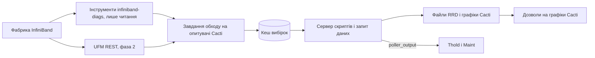

<!-- Source: README.md; SHA256: ce5af61a1bc993ec2aae6d4f22c3885694632f2b1d5eb94e2ce88b8390e96f1e -->

<!-- translations:start -->
[English](../../../README.md) | [简体中文](../zh-CN/README.md) | [हिन्दी](../hi-IN/README.md) | [Español (España)](../es-ES/README.md) | [Español (Latinoamérica)](../es-419/README.md) | [العربية (السعودية)](../ar-SA/README.md) | [Afrikaans](../af-ZA/README.md) | [አማርኛ](../am-ET/README.md) | [العربية (مصر)](../ar-EG/README.md) | [العربية (المغرب)](../ar-MA/README.md) | [বাংলা](../bn-BD/README.md) | [Deutsch](../de-DE/README.md) | [فارسی](../fa-IR/README.md) | [Filipino](../fil-PH/README.md) | [Français](../fr-FR/README.md) | [Français (Maroc)](../fr-MA/README.md) | [Français (Sénégal)](../fr-SN/README.md) | [Hausa](../ha-NG/README.md) | [עברית](../he-IL/README.md) | [Bahasa Indonesia](../id-ID/README.md) | [Igbo](../ig-NG/README.md) | [Italiano](../it-IT/README.md) | [日本語](../ja-JP/README.md) | [한국어](../ko-KR/README.md) | [Malagasy](../mg-MG/README.md) | [मराठी](../mr-IN/README.md) | [Bahasa Melayu](../ms-MY/README.md) | [Nederlands](../nl-NL/README.md) | [Polski](../pl-PL/README.md) | [Português (Brasil)](../pt-BR/README.md) | [Русский](../ru-RU/README.md) | [Kinyarwanda](../rw-RW/README.md) | [Soomaali](../so-SO/README.md) | [Svenska](../sv-SE/README.md) | [Kiswahili](../sw-KE/README.md) | [தமிழ்](../ta-IN/README.md) | [తెలుగు](../te-IN/README.md) | [ไทย](../th-TH/README.md) | [Türkçe](../tr-TR/README.md) | [Українська](README.md) | [اردو](../ur-PK/README.md) | [Tiếng Việt](../vi-VN/README.md) | [isiXhosa](../xh-ZA/README.md) | [Yorùbá](../yo-NG/README.md) | [繁體中文](../zh-TW/README.md) | [isiZulu](../zu-ZA/README.md)
<!-- translations:end -->

# plugin_fabric

Плагін для Cacti 1.2, який переносить лічильники портів InfiniBand, ширину та швидкість каналу, а також показники перевантаження до Cacti у вигляді звичайних пристроїв, джерел даних і графіків. Канал, що узгодився в режимі 1X замість 4X, з'являється як графік і сповіщення Thold поруч із хостом, який він обслуговує, з дотриманням прав доступу Cacti та можливістю приглушення через Maint.

> **Статус: у розробці, релізу ще немає.** Етап 2 (основа) уже об'єднано в гілку `main`, а етап 3 (об'єкти Cacti та сповіщення) перебуває на перевірці. На етапі 1 архітектуру підтверджено за документацією та вихідним кодом основної гілки розробки (PR #71); результати з посиланнями на джерела містяться в [docs/research/](../../research). Етап 2 додає базову основу плагіна:
>
> - встановлення, оновлення, видалення та перевірку версії PHP 8.2
> - області прав View, Operator і Admin, а також налаштування
> - записи про фабрики
> - межу виконання команд лише для читання для `perfquery`, `ibnetdiscover` та `iblinkinfo`
> - інвентаризацію за GUID з виявленням конфліктів ідентичності та пропозиціями повторного зв'язування
> - стан каналів і кеш обходу лічильників
> - сторінки інвентаризації, адміністрування та стану системи
>
> Етап 3 додає об'єкти Cacti:
>
> - шаблони пристроїв, джерел даних і графіків у форматі XML-шаблонів Cacti, а також запит даних «Fabric Port»
> - зіставлення вузла з пристроєм Cacti або його створення після підтвердження ([ADR 0010](../../decisions/0010-one-device-per-node.md))
> - лічильникові джерела даних для графіків і джерела даних типу GAUGE для стану каналу та швидкостей у Thold ([ADR 0011](../../decisions/0011-derive-counters-and-gauge-alert-values.md))
> - обробку розривів послідовності та зчитування насичених базових лічильників як невідомих значень ([ADR 0012](../../decisions/0012-saturated-basic-counters-read-as-unknown.md)), достовірність лічильників і посилання на графіки на сторінці порту, а також рейтинг перевантаження
> - наскрізний тест із незміненими Thold v1.8.2 та Maint v1.3, а також завдання CI, яке запускає реальні діагностичні інструменти проти змодельованої фабрики
>
> Обхід фабрики можливий лише з основного опитувача, доки у фазі 3 не буде додано підтримку віддалених збирачів даних. Плагін перевірявся лише на імітованих утилітах і симуляторі фабрики ibsim, але ніколи на реальній фабриці InfiniBand. Перевірки, що потребують реальної фабрики, залишаються відкритими в таблиці перевірок наживо на кожній сторінці дослідження. Цей проєкт не пов'язаний із проєктом Cacti.

## Ролі доступу

| Область прав | Доступ |
| --- | --- |
| Fabric View | Наявні сторінки моніторингу. |
| Fabric Operator | Моніторинг, а також сторінка «Operations» і персональні підтвердження під час первинного розбору. |
| Fabric Admin | Доступ оператора, а також наявні адміністративні дії та налаштування конфігурації. |

Після копіювання файлів оновлення відкрийте сторінку Plugins з правами адміністратора,
щоб зареєструвати нову область прав. Явно призначте область прав Operator у розділі **Configuration > Users** або для груп користувачів.
Оновлення зберігає наявні ідентифікатори та дозволи областей прав View і Admin. Доступ Admin
успадковує доступ Operator, а доступ Operator успадковує доступ View під час кожного запиту;
це не додає збережених дозволів до облікових записів користувачів чи груп. Налаштування плагіна також вимагають
доступу Fabric Admin на додачу до дозволу Settings у Cacti.

Дозволи на пристрої в Cacti й надалі обмежують рядки та дії, доступні кожному користувачеві; для роботи з незіставленими об'єктами потрібні права адміністратора.
Облікові дані, конфігурація, зіставлення, видалення та інші адміністративні зміни
залишаються на адміністративних сторінках. Підтвердження діють лише в межах поточного
сеансу користувача, щонайбільше одну годину й лише доти, доки те саме спостереження залишається
актуальним. Нові або змінені спостереження роблять їх недійсними. Вони ніколи не позначають невдалий
вимір як справний і не приглушують сповіщення.

## Навіщо це потрібно

Деградований канал InfiniBand усе ще пропускає трафік. Коли канал 4X повторно узгоджується в режимі 1X, порт залишається у стані «active», а SNMP-графіки інтерфейсів хоста виглядають нормально, проте тісно зв'язані обчислювальні завдання сповільнюються. Докази містяться в самій фабриці: кожен порт повідомляє свою активну, дозволену та підтримувану ширину й швидкість, а також лічильники помилок і перевантаження. Для їх зчитування потрібні діагностичні інструменти InfiniBand або API менеджера фабрики. Якщо запускати їх вручну, залишаються три прогалини:

- **Немає історії.** `perfquery` та `iblinkinfo` показують лише поточний стан, тому канал, який деградував минулого тижня, залишається непоміченим.
- **Немає контексту пристрою.** Порти фабрики не є об'єктами Cacti, тому графік порту неможливо розмістити поруч із хостом, який він обслуговує.
- **Немає інтеграції зі сповіщеннями Cacti.** Thold і Maint працюють із джерелами даних і пристроями Cacti.

Плагін усуває ці прогалини, зчитуючи стан фабрики за допомогою власних діагностичних інструментів (а згодом і через UFM), ідентифікуючи вузли та порти за GUID і публікуючи лічильники та стан каналів як джерела даних Cacti. Він працює виключно на читання: ніколи не скидає лічильники та не змінює стан портів.

## Перше виявлення

Нова фабрика не містить вузлів, а обхід із сервера скриптів запускається лише для вузла, зіставленого з пристроєм Cacti. Тому перше виявлення виконується вручну. Після збереження увімкненої фабрики запустіть цю команду один раз на опитувачі, до якого прив'язано фабрику, від імені облікового запису опитувача, замінивши `/path/to/cacti` на каталог вашої інсталяції Cacti (абсолютний шлях також працює з cron):

```
php /path/to/cacti/plugins/fabric/fabric_sweep.php --fabric=ID --force
```

Після цього інвентар буде заповнено. Зіставте вузли з пристроями Cacti на сторінці Fabric Admin; наступні обходи запускатимуться із запиту даних. Поки жоден вузол фабрики не зіставлено, ніщо не оновлює її інвентар, тому за потреби запускайте цю саму команду повторно (зокрема через cron), щоб зафіксувати нові або зниклі вузли. Сторінка стану системи показує цю команду для кожної увімкненої фабрики, яку ще не виявлено або в якої немає жодного зіставленого вузла.

## Запланований обсяг робіт

| Фаза | Обсяг | Етапи |
|---|---|---|
| 0, дослідження | Матриця версій, підтвердження поведінки основної гілки, поведінка лічильників на обладнанні, модель привілеїв, бюджет MAD, API UFM | [M1](https://github.com/somethingwithproof/plugin_fabric/milestone/1) |
| 1, спостереження | Інвентаризація за GUID, пристрої Cacti, запит даних портів, джерела даних лічильників і стану каналів, сповіщення Thold, приглушення Maint, сторінка стану системи | [M2](https://github.com/somethingwithproof/plugin_fabric/milestone/2), [M3](https://github.com/somethingwithproof/plugin_fabric/milestone/3), [M4](https://github.com/somethingwithproof/plugin_fabric/milestone/4) |
| 2, UFM | Бекенд UFM REST лише для читання, робота з обліковими даними, безперервність ідентифікації між бекендами | [M5](https://github.com/somethingwithproof/plugin_fabric/milestone/5) |
| 3, віддалена робота | Віддалені збирачі даних, реплікація, дії `remote_agent`, сегментовані обходи для великих фабрик | [M6](https://github.com/somethingwithproof/plugin_fabric/milestone/6) |

Поза межами проєкту: зміна стану фабрики, заміна менеджера фабрики або менеджера підмережі, власний механізм сповіщень плагіна, власний фоновий демон або мережевий протокол, а також фабрики Ethernet чи RoCE (на рівні дослідження).

## Цільові параметри сумісності

| Компонент | Цільове значення |
|---|---|
| Cacti | 1.2.31 або новіша, без латок ядра |
| PHP | 8.2 або новіша; `setup.php` залишається сумісним із синтаксисом 8.0, щоб непідтримуване середовище виконання видало відмову замість пошкодження інтерфейсу Cacti |
| Інструменти InfiniBand | infiniband-diags із rdma-core; формати виводу перевірено за вихідним кодом v66.0 |
| UFM | UFM Enterprise REST API, фаза 2; матриця випусків є результатом етапу 1 |
| Thold, Maint | Зміни не потрібні |

Залишайте тайм-аут скриптів Cacti на усталеному значенні 25 секунд або вище. Обхід, запущений під час читання запиту даних, обмежує час виконання утиліти цим тайм-аутом мінус п'ять секунд, резервуючи час на читання кешу та формування відповіді. Коли ліміт часу вичерпується, запит повертає останню актуальну вибірку або невідоме значення; у наступному циклі обхід буде повторено. Це обмеження також поширюється на PHP-опитувач. Тайм-аут у п'ять секунд або менше не залишає часу на запуск утиліти.

## Архітектура та проєктування

- [docs/PLAN.md](../../PLAN.md) — повний план: архітектура, факти основної гілки розробки, на які вона спирається (із джерелами), та припущення, які ще потребують підтвердження, модель ідентичності, правила лічильників і стану каналів, межі безпеки, розрахунок продуктивності, тестування та ризики.
- [docs/decisions/](../../decisions) містить записи архітектурних рішень щодо вже ухвалених виборів.
- [docs/REQUIREMENTS.md](../../REQUIREMENTS.md) зіставляє кожен ідентифікатор вимоги з відповідним завданням.



## Відстеження роботи

- **Етапи (Milestones)** відповідають етапам плану. Кожен має узагальнювальне завдання (epic) із переліком підзавдань та критеріями завершення.
- **Завдання (Issues)** типізовані за мітками: `type: requirement`, `type: research`, `type: decision`, `type: epic`. Завдання вимог визначають пронумеровані вимоги, які можна перевірити (`REQ-AREA-NNN`), та критерії приймання.
- **Мітки** також містять префікси `area:`, `phase:`, `priority:` і `status:`. Див. [CONTRIBUTING.md](../../../CONTRIBUTING.md#labels).
- На [дошці проєкту](https://github.com/users/somethingwithproof/projects/8) відображаються всі завдання за етапами.

## Участь у розробці

Прочитайте [CONTRIBUTING.md](../../../CONTRIBUTING.md). Коміти повинні містити підпис DCO. Обговорення архітектури відбувається в завданнях; відкриті рішення позначаються міткою `type: decision`.

## Безпека

Повідомляйте про вразливості приватно; див. [SECURITY.md](../../../SECURITY.md).

## Ліцензія

GNU General Public License v2.0 — та сама ліцензія, що й у Cacti та її плагінів. Див. [LICENSE](../../../LICENSE).
