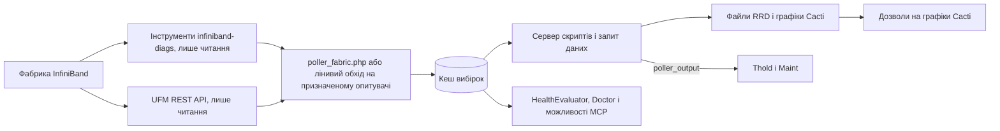

<!-- Source: README.md; SHA256: 79a16fb906f96ee79de2c719f18c38836f555440a7571a4a5ba38c64bb5b099f -->

<!-- translations:start -->
[English](../../../README.md) | [简体中文](../zh-CN/README.md) | [हिन्दी](../hi-IN/README.md) | [Español (España)](../es-ES/README.md) | [Español (Latinoamérica)](../es-419/README.md) | [العربية (السعودية)](../ar-SA/README.md) | [Afrikaans](../af-ZA/README.md) | [አማርኛ](../am-ET/README.md) | [العربية (مصر)](../ar-EG/README.md) | [العربية (المغرب)](../ar-MA/README.md) | [বাংলা](../bn-BD/README.md) | [Bosanski](../bs-BA/README.md) | [Deutsch](../de-DE/README.md) | [فارسی](../fa-IR/README.md) | [Filipino](../fil-PH/README.md) | [Français](../fr-FR/README.md) | [Français (Maroc)](../fr-MA/README.md) | [Français (Sénégal)](../fr-SN/README.md) | [Hausa](../ha-NG/README.md) | [עברית](../he-IL/README.md) | [Hrvatski](../hr-HR/README.md) | [Bahasa Indonesia](../id-ID/README.md) | [Igbo](../ig-NG/README.md) | [Italiano](../it-IT/README.md) | [日本語](../ja-JP/README.md) | [한국어](../ko-KR/README.md) | [Malagasy](../mg-MG/README.md) | [मराठी](../mr-IN/README.md) | [Bahasa Melayu](../ms-MY/README.md) | [Nederlands](../nl-NL/README.md) | [Polski](../pl-PL/README.md) | [Português (Brasil)](../pt-BR/README.md) | [Русский](../ru-RU/README.md) | [Kinyarwanda](../rw-RW/README.md) | [Soomaali](../so-SO/README.md) | [Српски](../sr-RS/README.md) | [Svenska](../sv-SE/README.md) | [Kiswahili](../sw-KE/README.md) | [தமிழ்](../ta-IN/README.md) | [తెలుగు](../te-IN/README.md) | [ไทย](../th-TH/README.md) | [Türkçe](../tr-TR/README.md) | [Українська](README.md) | [اردو](../ur-PK/README.md) | [Tiếng Việt](../vi-VN/README.md) | [isiXhosa](../xh-ZA/README.md) | [Yorùbá](../yo-NG/README.md) | [繁體中文](../zh-TW/README.md) | [isiZulu](../zu-ZA/README.md)
<!-- translations:end -->

# plugin_fabric

Плагін для Cacti 1.2 (`fabric`, версія `0.1.0-dev`), який переносить лічильники портів InfiniBand, ширину та швидкість каналу, а також показники перевантаження до Cacti у вигляді звичайних пристроїв, джерел даних і графіків. Канал, що узгодився в режимі 1X замість 4X, з'являється як графік і сповіщення Thold поруч із хостом, який він обслуговує, з дотриманням прав доступу Cacti, з урахуванням стану обслуговування Maint і можливістю приглушення.

> **Статус: у розробці, релізу ще немає.** Ця гілка реалізує основу плагіна, об'єкти Cacti та сповіщення, заплановані фонові обходи опитувача, реплікацію на віддалені збирачі, бекенд NVIDIA UFM REST лише для читання із зашифрованим сховищем облікових даних, керування CLI у стилі Configuration-as-Code (CasC) та хуки екосистеми Cacti (CasC, Doctor і MCP / Abilities API v2). Плагін перевірено на імітованих утилітах, синтетичних транспортах UFM і симуляторі фабрики `ibsim` (rdma-core 50.0), але ніколи не перевірявся на фізичній фабриці InfiniBand чи живому сервері UFM. Перевірки, що потребують обладнання, залишаються відкритими в [docs/research/](../../research/). Цей проєкт не пов'язаний із проєктом Cacti.

## Що реалізовано

- **Життєвий цикл і схема (v3)**: встановлення, ідемпотентне оновлення, видалення (із типовим збереженням таблиць плагіна) та перевірка вимоги PHP 8.2 зі збереженням синтаксичної сумісності точок входу з PHP 8.0.
- **Ролі доступу та сторінки**: області прав `Fabric View` (`fabric.php`), `Fabric Operator` (`fabric_operator.php`) і `Fabric Admin` (`fabric_admin.php`, `fabric_health.php`), а також вкладка налаштувань у розділі **Configuration > Settings > Fabrics**.
- **Діагностичний бекенд лише для читання (`diags`)**: суворе виконання через вектор аргументів команд `perfquery`, `ibnetdiscover` та `iblinkinfo`, інвентаризація за GUID із виявленням конфліктів ідентичності та пропозиціями повторного зв'язування, оцінка стану каналів і повузлові обходи лічильників.
- **Бекенд NVIDIA UFM REST лише для читання (`ufm`) та зашифроване сховище**: REST-клієнт лише з GET-запитами зі списку дозволених маршрутів (`/ufmRest/resources/ports`, `/ufmRest/resources/systems`, `/ufmRest/monitoring/session/0/data` та відповідники `/ufmRestV3/...` для автентифікації за токеном), який заповнює ті самі таблиці інвентаризації, стану каналів, вибірок і здоров'я, що й `diags`. Облікові дані (`token` або `basic`) зберігаються зашифрованими за допомогою AES-256-GCM у `plugin_fabric_secret` із використанням зовнішнього 256-бітного файлу ключа, налаштованого через `fabric_vault_key_file`. Фабрики UFM можна визначати через CasC (`cli/fabric.php`) або репозиторії; вебформа адміністрування наразі містить лише поля для `diags`.
- **Об'єкти Cacti, Thold і Maint**: шаблони пристроїв, даних і графіків Cacti (`templates/fabric-templates.xml`), запит даних сервера скриптів «Fabric Port» (`scripts/ss_fabric_ports.php`, `resource/script_server/fabric_ports.xml`), лічильникові джерела даних типу `DERIVE` і джерела даних стану каналу та швидкостей типу `GAUGE` для Thold, відстеження розривів послідовності, а також насичені базові лічильники, що повертаються як `U`. Інтеграція з Maint (`MaintMaintenance`) викликає `plugin_maint_check_cacti_host()` (із резервним переходом до хука `is_device_in_maintenance`), завдяки чому вузли в активному обслуговуванні підраховуються окремо та виключаються з попереджень про невдалі обходи й деградовані порти.
- **Заплановані обходи, сегментування та віддалені збирачі**: `poller_bottom` запускає `poller_fabric.php` у фоновому режимі для увімкнених фабрик, призначених поточному опитувачу, чий час обходу настав, поряд із лінивими обходами, які ініціює сервер скриптів. `INFO` оголошує `remote_collect:1, remote_poller:1`, `poller_fabric.php` підтримує детерміноване сегментування за GUID (`--shard=K/N`), а `replicate_out` реплікує несекретні рядки `plugin_fabric_fabric` на віддалені збирачі (`poller_id >= 2`). Записи сховища (`plugin_fabric_secret`) та зовнішні файли ключів ніколи не реплікуються.
- **CLI для CasC та хуки екосистеми**: `cli/fabric.php` для експорту YAML/XML, валідації, пробного планування відмінностей, застосування з підтвердженням та звітування про стан системи, а також хуки `casc_register_providers`, `doctor_register_checks` і `abilities_register`.

## Ролі доступу

| Область прав | Доступ |
| --- | --- |
| Fabric View | Моніторинг інвентаризації та перегляд портів (`fabric.php`). |
| Fabric Operator | Доступ View, а також сторінка Operations (`fabric_operator.php`) і персональні підтвердження під час первинного розбору. |
| Fabric Admin | Доступ Operator, а також конфігурація, адміністративні дії (`fabric_admin.php`) та сторінка стану системи (`fabric_health.php`). |

Після копіювання файлів оновлення відкрийте сторінку Plugins з правами адміністратора, щоб зареєструвати нові області прав і хуки. Явно призначте область прав Operator у розділі **Configuration > Users** або для груп користувачів. Оновлення зберігають наявні ідентифікатори та дозволи областей прав View і Admin. Доступ Admin успадковує доступ Operator, а доступ Operator успадковує доступ View під час кожного запиту; це не додає збережених дозволів до облікових записів користувачів чи груп. Налаштування плагіна також вимагають доступу Fabric Admin на додачу до дозволу Settings у Cacti.

Дозволи на пристрої в Cacti обмежують рядки та дії, доступні кожному користувачеві; для роботи з незіставленими об'єктами потрібні права адміністратора. Облікові дані, конфігурація, зіставлення, видалення та інші адміністративні зміни залишаються на адміністративних сторінках або в CLI. Підтвердження діють лише в межах поточного сеансу користувача, щонайбільше одну годину й лише доти, доки те саме спостереження залишається актуальним. Нові або змінені спостереження роблять їх недійсними. Вони ніколи не позначають невдалий вимір як справний і не приглушують сповіщення.

## Навіщо це потрібно

Деградований канал InfiniBand усе ще пропускає трафік. Коли канал 4X повторно узгоджується в режимі 1X, порт залишається у стані «active», а SNMP-графіки інтерфейсів хоста виглядають нормально, проте тісно зв'язані обчислювальні завдання сповільнюються. Докази містяться в самій фабриці: кожен порт повідомляє свою активну, дозволену та підтримувану ширину й швидкість, а також лічильники помилок і перевантаження. Для їх зчитування потрібні діагностичні інструменти InfiniBand або API менеджера фабрики. Якщо запускати їх вручну, залишаються три прогалини:

- **Немає історії.** `perfquery` та `iblinkinfo` показують лише поточний стан, тому канал, який деградував минулого тижня, залишається непоміченим.
- **Немає контексту пристрою.** Порти фабрики не є об'єктами Cacti, тому графік порту неможливо розмістити поруч із хостом, який він обслуговує.
- **Немає інтеграції зі сповіщеннями Cacti.** Thold і Maint працюють із джерелами даних і пристроями Cacti.

Плагін усуває ці прогалини, зчитуючи стан фабрики через `infiniband-diags` або NVIDIA UFM REST API, ідентифікуючи вузли та порти за GUID і публікуючи лічильники та стан каналів як джерела даних Cacti. Він працює виключно на читання: ніколи не скидає лічильники та не змінює стан портів.

## Експлуатація та CLI

### Фоновий опитувач і ручні обходи

`fabric_poller_bottom()` запускає `poller_fabric.php` у фоновому режимі на кожному опитувачі для увімкнених фабрик, призначених цьому `poller_id`, для яких настав час обходу. Ви також можете запустити виконувач опитувача або ручний обхід безпосередньо на призначеному опитувачі від імені користувача опитувача (замінивши `/path/to/cacti` на каталог вашої інсталяції Cacti):

```sh
php /path/to/cacti/plugins/fabric/poller_fabric.php [--fabric=ID] [--shard=K/N] [--force] [--debug]
php /path/to/cacti/plugins/fabric/fabric_sweep.php --fabric=ID [--node=GUID] [--force]
```

- `poller_fabric.php` запускає всі фабрики локального опитувача, для яких настав час обходу (або одну фабрику через `--fabric=ID`), забезпечує блокування реєстру процесів Cacti та оренди `ClaimRepository` із бюджетом часу `max(30, intdiv(sweep_interval, 2))` секунд і підтримує `--shard=K/N` (`0 <= K < N`) для детермінованого сегментування обходів лічильників вузлів `diags` за GUID вузла.
- `fabric_sweep.php` виконує обхід на вимогу для однієї увімкненої фабрики (або одного вузла через `--node=GUID`), призначеної локальному опитувачу. Прапорець `--force` ігнорує розклад фабрики, водночас дотримуючись захоплень блокування.

Після того як перше виявлення заповнить інвентар, зіставте вузли з пристроями Cacti на сторінці Fabric Admin. Тримайте тайм-аут скриптів Cacti на рівні 25 секунд або вище: лінивий обхід, запущений читанням запиту даних, обмежує виконання утиліти часом `script_timeout - 5` секунд, щоб сервер скриптів встиг повернути останню збережену вибірку або `U`.

### Бекенд NVIDIA UFM REST і сховище облікових даних

Фабрика типу `ufm` вимагає URL-адресу `https://` без вбудованих облікових даних, рядків запиту або фрагментів. `UfmSocketTransport` примусово перевіряє TLS-вузол та ім'я хоста, відхиляє перенаправлення та підтримує додатковий пакет ЦС (`ufm_ca_file`) і прив'язку SHA-256 SPKI (`ufm_spki_pin`).

Щоб зберігати облікові дані UFM у `plugin_fabric_secret`, налаштуйте `fabric_vault_key_file` у розділі **Configuration > Settings > Fabrics** з абсолютним шляхом до звичайного файлу, власником якого є користувач опитувача (без символічних посилань у жодному батьківському каталозі, з правами `0600`, що містить 64 шістнадцяткові символи, наприклад згенеровані `openssl rand -hex 32`, або 32 випадкові недруковані байти). Плагін ніколи не створює та не записує файл ключа, а `replicate_out` ніколи не реплікує `plugin_fabric_secret` чи файли ключів на віддалені опитувачі.

### Configuration-as-Code і CLI стану системи

`cli/fabric.php` декларативно керує налаштуваннями плагіна та визначеннями фабрик у YAML або XML, а також звітує про стан системи з урахуванням обслуговування без виконання живих обходів:

```sh
php /path/to/cacti/plugins/fabric/cli/fabric.php export [--format=yaml|xml] [--file=PATH]
php /path/to/cacti/plugins/fabric/cli/fabric.php validate --file=PATH [--format=yaml|xml]
php /path/to/cacti/plugins/fabric/cli/fabric.php plan --file=PATH [--format=yaml|xml]
php /path/to/cacti/plugins/fabric/cli/fabric.php apply --file=PATH --confirm=PLAN_HASH [--format=yaml|xml]
php /path/to/cacti/plugins/fabric/cli/fabric.php health [--format=text|json]
```

Команда `export` створює нові файли з правами `0600`, маскує `fabric_vault_key_file` як `[REDACTED]` і виводить іменовані посилання `ufm_credential_ref` замість секретів. Команди `plan` та `apply` відхиляють вбудовані значення `ufm_token`, `ufm_password`, `secret` і вбудовані значення `fabric_vault_key_file`. Для `apply` потрібен точний параметр `--confirm=PLAN_HASH`, згенерований командою `plan`.

### Хуки екосистеми

За наявності відповідних плагінів Cacti або інтеграцій хоста `setup.php` реєструє:

- `casc_register_providers`: експортує, валідує, планує та застосовує з підтвердженням конфігурацію `fabric` (`yaml` та `xml`, схема v1) із маскуванням секретів.
- `doctor_register_checks`: надає чотири діагностичні перевірки лише для читання (`fabric.schema`, `fabric.poller_freshness`, `fabric.identity_conflicts`, `fabric.ufm_vault`).
- `abilities_register`: реєструє три ідемпотентні неруйнівні можливості лише для читання в категорії `fabric`, обмежені областю прав Fabric View (і дозволами на пристрої Cacti для помилок портів): `fabric-list-fabrics`, `fabric-get-health` і `fabric-list-port-errors`.

## Обсяг і межі

Поза межами проєкту: зміна стану фабрики, скидання лічильників, заміна менеджера фабрики або менеджера підмережі, власний механізм сповіщень плагіна, власний фоновий демон або мережевий протокол, а також фабрики Ethernet чи RoCE.

## Вимоги та сумісність

| Компонент | Цільове значення |
|---|---|
| Cacti | 1.2.31 або новіша (`compat = 1.2.31`), без латок ядра |
| PHP | 8.2 або новіша; точки входу залишаються синтаксично сумісними з 8.0 і відхиляють активацію на 8.1, щоб непідтримуване середовище виконання отримало відмову замість пошкодження інтерфейсу Cacti |
| Інструменти InfiniBand | `infiniband-diags` із `rdma-core` (протестовано в CI з rdma-core 50.0 під `ibsim`; формати виводу перевірено за вихідним кодом v66.0) |
| UFM | NVIDIA UFM Enterprise REST API (кінцеві точки `ufmRest` і `ufmRestV3` лише для читання; протестовано проти синтетичних транспортів у модульних тестах) |
| Thold, Maint | Зміни не потрібні; CI виконує наскрізний тест із незміненими Thold v1.8.2 і Maint v1.3 |

## Розробка та тестування

Робочий процес CI (`.github/workflows/plugin-ci-workflow.yml`) тестує PHP від 8.2 до 8.5 проти Cacti `release/1.2.31` і `1.2.x`, лінтинг точок входу на PHP 8.0, відмову на PHP 8.1, PHPStan, перевірку gettext/перекладів, ліцензування REUSE, лінтинг робочих процесів, наскрізне відтворення Thold/Maint і симуляцію фабрики `ibsim`.

За допомогою зафіксованого спільного тестового середовища плагінів Pest для Cacti (`CACTI_PEST_BIN`) і одноразової бази даних Cacti:

```sh
# Unit tests
"$CACTI_PEST_BIN" --configuration=phpunit.xml

# Lifecycle integration tests (disposable database only)
CACTI_PATH=/path/to/cacti FABRIC_TEST_DATABASE=disposable "$CACTI_PEST_BIN" --configuration=phpunit-integration.xml

# Static analysis (against Cacti 1.2.31)
CACTI_PATH=/path/to/cacti phpstan analyse -c phpstan.neon --no-progress

# Translation template, catalogs, and localized README checks
sh locales/build_gettext.sh --check

# Simulated ibsim fixture parser check
php tests/bin/check-ibsim-fixtures.php tests/fixtures/ibsim
```

## Архітектура та проєктування

- [docs/PLAN.md](../../PLAN.md) є планом архітектури та проєктування: факти основної гілки розробки із джерелами, відкриті перевірки обладнання, модель ідентичності, правила лічильників і стану каналів, межі безпеки, розрахунок продуктивності, тестування та ризики.
- [docs/decisions/](../../decisions/) містить записи архітектурних рішень.
- [docs/REQUIREMENTS.md](../../REQUIREMENTS.md) зіставляє кожен ідентифікатор вимоги з відповідним завданням.



## Відстеження роботи

- **Етапи (Milestones)** відповідають етапам плану. Кожен має узагальнювальне завдання (epic) із переліком підзавдань та критеріями завершення.
- **Завдання (Issues)** типізовані за мітками: `type: requirement`, `type: research`, `type: decision`, `type: epic`. Завдання вимог визначають пронумеровані вимоги, які можна перевірити (`REQ-AREA-NNN`), та критерії приймання.
- **Мітки** також містять префікси `area:`, `phase:`, `priority:` і `status:`. Див. [CONTRIBUTING.md](../../../CONTRIBUTING.md#labels).
- На [дошці проєкту](https://github.com/users/somethingwithproof/projects/8) відображаються всі завдання за етапами.

## Участь у розробці

Прочитайте [CONTRIBUTING.md](../../../CONTRIBUTING.md). Коміти повинні містити підпис DCO (`git commit -s`). Обговорення архітектури відбувається в завданнях; відкриті рішення позначаються міткою `type: decision`.

## Безпека

Повідомляйте про вразливості приватно; див. [SECURITY.md](../../../SECURITY.md).

## Ліцензія

GNU General Public License v2.0, та сама ліцензія, що й у Cacti та її плагінів. Див. [LICENSE](../../../LICENSE).
