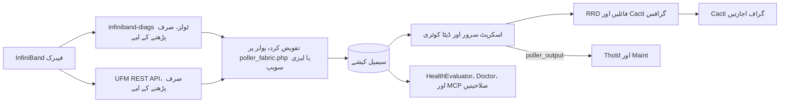

<!-- Source: README.md; SHA256: 79a16fb906f96ee79de2c719f18c38836f555440a7571a4a5ba38c64bb5b099f -->

<!-- translations:start -->
[English](../../../README.md) | [简体中文](../zh-CN/README.md) | [हिन्दी](../hi-IN/README.md) | [Español (España)](../es-ES/README.md) | [Español (Latinoamérica)](../es-419/README.md) | [العربية (السعودية)](../ar-SA/README.md) | [Afrikaans](../af-ZA/README.md) | [አማርኛ](../am-ET/README.md) | [العربية (مصر)](../ar-EG/README.md) | [العربية (المغرب)](../ar-MA/README.md) | [Български](../bg-BG/README.md) | [বাংলা](../bn-BD/README.md) | [Bosanski](../bs-BA/README.md) | [Deutsch](../de-DE/README.md) | [Ελληνικά](../el-GR/README.md) | [فارسی](../fa-IR/README.md) | [Filipino](../fil-PH/README.md) | [Français](../fr-FR/README.md) | [Français (Maroc)](../fr-MA/README.md) | [Français (Sénégal)](../fr-SN/README.md) | [Hausa](../ha-NG/README.md) | [עברית](../he-IL/README.md) | [Hrvatski](../hr-HR/README.md) | [Bahasa Indonesia](../id-ID/README.md) | [Igbo](../ig-NG/README.md) | [Italiano](../it-IT/README.md) | [日本語](../ja-JP/README.md) | [ქართული](../ka-GE/README.md) | [한국어](../ko-KR/README.md) | [Latviešu](../lv-LV/README.md) | [Malagasy](../mg-MG/README.md) | [मराठी](../mr-IN/README.md) | [Bahasa Melayu](../ms-MY/README.md) | [Nederlands](../nl-NL/README.md) | [Polski](../pl-PL/README.md) | [Português (Brasil)](../pt-BR/README.md) | [Português (Portugal)](../pt-PT/README.md) | [Русский](../ru-RU/README.md) | [Kinyarwanda](../rw-RW/README.md) | [Soomaali](../so-SO/README.md) | [Српски](../sr-RS/README.md) | [Svenska](../sv-SE/README.md) | [Kiswahili](../sw-KE/README.md) | [தமிழ்](../ta-IN/README.md) | [తెలుగు](../te-IN/README.md) | [ไทย](../th-TH/README.md) | [Türkçe](../tr-TR/README.md) | [Українська](../uk-UA/README.md) | [اردو](README.md) | [Tiếng Việt](../vi-VN/README.md) | [isiXhosa](../xh-ZA/README.md) | [Yorùbá](../yo-NG/README.md) | [繁體中文](../zh-TW/README.md) | [isiZulu](../zu-ZA/README.md)
<!-- translations:end -->

# plugin_fabric

ایک Cacti 1.2 پلگ ان (`fabric`، ورژن `0.1.0-dev`) جو InfiniBand پورٹ کاؤنٹرز، لنک کی چوڑائی اور رفتار، اور کنجیشن اشاروں کو عام ڈیوائسز، ڈیٹا سورسز، اور گراف کے طور پر Cacti میں لاتا ہے۔ چنانچہ جو لنک 4X کے بجائے 1X پر ٹرین ہوا ہو، وہ اس میزبان کے ساتھ ایک گراف اور Thold الرٹ کے طور پر ظاہر ہوتا ہے جسے یہ سروس فراہم کرتا ہے، Cacti کی اجازتوں کے تحت، اور Maint کی آگاہی و دباؤ (suppression) کے ساتھ کام کرتا ہے۔

> **حیثیت: زیرِ تعمیر، ابھی کوئی ریلیز نہیں ہوئی۔** یہ شاخ پلگ ان کی بنیاد، Cacti اشیاء اور الرٹنگ، شیڈول شدہ پسِ پردہ پولر سویپس، ریموٹ کلیکٹر ریپلیکیشن، خفیہ کردہ (encrypted) اسناد کے والٹ کے ساتھ صرف پڑھنے والا NVIDIA UFM REST بیک اینڈ، Configuration-as-Code (CasC) CLI انتظام، اور Cacti ایکوسسٹم ہکس (CasC، Doctor، اور MCP / Abilities API v2) نافذ کرتی ہے۔ اسے جعلی ٹولز، مصنوعی UFM ٹرانسپورٹس، اور `ibsim` فیبرک سمیولیٹر (rdma-core 50.0) پر ٹیسٹ کیا گیا ہے، کسی حقیقی InfiniBand فیبرک یا لائیو UFM سرور پر کبھی نہیں۔ وہ جانچیں جن کے لیے ہارڈویئر درکار ہے [docs/research/](../../research/) میں ابھی کھلی ہیں۔ یہ پروجیکٹ Cacti پروجیکٹ سے وابستہ نہیں ہے۔

## کیا نافذ کیا گیا ہے

- **لائف سائیکل اور اسکیما (v3)**: انسٹال، آئڈیمپوٹینٹ اپ گریڈ، ان انسٹال (طے شدہ طور پر پلگ ان کی جدولوں کو برقرار رکھتے ہوئے)، اور PHP 8.2 کی شرط کا تحفظ جبکہ انٹری پوائنٹس PHP 8.0 پر پارس کے قابل رہتے ہیں۔
- **رسائی کے کردار اور صفحات**: `Fabric View` (`fabric.php`)، `Fabric Operator` (`fabric_operator.php`)، اور `Fabric Admin` (`fabric_admin.php`، `fabric_health.php`) دائرہ ہائے اختیار، نیز **Configuration > Settings > Fabrics** کے تحت ایک Settings ٹیب۔
- **صرف پڑھنے والا تشخیصی بیک اینڈ (`diags`)**: `perfquery`، `ibnetdiscover`، اور `iblinkinfo` کا سخت آرگیومنٹ ویکٹر نفاذ، شناخت کے تنازعات کی نشاندہی اور دوبارہ لنک کرنے کی تجاویز کے ساتھ GUID کے ذریعے انوینٹری، لنک کی حالت کا جائزہ، اور فی نوڈ کاؤنٹر سویپس۔
- **صرف پڑھنے والا NVIDIA UFM REST بیک اینڈ (`ufm`) اور خفیہ کردہ والٹ**: صرف GET کی اجازت والا REST کلائنٹ (`/ufmRest/resources/ports`، `/ufmRest/resources/systems`، `/ufmRest/monitoring/session/0/data`، اور ٹوکن کی توثیق کے لیے `/ufmRestV3/...` متبادلات) جو `diags` جیسی انوینٹری، لنک اسٹیٹ، سیمپل، اور ہیلتھ جدولوں کو ڈیٹا فراہم کرتا ہے۔ اسناد (`token` یا `basic`) کو `fabric_vault_key_file` کے ذریعے کنفیگر کردہ بیرونی 256 بٹ کلیدی فائل استعمال کرتے ہوئے AES-256-GCM کے ساتھ `plugin_fabric_secret` میں خفیہ کر کے محفوظ کیا جاتا ہے۔ UFM فیبرکس کو CasC (`cli/fabric.php`) یا ریپوزٹریز کے ذریعے متعین کیا جا سکتا ہے؛ ویب ایڈمن فارم فی الحال `diags` کے خانے دکھاتا ہے۔
- **Cacti اشیاء، Thold، اور Maint**: Cacti ڈیوائس، ڈیٹا، اور گراف ٹیمپلیٹس (`templates/fabric-templates.xml`)، "Fabric Port" اسکرپٹ سرور ڈیٹا کوئری (`scripts/ss_fabric_ports.php`، `resource/script_server/fabric_ports.xml`)، Thold کے لیے `DERIVE` کاؤنٹر ڈیٹا سورسز اور `GAUGE` لنک اسٹیٹ/ریٹ ڈیٹا سورسز، تسلسل میں انقطاع کی ٹریکنگ، اور `U` کے طور پر رپورٹ کیے جانے والے سیر شدہ (saturated) بنیادی کاؤنٹرز۔ Maint انضمام (`MaintMaintenance`) `plugin_maint_check_cacti_host()` سے استفسار کرتا ہے (اور عدم موجودگی میں `is_device_in_maintenance` ہک پر واپس آتا ہے) تاکہ فعال دیکھ بھال (maintenance) میں موجود نوڈز کو الگ گنا جائے اور ناکام سویپ و خراب پورٹ کے ہیلتھ انتباہات سے مستثنیٰ رکھا جائے۔
- **شیڈول شدہ سویپس، شارڈنگ، اور ریموٹ کلیکٹرز**: اسکرپٹ سرور کے ذریعے شروع ہونے والے لیزی سویپس کے ساتھ ساتھ، `poller_bottom` موجودہ پولر کو تفویض کردہ وقت پر پہنچنے والے فعال فیبرکس کے لیے پسِ پردہ میں `poller_fabric.php` چلاتا ہے۔ `INFO` میں `remote_collect:1, remote_poller:1` کا اعلان کیا جاتا ہے، `poller_fabric.php` متعین GUID شارڈنگ (`--shard=K/N`) کی معاونت کرتا ہے، اور `replicate_out` غیر خفیہ `plugin_fabric_fabric` قطاروں کو ریموٹ کلیکٹرز (`poller_id >= 2`) پر نقل کرتا ہے۔ والٹ اندراجات (`plugin_fabric_secret`) اور بیرونی کلیدی فائلیں کبھی نقل نہیں کی جاتیں۔
- **CasC CLI اور ایکوسسٹم ہکس**: YAML/XML ایکسپورٹ، توثیق، ڈرائی رن فرق کی منصوبہ بندی، تصدیق سے مشروط نفاذ، اور ہیلتھ رپورٹنگ کے لیے `cli/fabric.php`، نیز `casc_register_providers`، `doctor_register_checks`، اور `abilities_register` ہکس۔

## رسائی کے کردار

| دائرہ اختیار | رسائی |
| --- | --- |
| Fabric View | انوینٹری اور پورٹ مناظر کی نگرانی (`fabric.php`)۔ |
| Fabric Operator | View رسائی کے علاوہ Operations صفحہ (`fabric_operator.php`) اور ذاتی ٹرائیج تصدیقات۔ |
| Fabric Admin | Operator رسائی کے علاوہ کنفیگریشن، انتظامی اقدامات (`fabric_admin.php`)، اور ہیلتھ صفحہ (`fabric_health.php`)۔ |

اپ گریڈ فائلیں کاپی کرنے کے بعد، نئے دائرہ ہائے اختیار اور ہکس رجسٹر کرنے کے لیے بطور منتظم Plugins صفحہ کھولیں۔ **Configuration > Users** یا صارف گروپس کے تحت Operator دائرہ اختیار کو واضح طور پر تفویض کریں۔ اپ گریڈز موجودہ View اور Admin دائرہ اختیار کی IDs اور اجازتوں کو برقرار رکھتے ہیں۔ ہر درخواست پر Admin رسائی Operator رسائی وراثت میں لیتی ہے، اور Operator رسائی View رسائی وراثت میں لیتی ہے؛ اس سے صارفین یا گروپس میں محفوظ کردہ اجازتوں کا اضافہ نہیں ہوتا۔ پلگ ان کی ترتیبات کے لیے Cacti کی Settings اجازت کے علاوہ Fabric Admin رسائی بھی درکار ہوتی ہے۔

Cacti ڈیوائس کی اجازتیں ہر صارف کے لیے دستیاب قطاروں اور اقدامات کو محدود کرتی ہیں؛ غیر میپ شدہ اشیاء کے لیے منتظم کا ہونا ضروری ہے۔ اسناد، کنفیگریشن، میپنگ، حذف کرنے اور دیگر انتظامی تبدیلیاں انتظامی صفحات یا CLI میں رہتی ہیں۔ تصدیقات صرف موجودہ صارف کے سیشن میں، زیادہ سے زیادہ ایک گھنٹے کے لیے اور صرف اس وقت تک برقرار رہتی ہیں جب تک وہی مشاہدہ تازہ رہے۔ نئے یا تبدیل شدہ مشاہدات انہیں باطل کر دیتے ہیں۔ وہ کبھی کسی ناکام پیمائش کو صحت مند قرار نہیں دیتیں اور نہ ہی الرٹس کو روکتی ہیں۔

## کیوں

ایک خراب شدہ (degraded) InfiniBand لنک اب بھی ٹریفک گزارتا رہتا ہے۔ جو 4X لنک دوبارہ 1X پر ٹرین ہو جائے، وہ پورٹ کو "active" رکھتا ہے، اور میزبان کے SNMP انٹرفیس گراف معمول کے مطابق نظر آتے ہیں، لیکن آپس میں جڑے ہوئے (tightly coupled) کام سست پڑ جاتے ہیں۔ اس کا ثبوت فیبرک میں موجود ہوتا ہے: ہر پورٹ اپنی فعال، مجاز (enabled)، اور معاونت یافتہ (supported) چوڑائی اور رفتار کے ساتھ ساتھ خرابی اور کنجیشن کے کاؤنٹرز بھی رپورٹ کرتا ہے۔ اسے پڑھنے کے لیے InfiniBand تشخیصی ٹولز یا فیبرک مینیجر API کی ضرورت ہوتی ہے۔ دستی طور پر چلانے سے تین خلا رہ جاتے ہیں:

- **کوئی تاریخ نہیں۔** `perfquery` اور `iblinkinfo` صرف حال دکھاتے ہیں، اس لیے پچھلے ہفتے خراب ہونے والا لنک نظر نہیں آتا۔
- **کوئی ڈیوائس سیاق و سباق نہیں۔** فیبرک پورٹس Cacti کی اشیاء نہیں ہوتیں، اس لیے کسی پورٹ کا گراف اس میزبان کے ساتھ نہیں بنایا جا سکتا جسے وہ فیڈ کرتا ہے۔
- **Cacti الرٹنگ میں کوئی راستہ نہیں۔** Thold اور Maint صرف Cacti ڈیٹا سورسز اور ڈیوائسز پر کام کرتے ہیں۔

یہ پلگ ان `infiniband-diags` یا NVIDIA UFM REST API کے ذریعے فیبرک کو پڑھ کر، GUID کے ذریعے نوڈز اور پورٹس کی شناخت کر کے، اور کاؤنٹرز اور لنک کی حالت کو Cacti ڈیٹا سورسز کے طور پر شائع کر کے ان خلا کو پُر کرتا ہے۔ یہ صرف پڑھتا ہے: یہ کبھی کاؤنٹرز کو ری سیٹ نہیں کرتا اور نہ ہی پورٹ کی حالت تبدیل کرتا ہے۔

## آپریشنز اور CLI

### پسِ پردہ پولر اور دستی سویپس

`fabric_poller_bottom()` ہر پولر پر ان فعال فیبرکس کے لیے پسِ پردہ میں `poller_fabric.php` شروع کرتا ہے جو اس `poller_id` کو تفویض کیے گئے ہوں اور جن کے سویپ کا وقت آ گیا ہو۔ آپ تفویض کردہ پولر پر پولر صارف کے طور پر براہِ راست پولر رنر یا دستی سویپ بھی چلا سکتے ہیں (`/path/to/cacti` کی جگہ اپنی Cacti ڈائریکٹری کا راستہ درج کریں):

```sh
php /path/to/cacti/plugins/fabric/poller_fabric.php [--fabric=ID] [--shard=K/N] [--force] [--debug]
php /path/to/cacti/plugins/fabric/fabric_sweep.php --fabric=ID [--node=GUID] [--force]
```

- `poller_fabric.php` مقامی پولر کے لیے وقت پر پہنچنے والے تمام فیبرکس (یا `--fabric=ID` کے ساتھ ایک فیبرک) چلاتا ہے، `max(30, intdiv(sweep_interval, 2))` سیکنڈ کے وقت کے بجٹ کے ساتھ Cacti کے پروسیس رجسٹری لاک اور `ClaimRepository` لیزز کو نافذ کرتا ہے، اور نوڈ GUID کے ذریعے `diags` نوڈ کاؤنٹر سویپس کو قطعی طور پر تقسیم کرنے کے لیے `--shard=K/N` (`0 <= K < N`) کی معاونت کرتا ہے۔
- `fabric_sweep.php` مقامی پولر کو تفویض کردہ ایک فعال فیبرک (یا `--node=GUID` کے ساتھ ایک نوڈ) کا طلب پر سویپ چلاتا ہے۔ `--force` کلیمز کا احترام کرتے ہوئے اس بات کو نظر انداز کرتا ہے کہ آیا فیبرک کا وقت پورا ہوا یا نہیں۔

پہلی دریافت سے انوینٹری پُر ہونے کے بعد، Fabric Admin صفحے پر نوڈز کو Cacti ڈیوائسز سے میپ کریں۔ Cacti کا اسکرپٹ ٹائم آؤٹ 25 سیکنڈ یا اس سے زیادہ رکھیں: ڈیٹا کوئری ریڈ سے شروع ہونے والا لیزی سویپ ٹول کے نفاذ کو `script_timeout - 5` سیکنڈ تک محدود رکھتا ہے تاکہ اسکرپٹ سرور آخری محفوظ کردہ سیمپل یا `U` کے ساتھ بروقت واپس آ سکے۔

### NVIDIA UFM REST بیک اینڈ اور اسناد کا والٹ

ایک `ufm` فیبرک کے لیے ایسا `https://` URL درکار ہے جس میں شامل کردہ اسناد، کوئری اسٹرنگز، یا فریگمنٹس نہ ہوں۔ `UfmSocketTransport` TLS پیئر اور میزبان نام کی تصدیق نافذ کرتا ہے، ری ڈائریکٹس کو مسترد کرتا ہے، اور اختیاری CA بنڈل (`ufm_ca_file`) اور SHA-256 SPKI پن (`ufm_spki_pin`) کی معاونت کرتا ہے۔

`plugin_fabric_secret` میں UFM اسناد محفوظ کرنے کے لیے، **Configuration > Settings > Fabrics** کے تحت `fabric_vault_key_file` کو پولر صارف کی ملکیت والی ایک عام فائل کے مطلق راستے کے ساتھ کنفیگر کریں (کسی بھی والدین ڈائریکٹری میں سم لنک نہ ہو، موڈ `0600` ہو، جس میں 64 ہیکس حروف مثلاً `openssl rand -hex 32` یا 32 بے ترتیب ناقابلِ طباعت بائٹس ہوں)۔ پلگ ان کبھی کلیدی فائل نہیں بناتا اور نہ ہی لکھتا ہے، اور `replicate_out` کبھی `plugin_fabric_secret` یا کلیدی فائلوں کو ریموٹ پولرز پر نقل نہیں کرتا۔

### Configuration-as-Code اور ہیلتھ CLI

`cli/fabric.php` پلگ ان کی ترتیبات اور فیبرک کی تعریفوں کو YAML یا XML میں اعلانیہ طور پر منظم کرتا ہے، اور لائیو سویپس چلائے بغیر دیکھ بھال سے باخبر صحت کی حالت رپورٹ کرتا ہے:

```sh
php /path/to/cacti/plugins/fabric/cli/fabric.php export [--format=yaml|xml] [--file=PATH]
php /path/to/cacti/plugins/fabric/cli/fabric.php validate --file=PATH [--format=yaml|xml]
php /path/to/cacti/plugins/fabric/cli/fabric.php plan --file=PATH [--format=yaml|xml]
php /path/to/cacti/plugins/fabric/cli/fabric.php apply --file=PATH --confirm=PLAN_HASH [--format=yaml|xml]
php /path/to/cacti/plugins/fabric/cli/fabric.php health [--format=text|json]
```

`export` نئی فائلیں `0600` موڈ کے ساتھ بناتا ہے، `fabric_vault_key_file` کو `[REDACTED]` کے طور پر چھپاتا ہے، اور رازوں کے بجائے نامزد `ufm_credential_ref` حوالے جاری کرتا ہے۔ `plan` اور `apply` ان لائن `ufm_token`، `ufm_password`، `secret`، اور ان لائن `fabric_vault_key_file` اقدار کو مسترد کرتے ہیں۔ `apply` کے لیے `plan` کا تیار کردہ عین `--confirm=PLAN_HASH` درکار ہوتا ہے۔

### ایکوسسٹم ہکس

جب متعلقہ Cacti پلگ انز یا میزبان انضمام موجود ہوں، تو `setup.php` درج ذیل کو رجسٹر کرتا ہے:

- `casc_register_providers`: رازوں کی پردہ پوشی کے ساتھ `fabric` کنفیگریشن (`yaml` اور `xml`، اسکیما v1) کو ایکسپورٹ، توثیق، پلان، اور تصدیق کے ساتھ لاگو کرتا ہے۔
- `doctor_register_checks`: چار صرف پڑھنے والی تشخیصی جانچیں فراہم کرتا ہے (`fabric.schema`، `fabric.poller_freshness`، `fabric.identity_conflicts`، `fabric.ufm_vault`)۔
- `abilities_register`: Fabric View دائرہ اختیار (اور پورٹ کی خرابیوں کے لیے Cacti ڈیوائس اجازتوں) کے تحت `fabric` زمرے میں تین صرف پڑھنے والی، غیر تخریبی، آئڈیمپوٹینٹ صلاحیتیں رجسٹر کرتا ہے: `fabric-list-fabrics`، `fabric-get-health`، اور `fabric-list-port-errors`۔

## دائرہ کار اور حدود

دائرہ کار سے باہر: فیبرک کی حالت تبدیل کرنا، کاؤنٹرز ری سیٹ کرنا، فیبرک مینیجر یا سب نیٹ مینیجر کی جگہ لینا، پلگ ان کا اپنا الرٹنگ انجن، کسٹم ڈیمن یا نیٹ ورک پروٹوکول، اور Ethernet یا RoCE فیبرکس۔

## تقاضے اور مطابقت

| جزو | ہدف |
|---|---|
| Cacti | 1.2.31 یا اس کے بعد کا ورژن (`compat = 1.2.31`)، کور پیچز کے بغیر |
| PHP | 8.2 یا اس کے بعد کا ورژن؛ انٹری پوائنٹس 8.0 پر پارس کے قابل رہتے ہیں اور 8.1 پر فعالی مسترد کرتے ہیں تاکہ غیر معاونت یافتہ رن ٹائم پر Cacti کا UI خراب ہونے کے بجائے انکار کا پیغام ملے |
| InfiniBand ٹولز | `rdma-core` سے `infiniband-diags` (`ibsim` کے تحت rdma-core 50.0 کے ساتھ CI میں ٹیسٹ کیا گیا؛ آؤٹ پٹ فارمیٹس کی جانچ v66.0 سورس سے کی گئی) |
| UFM | NVIDIA UFM Enterprise REST API (`ufmRest` اور `ufmRestV3` صرف پڑھنے والے اینڈپوائنٹس؛ یونٹ ٹیسٹس میں مصنوعی ٹرانسپورٹس پر ٹیسٹ کیا گیا) |
| Thold، Maint | کسی تبدیلی کی ضرورت نہیں؛ CI غیر تبدیل شدہ Thold v1.8.2 اور Maint v1.3 کے ساتھ اینڈ ٹو اینڈ ٹیسٹ چلاتا ہے |

## ترقی اور ٹیسٹنگ

CI ورک فلو (`.github/workflows/plugin-ci-workflow.yml`) Cacti `release/1.2.31` اور `1.2.x` کے خلاف PHP 8.2 تا 8.5، PHP 8.0 انٹری پوائنٹ لنٹنگ، PHP 8.1 انکار، PHPStan، gettext/ترجمہ توثیق، REUSE لائسنسنگ، ورک فلو لنٹنگ، Thold/Maint اینڈ ٹو اینڈ ری پلے، اور `ibsim` فیبرک سمیولیشن کا ٹیسٹ کرتا ہے۔

Cacti کے لاک شدہ مشترکہ Pest پلگ ان ہارنس (`CACTI_PEST_BIN`) اور ایک ڈسپوزایبل Cacti ڈیٹا بیس کے ساتھ:

```sh
# Unit tests
"$CACTI_PEST_BIN" --configuration=phpunit.xml

# Lifecycle integration tests (disposable database only)
CACTI_PATH=/path/to/cacti FABRIC_TEST_DATABASE=disposable "$CACTI_PEST_BIN" --configuration=phpunit-integration.xml

# Static analysis (against Cacti 1.2.31)
CACTI_PATH=/path/to/cacti phpstan analyse -c phpstan.neon --no-progress

# Translation template, catalogs, and localized README checks
sh locales/build_gettext.sh --check

# Simulated ibsim fixture parser check
php tests/bin/check-ibsim-fixtures.php tests/fixtures/ibsim
```

## ڈیزائن

- [docs/PLAN.md](../../PLAN.md) آرکیٹیکچر اور ڈیزائن منصوبہ ہے: مآخذ کے ساتھ اپ اسٹریم حقائق، کھلی ہارڈویئر جانچیں، شناخت کا ماڈل، کاؤنٹر اور لنک اسٹیٹ کے قواعد، سیکیورٹی حدود، کارکردگی کا حساب، ٹیسٹنگ، اور خطرات۔
- [docs/decisions/](../../decisions/) میں آرکیٹیکچر فیصلوں کے ریکارڈز موجود ہیں۔
- [docs/REQUIREMENTS.md](../../REQUIREMENTS.md) ہر ریکوائرمنٹ ID کو اس کے متعلقہ ایشو سے جوڑتا ہے۔



## کام کو کیسے ٹریک کیا جاتا ہے

- **سنگِ میل (Milestones)** منصوبے کے سنگِ میل کی پیروی کرتے ہیں۔ ہر ایک کا ایک ایپک ایشو ہے جس میں اس کے ذیلی ایشوز اور اختتامی شواہد درج ہیں۔
- **ایشوز** لیبل کے ذریعے درجہ بند کیے گئے ہیں: `type: requirement`، `type: research`، `type: decision`، `type: epic`۔ ریکوائرمنٹ ایشوز میں نمبر شدہ، قابلِ جانچ تقاضے (`REQ-AREA-NNN`) اور قبولیت کے معیار بیان کیے گئے ہیں۔
- **لیبلز** میں `area:`، `phase:`، `priority:`، اور `status:` بھی شامل ہوتے ہیں۔ دیکھیں [CONTRIBUTING.md](../../../CONTRIBUTING.md#labels)۔
- [پروجیکٹ بورڈ](https://github.com/users/somethingwithproof/projects/8) تمام سنگِ میل کے تمام ایشوز دکھاتا ہے۔

## تعاون کرنا

[CONTRIBUTING.md](../../../CONTRIBUTING.md) پڑھیں۔ کمٹس کے لیے DCO سائن آف (`git commit -s`) ضروری ہے۔ ڈیزائن پر بحث ایشوز پر ہوتی ہے؛ کھلے فیصلوں پر `type: decision` لیبل لگا ہوتا ہے۔

## سیکیورٹی

کمزوریوں کی اطلاع نجی طور پر دیں؛ دیکھیں [SECURITY.md](../../../SECURITY.md)۔

## لائسنس

GNU General Public License v2.0، وہی لائسنس جو Cacti اور اس کے پلگ انز کا ہے۔ دیکھیں [LICENSE](../../../LICENSE)۔
