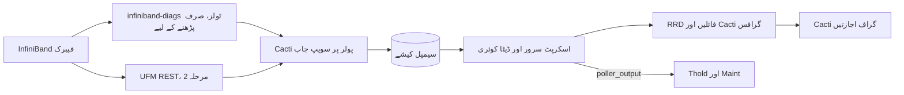

<!-- Source: README.md; SHA256: ce5af61a1bc993ec2aae6d4f22c3885694632f2b1d5eb94e2ce88b8390e96f1e -->

<!-- translations:start -->
[English](../../../README.md) | [简体中文](../zh-CN/README.md) | [हिन्दी](../hi-IN/README.md) | [Español (España)](../es-ES/README.md) | [Español (Latinoamérica)](../es-419/README.md) | [العربية (السعودية)](../ar-SA/README.md) | [Afrikaans](../af-ZA/README.md) | [አማርኛ](../am-ET/README.md) | [العربية (مصر)](../ar-EG/README.md) | [العربية (المغرب)](../ar-MA/README.md) | [বাংলা](../bn-BD/README.md) | [Deutsch](../de-DE/README.md) | [فارسی](../fa-IR/README.md) | [Filipino](../fil-PH/README.md) | [Français](../fr-FR/README.md) | [Français (Maroc)](../fr-MA/README.md) | [Français (Sénégal)](../fr-SN/README.md) | [Hausa](../ha-NG/README.md) | [עברית](../he-IL/README.md) | [Bahasa Indonesia](../id-ID/README.md) | [Igbo](../ig-NG/README.md) | [Italiano](../it-IT/README.md) | [日本語](../ja-JP/README.md) | [한국어](../ko-KR/README.md) | [Malagasy](../mg-MG/README.md) | [मराठी](../mr-IN/README.md) | [Bahasa Melayu](../ms-MY/README.md) | [Nederlands](../nl-NL/README.md) | [Polski](../pl-PL/README.md) | [Português (Brasil)](../pt-BR/README.md) | [Русский](../ru-RU/README.md) | [Kinyarwanda](../rw-RW/README.md) | [Soomaali](../so-SO/README.md) | [Svenska](../sv-SE/README.md) | [Kiswahili](../sw-KE/README.md) | [தமிழ்](../ta-IN/README.md) | [తెలుగు](../te-IN/README.md) | [ไทย](../th-TH/README.md) | [Türkçe](../tr-TR/README.md) | [Українська](../uk-UA/README.md) | [اردو](README.md) | [Tiếng Việt](../vi-VN/README.md) | [isiXhosa](../xh-ZA/README.md) | [Yorùbá](../yo-NG/README.md) | [繁體中文](../zh-TW/README.md) | [isiZulu](../zu-ZA/README.md)
<!-- translations:end -->

# plugin_fabric

ایک Cacti 1.2 پلگ ان جو InfiniBand پورٹ کاؤنٹرز، لنک کی چوڑائی اور رفتار، اور کنجیشن اشاروں کو عام ڈیوائسز، ڈیٹا سورسز، اور گراف کے طور پر Cacti میں لاتا ہے۔ چنانچہ جو لنک 4X کے بجائے 1X پر ٹرین ہوا ہو، وہ اس میزبان کے ساتھ ایک گراف اور Thold الرٹ کے طور پر ظاہر ہوتا ہے جسے یہ سروس فراہم کرتا ہے، Cacti کی اجازتوں کے تحت، اور Maint اسے دبا (suppress) سکتا ہے۔

> **حیثیت: زیرِ تعمیر، ابھی کوئی ریلیز نہیں ہوئی۔** سنگِ میل 2 (بنیاد) `main` پر ضم ہو چکا ہے، اور سنگِ میل 3 (Cacti اشیاء اور الرٹنگ) زیرِ جائزہ ہے۔ سنگِ میل 1 نے دستاویزات اور اپ اسٹریم سورس (PR #71) کی بنیاد پر ڈیزائن کی تصدیق کی؛ نتائج، مآخذ کے ساتھ، [docs/research/](../../research) میں موجود ہیں۔ سنگِ میل 2 پلگ ان کی بنیاد شامل کرتا ہے:
>
> - انسٹال، اپ گریڈ، ان انسٹال، اور PHP 8.2 گارڈ
> - View، Operator اور Admin دائرہ ہائے اختیار (realms)، اور ترتیبات
> - فیبرک ریکارڈز
> - `perfquery`، `ibnetdiscover`، اور `iblinkinfo` کے لیے صرف پڑھنے کی کمانڈ باؤنڈری
> - GUID کے ذریعے انوینٹری، شناخت کے تنازعات اور دوبارہ لنک کرنے کی تجاویز کے ساتھ
> - لنک کی حالت اور کاؤنٹر سویپ کیشے
> - انوینٹری، ایڈمن، اور ہیلتھ صفحات
>
> سنگِ میل 3 Cacti کی اشیاء شامل کرتا ہے:
>
> - Cacti ٹیمپلیٹ XML کے طور پر فراہم کیے گئے ڈیوائس، ڈیٹا، اور گراف ٹیمپلیٹس، اور "Fabric Port" ڈیٹا کوئری
> - کسی نوڈ کو Cacti ڈیوائس سے میپ کرنا، یا تصدیق پر نیا بنانا ([ADR 0010](../../decisions/0010-one-device-per-node.md))
> - گراف کے لیے کاؤنٹر ڈیٹا سورسز، اور Thold کے لیے GAUGE لنک اسٹیٹ اور ریٹ ڈیٹا سورسز ([ADR 0011](../../decisions/0011-derive-counters-and-gauge-alert-values.md))
> - تسلسل میں انقطاع (discontinuity) کی ہینڈلنگ اور سیر شدہ (saturated) بنیادی کاؤنٹرز کو نامعلوم کے طور پر پڑھنا ([ADR 0012](../../decisions/0012-saturated-basic-counters-read-as-unknown.md))، پورٹ کے صفحے پر کاؤنٹر کی درستگی اور گراف کے لنکس، اور کنجیشن درجہ بندی
> - غیر تبدیل شدہ Thold v1.8.2 اور Maint v1.3 کے ساتھ اینڈ ٹو اینڈ ٹیسٹ، اور ایک CI جاب جو ایک مصنوعی فیبرک کے خلاف حقیقی تشخیصی ٹولز چلاتی ہے
>
> فیبرک کو صرف مرکزی پولر سے سویپ کیا جا سکتا ہے جب تک کہ مرحلہ 3 میں ریموٹ ڈیٹا کلیکٹرز کی معاونت شامل نہ ہو جائے۔ اسے جعلی ٹولز اور ibsim فیبرک سمیولیٹر پر ٹیسٹ کیا گیا ہے، کسی حقیقی InfiniBand فیبرک پر کبھی نہیں۔ وہ جانچیں جن کے لیے فیبرک درکار ہے، ہر تحقیقی صفحے کے لائیو چیکس جدول میں ابھی باقی ہیں۔ یہ پروجیکٹ Cacti پروجیکٹ سے وابستہ نہیں ہے۔

## رسائی کے کردار

| دائرہ اختیار | رسائی |
| --- | --- |
| Fabric View | موجودہ مانیٹرنگ صفحات۔ |
| Fabric Operator | مانیٹرنگ کے علاوہ آپریشنز کا صفحہ اور ذاتی ٹرائیج تصدیقات (acknowledgments)۔ |
| Fabric Admin | آپریٹر کی رسائی کے علاوہ موجودہ کنفیگریشن اور انتظامی اقدامات۔ |

اپ گریڈ فائلیں کاپی کرنے کے بعد، نیا دائرہ اختیار رجسٹر کرنے کے لیے بطور منتظم Plugins صفحہ کھولیں۔ **Configuration > Users** یا صارف گروپس کے تحت Operator دائرہ اختیار کو واضح طور پر تفویض کریں۔
اپ گریڈز موجودہ View اور Admin دائرہ اختیار کی IDs اور اجازتوں کو برقرار رکھتے ہیں۔ Admin رسائی
ہر درخواست پر Operator رسائی وراثت میں لیتی ہے، اور Operator رسائی View رسائی وراثت میں لیتی ہے؛
اس سے صارفین یا گروپس میں محفوظ کردہ اجازتوں کا اضافہ نہیں ہوتا۔ پلگ ان کی ترتیبات کے لیے
Cacti کی Settings اجازت کے علاوہ Fabric Admin رسائی بھی درکار ہوتی ہے۔

Cacti ڈیوائس کی اجازتیں اب بھی ہر صارف کے لیے دستیاب قطاروں اور اقدامات کو محدود کرتی ہیں؛ غیر میپ شدہ اشیاء کے لیے منتظم (administrator) کا ہونا ضروری ہے۔
اسناد، کنفیگریشن، میپنگ، حذف کرنے اور دیگر انتظامی تبدیلیاں
انتظامی صفحات ہی میں رہتی ہیں۔ تصدیقات (acknowledgments) صرف موجودہ
صارف کے سیشن میں، زیادہ سے زیادہ ایک گھنٹے کے لیے اور صرف اس وقت تک برقرار رہتی ہیں جب تک وہی مشاہدہ
تازہ رہے۔ نئے یا تبدیل شدہ مشاہدات انہیں باطل کر دیتے ہیں۔ وہ کبھی کسی ناکام
پیمائش کو صحت مند قرار نہیں دیتیں اور نہ ہی الرٹس کو روکتی ہیں۔

## کیوں

ایک خراب شدہ (degraded) InfiniBand لنک اب بھی ٹریفک گزارتا رہتا ہے۔ جو 4X لنک دوبارہ 1X پر ٹرین ہو جائے، وہ پورٹ کو "فعال" (active) رکھتا ہے، اور میزبان کے SNMP انٹرفیس گراف معمول کے مطابق نظر آتے ہیں، لیکن آپس میں جڑے ہوئے (tightly coupled) کام سست پڑ جاتے ہیں۔ اس کا ثبوت فیبرک میں موجود ہوتا ہے: ہر پورٹ اپنی فعال، مجاز (enabled)، اور معاونت یافتہ (supported) چوڑائی اور رفتار کے ساتھ ساتھ خرابی اور کنجیشن کے کاؤنٹرز بھی رپورٹ کرتا ہے۔ اسے پڑھنے کے لیے InfiniBand تشخیصی ٹولز یا فیبرک مینیجر API کی ضرورت ہوتی ہے۔ دستی طور پر چلانے سے تین خلا رہ جاتے ہیں:

- **کوئی تاریخ نہیں۔** `perfquery` اور `iblinkinfo` صرف حال دکھاتے ہیں، اس لیے پچھلے ہفتے خراب ہونے والا لنک نظر نہیں آتا۔
- **کوئی ڈیوائس سیاق و سباق نہیں۔** فیبرک پورٹس Cacti کی اشیاء نہیں ہوتیں، اس لیے کسی پورٹ کا گراف اس میزبان کے ساتھ نہیں بنایا جا سکتا جسے وہ فیڈ کرتا ہے۔
- **Cacti الرٹنگ میں کوئی راستہ نہیں۔** Thold اور Maint صرف Cacti ڈیٹا سورسز اور ڈیوائسز پر کام کرتے ہیں۔

یہ پلگ ان اپنے تشخیصی ٹولز (اور بعد میں UFM) کے ذریعے فیبرک کو پڑھ کر، GUID کے ذریعے نوڈز اور پورٹس کی شناخت کر کے، اور کاؤنٹرز اور لنک کی حالت کو Cacti ڈیٹا سورسز کے طور پر شائع کر کے ان خلا کو پُر کرتا ہے۔ یہ صرف پڑھتا ہے: یہ کبھی کاؤنٹرز کو ری سیٹ نہیں کرتا اور نہ ہی پورٹ کی حالت تبدیل کرتا ہے۔

## پہلی دریافت

نئے فیبرک میں کوئی نوڈز نہیں ہوتے، اور سویپس اسکرپٹ سرور سے صرف اسی نوڈ کے لیے شروع ہوتے ہیں جو کسی Cacti ڈیوائس سے میپ ہو۔ اس لیے پہلی دریافت ایک دستی مرحلہ ہے۔ ایک فعال فیبرک کو محفوظ کرنے کے بعد، جس پولر کو یہ فیبرک تفویض کیا گیا ہے اس پر پولر کے اکاؤنٹ سے یہ کمانڈ ایک بار چلائیں، اور `/path/to/cacti` کی جگہ اپنی Cacti ڈائریکٹری کا راستہ درج کریں (مکمل راستہ cron سے بھی کام کرتا ہے):

```
php /path/to/cacti/plugins/fabric/fabric_sweep.php --fabric=ID --force
```

اس کے بعد انوینٹری پُر ہو جاتی ہے۔ Fabric Admin صفحے پر نوڈز کو Cacti ڈیوائسز سے میپ کریں؛ بعد کے سویپس ڈیٹا کوئری سے شروع ہوتے ہیں۔ جب تک کسی فیبرک کا کوئی نوڈ میپ نہ ہو، کوئی چیز اس کی انوینٹری کو تازہ نہیں کرتی، لہٰذا نئے یا گمشدہ نوڈز کو ریکارڈ کرنے کے لیے یہی کمانڈ دوبارہ چلائیں، چاہیں تو cron کے ذریعے چلائیں۔ ہیلتھ صفحہ یہ کمانڈ ہر اس فعال فیبرک کے لیے دکھاتا ہے جس کی دریافت نہ ہوئی ہو یا جس کا کوئی میپ شدہ نوڈ نہ ہو۔

## منصوبہ بند دائرہ کار

| مرحلہ | دائرہ کار | سنگِ میل |
|---|---|---|
| 0، تحقیق | ورژن میٹرکس، اپ اسٹریم رویے کی تصدیق، ہارڈویئر پر کاؤنٹر کا رویہ، استحقاق ماڈل، MAD بجٹ، UFM API | [M1](https://github.com/somethingwithproof/plugin_fabric/milestone/1) |
| 1، مشاہدہ | GUID کے ذریعے انوینٹری، Cacti ڈیوائسز، پورٹ ڈیٹا کوئری، کاؤنٹر اور لنک اسٹیٹ ڈیٹا سورسز، Thold الرٹنگ، Maint سپریشن، ہیلتھ صفحہ | [M2](https://github.com/somethingwithproof/plugin_fabric/milestone/2)، [M3](https://github.com/somethingwithproof/plugin_fabric/milestone/3)، [M4](https://github.com/somethingwithproof/plugin_fabric/milestone/4) |
| 2، UFM | صرف پڑھنے والا UFM REST بیک اینڈ، اسناد کی ہینڈلنگ، بیک اینڈز کے درمیان شناخت کا تسلسل | [M5](https://github.com/somethingwithproof/plugin_fabric/milestone/5) |
| 3، ریموٹ | ریموٹ ڈیٹا کلیکٹرز، ریپلیکیشن، `remote_agent` اقدامات، بڑے فیبرکس کے لیے منقسم (sharded) سویپس | [M6](https://github.com/somethingwithproof/plugin_fabric/milestone/6) |

دائرہ کار سے باہر: فیبرک کی حالت تبدیل کرنا، فیبرک مینیجر یا سب نیٹ مینیجر کی جگہ لینا، پلگ ان کا اپنا الرٹنگ انجن، کسٹم ڈیمن یا نیٹ ورک پروٹوکول، اور Ethernet یا RoCE فیبرکس (تحقیق)۔

## مطابقت کے اہداف

| جزو | ہدف |
|---|---|
| Cacti | 1.2.31 یا اس کے بعد کا ورژن، کور پیچز کے بغیر |
| PHP | 8.2 یا اس کے بعد کا ورژن؛ `setup.php` ورژن 8.0 پر بھی پارس کے قابل رہتا ہے تاکہ غیر معاونت یافتہ رن ٹائم پر Cacti کا UI خراب ہونے کے بجائے انکار کا پیغام ملے |
| InfiniBand ٹولز | rdma-core سے infiniband-diags؛ آؤٹ پٹ فارمیٹس کی جانچ v66.0 سورس سے کی گئی |
| UFM | UFM Enterprise REST API، مرحلہ 2؛ ریلیز میٹرکس سنگِ میل 1 کا حصہ ہے |
| Thold، Maint | کسی تبدیلی کی ضرورت نہیں |

Cacti کے اسکرپٹ ٹائم آؤٹ کو اس کی طے شدہ قدر 25 سیکنڈ یا اس سے زیادہ پر رکھیں۔ ڈیٹا کوئری ریڈ کے ذریعے شروع ہونے والا سویپ ٹول کے نفاذ کو اس ٹائم آؤٹ سے پانچ سیکنڈ کم تک محدود رکھتا ہے، تاکہ کیشے پڑھنے اور جواب دینے کے لیے وقت محفوظ رہے۔ جب بجٹ ختم ہو جاتا ہے، تو کوئری آخری حالیہ سیمپل یا نامعلوم (unknown) فراہم کرتی ہے؛ اگلا چکر دوبارہ سویپ کی کوشش کرتا ہے۔ یہ حد PHP پولر پر بھی لاگو ہوتی ہے۔ پانچ سیکنڈ یا اس سے کم کا ٹائم آؤٹ کوئی ٹول شروع کرنے کے لیے وقت نہیں چھوڑتا۔

## ڈیزائن

- [docs/PLAN.md](../../PLAN.md) مکمل منصوبہ ہے: آرکیٹیکچر، وہ اپ اسٹریم حقائق جن پر یہ منحصر ہے (مآخذ کے ساتھ) اور وہ مفروضے جن کی تصدیق ابھی باقی ہے، شناخت کا ماڈل، کاؤنٹر اور لنک اسٹیٹ کے قواعد، سیکیورٹی حدود، کارکردگی کا حساب، ٹیسٹنگ، اور خطرات۔
- [docs/decisions/](../../decisions) میں پہلے سے کیے گئے فیصلوں کے آرکیٹیکچر ڈیسیژن ریکارڈز موجود ہیں۔
- [docs/REQUIREMENTS.md](../../REQUIREMENTS.md) ہر ریکوائرمنٹ ID کو اس کے متعلقہ ایشو سے جوڑتا ہے۔



## کام کو کیسے ٹریک کیا جاتا ہے

- **سنگِ میل (Milestones)** منصوبے کے سنگِ میل کی پیروی کرتے ہیں۔ ہر ایک کا ایک ایپک ایشو ہے جس میں اس کے ذیلی ایشوز اور اختتامی شواہد درج ہیں۔
- **ایشوز** لیبل کے ذریعے درجہ بند کیے گئے ہیں: `type: requirement`، `type: research`، `type: decision`، `type: epic`۔ ریکوائرمنٹ ایشوز میں نمبر شدہ، قابلِ جانچ تقاضے (`REQ-AREA-NNN`) اور قبولیت کے معیار بیان کیے گئے ہیں۔
- **لیبلز** میں `area:`، `phase:`، `priority:`، اور `status:` بھی شامل ہوتے ہیں۔ دیکھیں [CONTRIBUTING.md](../../../CONTRIBUTING.md#labels)۔
- [پروجیکٹ بورڈ](https://github.com/users/somethingwithproof/projects/8) تمام سنگِ میل کے تمام ایشوز دکھاتا ہے۔

## تعاون کرنا

[CONTRIBUTING.md](../../../CONTRIBUTING.md) پڑھیں۔ کمٹس کے لیے DCO سائن آف ضروری ہے۔ ڈیزائن پر بحث ایشوز پر ہوتی ہے؛ کھلے فیصلوں پر `type: decision` لیبل لگا ہوتا ہے۔

## سیکیورٹی

کمزوریوں کی اطلاع نجی طور پر دیں؛ دیکھیں [SECURITY.md](../../../SECURITY.md)۔

## لائسنس

GNU General Public License v2.0، وہی لائسنس جو Cacti اور اس کے پلگ انز کا ہے۔ دیکھیں [LICENSE](../../../LICENSE)۔
