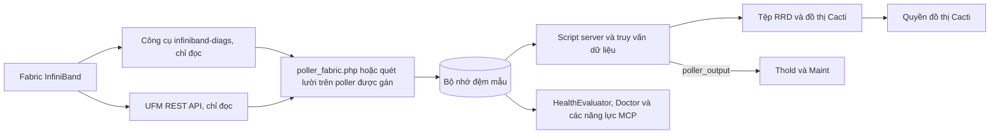

<!-- Source: README.md; SHA256: 79a16fb906f96ee79de2c719f18c38836f555440a7571a4a5ba38c64bb5b099f -->

<!-- translations:start -->
[English](../../../README.md) | [简体中文](../zh-CN/README.md) | [हिन्दी](../hi-IN/README.md) | [Español (España)](../es-ES/README.md) | [Español (Latinoamérica)](../es-419/README.md) | [العربية (السعودية)](../ar-SA/README.md) | [Afrikaans](../af-ZA/README.md) | [አማርኛ](../am-ET/README.md) | [العربية (مصر)](../ar-EG/README.md) | [العربية (المغرب)](../ar-MA/README.md) | [বাংলা](../bn-BD/README.md) | [Bosanski](../bs-BA/README.md) | [Deutsch](../de-DE/README.md) | [فارسی](../fa-IR/README.md) | [Filipino](../fil-PH/README.md) | [Français](../fr-FR/README.md) | [Français (Maroc)](../fr-MA/README.md) | [Français (Sénégal)](../fr-SN/README.md) | [Hausa](../ha-NG/README.md) | [עברית](../he-IL/README.md) | [Hrvatski](../hr-HR/README.md) | [Bahasa Indonesia](../id-ID/README.md) | [Igbo](../ig-NG/README.md) | [Italiano](../it-IT/README.md) | [日本語](../ja-JP/README.md) | [한국어](../ko-KR/README.md) | [Malagasy](../mg-MG/README.md) | [मराठी](../mr-IN/README.md) | [Bahasa Melayu](../ms-MY/README.md) | [Nederlands](../nl-NL/README.md) | [Polski](../pl-PL/README.md) | [Português (Brasil)](../pt-BR/README.md) | [Русский](../ru-RU/README.md) | [Kinyarwanda](../rw-RW/README.md) | [Soomaali](../so-SO/README.md) | [Српски](../sr-RS/README.md) | [Svenska](../sv-SE/README.md) | [Kiswahili](../sw-KE/README.md) | [தமிழ்](../ta-IN/README.md) | [తెలుగు](../te-IN/README.md) | [ไทย](../th-TH/README.md) | [Türkçe](../tr-TR/README.md) | [Українська](../uk-UA/README.md) | [اردو](../ur-PK/README.md) | [Tiếng Việt](README.md) | [isiXhosa](../xh-ZA/README.md) | [Yorùbá](../yo-NG/README.md) | [繁體中文](../zh-TW/README.md) | [isiZulu](../zu-ZA/README.md)
<!-- translations:end -->

# plugin_fabric

Một plugin cho Cacti 1.2 (`fabric`, phiên bản `0.1.0-dev`) đưa các bộ đếm cổng InfiniBand, độ rộng và tốc độ liên kết cùng các chỉ báo nghẽn mạng vào Cacti dưới dạng thiết bị, nguồn dữ liệu và đồ thị thông thường. Khi một liên kết chỉ thương lượng ở mức 1X thay vì 4X, nó sẽ hiển thị thành đồ thị và cảnh báo Thold ngay bên cạnh máy chủ mà nó phục vụ, tuân theo phân quyền của Cacti, đồng thời nhận biết trạng thái bảo trì và cho phép tạm ẩn qua Maint.

> **Trạng thái: đang phát triển, chưa có bản phát hành.** Nhánh này triển khai phần nền tảng plugin, các đối tượng Cacti và cơ chế cảnh báo, các lượt quét nền định kỳ của poller, đồng bộ nhân bản sang bộ thu thập từ xa, backend NVIDIA UFM REST chỉ đọc kèm kho lưu trữ thông tin xác thực được mã hóa, quản lý CLI theo mô hình Configuration-as-Code (CasC), cùng các hook hệ sinh thái Cacti (CasC, Doctor và MCP / Abilities API v2). Plugin đã được kiểm thử với các công cụ giả lập, tầng truyền tải UFM tổng hợp và trình mô phỏng fabric `ibsim` (rdma-core 50.0), chưa từng chạy trên một fabric InfiniBand vật lý hay máy chủ UFM thực tế. Các bài kiểm tra đòi hỏi phần cứng vẫn đang mở tại [docs/research/](../../research/). Dự án này không liên kết với dự án Cacti.

## Những gì đã triển khai

- **Vòng đời và lược đồ (v3)**: cài đặt, nâng cấp bất biến khi lặp lại, gỡ cài đặt (mặc định giữ lại các bảng của plugin), và lớp bảo vệ yêu cầu PHP 8.2 trong khi vẫn giữ các điểm vào có thể phân tích cú pháp trên PHP 8.0.
- **Vai trò truy cập và các trang**: các quyền `Fabric View` (`fabric.php`), `Fabric Operator` (`fabric_operator.php`) và `Fabric Admin` (`fabric_admin.php`, `fabric_health.php`), cùng một thẻ Settings trong **Configuration > Settings > Fabrics**.
- **Backend chẩn đoán chỉ đọc (`diags`)**: thực thi chặt chẽ theo vector đối số cho `perfquery`, `ibnetdiscover` và `iblinkinfo`, kiểm kê theo khóa GUID kèm phát hiện xung đột danh tính và đề xuất liên kết lại, đánh giá trạng thái liên kết và quét bộ đếm theo từng nút.
- **Backend NVIDIA UFM REST chỉ đọc (`ufm`) và kho lưu trữ mã hóa**: client REST chỉ dùng GET với danh sách đường dẫn cho phép (`/ufmRest/resources/ports`, `/ufmRest/resources/systems`, `/ufmRest/monitoring/session/0/data` và các đường dẫn tương đương `/ufmRestV3/...` cho xác thực token) cung cấp dữ liệu cho cùng các bảng kiểm kê, trạng thái liên kết, mẫu và tình trạng hệ thống như `diags`. Thông tin xác thực (`token` hoặc `basic`) được lưu ở dạng mã hóa AES-256-GCM trong `plugin_fabric_secret` bằng tệp khóa 256-bit bên ngoài cấu hình qua `fabric_vault_key_file`. Các fabric UFM có thể được định nghĩa qua CasC (`cli/fabric.php`) hoặc các repository; biểu mẫu quản trị web hiện hiển thị các trường của `diags`.
- **Đối tượng Cacti, Thold và Maint**: các mẫu thiết bị, dữ liệu và đồ thị Cacti (`templates/fabric-templates.xml`), truy vấn dữ liệu script server "Fabric Port" (`scripts/ss_fabric_ports.php`, `resource/script_server/fabric_ports.xml`), nguồn dữ liệu bộ đếm `DERIVE` và nguồn dữ liệu trạng thái/tốc độ liên kết `GAUGE` cho Thold, theo dõi gián đoạn và báo cáo các bộ đếm cơ bản đã bão hòa là `U`. Tích hợp Maint (`MaintMaintenance`) truy vấn `plugin_maint_check_cacti_host()` (dự phòng bằng hook `is_device_in_maintenance`) để các nút đang bảo trì được đếm riêng và loại trừ khỏi các cảnh báo sức khỏe về quét lỗi và cổng suy giảm.
- **Quét định kỳ, phân mảnh và bộ thu thập từ xa**: `poller_bottom` khởi chạy ngầm `poller_fabric.php` cho các fabric đến hạn được gán cho poller hiện tại, song song với các lượt quét lười được kích hoạt bởi script server. `INFO` khai báo `remote_collect:1, remote_poller:1`, `poller_fabric.php` hỗ trợ phân mảnh GUID tất định (`--shard=K/N`), và `replicate_out` nhân bản các hàng không chứa bí mật của `plugin_fabric_fabric` sang các bộ thu thập từ xa (`poller_id >= 2`). Các mục trong kho bí mật (`plugin_fabric_secret`) và tệp khóa bên ngoài không bao giờ được nhân bản.
- **CasC CLI và các hook hệ sinh thái**: `cli/fabric.php` dùng để xuất YAML/XML, kiểm tra hợp lệ, lập kế hoạch sai khác chạy thử, áp dụng có bước xác nhận và báo cáo tình trạng hệ thống, cùng các hook `casc_register_providers`, `doctor_register_checks` và `abilities_register`.

## Vai trò truy cập

| Quyền | Phạm vi truy cập |
| --- | --- |
| Fabric View | Xem giám sát danh mục kiểm kê và cổng (`fabric.php`). |
| Fabric Operator | Quyền View cộng với trang Operations (`fabric_operator.php`) và xác nhận phân loại sự cố cá nhân. |
| Fabric Admin | Quyền Operator cộng với cấu hình, các thao tác quản trị (`fabric_admin.php`) và trang tình trạng hệ thống (`fabric_health.php`). |

Sau khi sao chép các tệp nâng cấp, hãy mở trang Plugins với tư cách quản trị viên để đăng ký các quyền và hook mới. Gán quyền Operator một cách tường minh trong **Configuration > Users** hoặc các nhóm người dùng. Quá trình nâng cấp giữ nguyên ID và quyền đã cấp cho View và Admin hiện có. Quyền Admin kế thừa quyền Operator và quyền Operator kế thừa quyền View trên mỗi yêu cầu; việc này không thêm quyền lưu trữ cố định vào người dùng hay nhóm. Phần cài đặt plugin cũng yêu cầu quyền Fabric Admin bên cạnh quyền Settings của Cacti.

Quyền trên thiết bị Cacti giới hạn các hàng dữ liệu và thao tác khả dụng đối với từng người dùng; các đối tượng chưa được ánh xạ yêu cầu quyền quản trị viên. Thông tin xác thực, cấu hình, ánh xạ, xóa bỏ và các thay đổi quản trị khác vẫn nằm trong các trang quản trị hoặc CLI. Các xác nhận sự cố chỉ tồn tại trong phiên làm việc hiện tại của người dùng, tối đa một giờ và chỉ có hiệu lực khi cùng một quan sát đó vẫn còn mới. Các quan sát mới hoặc đã thay đổi sẽ làm mất hiệu lực của chúng. Chúng không bao giờ đánh dấu một phép đo lỗi là bình thường hoặc ẩn cảnh báo.

## Lý do

Một liên kết InfiniBand bị suy giảm vẫn có thể truyền lưu lượng. Một liên kết 4X khi huấn luyện lại ở mức 1X vẫn giữ cổng ở trạng thái "active", và các đồ thị giao diện SNMP của máy chủ trông vẫn bình thường, nhưng các tác vụ kết nối chặt chẽ sẽ bị chậm lại. Bằng chứng nằm ngay trong fabric: mỗi cổng đều báo cáo độ rộng và tốc độ đang hoạt động, được bật và được hỗ trợ, cùng các bộ đếm lỗi và nghẽn mạng. Để đọc thông tin này cần dùng các công cụ chẩn đoán InfiniBand hoặc API của trình quản lý fabric. Nếu chạy thủ công, chúng để lại ba khoảng trống:

- **Không có lịch sử.** `perfquery` và `iblinkinfo` chỉ hiển thị trạng thái hiện tại, nên một liên kết bị suy giảm từ tuần trước sẽ không thể thấy được.
- **Không có ngữ cảnh thiết bị.** Các cổng fabric không phải là đối tượng Cacti, nên không thể vẽ đồ thị của cổng bên cạnh máy chủ mà nó phục vụ.
- **Không có đường dẫn vào hệ thống cảnh báo của Cacti.** Thold và Maint hoạt động trên các nguồn dữ liệu và thiết bị của Cacti.

Plugin thu hẹp các khoảng trống này bằng cách đọc fabric thông qua `infiniband-diags` hoặc NVIDIA UFM REST API, định danh các nút và cổng bằng GUID, rồi xuất bản các bộ đếm và trạng thái liên kết dưới dạng nguồn dữ liệu Cacti. Plugin chỉ đọc: nó không bao giờ đặt lại bộ đếm hay thay đổi trạng thái cổng.

## Vận hành và CLI

### Poller chạy nền và quét thủ công

`fabric_poller_bottom()` khởi chạy ngầm `poller_fabric.php` trên mỗi poller cho các fabric đang bật được gán cho `poller_id` đó đã đến hạn quét. Bạn cũng có thể chạy trực tiếp trình điều phối poller hoặc quét thủ công trên poller được gán bằng tài khoản người dùng của poller (thay `/path/to/cacti` bằng thư mục Cacti của bạn):

```sh
php /path/to/cacti/plugins/fabric/poller_fabric.php [--fabric=ID] [--shard=K/N] [--force] [--debug]
php /path/to/cacti/plugins/fabric/fabric_sweep.php --fabric=ID [--node=GUID] [--force]
```

- `poller_fabric.php` chạy tất cả các fabric đến hạn cho poller cục bộ (hoặc một fabric với `--fabric=ID`), áp dụng khóa đăng ký tiến trình của Cacti và hợp đồng thuê `ClaimRepository` với ngân sách thời gian `max(30, intdiv(sweep_interval, 2))` giây, đồng thời hỗ trợ `--shard=K/N` (`0 <= K < N`) để phân mảnh tất định các lượt quét bộ đếm nút `diags` theo GUID của nút.
- `fabric_sweep.php` chạy quét theo yêu cầu cho một fabric đang bật (hoặc một nút với `--node=GUID`) được gán cho poller cục bộ. `--force` bỏ qua điều kiện đến hạn của fabric nhưng vẫn tuân thủ các lượt giữ chỗ (claims).

Sau khi lần khám phá đầu tiên điền đầy dữ liệu kiểm kê, hãy ánh xạ các nút vào thiết bị Cacti trên trang Fabric Admin. Giữ thời gian chờ script của Cacti ở mức 25 giây trở lên: một lượt quét lười được kích hoạt bởi truy vấn dữ liệu sẽ giới hạn thời gian thực thi công cụ ở mức `script_timeout - 5` giây để script server trả về kịp thời với mẫu lưu gần nhất hoặc `U`.

### Backend NVIDIA UFM REST và kho lưu trữ thông tin xác thực

Một fabric `ufm` yêu cầu URL `https://` không nhúng sẵn thông tin xác thực, chuỗi truy vấn hay phân đoạn URL. `UfmSocketTransport` bắt buộc xác minh thực thể ngang hàng và tên máy chủ TLS, từ chối chuyển hướng và hỗ trợ tệp CA tùy chọn (`ufm_ca_file`) cùng ghim khóa SHA-256 SPKI (`ufm_spki_pin`).

Để lưu thông tin xác thực UFM trong `plugin_fabric_secret`, hãy cấu hình `fabric_vault_key_file` trong **Configuration > Settings > Fabrics** bằng đường dẫn tuyệt đối tới một tệp thông thường thuộc sở hữu của người dùng poller (không có symlink ở bất kỳ thư mục cha nào, quyền `0600`, chứa 64 ký tự thập lục phân như `openssl rand -hex 32` hoặc 32 byte ngẫu nhiên không in được). Plugin không bao giờ tạo hoặc ghi vào tệp khóa, và `replicate_out` không bao giờ nhân bản `plugin_fabric_secret` hay tệp khóa sang các poller từ xa.

### Configuration-as-Code và CLI tình trạng hệ thống

`cli/fabric.php` quản lý cấu hình plugin và định nghĩa fabric theo cách khai báo bằng YAML hoặc XML, đồng thời báo cáo tình trạng hệ thống có nhận biết bảo trì mà không cần chạy quét trực tiếp:

```sh
php /path/to/cacti/plugins/fabric/cli/fabric.php export [--format=yaml|xml] [--file=PATH]
php /path/to/cacti/plugins/fabric/cli/fabric.php validate --file=PATH [--format=yaml|xml]
php /path/to/cacti/plugins/fabric/cli/fabric.php plan --file=PATH [--format=yaml|xml]
php /path/to/cacti/plugins/fabric/cli/fabric.php apply --file=PATH --confirm=PLAN_HASH [--format=yaml|xml]
php /path/to/cacti/plugins/fabric/cli/fabric.php health [--format=text|json]
```

`export` tạo các tệp mới với quyền `0600`, che giấu `fabric_vault_key_file` thành `[REDACTED]` và xuất ra các tham chiếu có tên `ufm_credential_ref` thay cho bí mật. `plan` và `apply` từ chối các giá trị nội tuyến của `ufm_token`, `ufm_password`, `secret` và `fabric_vault_key_file`. `apply` yêu cầu đúng chuỗi `--confirm=PLAN_HASH` do `plan` tạo ra.

### Các hook hệ sinh thái

Khi có các plugin Cacti hoặc tích hợp máy chủ tương ứng, `setup.php` sẽ đăng ký:

- `casc_register_providers`: xuất, kiểm tra hợp lệ, lập kế hoạch và áp dụng có xác nhận cấu hình `fabric` (`yaml` và `xml`, lược đồ v1) kèm che giấu bí mật.
- `doctor_register_checks`: cung cấp bốn kiểm tra chẩn đoán chỉ đọc (`fabric.schema`, `fabric.poller_freshness`, `fabric.identity_conflicts`, `fabric.ufm_vault`).
- `abilities_register`: đăng ký ba năng lực chỉ đọc, không phá hủy và bất biến khi lặp lại trong danh mục `fabric`, được kiểm soát bởi quyền Fabric View (và quyền thiết bị Cacti đối với lỗi cổng): `fabric-list-fabrics`, `fabric-get-health` và `fabric-list-port-errors`.

## Phạm vi và giới hạn

Ngoài phạm vi: thay đổi trạng thái fabric, đặt lại bộ đếm, thay thế trình quản lý fabric hoặc subnet manager, công cụ cảnh báo riêng của plugin, daemon hoặc giao thức mạng tùy chỉnh, và các fabric Ethernet hoặc RoCE.

## Yêu cầu và khả năng tương thích

| Thành phần | Mục tiêu |
|---|---|
| Cacti | 1.2.31 trở lên (`compat = 1.2.31`), không vá mã nguồn lõi |
| PHP | 8.2 trở lên; các điểm vào vẫn phân tích cú pháp được trên 8.0 và từ chối kích hoạt trên 8.1 để môi trường chạy không được hỗ trợ nhận thông báo từ chối thay vì làm hỏng giao diện Cacti |
| Công cụ InfiniBand | `infiniband-diags` từ `rdma-core` (được kiểm thử trong CI với rdma-core 50.0 dưới `ibsim`; định dạng đầu ra được kiểm tra đối chiếu với mã nguồn v66.0) |
| UFM | API REST của NVIDIA UFM Enterprise (các điểm cuối chỉ đọc `ufmRest` và `ufmRestV3`; được kiểm thử với tầng truyền tải tổng hợp trong kiểm thử đơn vị) |
| Thold, Maint | Không yêu cầu thay đổi; CI chạy kiểm thử đầu-cuối với Thold v1.8.2 và Maint v1.3 nguyên bản |

## Phát triển và kiểm thử

Quy trình CI (`.github/workflows/plugin-ci-workflow.yml`) kiểm thử PHP 8.2 đến 8.5 với Cacti `release/1.2.31` và `1.2.x`, kiểm tra cú pháp điểm vào PHP 8.0, từ chối PHP 8.1, PHPStan, xác minh gettext/bản dịch, cấp phép REUSE, kiểm tra quy trình làm việc, chạy lại đầu-cuối Thold/Maint và mô phỏng fabric `ibsim`.

Với bộ khung kiểm thử plugin Pest dùng chung được khóa phiên bản của Cacti (`CACTI_PEST_BIN`) và một cơ sở dữ liệu Cacti dùng một lần:

```sh
# Unit tests
"$CACTI_PEST_BIN" --configuration=phpunit.xml

# Lifecycle integration tests (disposable database only)
CACTI_PATH=/path/to/cacti FABRIC_TEST_DATABASE=disposable "$CACTI_PEST_BIN" --configuration=phpunit-integration.xml

# Static analysis (against Cacti 1.2.31)
CACTI_PATH=/path/to/cacti phpstan analyse -c phpstan.neon --no-progress

# Translation template, catalogs, and localized README checks
sh locales/build_gettext.sh --check

# Simulated ibsim fixture parser check
php tests/bin/check-ibsim-fixtures.php tests/fixtures/ibsim
```

## Thiết kế

- [docs/PLAN.md](../../PLAN.md) là kế hoạch kiến trúc và thiết kế: các dữ kiện từ mã nguồn gốc kèm nguồn tham chiếu, các kiểm tra phần cứng đang mở, mô hình danh tính, quy tắc bộ đếm và trạng thái liên kết, ranh giới bảo mật, tính toán hiệu năng, kiểm thử và rủi ro.
- [docs/decisions/](../../decisions/) lưu giữ các bản ghi quyết định kiến trúc.
- [docs/REQUIREMENTS.md](../../REQUIREMENTS.md) ánh xạ từng mã yêu cầu tới issue tương ứng.



## Cách theo dõi công việc

- **Cột mốc** tuân theo các cột mốc của kế hoạch. Mỗi cột mốc có một epic issue liệt kê các issue con và bằng chứng hoàn thành.
- **Issues** được phân loại theo nhãn: `type: requirement`, `type: research`, `type: decision`, `type: epic`. Các issue yêu cầu nêu rõ các yêu cầu được đánh số và có thể kiểm thử (`REQ-AREA-NNN`) cùng tiêu chí nghiệm thu.
- **Nhãn** cũng đi kèm các tiền tố `area:`, `phase:`, `priority:` và `status:`. Xem [CONTRIBUTING.md](../../../CONTRIBUTING.md#labels).
- [Bảng dự án](https://github.com/users/somethingwithproof/projects/8) hiển thị tất cả các issue trên các cột mốc.

## Đóng góp

Đọc [CONTRIBUTING.md](../../../CONTRIBUTING.md). Các commit cần có xác nhận DCO (`git commit -s`). Thảo luận thiết kế diễn ra trên các issue; các quyết định đang mở được gắn nhãn `type: decision`.

## Bảo mật

Báo cáo lỗ hổng bảo mật một cách riêng tư; xem [SECURITY.md](../../../SECURITY.md).

## Giấy phép

GNU General Public License v2.0, cùng giấy phép với Cacti và các plugin của nó. Xem [LICENSE](../../../LICENSE).
