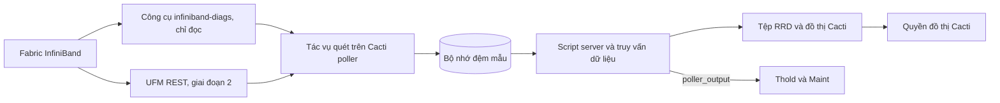

<!-- Source: README.md; SHA256: ce5af61a1bc993ec2aae6d4f22c3885694632f2b1d5eb94e2ce88b8390e96f1e -->

<!-- translations:start -->
[English](../../../README.md) | [简体中文](../zh-CN/README.md) | [हिन्दी](../hi-IN/README.md) | [Español (España)](../es-ES/README.md) | [Español (Latinoamérica)](../es-419/README.md) | [العربية (السعودية)](../ar-SA/README.md) | [Afrikaans](../af-ZA/README.md) | [አማርኛ](../am-ET/README.md) | [العربية (مصر)](../ar-EG/README.md) | [العربية (المغرب)](../ar-MA/README.md) | [বাংলা](../bn-BD/README.md) | [Deutsch](../de-DE/README.md) | [فارسی](../fa-IR/README.md) | [Filipino](../fil-PH/README.md) | [Français](../fr-FR/README.md) | [Français (Maroc)](../fr-MA/README.md) | [Français (Sénégal)](../fr-SN/README.md) | [Hausa](../ha-NG/README.md) | [עברית](../he-IL/README.md) | [Bahasa Indonesia](../id-ID/README.md) | [Igbo](../ig-NG/README.md) | [Italiano](../it-IT/README.md) | [日本語](../ja-JP/README.md) | [한국어](../ko-KR/README.md) | [Malagasy](../mg-MG/README.md) | [मराठी](../mr-IN/README.md) | [Bahasa Melayu](../ms-MY/README.md) | [Nederlands](../nl-NL/README.md) | [Polski](../pl-PL/README.md) | [Português (Brasil)](../pt-BR/README.md) | [Русский](../ru-RU/README.md) | [Kinyarwanda](../rw-RW/README.md) | [Soomaali](../so-SO/README.md) | [Svenska](../sv-SE/README.md) | [Kiswahili](../sw-KE/README.md) | [தமிழ்](../ta-IN/README.md) | [తెలుగు](../te-IN/README.md) | [ไทย](../th-TH/README.md) | [Türkçe](../tr-TR/README.md) | [Українська](../uk-UA/README.md) | [اردو](../ur-PK/README.md) | [Tiếng Việt](README.md) | [isiXhosa](../xh-ZA/README.md) | [Yorùbá](../yo-NG/README.md) | [繁體中文](../zh-TW/README.md) | [isiZulu](../zu-ZA/README.md)
<!-- translations:end -->

# plugin_fabric

Một plugin cho Cacti 1.2 đưa các bộ đếm cổng InfiniBand, độ rộng và tốc độ liên kết cùng các chỉ báo nghẽn mạng vào Cacti dưới dạng thiết bị, nguồn dữ liệu và đồ thị thông thường. Khi một liên kết chỉ thương lượng ở mức 1X thay vì 4X, nó sẽ hiển thị thành đồ thị và cảnh báo Thold ngay bên cạnh máy chủ mà nó phục vụ, tuân theo phân quyền của Cacti và cho phép Maint tạm ẩn cảnh báo đó.

> **Trạng thái: đang phát triển, chưa có bản phát hành.** Cột mốc 2 (nền tảng) đã được hợp nhất vào `main`, và cột mốc 3 (các đối tượng Cacti và cảnh báo) đang trong quá trình xem xét. Cột mốc 1 đã xác nhận thiết kế dựa trên tài liệu và mã nguồn gốc (PR #71); kết quả cùng các nguồn tham chiếu được lưu tại [docs/research/](../../research). Cột mốc 2 bổ sung phần nền tảng cho plugin:
>
> - cài đặt, nâng cấp, gỡ cài đặt và kiểm tra điều kiện PHP 8.2
> - các quyền View, Operator và Admin cùng phần cấu hình
> - bản ghi fabric
> - ranh giới lệnh chỉ đọc cho `perfquery`, `ibnetdiscover` và `iblinkinfo`
> - kiểm kê theo GUID, kèm xử lý xung đột danh tính và đề xuất liên kết lại
> - trạng thái liên kết và bộ nhớ đệm quét bộ đếm
> - các trang kiểm kê, quản trị và tình trạng hệ thống
>
> Cột mốc 3 bổ sung các đối tượng Cacti:
>
> - các mẫu thiết bị, dữ liệu và đồ thị được đóng gói dưới dạng XML mẫu của Cacti, cùng truy vấn dữ liệu "Fabric Port"
> - ánh xạ một nút vào thiết bị Cacti hoặc tạo mới khi xác nhận ([ADR 0010](../../decisions/0010-one-device-per-node.md))
> - nguồn dữ liệu bộ đếm cho đồ thị, cùng nguồn dữ liệu GAUGE cho trạng thái liên kết và tốc độ dành cho Thold ([ADR 0011](../../decisions/0011-derive-counters-and-gauge-alert-values.md))
> - xử lý gián đoạn và đọc các bộ đếm cơ bản đã bão hòa là unknown ([ADR 0012](../../decisions/0012-saturated-basic-counters-read-as-unknown.md)), tính hợp lệ của bộ đếm và liên kết đồ thị trên trang cổng, cùng bảng xếp hạng mức độ nghẽn
> - kiểm thử đầu-cuối với Thold v1.8.2 và Maint v1.3 nguyên bản, cùng một tác vụ CI chạy các công cụ chẩn đoán thực tế trên fabric mô phỏng
>
> Hiện chỉ có thể quét fabric từ poller chính cho đến khi các bộ thu thập dữ liệu từ xa được hỗ trợ ở giai đoạn 3. Plugin mới chỉ được kiểm thử với các công cụ giả lập và trình mô phỏng fabric ibsim, chưa từng chạy trên một fabric InfiniBand thực tế. Các bài kiểm tra cần fabric thực vẫn đang mở trong bảng kiểm tra trực tiếp của từng trang nghiên cứu. Dự án này không liên kết với dự án Cacti.

## Vai trò truy cập

| Quyền | Phạm vi truy cập |
| --- | --- |
| Fabric View | Các trang giám sát hiện có. |
| Fabric Operator | Quyền giám sát cộng với trang Operations và xác nhận phân loại sự cố cá nhân. |
| Fabric Admin | Quyền Operator cộng với các thao tác cấu hình và quản trị hiện có. |

Sau khi sao chép các tệp nâng cấp, hãy mở trang Plugins với tư cách quản trị viên để đăng ký
quyền mới. Gán quyền Operator một cách tường minh trong **Configuration > Users** hoặc các nhóm người dùng.
Quá trình nâng cấp vẫn giữ nguyên ID và quyền đã cấp cho View và Admin hiện có. Quyền Admin
kế thừa quyền Operator, và quyền Operator kế thừa quyền View trên mỗi yêu cầu;
việc này không thêm quyền lưu trữ cố định vào người dùng hay nhóm. Phần cài đặt plugin cũng yêu cầu
quyền Fabric Admin bên cạnh quyền Settings của Cacti.

Quyền trên thiết bị Cacti vẫn giới hạn các hàng dữ liệu và thao tác khả dụng đối với từng người dùng; các đối tượng chưa được ánh xạ yêu cầu quyền quản trị viên.
Thông tin xác thực, cấu hình, ánh xạ, xóa bỏ và các thay đổi quản trị khác
vẫn nằm trong các trang quản trị. Các xác nhận sự cố chỉ tồn tại trong phiên làm việc hiện tại
của người dùng, tối đa một giờ và chỉ có hiệu lực khi cùng một quan sát đó vẫn
còn mới. Các quan sát mới hoặc đã thay đổi sẽ làm mất hiệu lực của chúng. Chúng không bao giờ đánh dấu một phép đo lỗi
là bình thường hoặc ẩn cảnh báo.

## Lý do

Một liên kết InfiniBand bị suy giảm vẫn có thể truyền lưu lượng. Một liên kết 4X khi huấn luyện lại ở mức 1X vẫn giữ cổng ở trạng thái "active", và các đồ thị giao diện SNMP của máy chủ trông vẫn bình thường, nhưng các tác vụ kết nối chặt chẽ sẽ bị chậm lại. Bằng chứng nằm ở ngay trong fabric: mỗi cổng đều báo cáo độ rộng và tốc độ đang hoạt động, được bật và được hỗ trợ, cùng các bộ đếm lỗi và nghẽn mạng. Để đọc thông tin này cần dùng các công cụ chẩn đoán InfiniBand hoặc API của trình quản lý fabric. Nếu chạy thủ công, chúng để lại ba khoảng trống:

- **Không có lịch sử.** `perfquery` và `iblinkinfo` chỉ hiển thị trạng thái hiện tại, nên một liên kết bị suy giảm từ tuần trước sẽ không thể thấy được.
- **Không có ngữ cảnh thiết bị.** Các cổng fabric không phải là đối tượng Cacti, nên không thể vẽ đồ thị của cổng bên cạnh máy chủ mà nó kết nối.
- **Không có đường dẫn vào hệ thống cảnh báo của Cacti.** Thold và Maint chỉ hoạt động trên các nguồn dữ liệu và thiết bị của Cacti.

Plugin thu hẹp các khoảng trống này bằng cách đọc fabric thông qua các công cụ chẩn đoán riêng (và sau này qua UFM), định danh các nút và cổng bằng GUID, rồi xuất bản các bộ đếm và trạng thái liên kết dưới dạng nguồn dữ liệu Cacti. Plugin chỉ đọc: nó không bao giờ đặt lại bộ đếm hay thay đổi trạng thái cổng.

## Khám phá lần đầu

Một fabric mới chưa có nút nào, và quá trình quét chỉ khởi chạy từ script server đối với các nút đã được ánh xạ vào một thiết bị Cacti. Do đó, lần khám phá đầu tiên phải thực hiện thủ công. Sau khi lưu một fabric đã bật, hãy chạy lệnh này một lần trên poller được gán cho fabric đó, bằng tài khoản của poller, với `/path/to/cacti` được thay bằng thư mục Cacti của bạn (đường dẫn tuyệt đối cũng hoạt động từ cron):

```
php /path/to/cacti/plugins/fabric/fabric_sweep.php --fabric=ID --force
```

Kho dữ liệu kiểm kê sau đó sẽ được điền đầy đủ. Hãy ánh xạ các nút vào thiết bị Cacti trên trang Fabric Admin; các lần quét sau sẽ khởi chạy từ truy vấn dữ liệu. Khi chưa có nút nào của fabric được ánh xạ, sẽ không có gì làm mới dữ liệu kiểm kê của nó, vì vậy hãy chạy lại chính lệnh đó — từ cron nếu muốn — để ghi nhận các nút mới hoặc bị thiếu. Trang tình trạng hệ thống sẽ hiển thị lệnh này cho bất kỳ fabric đang bật nào chưa được khám phá hoặc chưa có nút nào được ánh xạ.

## Phạm vi dự kiến

| Giai đoạn | Phạm vi | Cột mốc |
|---|---|---|
| 0, nghiên cứu | Ma trận phiên bản, xác nhận hành vi mã nguồn gốc, hành vi bộ đếm trên phần cứng, mô hình phân quyền, ngân sách MAD, API UFM | [M1](https://github.com/somethingwithproof/plugin_fabric/milestone/1) |
| 1, quan sát | Kiểm kê theo GUID, thiết bị Cacti, truy vấn dữ liệu cổng, nguồn dữ liệu bộ đếm và trạng thái liên kết, cảnh báo Thold, tạm ẩn Maint, trang tình trạng hệ thống | [M2](https://github.com/somethingwithproof/plugin_fabric/milestone/2), [M3](https://github.com/somethingwithproof/plugin_fabric/milestone/3), [M4](https://github.com/somethingwithproof/plugin_fabric/milestone/4) |
| 2, UFM | Backend REST UFM chỉ đọc, xử lý thông tin xác thực, tính liên tục danh tính giữa các backend | [M5](https://github.com/somethingwithproof/plugin_fabric/milestone/5) |
| 3, từ xa | Bộ thu thập dữ liệu từ xa, đồng bộ nhân bản, tác vụ `remote_agent`, quét phân mảnh cho các fabric lớn | [M6](https://github.com/somethingwithproof/plugin_fabric/milestone/6) |

Ngoài phạm vi: thay đổi trạng thái fabric, thay thế trình quản lý fabric hoặc subnet manager, công cụ cảnh báo riêng của plugin, daemon hoặc giao thức mạng tùy chỉnh, và các fabric Ethernet hoặc RoCE (đang nghiên cứu).

## Mục tiêu tương thích

| Thành phần | Mục tiêu |
|---|---|
| Cacti | 1.2.31 trở lên, không cần vá mã nguồn lõi |
| PHP | 8.2 trở lên; `setup.php` vẫn có thể phân tích cú pháp trên 8.0 để môi trường chạy không được hỗ trợ nhận thông báo từ chối thay vì làm hỏng giao diện Cacti |
| Công cụ InfiniBand | infiniband-diags từ rdma-core; định dạng đầu ra đã được kiểm tra với mã nguồn v66.0 |
| UFM | API REST của UFM Enterprise, giai đoạn 2; ma trận phát hành là sản phẩm bàn giao của cột mốc 1 |
| Thold, Maint | Không yêu cầu thay đổi |

Giữ nguyên thời gian chờ script của Cacti ở mức mặc định 25 giây hoặc cao hơn. Một lần quét được khởi chạy bởi truy vấn dữ liệu sẽ giới hạn thời gian thực thi công cụ ở mức thời gian chờ đó trừ đi năm giây, dành thời gian để đọc bộ nhớ đệm và phản hồi. Khi hết ngân sách thời gian, truy vấn sẽ trả về mẫu hiện hành gần nhất hoặc giá trị unknown; chu kỳ tiếp theo sẽ thử quét lại. Giới hạn này cũng áp dụng cho PHP poller. Thời gian chờ từ năm giây trở xuống sẽ không đủ thời gian để khởi chạy công cụ.

## Thiết kế

- [docs/PLAN.md](../../PLAN.md) là bản kế hoạch đầy đủ: kiến trúc, các dữ kiện từ mã nguồn gốc mà hệ thống phụ thuộc (kèm nguồn) và các giả định cần xác nhận, mô hình danh tính, quy tắc bộ đếm và trạng thái liên kết, ranh giới bảo mật, tính toán hiệu năng, kiểm thử và rủi ro.
- [docs/decisions/](../../decisions) lưu giữ các bản ghi quyết định kiến trúc cho những lựa chọn đã được chốt.
- [docs/REQUIREMENTS.md](../../REQUIREMENTS.md) ánh xạ từng mã yêu cầu tới issue tương ứng.



## Cách theo dõi công việc

- **Cột mốc** tuân theo các cột mốc của kế hoạch. Mỗi cột mốc có một epic issue liệt kê các issue con và bằng chứng hoàn thành.
- **Issues** được phân loại theo nhãn: `type: requirement`, `type: research`, `type: decision`, `type: epic`. Các issue yêu cầu nêu rõ các yêu cầu được đánh số và có thể kiểm thử (`REQ-AREA-NNN`) cùng tiêu chí nghiệm thu.
- **Nhãn** cũng đi kèm các tiền tố `area:`, `phase:`, `priority:` và `status:`. Xem [CONTRIBUTING.md](../../../CONTRIBUTING.md#labels).
- [Bảng dự án](https://github.com/users/somethingwithproof/projects/8) hiển thị tất cả các issue trên các cột mốc.

## Đóng góp

Đọc [CONTRIBUTING.md](../../../CONTRIBUTING.md). Các commit cần có xác nhận DCO (sign-off). Thảo luận thiết kế diễn ra trên các issue; các quyết định đang mở được gắn nhãn `type: decision`.

## Bảo mật

Vui lòng báo cáo lỗ hổng bảo mật một cách riêng tư; xem [SECURITY.md](../../../SECURITY.md).

## Giấy phép

Giấy phép Công cộng GNU phiên bản 2.0 (GNU General Public License v2.0), cùng giấy phép với Cacti và các plugin của nó. Xem [LICENSE](../../../LICENSE).
