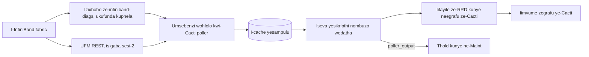

<!-- Source: README.md; SHA256: ce5af61a1bc993ec2aae6d4f22c3885694632f2b1d5eb94e2ce88b8390e96f1e -->

<!-- translations:start -->
[English](../../../README.md) | [简体中文](../zh-CN/README.md) | [हिन्दी](../hi-IN/README.md) | [Español (España)](../es-ES/README.md) | [Español (Latinoamérica)](../es-419/README.md) | [العربية (السعودية)](../ar-SA/README.md) | [Afrikaans](../af-ZA/README.md) | [አማርኛ](../am-ET/README.md) | [العربية (مصر)](../ar-EG/README.md) | [العربية (المغرب)](../ar-MA/README.md) | [বাংলা](../bn-BD/README.md) | [Bosanski](../bs-BA/README.md) | [Deutsch](../de-DE/README.md) | [فارسی](../fa-IR/README.md) | [Filipino](../fil-PH/README.md) | [Français](../fr-FR/README.md) | [Français (Maroc)](../fr-MA/README.md) | [Français (Sénégal)](../fr-SN/README.md) | [Hausa](../ha-NG/README.md) | [עברית](../he-IL/README.md) | [Hrvatski](../hr-HR/README.md) | [Bahasa Indonesia](../id-ID/README.md) | [Igbo](../ig-NG/README.md) | [Italiano](../it-IT/README.md) | [日本語](../ja-JP/README.md) | [한국어](../ko-KR/README.md) | [Malagasy](../mg-MG/README.md) | [मराठी](../mr-IN/README.md) | [Bahasa Melayu](../ms-MY/README.md) | [Nederlands](../nl-NL/README.md) | [Polski](../pl-PL/README.md) | [Português (Brasil)](../pt-BR/README.md) | [Русский](../ru-RU/README.md) | [Kinyarwanda](../rw-RW/README.md) | [Soomaali](../so-SO/README.md) | [Српски](../sr-RS/README.md) | [Svenska](../sv-SE/README.md) | [Kiswahili](../sw-KE/README.md) | [தமிழ்](../ta-IN/README.md) | [తెలుగు](../te-IN/README.md) | [ไทย](../th-TH/README.md) | [Türkçe](../tr-TR/README.md) | [Українська](../uk-UA/README.md) | [اردو](../ur-PK/README.md) | [Tiếng Việt](../vi-VN/README.md) | [isiXhosa](README.md) | [Yorùbá](../yo-NG/README.md) | [繁體中文](../zh-TW/README.md) | [isiZulu](../zu-ZA/README.md)
<!-- translations:end -->

# plugin_fabric

I-plugin ye-Cacti 1.2 ezisa izibali zezibuko ze-InfiniBand, ububanzi nesantya sokudibanisa, kunye nezikhombisi zoxinzelelo kwi-Cacti njengezixhobo eziqhelekileyo, imithombo yedatha, kunye neegrafu. Ikhonkco eliqeqeshwe ku-1X endaweni ka-4X libonakala njengegrafu kunye nesilumkiso se-Thold ecaleni komamkeli eliwuncedayo, phantsi kweemvume ze-Cacti, apho i-Maint ikwazi ukulicinezela.

> **Imeko: isaphuhliswa, akukho kukhululwa okwenzekileyo okwangoku.** Inqanaba lesi-2 (isiseko) lidityanisiwe kwi-`main`, kwaye inqanaba lesi-3 (izinto ze-Cacti kunye nezilumkiso) lisahlolwa. Inqanaba loku-1 liqinisekise uyilo ngokumelene namaxwebhu kunye nomthombo ophezulu (PR #71); iziphumo, kunye nemithombo, zikwi-[docs/research/](../../research). Inqanaba lesi-2 longeza isiseko se-plugin:
>
> - ukufakela, ukuphucula, ukukhupha, kunye nomlindi we-PHP 8.2
> - iindawo ze-View, i-Operator kunye ne-Admin, kunye noseto
> - iirekhodi ze-fabric
> - umda womyalelo wokufunda kuphela we-`perfquery`, `ibnetdiscover`, kunye ne-`iblinkinfo`
> - uluhlu lweempahla nge-GUID, kunye neengxabano zokuchonga kunye nezindululo zokudibanisa kwakhona
> - imeko yekhonkco kunye ne-cache yohlolo lwezibali
> - amaphepha oluhlu lweempahla, abalawuli, kunye nempilo
>
> Inqanaba lesi-3 longeza izinto ze-Cacti:
>
> - iitemplates zezixhobo, zedatha, nezegrafu ezithunyelwa njenge-XML ye-template ye-Cacti, kunye nombuzo wedatha we-"Fabric Port"
> - ukudibanisa i-node kwisixhobo se-Cacti, okanye ukudala esinye ekuqinisekisweni ([ADR 0010](../../decisions/0010-one-device-per-node.md))
> - imithombo yedatha yezibali zeegrafu, kunye nemithombo yedatha yemeko yekhonkco ye-GAUGE kunye nesantya kwi-Thold ([ADR 0011](../../decisions/0011-derive-counters-and-gauge-alert-values.md))
> - ukulawulwa kokuphazamiseka kunye nezibali ezisisiseko ezigcweleyo ezifundwa njengokungaziwayo ([ADR 0012](../../decisions/0012-saturated-basic-counters-read-as-unknown.md)), ukusebenza kwesibali namakhonkco egrafu kwiphepha lezibuko, kunye nokubekwa kwinqanaba loxinzelelo
> - uvavanyo olupheleleyo nge-Thold v1.8.2 kunye ne-Maint v1.3 ezingatshintshwanga, kunye nomsebenzi we-CI oqhuba izixhobo zokuxilonga zokwenyani ngokuchasene ne-fabric elinganiswayo
>
> I-fabric inokuhlolwa kuphela kwi-poller engundoqo de abaqokeleli bedatha abakude baxhaswe kwisigaba sesi-3. Iye yavavanywa ngokuchasene nezixhobo zomgunyathi kunye nesilinganisi se-fabric se-ibsim, ayizange ivavanywe kwi-InfiniBand fabric yokwenyani. Iitshekhi ezidinga i-fabric zihlala zivuliwe kwitheyibhile yeetshekhi ezisebenzayo kwiphepha ngalinye lophando. Le projekthi ayinabudlelwane neprojekthi ye-Cacti.

## Iindima zokufikelela

| Ummandla | Ufikelelo |
| --- | --- |
| Fabric View | Amaphepha okubeka iliso akhoyo. |
| Fabric Operator | Ukubeka iliso kunye nephepha leMisebenzi kunye neziqinisekiso zokuhlela zomntu siqu. |
| Fabric Admin | Ufikelelo loMsebenzisi kunye nezenzo ezikhoyo zoqwalaselo nolawulo. |

Emva kokukopa iifayile zophuculo, vula iphepha le-Plugins njengomlawuli ukubhalisa ummandla omtsha. Yabela ummandla we-Operator ngokucacileyo phantsi kwe-**Configuration > Users** okanye amaqela abasebenzisi. Uphuculo lugcina ii-ID zommandla we-View kunye ne-Admin ezikhoyo kunye neemvume. Ufikelelo lwe-Admin lufumana ufikelelo lwe-Operator njengelifa, kwaye ufikelelo lwe-Operator lufumana ufikelelo lwe-View njengelifa kwisicelo ngasinye; oku akongezi iimvume ezigciniweyo kubasebenzisi okanye kumaqela. Useto lwe-plugin lufuna kwakhona ufikelelo lwe-Fabric Admin ukongeza kwimvume ye-Settings ye-Cacti.

Iimvume zezixhobo ze-Cacti zisaqhubeka nokunciphisa imiqolo nezenzo ezifumanekayo kumsebenzisi ngamnye; izinto ezingadityaniswanga zifuna umlawuli. Iziqinisekiso, uqwalaselo, ukudibanisa, ukucima nolunye utshintsho lolawulo zihlala kumaphepha olawulo. Iziqinisekiso zihlala kuphela kwiseshoni yomsebenzisi wangoku, kangangeyure enye ubuninzi kwaye kuphela ngelixa uqwalaselo olufanayo luhlala lutsha. Uqwalaselo olutsha okanye olutshintshileyo luluphelisa ukusebenza kwazo. Azize zimakishe umlinganiselo ohlulekileyo njengosempilweni okanye zicinezele izilumkiso.

## Kutheni

Ikhonkco le-InfiniBand elithobekileyo lisagqithisa itrafikhi. Ikhonkco le-4X eliqeqesha kwakhona ku-1X lishiya izibuko "lisebenza", kwaye iigrafu ze-interface ye-SNMP zomamkeli zikhangeleka ziqhelekile, kodwa imisebenzi edityaniswe ngokusondeleyo iyacotha. Ubungqina bukwi-fabric: izibuko ngalinye lixela ububanzi kunye nesantya salo esisebenzayo, esinikwe amandla, nesixhaswayo, kunye nezibali zeempazamo kunye noxinzelelo. Ukuyifunda kuthatha izixhobo zokuxilonga ze-InfiniBand okanye i-API yomphathi we-fabric. Xa ziqhutywa ngesandla, zishiya izikhewu ezithathu:

- **Akukho mbali.** `perfquery` kunye ne-`iblinkinfo` zibonisa okwangoku, ngoko ikhonkco elithobeke kwiveki ephelileyo alibonakali.
- **Akukho mxholo wesixhobo.** Amazibuko e-fabric ayizizo izinto ze-Cacti, ngoko izibuko alinakwenziwa igrafu ecaleni komamkeli eliwuphakelayo.
- **Akukho ndlela eya kwizilumkiso ze-Cacti.** I-Thold kunye ne-Maint zisebenza kwimithombo yedatha nakwizixhobo ze-Cacti.

I-plugin ivale ezi zikhewu ngokufunda i-fabric ngezixhobo zayo zokuxilonga (kwaye kamva nge-UFM), ukuchonga ii-nodes namazibuko nge-GUID, kunye nokupapasha izibali nemeko yekhonkco njengemithombo yedatha ye-Cacti. Ifunda kuphela: ayize isete kwakhona izibali okanye itshintshe imeko yezibuko.

## Ukufunyanwa kokuqala

I-fabric entsha ayinazii-nodes, kwaye uhlolo luqala kwiseva yesikripthi kuphela kwi-node edityaniswe nesixhobo se-Cacti. Ukufunyanwa kokuqala ngoko ke linyathelo elenziwa ngesandla. Emva kokugcina i-fabric enikwe amandla, sebenzisa oku kanye kwi-poller eyabelwe i-fabric, njenge-akhawunti ye-poller, nge-`/path/to/cacti` itshintshwe ngolawulo lwakho lwe-Cacti (indlela epheleleyo iyasebenza nakwi-cron):

```
php /path/to/cacti/plugins/fabric/fabric_sweep.php --fabric=ID --force
```

Uluhlu lweempahla luyazaliswa emva koko. Dibanisa ii-nodes kwizixhobo ze-Cacti kwiphepha le-Fabric Admin; uhlolo lwakamva luqala kumbuzo wedatha. Ngelixa kungekho node ye-fabric edityanisiweyo, akukho nto ihlaziya uluhlu lwayo lweempahla, ngoko ke sebenzisa kwakhona lo myalelo mnye, ukusuka kwi-cron ukuba uyathanda, ukurekhoda ii-nodes ezintsha okanye ezilahlekileyo. Iphepha lempilo libonisa lo myalelo we-fabric enikwe amandla engekabhaqwa okanye engenayo i-node edityanisiweyo.

## Ububanzi obucetywayo

| Isigaba | Ububanzi | Amanqanaba |
|---|---|---|
| 0, uphando | Imatriksi yeenguqulelo, ukuqinisekiswa kokuziphatha kophezulu, ukuziphatha kwesibali kwihardware, imodeli yelungelo, uhlahlo lwabiwo-mali lwe-MAD, UFM API | [M1](https://github.com/somethingwithproof/plugin_fabric/milestone/1) |
| 1, ukujonga | Uluhlu lweempahla nge-GUID, izixhobo ze-Cacti, umbuzo wedatha yezibuko, izibali kunye nemithombo yedatha yemeko yekhonkco, izilumkiso ze-Thold, ukucinezela kwe-Maint, iphepha lempilo | [M2](https://github.com/somethingwithproof/plugin_fabric/milestone/2), [M3](https://github.com/somethingwithproof/plugin_fabric/milestone/3), [M4](https://github.com/somethingwithproof/plugin_fabric/milestone/4) |
| 2, UFM | I-backend ye-UFM REST yokufunda kuphela, ukuphathwa kweziqinisekiso, ukuqhubeka kwesazisi phakathi kwee-backends | [M5](https://github.com/somethingwithproof/plugin_fabric/milestone/5) |
| 3, kude | Abaqokeleli bedatha abakude, ukuphinda-phinda, izenzo ze-`remote_agent`, uhlolo olwahluliweyo lwee-fabrics ezinkulu | [M6](https://github.com/somethingwithproof/plugin_fabric/milestone/6) |

Ngaphandle kobubanzi: ukutshintsha imeko ye-fabric, ukutshintsha umphathi we-fabric okanye umphathi we-subnet, injini yezilumkiso ephethwe yi-plugin, i-daemon yesiko okanye iprothokholi yothungelwano, kunye nee-fabrics ze-Ethernet okanye ze-RoCE (uphando).

## Iithagethi zokuhambelana

| Icandelo | Ekujoliswe kuko |
|---|---|
| Cacti | 1.2.31 okanye kamva, akukho zipatches ezingundoqo |
| PHP | 8.2 okanye kamva; i-`setup.php` ihlala ifundeka kwi-8.0 ukuze ixesha lokuqhuba elingaxhaswayo lifumane ukwaliwa endaweni ye-UI ye-Cacti eyaphukileyo |
| Izixhobo ze-InfiniBand | infiniband-diags ukusuka kwi-rdma-core; iifomathi zemveliso zijongwe ngokuchasene nomthombo we-v66.0 |
| UFM | UFM Enterprise REST API, isigaba sesi-2; imatriksi yokukhululwa sisiphumo senqanaba loku-1 |
| Thold, Maint | Akukho lutshintsho lufunekayo |

Gcina ixesha lokuphela kwesikripthi se-Cacti kwi-25 yemizuzwana emiselweyo okanye ngaphezulu. Uhlolo oluqaliswe ngokufunda umbuzo wedatha luthintela ukuqhutywa kwesixhobo kwelo xesha lokuphela lisuswe imizuzwana emihlanu, ukugcina ixesha lokufunda i-cache kunye nokuphendula. Xa uhlahlo lwabiwo-mali luphelelwa lixesha, umbuzo unika isampulu yokugqibela yangoku okanye engaziwayo; umjikelo olandelayo uzama uhlolo kwakhona. Lo mda usebenza nakwi-poller ye-PHP. Ixesha lokuphela lemizuzwana emihlanu okanye ngaphantsi alishiyi xesha lokuqalisa isixhobo.

## Uyilo

- [docs/PLAN.md](../../PLAN.md) sisicwangciso esipheleleyo: uyilo lolwakhiwo, iinyani zophezulu ezixhomekeke kuzo (kunye nemithombo) kunye neengcinga ekusafuneka ziqinisekisiwe, imodeli yesazisi, imigaqo yesibali nemeko yekhonkco, imida yokhuseleko, imathematika yokusebenza, uvavanyo, kunye neengozi.
- [docs/decisions/](../../decisions) igcina iirekhodi zezigqibo zoyilo lolwakhiwo zeenketho esele zenziwe.
- [docs/REQUIREMENTS.md](../../REQUIREMENTS.md) idibanisa i-ID yemfuneko nganye nomba wayo.



## Indlela umsebenzi olandelwa ngayo

- **Amanqanaba** alandela amanqanaba esicwangciso. Linye linomba we-epic odwelisa imiba yawo engaphantsi kunye nobungqina bokuphuma.
- **Imiba** ichwethezwe ngelebheli: `type: requirement`, `type: research`, `type: decision`, `type: epic`. Imiba yeemfuno ichaza iimfuno ezinamanani, ezivavanyekayo (`REQ-AREA-NNN`) kunye nemigaqo yokwamkelwa.
- **Iilebheli** zikwathwala `area:`, `phase:`, `priority:`, kunye ne-`status:`. Jonga [CONTRIBUTING.md](../../../CONTRIBUTING.md#labels).
- [Ibhodi yeprojekthi](https://github.com/users/somethingwithproof/projects/8) ibonisa yonke imiba kumanqanaba onke.

## Ukufaka isandla

Funda [CONTRIBUTING.md](../../../CONTRIBUTING.md). Ii-commits zifuna ukusayinwa kwe-DCO. Ingxoxo yoyilo yenzeka kwimiba; izigqibo ezivuliweyo zithwala ilebheli ye-`type: decision`.

## Ukhuseleko

Xela ubuthathaka ngokwabucala; jonga [SECURITY.md](../../../SECURITY.md).

## Ilayisensi

I-GNU General Public License v2.0, ilayisensi efanayo ne-Cacti kunye nee-plugins zayo. Jonga [LICENSE](../../../LICENSE).
