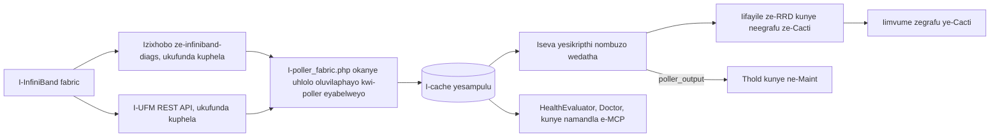

<!-- Source: README.md; SHA256: 79a16fb906f96ee79de2c719f18c38836f555440a7571a4a5ba38c64bb5b099f -->

<!-- translations:start -->
[English](../../../README.md) | [简体中文](../zh-CN/README.md) | [हिन्दी](../hi-IN/README.md) | [Español (España)](../es-ES/README.md) | [Español (Latinoamérica)](../es-419/README.md) | [العربية (السعودية)](../ar-SA/README.md) | [Afrikaans](../af-ZA/README.md) | [አማርኛ](../am-ET/README.md) | [العربية (مصر)](../ar-EG/README.md) | [العربية (المغرب)](../ar-MA/README.md) | [বাংলা](../bn-BD/README.md) | [Bosanski](../bs-BA/README.md) | [Deutsch](../de-DE/README.md) | [فارسی](../fa-IR/README.md) | [Filipino](../fil-PH/README.md) | [Français](../fr-FR/README.md) | [Français (Maroc)](../fr-MA/README.md) | [Français (Sénégal)](../fr-SN/README.md) | [Hausa](../ha-NG/README.md) | [עברית](../he-IL/README.md) | [Hrvatski](../hr-HR/README.md) | [Bahasa Indonesia](../id-ID/README.md) | [Igbo](../ig-NG/README.md) | [Italiano](../it-IT/README.md) | [日本語](../ja-JP/README.md) | [한국어](../ko-KR/README.md) | [Malagasy](../mg-MG/README.md) | [मराठी](../mr-IN/README.md) | [Bahasa Melayu](../ms-MY/README.md) | [Nederlands](../nl-NL/README.md) | [Polski](../pl-PL/README.md) | [Português (Brasil)](../pt-BR/README.md) | [Русский](../ru-RU/README.md) | [Kinyarwanda](../rw-RW/README.md) | [Soomaali](../so-SO/README.md) | [Српски](../sr-RS/README.md) | [Svenska](../sv-SE/README.md) | [Kiswahili](../sw-KE/README.md) | [தமிழ்](../ta-IN/README.md) | [తెలుగు](../te-IN/README.md) | [ไทย](../th-TH/README.md) | [Türkçe](../tr-TR/README.md) | [Українська](../uk-UA/README.md) | [اردو](../ur-PK/README.md) | [Tiếng Việt](../vi-VN/README.md) | [isiXhosa](README.md) | [Yorùbá](../yo-NG/README.md) | [繁體中文](../zh-TW/README.md) | [isiZulu](../zu-ZA/README.md)
<!-- translations:end -->

# plugin_fabric

I-plugin ye-Cacti 1.2 (`fabric`, inguqulo `0.1.0-dev`) ezisa izibali zezibuko ze-InfiniBand, ububanzi nesantya sokudibanisa, kunye nezikhombisi zoxinzelelo kwi-Cacti njengezixhobo eziqhelekileyo, imithombo yedatha, kunye neegrafu. Ikhonkco eliqeqeshwe ku-1X endaweni ka-4X libonakala njengegrafu kunye nesilumkiso se-Thold ecaleni komamkeli eliwuncedayo, phantsi kweemvume ze-Cacti, linolwazi kunye nokucinezela kwe-Maint.

> **Imeko: isaphuhliswa, akukho kukhululwa okwenzekileyo okwangoku.** Eli sebe liphumeza isiseko se-plugin, izinto ze-Cacti nezilumkiso, uhlolo olucwangcisiweyo lwe-poller yangasemva, ukuphindaphindwa kwabaqokeleli abakude, i-backend yokufunda kuphela ye-NVIDIA UFM REST enegumbi leziqinisekiso elifihliweyo, ulawulo lwe-CLI lwe-Configuration-as-Code (CasC), kunye neehooks ze-ecosystem ye-Cacti (CasC, Doctor, kunye ne-MCP / Abilities API v2). Iye yavavanywa ngokuchasene nezixhobo zomgunyathi, iithranspothi ze-UFM ezenziweyo, kunye nesilinganisi se-fabric se-`ibsim` (rdma-core 50.0), ayizange ivavanywe kwi-InfiniBand fabric yokwenyani okanye kwiseva ye-UFM ephilayo. Iitshekhi ezidinga ihardware zihlala zivuliwe kwi-[docs/research/](../../research/). Le projekthi ayinabudlelwane neprojekthi ye-Cacti.

## Okuphunyeziweyo

- **Umjikelo wobomi kunye neskimu (v3)**: ukufakela, ukuphucula okungatshintshiyo xa kuphindwa, ukukhupha (kugcinwa iitheyibhile ze-plugin ngokwendalo), kunye nomlindi wemfuneko ye-PHP 8.2 ngelixa kugcina iindawo zokungena zifundeka kwi-PHP 8.0.
- **Iindima zokufikelela namaphepha**: imimandla ye-`Fabric View` (`fabric.php`), `Fabric Operator` (`fabric_operator.php`), kunye ne-`Fabric Admin` (`fabric_admin.php`, `fabric_health.php`), kunye nethebhu ye-Settings phantsi kwe-**Configuration > Settings > Fabrics**.
- **I-backend yokuxilonga yokufunda kuphela (`diags`)**: ukuqhutywa okungqongqo kwe-argument-vector ye-`perfquery`, `ibnetdiscover`, kunye ne-`iblinkinfo`, uluhlu lweempahla nge-GUID oluchonga iingxabano zobunikazi nezindululo zokudibanisa kwakhona, uvavanyo lwemeko yekhonkco, kunye nohlolo lwezibali kwi-node nganye.
- **I-backend yokufunda kuphela ye-NVIDIA UFM REST (`ufm`) kunye negumbi leziqinisekiso elifihliweyo**: umxhasi we-REST we-GET kuphela onoluhlu oluvunyelweyo (`/ufmRest/resources/ports`, `/ufmRest/resources/systems`, `/ufmRest/monitoring/session/0/data`, kunye nezilingana nazo ze-`/ufmRestV3/...` zogunyaziso lwe-token) onika iitheyibhile ezifanayo zoluhlu lweempahla, imeko yekhonkco, iisampulu, kunye nempilo njenge-`diags`. Iziqinisekiso (`token` okanye `basic`) zigcinwa zifihliwe nge-AES-256-GCM kwi-`plugin_fabric_secret` kusetyenziswa ifayile yesitshixo sangaphandle esiyi-256-bit eqwalaselwe nge-`fabric_vault_key_file`. Ii-fabrics ze-UFM zinokuchazwa nge-CasC (`cli/fabric.php`) okanye oovimba; ifomu yolawulo lwewebhu okwangoku ibonisa imimandla ye-`diags`.
- **Izinto ze-Cacti, i-Thold, kunye ne-Maint**: iitemplates zezixhobo, zedatha, nezegrafu ze-Cacti (`templates/fabric-templates.xml`), umbuzo wedatha weseva yesikripthi we-"Fabric Port" (`scripts/ss_fabric_ports.php`, `resource/script_server/fabric_ports.xml`), imithombo yedatha yezibali ze-`DERIVE` kunye nemithombo yedatha yemeko yekhonkco/yesantya ye-`GAUGE` ye-Thold, ukulandelelwa kokuphazamiseka, kunye nezibali ezisisiseko ezigcweleyo ezixelwa njenge-`U`. Ukudityaniswa kwe-Maint (`MaintMaintenance`) kubuza i-`plugin_maint_check_cacti_host()` (kubuyelwa kwi-hook ye-`is_device_in_maintenance`) ukuze ii-nodes ezikulondolozo olusebenzayo zibalwe zodwa kwaye zingabandakanywa kwizilumkiso zempilo zohlolo oluhlulekileyo nezibuko ezithobekileyo.
- **Uhlolo olucwangcisiweyo, ukwahlulwa (sharding), kunye nabaqokeleli abakude**: i-`poller_bottom` iqalisa i-`poller_fabric.php` ngasemva kwii-fabrics ekufike ixesha lazo ezabelwe i-poller yangoku, kunye nohlolo oluvilaphayo oluqaliswa yiseva yesikripthi. I-`INFO` ibhengeza `remote_collect:1, remote_poller:1`, i-`poller_fabric.php` ixhasa ukwahlulwa kwe-GUID okuchaziweyo (`--shard=K/N`), kwaye i-`replicate_out` iphindaphinda imiqolo engeyiyo eyemfihlo ye-`plugin_fabric_fabric` kubabaqokeleli abakude (`poller_id >= 2`). Iirekhodi zegumbi (`plugin_fabric_secret`) kunye neefayile zezitshixo zangaphandle azize ziphindaphindwe.
- **I-CasC CLI kunye neehooks ze-ecosystem**: i-`cli/fabric.php` yokuthumela ngaphandle i-YAML/XML, ukuqinisekisa, ukucwangcisa umahluko we-dry-run, ukusebenzisa okunesango lesiqinisekiso, kunye nokuxela impilo, kunye neehooks ze-`casc_register_providers`, `doctor_register_checks`, kunye ne-`abilities_register`.

## Iindima zokufikelela

| Ummandla | Ufikelelo |
| --- | --- |
| Fabric View | Ukubeka iliso kuluhlu lweempahla kunye neembono zezibuko (`fabric.php`). |
| Fabric Operator | Ufikelelo lwe-View kunye nephepha le-Operations (`fabric_operator.php`) kunye neziqinisekiso zokuhlela zomntu siqu. |
| Fabric Admin | Ufikelelo lwe-Operator kunye noqwalaselo, izenzo zolawulo (`fabric_admin.php`), kunye nephepha lempilo (`fabric_health.php`). |

Emva kokukopa iifayile zophuculo, vula iphepha le-Plugins njengomlawuli ukubhalisa imimandla emitsha neehooks. Yabela ummandla we-Operator ngokucacileyo phantsi kwe-**Configuration > Users** okanye amaqela abasebenzisi. Uphuculo lugcina ii-ID zommandla we-View kunye ne-Admin ezikhoyo kunye neemvume. Ufikelelo lwe-Admin lufumana ufikelelo lwe-Operator njengelifa, kwaye ufikelelo lwe-Operator lufumana ufikelelo lwe-View njengelifa kwisicelo ngasinye; oku akongezi iimvume ezigciniweyo kubasebenzisi okanye kumaqela. Useto lwe-plugin lufuna kwakhona ufikelelo lwe-Fabric Admin ukongeza kwimvume ye-Settings ye-Cacti.

Iimvume zezixhobo ze-Cacti zinciphisa imiqolo nezenzo ezifumanekayo kumsebenzisi ngamnye; izinto ezingadityaniswanga zifuna umlawuli. Iziqinisekiso, uqwalaselo, ukudibanisa, ukucima, nolunye utshintsho lolawulo zihlala kumaphepha olawulo okanye kwi-CLI. Iziqinisekiso zihlala kuphela kwiseshoni yomsebenzisi wangoku, kangangeyure enye ubuninzi kwaye kuphela ngelixa uqwalaselo olufanayo luhlala lutsha. Uqwalaselo olutsha okanye olutshintshileyo luluphelisa ukusebenza kwazo. Azize zimakishe umlinganiselo ohlulekileyo njengosempilweni okanye zicinezele izilumkiso.

## Kutheni

Ikhonkco le-InfiniBand elithobekileyo lisagqithisa itrafikhi. Ikhonkco le-4X eliqeqesha kwakhona ku-1X lishiya izibuko lise-"active", kwaye iigrafu ze-interface ye-SNMP zomamkeli zikhangeleka ziqhelekile, kodwa imisebenzi edityaniswe ngokusondeleyo iyacotha. Ubungqina bukwi-fabric: izibuko ngalinye lixela ububanzi nesantya salo esisebenzayo, esinikwe amandla, nesixhaswayo, kunye nezibali zeempazamo noxinzelelo. Ukuyifunda kuthatha izixhobo zokuxilonga ze-InfiniBand okanye i-API yomphathi we-fabric. Xa ziqhutywa ngesandla, zishiya izikhewu ezithathu:

- **Akukho mbali.** I-`perfquery` kunye ne-`iblinkinfo` zibonisa okwangoku, ngoko ikhonkco elithobeke kwiveki ephelileyo alibonakali.
- **Akukho mxholo wesixhobo.** Amazibuko e-fabric ayizizo izinto ze-Cacti, ngoko izibuko alinakwenziwa igrafu ecaleni komamkeli eliwuncedayo.
- **Akukho ndlela eya kwizilumkiso ze-Cacti.** I-Thold kunye ne-Maint zisebenza kwimithombo yedatha nakwizixhobo ze-Cacti.

I-plugin ivale ezi zikhewu ngokufunda i-fabric nge-`infiniband-diags` okanye i-NVIDIA UFM REST API, ukuchonga ii-nodes namazibuko nge-GUID, kunye nokupapasha izibali nemeko yekhonkco njengemithombo yedatha ye-Cacti. Ifunda kuphela: ayize isete kwakhona izibali okanye itshintshe imeko yezibuko.

## Imisebenzi kunye ne-CLI

### I-poller yangasemva kunye nohlolo lwesandla

I-`fabric_poller_bottom()` iqalisa i-`poller_fabric.php` ngasemva kwi-poller nganye kwii-fabrics ezinikwe amandla ezabelwe loo `poller_id` ekufike ixesha lazo lohlolo. Ungaqhuba kwakhona umqhube we-poller okanye uhlolo lwesandla ngokuthe ngqo kwi-poller eyabelweyo njengomsebenzisi we-poller (utshintsha i-`/path/to/cacti` ngolawulo lwakho lwe-Cacti):

```sh
php /path/to/cacti/plugins/fabric/poller_fabric.php [--fabric=ID] [--shard=K/N] [--force] [--debug]
php /path/to/cacti/plugins/fabric/fabric_sweep.php --fabric=ID [--node=GUID] [--force]
```

- I-`poller_fabric.php` iqhuba zonke ii-fabrics ekufike ixesha lazo ze-poller yasekuhlaleni (okanye i-fabric enye nge-`--fabric=ID`), inyanzelisa isitshixo serejistri yenkqubo ye-Cacti kunye neengqeshiso ze-`ClaimRepository` ngohlahlo lwabiwo-mali lwexesha lwe-`max(30, intdiv(sweep_interval, 2))` imizuzwana, kwaye ixhasa i-`--shard=K/N` (`0 <= K < N`) ukwahlula uhlolo lwezibali ze-node ze-`diags` ngokuqinisekileyo nge-GUID ye-node.
- I-`fabric_sweep.php` iqhuba uhlolo xa lufuneka lwe-fabric enye enikwe amandla (okanye i-node enye nge-`--node=GUID`) eyabelwe i-poller yasekuhlaleni. I-`--force` ayihoyi ukuba ixesha le-fabric lifikile na ngelixa isahlonipha amabango.

Emva kokuba ukufunyanwa kokuqala kuzalise uluhlu lweempahla, dibanisa ii-nodes nezixhobo ze-Cacti kwiphepha le-Fabric Admin. Gcina ixesha lokuphela kwesikripthi se-Cacti kwi-25 yemizuzwana okanye ngaphezulu: uhlolo oluvilaphayo oluqaliswe ngokufunda umbuzo wedatha luthintela ukuqhutywa kwesixhobo kwi-`script_timeout - 5` imizuzwana ukuze iseva yesikripthi ibuyele ngexesha nesampulu yokugqibela egciniweyo okanye i-`U`.

### I-backend ye-NVIDIA UFM REST kunye negumbi leziqinisekiso

I-fabric ye-`ufm` idinga i-URL ye-`https://` engenaziziqinisekiso ezifakiweyo, imitya yemibuzo, okanye iziqwenga. I-`UfmSocketTransport` inyanzelisa ukuqinisekiswa kwe-TLS peer kunye negama lomamkeli, iyala ukuthunyelwa kwenye indawo, kwaye ixhasa isipakethi se-CA esikhethwayo (`ufm_ca_file`) kunye ne-SHA-256 SPKI pin (`ufm_spki_pin`).

Ukugcina iziqinisekiso ze-UFM kwi-`plugin_fabric_secret`, qwalasela i-`fabric_vault_key_file` phantsi kwe-**Configuration > Settings > Fabrics** ngendlela epheleleyo eya kwifayile eqhelekileyo ephethwe ngumsebenzisi we-poller (akukho symlinks kulo naluphi na ulawulo lomzali, imowudi `0600`, ephethe oonobumba abangama-64 be-hex abanjenge-`openssl rand -hex 32` okanye ii-bytes ezikhethiweyo ezingama-32 ezingaprintekiyo). I-plugin ayize idale okanye ibhale ifayile yesitshixo, kwaye i-`replicate_out` ayize iphindaphinde i-`plugin_fabric_secret` okanye iifayile zezitshixo kwii-pollers ezikude.

### I-Configuration-as-Code kunye ne-CLI yempilo

I-`cli/fabric.php` ilawula iisetingi ze-plugin kunye neenkcazo ze-fabric ngokuchazayo kwi-YAML okanye kwi-XML, kwaye ixela impilo ethathela ingqalelo ulondolozo ngaphandle kokuqhuba uhlolo oluphilayo:

```sh
php /path/to/cacti/plugins/fabric/cli/fabric.php export [--format=yaml|xml] [--file=PATH]
php /path/to/cacti/plugins/fabric/cli/fabric.php validate --file=PATH [--format=yaml|xml]
php /path/to/cacti/plugins/fabric/cli/fabric.php plan --file=PATH [--format=yaml|xml]
php /path/to/cacti/plugins/fabric/cli/fabric.php apply --file=PATH --confirm=PLAN_HASH [--format=yaml|xml]
php /path/to/cacti/plugins/fabric/cli/fabric.php health [--format=text|json]
```

I-`export` idala iifayile ezintsha ngemowudi `0600`, igqume i-`fabric_vault_key_file` njenge-`[REDACTED]`, kwaye ikhuphe iireferensi ze-`ufm_credential_ref` ezithiywe amagama endaweni yeemfihlo. I-`plan` kunye ne-`apply` ziyala amaxabiso e-`ufm_token`, `ufm_password`, `secret`, kunye namaxabiso e-`fabric_vault_key_file` afakwe ngaphakathi. I-`apply` ifuna kanye i-`--confirm=PLAN_HASH` eveliswe yi-`plan`.

### Iihooks ze-ecosystem

Xa kukho ii-plugins ze-Cacti ezihambelanayo okanye udibaniso lomamkeli, i-`setup.php` ibhalisa:

- `casc_register_providers`: ithumela ngaphandle, iqinisekisa, icwangcisa, kwaye isebenzisa ngokuvuma uqwalaselo lwe-`fabric` (`yaml` kunye ne-`xml`, iskimu v1) ngokugqunywa kweemfihlo.
- `doctor_register_checks`: ibonelela ngeetshekhi ezine zokuxilonga zokufunda kuphela (`fabric.schema`, `fabric.poller_freshness`, `fabric.identity_conflicts`, `fabric.ufm_vault`).
- `abilities_register`: ibhalisa amandla amathathu okufunda kuphela, angonakalisiyo, angatshintshiyo xa ephindwa phantsi kodidi lwe-`fabric`, elawulwa ngummandla we-Fabric View (kunye neemvume zezixhobo ze-Cacti kwiimpazamo zezibuko): `fabric-list-fabrics`, `fabric-get-health`, kunye ne-`fabric-list-port-errors`.

## Ububanzi kunye nemida

Ngaphandle kobubanzi: ukutshintsha imeko ye-fabric, ukuseta kwakhona izibali, ukutshintsha umphathi we-fabric okanye umphathi we-subnet, injini yezilumkiso ephethwe yi-plugin, i-daemon yesiko okanye iprothokholi yothungelwano, kunye nee-fabrics ze-Ethernet okanye ze-RoCE.

## Iimfuno kunye nokuhambelana

| Icandelo | Ekujoliswe kuko |
|---|---|
| Cacti | 1.2.31 okanye kamva (`compat = 1.2.31`), akukho zipatches ezingundoqo |
| PHP | 8.2 okanye kamva; iindawo zokungena zihlala zifundeka kwi-8.0 kwaye ziyala ukusetyenziswa kwi-8.1 ukuze ixesha lokuqhuba elingaxhaswayo lifumane ukwaliwa endaweni ye-UI ye-Cacti eyaphukileyo |
| Izixhobo ze-InfiniBand | `infiniband-diags` ukusuka kwi-`rdma-core` (ivavanywe kwi-CI nge-rdma-core 50.0 phantsi kwe-`ibsim`; iifomathi zemveliso zijongwe ngokuchasene nomthombo we-v66.0) |
| UFM | I-NVIDIA UFM Enterprise REST API (iindawo zokugqibela zokufunda kuphela ze-`ufmRest` kunye ne-`ufmRestV3`; zivavanywe ngokuchasene neethranspothi ezenziweyo kuvavanyo lweyunithi) |
| Thold, Maint | Akukho lutshintsho lufunekayo; i-CI iqhuba uvavanyo olupheleleyo nge-Thold v1.8.2 kunye ne-Maint v1.3 ezingatshintshwanga |

## Uphuhliso kunye novavanyo

Ukuhamba komsebenzi we-CI (`.github/workflows/plugin-ci-workflow.yml`) kuvavanya i-PHP 8.2 ukuya kwi-8.5 ngokuchasene ne-Cacti `release/1.2.31` kunye ne-`1.2.x`, ukuhlolwa kweendawo zokungena ze-PHP 8.0, ukwaliwa kwe-PHP 8.1, i-PHPStan, ukuqinisekiswa kwe-gettext/uguqulelo, ilayisensi ye-REUSE, ukuhlolwa kokuhamba komsebenzi, ukudlalwa kwakhona okupheleleyo kwe-Thold/Maint, kunye nokulinganiswa kwe-fabric ye-`ibsim`.

Nge-harness ye-plugin ye-Pest ekhutshwe kunye ne-Cacti (`CACTI_PEST_BIN`) kunye nesiseko sedatha se-Cacti esilahlwayo:

```sh
# Unit tests
"$CACTI_PEST_BIN" --configuration=phpunit.xml

# Lifecycle integration tests (disposable database only)
CACTI_PATH=/path/to/cacti FABRIC_TEST_DATABASE=disposable "$CACTI_PEST_BIN" --configuration=phpunit-integration.xml

# Static analysis (against Cacti 1.2.31)
CACTI_PATH=/path/to/cacti phpstan analyse -c phpstan.neon --no-progress

# Translation template, catalogs, and localized README checks
sh locales/build_gettext.sh --check

# Simulated ibsim fixture parser check
php tests/bin/check-ibsim-fixtures.php tests/fixtures/ibsim
```

## Uyilo

- [docs/PLAN.md](../../PLAN.md) sisicwangciso soyilo lolwakhiwo nolwengqondo: iinyani zophezulu ezinemithombo, iitshekhi zehardware ezivuliweyo, imodeli yesazisi, imigaqo yesibali nemeko yekhonkco, imida yokhuseleko, imathematika yokusebenza, uvavanyo, kunye neengozi.
- [docs/decisions/](../../decisions/) igcina iirekhodi zezigqibo zoyilo lolwakhiwo.
- [docs/REQUIREMENTS.md](../../REQUIREMENTS.md) idibanisa i-ID yemfuneko nganye nomba wayo.



## Indlela umsebenzi olandelwa ngayo

- **Amanqanaba** alandela amanqanaba esicwangciso. Linye linomba we-epic odwelisa imiba yawo engaphantsi kunye nobungqina bokuphuma.
- **Imiba** ichwethezwe ngelebheli: `type: requirement`, `type: research`, `type: decision`, `type: epic`. Imiba yeemfuno ichaza iimfuno ezinamanani, ezivavanyekayo (`REQ-AREA-NNN`) kunye nemigaqo yokwamkelwa.
- **Iilebheli** zikwathwala `area:`, `phase:`, `priority:`, kunye ne-`status:`. Jonga [CONTRIBUTING.md](../../../CONTRIBUTING.md#labels).
- [Ibhodi yeprojekthi](https://github.com/users/somethingwithproof/projects/8) ibonisa yonke imiba kumanqanaba onke.

## Ukufaka isandla

Funda [CONTRIBUTING.md](../../../CONTRIBUTING.md). Ii-commits zifuna ukusayinwa kwe-DCO (`git commit -s`). Ingxoxo yoyilo yenzeka kwimiba; izigqibo ezivuliweyo zithwala ilebheli ye-`type: decision`.

## Ukhuseleko

Xela ubuthathaka ngokwabucala; jonga [SECURITY.md](../../../SECURITY.md).

## Ilayisensi

GNU General Public License v2.0, ilayisensi efanayo ne-Cacti kunye nee-plugins zayo. Jonga [LICENSE](../../../LICENSE).
