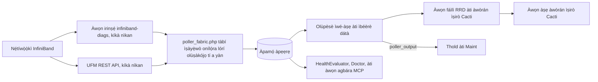

<!-- Source: README.md; SHA256: 79a16fb906f96ee79de2c719f18c38836f555440a7571a4a5ba38c64bb5b099f -->

<!-- translations:start -->
[English](../../../README.md) | [简体中文](../zh-CN/README.md) | [हिन्दी](../hi-IN/README.md) | [Español (España)](../es-ES/README.md) | [Español (Latinoamérica)](../es-419/README.md) | [العربية (السعودية)](../ar-SA/README.md) | [Afrikaans](../af-ZA/README.md) | [አማርኛ](../am-ET/README.md) | [العربية (مصر)](../ar-EG/README.md) | [العربية (المغرب)](../ar-MA/README.md) | [বাংলা](../bn-BD/README.md) | [Bosanski](../bs-BA/README.md) | [Deutsch](../de-DE/README.md) | [فارسی](../fa-IR/README.md) | [Filipino](../fil-PH/README.md) | [Français](../fr-FR/README.md) | [Français (Maroc)](../fr-MA/README.md) | [Français (Sénégal)](../fr-SN/README.md) | [Hausa](../ha-NG/README.md) | [עברית](../he-IL/README.md) | [Hrvatski](../hr-HR/README.md) | [Bahasa Indonesia](../id-ID/README.md) | [Igbo](../ig-NG/README.md) | [Italiano](../it-IT/README.md) | [日本語](../ja-JP/README.md) | [한국어](../ko-KR/README.md) | [Malagasy](../mg-MG/README.md) | [मराठी](../mr-IN/README.md) | [Bahasa Melayu](../ms-MY/README.md) | [Nederlands](../nl-NL/README.md) | [Polski](../pl-PL/README.md) | [Português (Brasil)](../pt-BR/README.md) | [Русский](../ru-RU/README.md) | [Kinyarwanda](../rw-RW/README.md) | [Soomaali](../so-SO/README.md) | [Српски](../sr-RS/README.md) | [Svenska](../sv-SE/README.md) | [Kiswahili](../sw-KE/README.md) | [தமிழ்](../ta-IN/README.md) | [తెలుగు](../te-IN/README.md) | [ไทย](../th-TH/README.md) | [Türkçe](../tr-TR/README.md) | [Українська](../uk-UA/README.md) | [اردو](../ur-PK/README.md) | [Tiếng Việt](../vi-VN/README.md) | [isiXhosa](../xh-ZA/README.md) | [Yorùbá](README.md) | [繁體中文](../zh-TW/README.md) | [isiZulu](../zu-ZA/README.md)
<!-- translations:end -->

# plugin_fabric

Àfikún Cacti 1.2 kan (`fabric`, ẹ̀dà `0.1.0-dev`) tí ó ń mú àwọn òǹkà ibùdó ìsopọ̀ InfiniBand, ìbú àti iyàrá ìsopọ̀, àti àwọn àmì ìkúnjù wọ inú Cacti gẹ́gẹ́ bí àwọn ẹ̀rọ lásán, àwọn orísun dátà, àti àwọn àwòrán ìṣirò. Ìsopọ̀ tí ó ṣètò ara rẹ̀ ní 1X dípò 4X yóò wá hàn gẹ́gẹ́ bí àwòrán ìṣirò àti ìkìlọ̀ Thold lẹ́gbẹ̀ẹ́ olùgbàlejò tí ó ń sìn, lábẹ́ àwọn àṣẹ Cacti, pẹ̀lú ìmọ̀ àti ìpalẹ́numọ́ Maint.

> **Ipò: ó wà lórí ìdàgbàsókè, kò tíì sí ìtẹ̀jáde kankan.** Ẹ̀ka yìí ń ṣe ìpìlẹ̀ àfikún, àwọn ohun Cacti àti ìkìlọ̀, àwọn ìṣàyẹ̀wò ìṣàkójọ abẹ́lẹ̀ tí a ṣètò sílẹ̀, ìṣàdàkọ sí olùkójọ òkèèrè, ẹ̀ka ẹ̀yìn NVIDIA UFM REST kíkà-nìkan pẹ̀lú ibi ìpamọ́ ìwé-ẹ̀rí ìdánimọ̀ tí a fi ìpamọ́ bò, ìṣàkóso CLI ti Configuration-as-Code (CasC), àti àwọn ìkọ́ ètò Cacti (CasC, Doctor, àti MCP / Abilities API v2). A ti dán an wò pẹ̀lú àwọn irinṣẹ́ èké, àwọn ìrìnà UFM àfarawé, àti olùfarawé nẹ́tíwọ̀ọ̀kì ìsopọ̀ `ibsim` (rdma-core 50.0), kì í ṣe lórí nẹ́tíwọ̀ọ̀kì InfiniBand gidi tàbí olùpèsè UFM gidi rí. Àwọn àyẹ̀wò tí ó nílò ohun-èlò gidi ṣì wà ní ṣíṣí sílẹ̀ nínú [docs/research/](../../research/). Iṣẹ́-àkànṣe yìí kò ní àjọṣepọ̀ kankan pẹ̀lú iṣẹ́-àkànṣe Cacti.

## Ohun tí a ti ṣe

- **Ìgbésí-ayé àti àtòjọ tábìlì (v3)**: ìfi-sórí-ẹ̀rọ, ìgbéga tí kì í yí èsì padà ní àtúnṣe, ìyọkúrò (tí ó ń pa àwọn tábìlì àfikún mọ́ ní ìbẹ̀rẹ̀), àti ààbò ìbéèrè PHP 8.2 nígbà tí àwọn ibi ìbẹ̀rẹ̀ ṣì lè jẹ́ títúpalẹ̀ lórí PHP 8.0.
- **Àwọn ipa àṣẹ ìwọlé àti àwọn ojú-ewé**: àwọn agbègbè àṣẹ `Fabric View` (`fabric.php`), `Fabric Operator` (`fabric_operator.php`), àti `Fabric Admin` (`fabric_admin.php`, `fabric_health.php`), pẹ̀lú abala Settings kan lábẹ́ **Configuration > Settings > Fabrics**.
- **Ẹ̀ka ẹ̀yìn ìwádìí kíkà-nìkan (`diags`)**: ìṣiṣẹ́ pàtó ti `perfquery`, `ibnetdiscover`, àti `iblinkinfo`, àkójọ ohun-ìní nípa GUID pẹ̀lú ìwárí ìforígbárí ìdánimọ̀ àti àwọn àbá àtúnsopọ̀, ìṣàyẹ̀wò ipò ìsopọ̀, àti àwọn ìṣàyẹ̀wò òǹkà fún kókó kọ̀ọ̀kan.
- **Ẹ̀ka ẹ̀yìn NVIDIA UFM REST kíkà-nìkan (`ufm`) àti ibi ìpamọ́ tí a fi ìpamọ́ bò**: olùbáraẹnisọ̀rọ̀ REST ti GET-nìkan tí a fọwọ́ sí (`/ufmRest/resources/ports`, `/ufmRest/resources/systems`, `/ufmRest/monitoring/session/0/data`, àti àwọn ẹgbẹ́ `/ufmRestV3/...` fún ìjẹ́rìísí token) tí ó ń fi dátà sí inú àwọn tábìlì àkójọ ohun-ìní, ipò ìsopọ̀, àpẹẹrẹ, àti ìlera kan náà bíi `diags`. Àwọn ìwé-ẹ̀rí ìdánimọ̀ (`token` tàbí `basic`) ni a fi pamọ́ pẹ̀lú ìpamọ́ AES-256-GCM nínú `plugin_fabric_secret` nípa lílo fáìlì kọ́kọ́rọ́ 256-bit òde tí a ṣètò nípasẹ̀ `fabric_vault_key_file`. A lè ṣàlàyé àwọn nẹ́tíwọ̀ọ̀kì ìsopọ̀ UFM nípasẹ̀ CasC (`cli/fabric.php`) tàbí àwọn ibi ìpamọ́; fọ́ọ̀mù alámòójútó wẹ́ẹ̀bù lọ́wọ́lọ́wọ́ ń fi àwọn pápá `diags` hàn.
- **Àwọn ohun Cacti, Thold, àti Maint**: àwọn àdàkọ ẹ̀rọ, dátà, àti àwòrán ìṣirò Cacti (`templates/fabric-templates.xml`), ìbéèrè dátà olùpèsè ìwé-àṣẹ "Fabric Port" (`scripts/ss_fabric_ports.php`, `resource/script_server/fabric_ports.xml`), àwọn orísun dátà òǹkà `DERIVE` àti àwọn orísun dátà ipò ìsopọ̀/iyàrá `GAUGE` fún Thold, ìtọpinpin ìdádúró, àti àwọn òǹkà ìpìlẹ̀ tí ó kún tí a ròyìn gẹ́gẹ́ bí `U`. Ìbáṣepọ̀ Maint (`MaintMaintenance`) ń béèrè lọ́wọ́ `plugin_maint_check_cacti_host()` (tí ó ń padà sí ìkọ́ `is_device_in_maintenance`) kí àwọn kókó tí ó wà nínú àtúnṣe lọ́wọ́lọ́wọ́ baà lè jẹ́ kíka lọ́tọ̀ àti yíyọ kúrò nínú àwọn ìkìlọ̀ ìlera ti ìṣàyẹ̀wò tí ó kùnà àti àwọn ibùdó ìsopọ̀ tí agbára wọn dínkù.
- **Àwọn ìṣàyẹ̀wò tí a ṣètò, ìpínkiri, àti àwọn olùkójọ òkèèrè**: `poller_bottom` ń bẹ̀rẹ̀ `poller_fabric.php` ní abẹ́lẹ̀ fún àwọn nẹ́tíwọ̀ọ̀kì ìsopọ̀ tí a mú ṣiṣẹ́ tí àsìkò wọn ti tó tí a yàn fún olùṣàkójọ lọ́wọ́lọ́wọ́, lẹ́gbẹ̀ẹ́ àwọn ìṣàyẹ̀wò onílọ́ra tí olùpèsè ìwé-àṣẹ bẹ̀rẹ̀. `INFO` ń kéde `remote_collect:1, remote_poller:1`, `poller_fabric.php` ń ṣe àtìlẹ́yìn fún ìpínkiri GUID tí a lè sọ tẹ́lẹ̀ (`--shard=K/N`), àti pé `replicate_out` ń ṣe àdàkọ àwọn ìlà `plugin_fabric_fabric` tí kì í ṣe àṣírí sí àwọn olùkójọ òkèèrè (`poller_id >= 2`). Àwọn àkọsílẹ̀ ibi ìpamọ́ (`plugin_fabric_secret`) àti àwọn fáìlì kọ́kọ́rọ́ òde kì í jẹ́ ṣíṣe àdàkọ rí.
- **CasC CLI àti àwọn ìkọ́ ètò**: `cli/fabric.php` fún títẹ̀ jáde YAML/XML, ìfìdímúlẹ̀, ìgbèrò ìyàtọ̀ láìṣiṣẹ́ gidi, ìfilọ̀lẹ̀ tí ó ní ìjẹ́rìísí, àti ìròyìn ìlera, pẹ̀lú àwọn ìkọ́ `casc_register_providers`, `doctor_register_checks`, àti `abilities_register`.

## Àwọn ipa àṣẹ ìwọlé

| Agbègbè àṣẹ | Àṣẹ ìwọlé |
| --- | --- |
| Fabric View | Àbójútó àkójọ ohun-ìní àti àwọn ìwò ibùdó ìsopọ̀ (`fabric.php`). |
| Fabric Operator | Àṣẹ View pẹ̀lú ojú-ewé Operations (`fabric_operator.php`) àti àwọn ìfọwọ́sí ìtọ́jú àdáni. |
| Fabric Admin | Àṣẹ Operator pẹ̀lú ètò ìṣàkóso, àwọn ìgbésẹ̀ alámòójútó (`fabric_admin.php`), àti ojú-ewé ìlera (`fabric_health.php`). |

Lẹ́yìn dída àwọn fáìlì ìgbéga kọ̀pì, ṣí ojú-ewé Plugins gẹ́gẹ́ bí alámòójútó láti forúkọsílẹ̀ àwọn agbègbè àṣẹ àti àwọn ìkọ́ tuntun. Yan agbègbè Operator ní pàtó lábẹ́ **Configuration > Users** tàbí àwọn ẹgbẹ́ olùlò. Àwọn ìgbéga ń pa àwọn ID agbègbè àṣẹ View àti Admin tí ó wà tẹ́lẹ̀ àti àwọn ẹ̀bùn àṣẹ mọ́. Àṣẹ Admin ń jogún àṣẹ Operator, àti pé àṣẹ Operator ń jogún àṣẹ View lórí ìbéèrè kọ̀ọ̀kan; èyí kò fi àwọn ẹ̀bùn tí a fi pamọ́ kún àwọn olùlò tàbí àwọn ẹgbẹ́. Àwọn ètò àfikún tún nílò àṣẹ Fabric Admin ní àfikún sí àṣẹ Settings ti Cacti.

Àwọn àṣẹ ẹ̀rọ Cacti ń díwọ̀n àwọn ìlà àti àwọn ìgbésẹ̀ tí ó wà fún olùlò kọ̀ọ̀kan; àwọn ohun tí a kò so pọ̀ nílò alámòójútó. Àwọn ìwé-ẹ̀rí ìdánimọ̀, ètò ìṣàkóso, ìsopọ̀, ìparẹ́, àti àwọn àyípadà alámòójútó mìíràn wà nínú àwọn ojú-ewé alámòójútó tàbí CLI. Àwọn ìfọwọ́sí máa ń wà nìkan ní àsìkò ìṣiṣẹ́ olùlò lọ́wọ́lọ́wọ́, fún wákàtí kan ní pọ́ọ̀kọ̀ àti nìkan nígbà tí àkíyèsí kan náà bá ṣì wà ní tútù. Àwọn àkíyèsí tuntun tàbí tí ó yí padà máa ń sọ wọ́n di aláìlágbára. Wọn kì í fi àmì ìlera sí ìwọ̀n tí ó kùnà tàbí pa àwọn ìkìlọ̀ lẹ́nu mọ́ rí.

## Kí ló dé

Ìsopọ̀ InfiniBand tí agbára rẹ̀ ti dínkù ṣì máa ń gba ìrìnà dátà kọjá. Ìsopọ̀ 4X tí ó bá tún ṣètò ara rẹ̀ ní 1X máa ń fi ibùdó ìsopọ̀ náà sílẹ̀ ní "active", àti pé àwọn àwòrán ìṣirò ìsopọ̀ SNMP ti olùgbàlejò náà á jọ bíi pé ó wà déédéé, ṣùgbọ́n àwọn iṣẹ́ tí ó so mọ́ ara wọn ṣinṣin á máa lọ́ra. Ẹ̀rí náà wà nínú nẹ́tíwọ̀ọ̀kì ìsopọ̀: ibùdó ìsopọ̀ kọ̀ọ̀kan ń ròyìn ìbú àti iyàrá rẹ̀ tí ó ń ṣiṣẹ́, tí a mú ṣiṣẹ́, àti tí ó ṣeé tì lẹ́yìn, pẹ̀lú àwọn òǹkà àṣìṣe àti ìkúnjù. Kíkà á gba àwọn irinṣẹ́ ìwádìí InfiniBand tàbí API olùṣàkóso nẹ́tíwọ̀ọ̀kì ìsopọ̀. Nígbà tí a bá ṣiṣẹ́ wọn pẹ̀lú ọwọ́, wọ́n máa ń fi àlàfo mẹ́ta sílẹ̀:

- **Kò sí ìtàn.** `perfquery` àti `iblinkinfo` ń fi ìsinsìnyí hàn, nítorí náà ìsopọ̀ tí agbára rẹ̀ dínkù ní ọ̀sẹ̀ tí ó kọjá kò ní hàn.
- **Kò sí àyíká ẹ̀rọ.** Àwọn ibùdó ìsopọ̀ nẹ́tíwọ̀ọ̀kì kì í ṣe àwọn ohun Cacti, nítorí náà a kò lè ya àwòrán ìṣirò ibùdó ìsopọ̀ lẹ́gbẹ̀ẹ́ olùgbàlejò tí ó ń fún níṣẹ́.
- **Kò sí ọ̀nà sínú ìkìlọ̀ Cacti.** Thold àti Maint ń ṣiṣẹ́ lórí àwọn orísun dátà àti àwọn ẹ̀rọ Cacti.

Àfikún náà dí àwọn àlàfo wọ̀nyí nípa kíkà nẹ́tíwọ̀ọ̀kì ìsopọ̀ nípasẹ̀ `infiniband-diags` tàbí NVIDIA UFM REST API, nípa dídá àwọn kókó àti àwọn ibùdó ìsopọ̀ mọ̀ nípasẹ̀ GUID, àti nípa títẹ àwọn òǹkà àti ipò ìsopọ̀ jáde gẹ́gẹ́ bí àwọn orísun dátà Cacti. Ó ń kà nìkan: kì í tún àwọn òǹkà ṣe sí ìbẹ̀rẹ̀ tàbí yí ipò ibùdó ìsopọ̀ padà rí.

## Àwọn iṣẹ́ àti CLI

### Olùṣàkójọ abẹ́lẹ̀ àti àwọn ìṣàyẹ̀wò ọwọ́

`fabric_poller_bottom()` ń bẹ̀rẹ̀ `poller_fabric.php` ní abẹ́lẹ̀ lórí olùṣàkójọ kọ̀ọ̀kan fún àwọn nẹ́tíwọ̀ọ̀kì ìsopọ̀ tí a mú ṣiṣẹ́ tí a yàn fún `poller_id` náà tí àsìkò ìṣàyẹ̀wò wọn ti tó. O tún lè ṣiṣẹ́ olùṣiṣẹ́ olùṣàkójọ tàbí ìṣàyẹ̀wò ọwọ́ tààrà lórí olùṣàkójọ tí a yàn bíi olùlò olùṣàkójọ (nípa rírọ́pò `/path/to/cacti` pẹ̀lú ìtọ́sọ́nà Cacti rẹ):

```sh
php /path/to/cacti/plugins/fabric/poller_fabric.php [--fabric=ID] [--shard=K/N] [--force] [--debug]
php /path/to/cacti/plugins/fabric/fabric_sweep.php --fabric=ID [--node=GUID] [--force]
```

- `poller_fabric.php` ń ṣiṣẹ́ gbogbo àwọn nẹ́tíwọ̀ọ̀kì ìsopọ̀ tí àsìkò wọn ti tó fún olùṣàkójọ abẹ́lé (tàbí nẹ́tíwọ̀ọ̀kì ìsopọ̀ kan pẹ̀lú `--fabric=ID`), ń fi ìdènà ìforúkọsílẹ̀ ìlànà Cacti àti àwọn àdéhùn `ClaimRepository` ṣiṣẹ́ pẹ̀lú ìṣúná àsìkò ti `max(30, intdiv(sweep_interval, 2))` ìṣẹ́jú-àáyá, ó sì ń ṣe àtìlẹ́yìn fún `--shard=K/N` (`0 <= K < N`) láti pín àwọn ìṣàyẹ̀wò òǹkà kókó `diags` lọ́nà tí a lè sọ tẹ́lẹ̀ nípa GUID kókó.
- `fabric_sweep.php` ń ṣiṣẹ́ ìṣàyẹ̀wò nígbà tí a bá béèrè fún nẹ́tíwọ̀ọ̀kì ìsopọ̀ kan tí a mú ṣiṣẹ́ (tàbí kókó kan pẹ̀lú `--node=GUID`) tí a yàn fún olùṣàkójọ abẹ́lé. `--force` ń fojú fo bóyá àsìkò nẹ́tíwọ̀ọ̀kì ìsopọ̀ ti tó nígbà tí ó ṣì ń bọ̀wọ̀ fún àwọn ìdènà ìbéèrè.

Lẹ́yìn tí ìwádìí àkọ́kọ́ bá kún àkójọ ohun-ìní, so àwọn kókó mọ́ àwọn ẹ̀rọ Cacti lórí ojú-ewé Fabric Admin. Pa àsìkò ìparí ìwé-àṣẹ Cacti mọ́ ní ìṣẹ́jú-àáyá 25 tàbí ju bẹ́ẹ̀ lọ: ìṣàyẹ̀wò onílọ́ra tí kíkà ìbéèrè-dátà bẹ̀rẹ̀ máa ń díwọ̀n ìṣiṣẹ́ irinṣẹ́ sí `script_timeout - 5` ìṣẹ́jú-àáyá kí olùpèsè ìwé-àṣẹ baà lè padà wá ní àsìkò pẹ̀lú àpẹẹrẹ tí a fi pamọ́ kẹ́yìn tàbí `U`.

### Ẹ̀ka ẹ̀yìn NVIDIA UFM REST àti ibi ìpamọ́ ìwé-ẹ̀rí ìdánimọ̀

Nẹ́tíwọ̀ọ̀kì ìsopọ̀ `ufm` kan nílò URL `https://` láìsí àwọn ìwé-ẹ̀rí ìdánimọ̀ tí a fi sínú rẹ̀, àwọn okùn ìbéèrè, tàbí àwọn ìpín URL. `UfmSocketTransport` ń fi ìjẹ́rìísí ẹgbẹ́ TLS àti orúkọ olùgbàlejò ṣiṣẹ́, ń kọ̀ àwọn ìdarísí-ọ̀nà mìíràn, ó sì ń ṣe àtìlẹ́yìn fún àpò CA àṣàyàn (`ufm_ca_file`) àti àmì SHA-256 SPKI (`ufm_spki_pin`).

Láti fi àwọn ìwé-ẹ̀rí ìdánimọ̀ UFM pamọ́ sínú `plugin_fabric_secret`, ṣètò `fabric_vault_key_file` lábẹ́ **Configuration > Settings > Fabrics** pẹ̀lú ọ̀nà pípé sí fáìlì déédéé tí olùlò olùṣàkójọ ní (kò sí àwọn ìjápọ̀ symlink nínú ìtọ́sọ́nà òbí kankan, ipò `0600`, tí ó ní àwọn lẹ́tà hex 64 bíi `openssl rand -hex 32` tàbí àwọn byte 32 aláìlẹ́wà tí kò ṣeé tẹ̀ jáde). Àfikún náà kì í ṣẹ̀dá tàbí kọ fáìlì kọ́kọ́rọ́ rí, àti pé `replicate_out` kì í ṣe àdàkọ `plugin_fabric_secret` tàbí àwọn fáìlì kọ́kọ́rọ́ sí àwọn olùṣàkójọ òkèèrè rí.

### Configuration-as-Code àti CLI ìlera

`cli/fabric.php` ń ṣàkóso àwọn ètò àfikún àti àwọn ìtumọ̀ nẹ́tíwọ̀ọ̀kì ìsopọ̀ ní ọ̀nà ìpolongo nínú YAML tàbí XML, ó sì ń ròyìn ìlera tí ó mọ̀ nípa àtúnṣe láìṣiṣẹ́ àwọn ìṣàyẹ̀wò gidi:

```sh
php /path/to/cacti/plugins/fabric/cli/fabric.php export [--format=yaml|xml] [--file=PATH]
php /path/to/cacti/plugins/fabric/cli/fabric.php validate --file=PATH [--format=yaml|xml]
php /path/to/cacti/plugins/fabric/cli/fabric.php plan --file=PATH [--format=yaml|xml]
php /path/to/cacti/plugins/fabric/cli/fabric.php apply --file=PATH --confirm=PLAN_HASH [--format=yaml|xml]
php /path/to/cacti/plugins/fabric/cli/fabric.php health [--format=text|json]
```

`export` ń ṣẹ̀dá àwọn fáìlì tuntun pẹ̀lú ipò `0600`, ń bo `fabric_vault_key_file` gẹ́gẹ́ bí `[REDACTED]`, ó sì ń mú àwọn ìtọ́kasí `ufm_credential_ref` tí ó ní orúkọ jáde dípò àwọn àṣírí. `plan` àti `apply` ń kọ̀ àwọn iye `ufm_token`, `ufm_password`, `secret`, àti àwọn iye `fabric_vault_key_file` tí a fi sínú ìlà. `apply` nílò `--confirm=PLAN_HASH` pàtó tí `plan` ṣẹ̀dá.

### Àwọn ìkọ́ ètò

Nígbà tí àwọn àfikún Cacti tí ó báramu tàbí àwọn ìbáṣepọ̀ olùgbàlejò bá wà, `setup.php` ń forúkọsílẹ̀:

- `casc_register_providers`: ń tẹ̀ jáde, ń fìdímúlẹ̀, ń gbèrò, ó sì ń fi ìjẹ́rìísí lo ètò ìṣàkóso `fabric` (`yaml` àti `xml`, àtòjọ v1) pẹ̀lú ìbò àṣírí.
- `doctor_register_checks`: ń pèsè àwọn àyẹ̀wò ìwádìí kíkà-nìkan mẹ́rin (`fabric.schema`, `fabric.poller_freshness`, `fabric.identity_conflicts`, `fabric.ufm_vault`).
- `abilities_register`: ń forúkọsílẹ̀ àwọn agbára kíkà-nìkan, aláìbàjẹ́, tí kì í yí èsì padà mẹ́ta lábẹ́ ẹ̀ka `fabric`, tí agbègbè àṣẹ Fabric View (àti àwọn àṣẹ ẹ̀rọ Cacti fún àwọn àṣìṣe ibùdó ìsopọ̀) ń ṣàkóso: `fabric-list-fabrics`, `fabric-get-health`, àti `fabric-list-port-errors`.

## Ààlà iṣẹ́ àti àwọn òpin

Kò sí lára iṣẹ́ yìí: yíyí ipò nẹ́tíwọ̀ọ̀kì ìsopọ̀ padà, títún àwọn òǹkà ṣe sí ìbẹ̀rẹ̀, rírọ́pò olùṣàkóso nẹ́tíwọ̀ọ̀kì ìsopọ̀ tàbí olùṣàkóso subnet, ẹ̀rọ ìkìlọ̀ tirẹ̀ tí àfikún ní, daemon àdáni tàbí ìlànà nẹ́tíwọ̀ọ̀kì, àti àwọn nẹ́tíwọ̀ọ̀kì ìsopọ̀ Ethernet tàbí RoCE.

## Àwọn ìbéèrè àti ìbáramu

| Ẹ̀ya | Ibi-àfojúsùn |
|---|---|
| Cacti | 1.2.31 tàbí tuntun jù bẹ́ẹ̀ lọ (`compat = 1.2.31`), kò sí àtúnṣe kókó inú |
| PHP | 8.2 tàbí tuntun jù bẹ́ẹ̀ lọ; àwọn ibi ìbẹ̀rẹ̀ ṣì lè jẹ́ títúpalẹ̀ lórí 8.0 wọ́n sì ń kọ̀ ìṣíṣẹ́ lórí 8.1 kí àyíká ìṣiṣẹ́ tí kò ní àtìlẹ́yìn baà lè rí ìkọ̀sílẹ̀ dípò UI Cacti tí ó bàjẹ́ |
| Àwọn irinṣẹ́ InfiniBand | `infiniband-diags` láti inú `rdma-core` (a dán an wò nínú CI pẹ̀lú rdma-core 50.0 lábẹ́ `ibsim`; àwọn ìlànà àbájáde tí a ṣàyẹ̀wò lòdì sí kóòdù orísun v66.0) |
| UFM | NVIDIA UFM Enterprise REST API (àwọn ibi ìparí kíkà-nìkan `ufmRest` àti `ufmRestV3`; a dán an wò lòdì sí àwọn ìrìnà àfarawé nínú àwọn ìdánwò ẹyọ̀) |
| Thold, Maint | Kò nílò àtúnṣe kankan; CI ń ṣiṣẹ́ ìdánwò láti ìbẹ̀rẹ̀ dé òpin pẹ̀lú Thold v1.8.2 àti Maint v1.3 tí a kò yí padà |

## Ìdàgbàsókè àti ìdánwò

Ìlànà iṣẹ́ CI (`.github/workflows/plugin-ci-workflow.yml`) ń dán PHP 8.2 títí dé 8.5 wò lòdì sí Cacti `release/1.2.31` àti `1.2.x`, àyẹ̀wò ìhun ọ̀rọ̀ ibi ìbẹ̀rẹ̀ PHP 8.0, ìkọ̀sílẹ̀ PHP 8.1, PHPStan, ìfìdímúlẹ̀ gettext/ìtúmọ̀, ìwé-àṣẹ REUSE, àyẹ̀wò ìlànà iṣẹ́, àtúnṣe ìdánwò láti ìbẹ̀rẹ̀ dé òpin Thold/Maint, àti àfarawé nẹ́tíwọ̀ọ̀kì ìsopọ̀ `ibsim`.

Pẹ̀lú àyíká ìdánwò àfikún Pest tí Cacti dè pọ̀ (`CACTI_PEST_BIN`) àti ibi ìpamọ́ dátà Cacti tí a lè sọnù:

```sh
# Unit tests
"$CACTI_PEST_BIN" --configuration=phpunit.xml

# Lifecycle integration tests (disposable database only)
CACTI_PATH=/path/to/cacti FABRIC_TEST_DATABASE=disposable "$CACTI_PEST_BIN" --configuration=phpunit-integration.xml

# Static analysis (against Cacti 1.2.31)
CACTI_PATH=/path/to/cacti phpstan analyse -c phpstan.neon --no-progress

# Translation template, catalogs, and localized README checks
sh locales/build_gettext.sh --check

# Simulated ibsim fixture parser check
php tests/bin/check-ibsim-fixtures.php tests/fixtures/ibsim
```

## Ètò ìṣe

- [docs/PLAN.md](../../PLAN.md) ni ètò ìṣètò àgbékalẹ̀ àti ìṣe: àwọn òótọ́ òkè pẹ̀lú àwọn orísun, àwọn àyẹ̀wò ohun-èlò gidi tí ó ṣì wà ní ṣíṣí, àwòṣe ìdánimọ̀, àwọn òfin òǹkà àti ipò ìsopọ̀, àwọn ààlà ààbò, ìṣirò iṣẹ́-ṣíṣe, ìdánwò, àti àwọn ewu.
- [docs/decisions/](../../decisions/) ní àwọn àkọsílẹ̀ ìpinnu ìṣètò.
- [docs/REQUIREMENTS.md](../../REQUIREMENTS.md) so gbogbo ID ìbéèrè pọ̀ mọ́ ọ̀ràn rẹ̀.



## Bí a ṣe ń tọpinpin iṣẹ́

- **Àwọn àṣeyọrí pàtàkì** tẹ̀lé àwọn àṣeyọrí pàtàkì ti ètò náà. Ọ̀kọ̀ọ̀kan ní ọ̀ràn ńlá kan tí ó ṣàkójọ àwọn ọ̀ràn kékeré rẹ̀ àti ẹ̀rí ìjáde.
- **Àwọn ọ̀ràn** ní irú wọn nípa àmì: `type: requirement`, `type: research`, `type: decision`, `type: epic`. Àwọn ọ̀ràn ìbéèrè sọ àwọn ìbéèrè tí a lè dán wò tí ó ní nọ́mbà (`REQ-AREA-NNN`) àti àwọn ìlànà ìtẹ́wọ́gbà.
- **Àwọn àmì** tún gbé `area:`, `phase:`, `priority:`, àti `status:`. Wo [CONTRIBUTING.md](../../../CONTRIBUTING.md#labels).
- [Pátákó iṣẹ́-àkànṣe](https://github.com/users/somethingwithproof/projects/8) náà fi gbogbo àwọn ọ̀ràn hàn káàkiri àwọn àṣeyọrí pàtàkì.

## Ìkópa

Ka [CONTRIBUTING.md](../../../CONTRIBUTING.md). Àwọn ìfiránṣẹ́ kóòdù nílò ìfọwọ́sowọ́pọ̀ DCO (`git commit -s`). Ìjíròrò ètò ìṣe ń ṣẹlẹ̀ lórí àwọn ọ̀ràn; àwọn ìpinnu tí ó ṣì wà ní ṣíṣí gbé àmì `type: decision`.

## Ààbò

Ròyìn àwọn àìlera ní ìkọ̀kọ̀; wo [SECURITY.md](../../../SECURITY.md).

## Ìwé-àṣẹ

GNU General Public License v2.0, ìwé-àṣẹ kan náà pẹ̀lú Cacti àti àwọn àfikún rẹ̀. Wo [LICENSE](../../../LICENSE).
