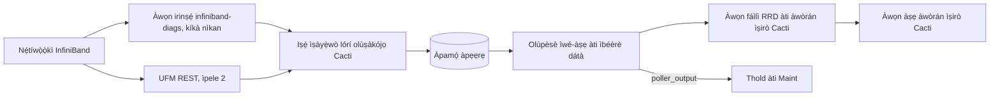

<!-- Source: README.md; SHA256: ce5af61a1bc993ec2aae6d4f22c3885694632f2b1d5eb94e2ce88b8390e96f1e -->

<!-- translations:start -->
[English](../../../README.md) | [简体中文](../zh-CN/README.md) | [हिन्दी](../hi-IN/README.md) | [Español (España)](../es-ES/README.md) | [Español (Latinoamérica)](../es-419/README.md) | [العربية (السعودية)](../ar-SA/README.md) | [Afrikaans](../af-ZA/README.md) | [አማርኛ](../am-ET/README.md) | [العربية (مصر)](../ar-EG/README.md) | [العربية (المغرب)](../ar-MA/README.md) | [বাংলা](../bn-BD/README.md) | [Deutsch](../de-DE/README.md) | [فارسی](../fa-IR/README.md) | [Filipino](../fil-PH/README.md) | [Français](../fr-FR/README.md) | [Français (Maroc)](../fr-MA/README.md) | [Français (Sénégal)](../fr-SN/README.md) | [Hausa](../ha-NG/README.md) | [עברית](../he-IL/README.md) | [Bahasa Indonesia](../id-ID/README.md) | [Igbo](../ig-NG/README.md) | [Italiano](../it-IT/README.md) | [日本語](../ja-JP/README.md) | [한국어](../ko-KR/README.md) | [Malagasy](../mg-MG/README.md) | [मराठी](../mr-IN/README.md) | [Bahasa Melayu](../ms-MY/README.md) | [Nederlands](../nl-NL/README.md) | [Polski](../pl-PL/README.md) | [Português (Brasil)](../pt-BR/README.md) | [Русский](../ru-RU/README.md) | [Kinyarwanda](../rw-RW/README.md) | [Soomaali](../so-SO/README.md) | [Svenska](../sv-SE/README.md) | [Kiswahili](../sw-KE/README.md) | [தமிழ்](../ta-IN/README.md) | [తెలుగు](../te-IN/README.md) | [ไทย](../th-TH/README.md) | [Türkçe](../tr-TR/README.md) | [Українська](../uk-UA/README.md) | [اردو](../ur-PK/README.md) | [Tiếng Việt](../vi-VN/README.md) | [isiXhosa](../xh-ZA/README.md) | [Yorùbá](README.md) | [繁體中文](../zh-TW/README.md) | [isiZulu](../zu-ZA/README.md)
<!-- translations:end -->

# plugin_fabric

Àfikún Cacti 1.2 kan tí ó ń mú àwọn òǹkà ibùdó ìsopọ̀ InfiniBand, ìbú àti iyàrá ìsopọ̀, àti àwọn àmì ìkúnjù wọ inú Cacti gẹ́gẹ́ bí àwọn ẹ̀rọ lásán, àwọn orísun dátà, àti àwọn àwòrán ìṣirò. Ìsopọ̀ tí ó ṣètò ara rẹ̀ ní 1X dípò 4X yóò wá hàn gẹ́gẹ́ bí àwòrán ìṣirò àti ìkìlọ̀ Thold lẹ́gbẹ̀ẹ́ olùgbàlejò tí ó ń sìn, lábẹ́ àwọn àṣẹ Cacti, pẹ̀lú Maint tí ó lè pa á lẹ́nu mọ́.

> **Ipò: ó wà lórí ìdàgbàsókè, kò tíì sí ìtẹ̀jáde kankan.** Àṣeyọrí pàtàkì 2 (ìpìlẹ̀) ti jẹ́ dídàpọ̀ lórí `main`, àti pé àṣeyọrí pàtàkì 3 (àwọn ohun Cacti àti ìkìlọ̀) wà lábẹ́ àyẹ̀wò. Àṣeyọrí pàtàkì 1 fìdí ètò ìṣe náà múlẹ̀ lórí àwọn ìwé àkọsílẹ̀ àti kóòdù orísun òkè (PR #71); àwọn èsì, pẹ̀lú àwọn orísun, wà nínú [docs/research/](../../research). Àṣeyọrí pàtàkì 2 fi ìpìlẹ̀ àfikún kún un:
>
> - ìfi-sórí-ẹ̀rọ, ìgbéga, ìyọkúrò, àti ààbò PHP 8.2
> - àwọn agbègbè àṣẹ View, Operator àti Admin, àti àwọn àtòjọ ètò
> - àwọn àkọsílẹ̀ nẹ́tíwọ̀ọ̀kì ìsopọ̀
> - ààlà àṣẹ kíkà-nìkan fún `perfquery`, `ibnetdiscover`, àti `iblinkinfo`
> - àkójọ ohun-ìní nípa GUID, pẹ̀lú ìforígbárí ìdánimọ̀ àti àwọn àbá àtúnsopọ̀
> - ipò ìsopọ̀ àti àpamọ́ ìṣàyẹ̀wò òǹkà
> - àwọn ojú-ewé àkójọ ohun-ìní, alámòójútó, àti ìlera ètò
>
> Àṣeyọrí pàtàkì 3 fi àwọn ohun Cacti kún un:
>
> - àwọn àdàkọ ẹ̀rọ, dátà, àti àwòrán ìṣirò tí a fi ránṣẹ́ gẹ́gẹ́ bí XML àdàkọ Cacti, àti ìbéèrè dátà "Fabric Port"
> - síso kókó kan mọ́ ẹ̀rọ Cacti kan, tàbí ṣíṣẹ̀dá ọ̀kan lẹ́yìn ìjẹ́rìísí ([ADR 0010](../../decisions/0010-one-device-per-node.md))
> - àwọn orísun dátà òǹkà fún àwọn àwòrán ìṣirò, àti ipò ìsopọ̀ GAUGE àti àwọn orísun dátà ìwọ̀n fún Thold ([ADR 0011](../../decisions/0011-derive-counters-and-gauge-alert-values.md))
> - ìtọ́jú ìdádúró àti àwọn òǹkà ìpìlẹ̀ tí ó kún tí a kà gẹ́gẹ́ bí àìmọ̀ ([ADR 0012](../../decisions/0012-saturated-basic-counters-read-as-unknown.md)), ìwúlò òǹkà àti àwọn ìjápọ̀ àwòrán ìṣirò lórí ojú-ewé ibùdó ìsopọ̀, àti ipò ìtòjọ ìkúnjù
> - àyẹ̀wò láti ìbẹ̀rẹ̀ dé òpin pẹ̀lú Thold v1.8.2 àti Maint v1.3 tí a kò yí padà, àti iṣẹ́ CI kan tí ó ń ṣiṣẹ́ àwọn irinṣẹ́ ìwádìí gidi lórí nẹ́tíwọ̀ọ̀kì ìsopọ̀ àfarawé
>
> A lè ṣàyẹ̀wò nẹ́tíwọ̀ọ̀kì ìsopọ̀ kan láti orí olùṣàkójọ àkọ́kọ́ nìkan títí tí àwọn olùkójọ dátà òkèèrè yóò fi ní àtìlẹ́yìn ní ìpele 3. A ti dán an wò pẹ̀lú àwọn irinṣẹ́ èké àti olùfarawé nẹ́tíwọ̀ọ̀kì ìsopọ̀ ibsim, kì í ṣe lórí nẹ́tíwọ̀ọ̀kì InfiniBand gidi rí. Àwọn àyẹ̀wò tí ó nílò nẹ́tíwọ̀ọ̀kì ìsopọ̀ wà ní ṣíṣí sílẹ̀ nínú tábìlì àwọn àyẹ̀wò-lórí-ẹ̀rọ ti ojú-ewé ìwádìí kọ̀ọ̀kan. Iṣẹ́-àkànṣe yìí kò ní àjọṣepọ̀ kankan pẹ̀lú iṣẹ́-àkànṣe Cacti.

## Àwọn ipa àṣẹ ìwọlé

| Agbègbè àṣẹ | Àṣẹ ìwọlé |
| --- | --- |
| Fabric View | Àwọn ojú-ewé àbójútó tí ó wà tẹ́lẹ̀. |
| Fabric Operator | Àbójútó pẹ̀lú ojú-ewé Iṣẹ́ àti àwọn ìfọwọ́sí ìtọ́jú àdáni. |
| Fabric Admin | Àṣẹ Operator pẹ̀lú ètò ìṣàkóso àti àwọn ìgbésẹ̀ alámòójútó tí ó wà tẹ́lẹ̀. |

Lẹ́yìn dída àwọn fáìlì ìgbéga kọ̀pì, ṣí ojú-ewé Plugins gẹ́gẹ́ bí alámòójútó láti forúkọsílẹ̀
agbègbè àṣẹ tuntun náà. Yan agbègbè Operator ní pàtó lábẹ́ **Configuration > Users** tàbí àwọn ẹgbẹ́ olùlò.
Àwọn ìgbéga ń pa àwọn ID agbègbè àṣẹ View àti Admin tí ó wà tẹ́lẹ̀ àti àwọn ẹ̀bùn àṣẹ mọ́. Àṣẹ Admin
ń jogún àṣẹ Operator, àti pé àṣẹ Operator ń jogún àṣẹ View lórí ìbéèrè kọ̀ọ̀kan;
èyí kò fi àwọn ẹ̀bùn tí a fi pamọ́ kún àwọn olùlò tàbí àwọn ẹgbẹ́. Àwọn ètò àfikún tún nílò
àṣẹ Fabric Admin ní àfikún sí àṣẹ Settings ti Cacti.

Àwọn àṣẹ ẹ̀rọ Cacti ṣì ń díwọ̀n àwọn ìlà àti àwọn ìgbésẹ̀ tí ó wà fún olùlò kọ̀ọ̀kan; àwọn ohun tí a kò so pọ̀ nílò alámòójútó.
Àwọn ìwé-ẹ̀rí ìdánimọ̀, ètò ìṣàkóso, ìsopọ̀, ìparẹ́ àti àwọn àyípadà alámòójútó mìíràn
wà nínú àwọn ojú-ewé alámòójútó. Àwọn ìfọwọ́sí máa ń wà nìkan ní àsìkò ìṣiṣẹ́
olùlò lọ́wọ́lọ́wọ́, fún wákàtí kan ní pọ́ọ̀kọ̀ àti nìkan nígbà tí àkíyèsí kan náà bá ṣì
wà ní tútù. Àwọn àkíyèsí tuntun tàbí tí ó yí padà máa ń sọ wọ́n di aláìlágbára. Wọn kì í fi àmì ìlera sí
ìwọ̀n tí ó kùnà tàbí pa àwọn ìkìlọ̀ lẹ́nu mọ́ rí.

## Kí ló dé

Ìsopọ̀ InfiniBand tí agbára rẹ̀ ti dínkù ṣì máa ń gba ìrìnà dátà kọjá. Ìsopọ̀ 4X tí ó bá tún ṣètò ara rẹ̀ ní 1X máa ń fi ibùdó ìsopọ̀ náà sílẹ̀ ní "active", àti pé àwọn àwòrán ìṣirò ìsopọ̀ SNMP ti olùgbàlejò náà á jọ bíi pé ó wà déédéé, ṣùgbọ́n àwọn iṣẹ́ tí ó so mọ́ ara wọn ṣinṣin á máa lọ́ra. Ẹ̀rí náà wà nínú nẹ́tíwọ̀ọ̀kì ìsopọ̀: ibùdó ìsopọ̀ kọ̀ọ̀kan ń ròyìn ìbú àti iyàrá rẹ̀ tí ó ń ṣiṣẹ́, tí a mú ṣiṣẹ́, àti tí ó ṣeé tì lẹ́yìn, pẹ̀lú àwọn òǹkà àṣìṣe àti ìkúnjù. Kíkà á gba àwọn irinṣẹ́ ìwádìí InfiniBand tàbí API olùṣàkóso nẹ́tíwọ̀ọ̀kì ìsopọ̀. Nígbà tí a bá ṣiṣẹ́ wọn pẹ̀lú ọwọ́, wọ́n máa ń fi àlàfo mẹ́ta sílẹ̀:

- **Kò sí ìtàn.** `perfquery` àti `iblinkinfo` ń fi ìsinsìnyí hàn, nítorí náà ìsopọ̀ tí agbára rẹ̀ dínkù ní ọ̀sẹ̀ tí ó kọjá kò ní hàn.
- **Kò sí àyíká ẹ̀rọ.** Àwọn ibùdó ìsopọ̀ nẹ́tíwọ̀ọ̀kì kì í ṣe àwọn ohun Cacti, nítorí náà a kò lè ya àwòrán ìṣirò ibùdó ìsopọ̀ lẹ́gbẹ̀ẹ́ olùgbàlejò tí ó ń fún níṣẹ́.
- **Kò sí ọ̀nà sínú ìkìlọ̀ Cacti.** Thold àti Maint ń ṣiṣẹ́ lórí àwọn orísun dátà àti àwọn ẹ̀rọ Cacti.

Àfikún náà dí àwọn àlàfo wọ̀nyí nípa kíkà nẹ́tíwọ̀ọ̀kì ìsopọ̀ nípasẹ̀ àwọn irinṣẹ́ ìwádìí tirẹ̀ (àti lẹ́yìn náà nípasẹ̀ UFM), nípa dídá àwọn kókó àti àwọn ibùdó ìsopọ̀ mọ̀ nípasẹ̀ GUID, àti nípa títẹ àwọn òǹkà àti ipò ìsopọ̀ jáde gẹ́gẹ́ bí àwọn orísun dátà Cacti. Ó ń kà nìkan: kì í tún àwọn òǹkà ṣe sí ìbẹ̀rẹ̀ tàbí yí ipò ibùdó ìsopọ̀ padà rí.

## Ìwádìí àkọ́kọ́

Nẹ́tíwọ̀ọ̀kì ìsopọ̀ tuntun kò ní àwọn kókó kankan, àti pé àwọn ìṣàyẹ̀wò máa ń bẹ̀rẹ̀ láti orí olùpèsè ìwé-àṣẹ nìkan fún kókó tí a ti so mọ́ ẹ̀rọ Cacti kan. Nítorí náà, ìwádìí àkọ́kọ́ jẹ́ ìgbésẹ̀ tí a ń ṣe fúnra ẹni. Lẹ́yìn tí o bá fi nẹ́tíwọ̀ọ̀kì ìsopọ̀ tí a mú ṣiṣẹ́ pamọ́, ṣiṣẹ́ àṣẹ yìí lẹ́ẹ̀kan lórí olùṣàkójọ tí a fi nẹ́tíwọ̀ọ̀kì ìsopọ̀ náà fún, gẹ́gẹ́ bí àkọọ́lẹ̀ olùṣàkójọ náà, pẹ̀lú `/path/to/cacti` tí a fi àdírẹ́sì ìtọ́sọ́nà Cacti rẹ rọ́pò (ọ̀nà pípé náà tún ń ṣiṣẹ́ láti inú cron):

```
php /path/to/cacti/plugins/fabric/fabric_sweep.php --fabric=ID --force
```

Àkójọ ohun-ìní náà yóò wá kún. So àwọn kókó mọ́ àwọn ẹ̀rọ Cacti lórí ojú-ewé Fabric Admin; àwọn ìṣàyẹ̀wò tí ó tẹ̀lé e máa ń bẹ̀rẹ̀ láti orí ìbéèrè dátà. Níwọ̀n ìgbà tí kò bá sí kókó kankan ti nẹ́tíwọ̀ọ̀kì ìsopọ̀ kan tí a so pọ̀, kò sí ohun tí ń mú àkójọ ohun-ìní rẹ̀ dọ̀tun, nítorí náà tún àṣẹ kan náà ṣiṣẹ́ lẹ́ẹ̀kan sí i, láti inú cron bí ó bá wù ọ́, láti ṣàkọsílẹ̀ àwọn kókó tuntun tàbí tí ó ṣẹ̀kù. Ojú-ewé ìlera ètò ń fi àṣẹ yìí hàn fún nẹ́tíwọ̀ọ̀kì ìsopọ̀ tí a mú ṣiṣẹ́ tí a kò tíì wádìí rí tàbí tí kò ní kókó tí a so pọ̀ kankan.

## Àwọn àfojúsùn tí a gbèrò

| Ìpele | Ààlà iṣẹ́ | Àwọn àṣeyọrí pàtàkì |
|---|---|---|
| 0, ìwádìí | Àtòjọ ẹ̀dà, ìjẹ́rìísí ìhùwàsí òkè, ìhùwàsí òǹkà lórí ohun-èlò gidi, àwòṣe àṣẹ àǹfààní, ìṣúná MAD, UFM API | [M1](https://github.com/somethingwithproof/plugin_fabric/milestone/1) |
| 1, àkíyèsí | Àkójọ ohun-ìní nípa GUID, àwọn ẹ̀rọ Cacti, ìbéèrè dátà ibùdó ìsopọ̀, àwọn orísun dátà òǹkà àti ipò ìsopọ̀, ìkìlọ̀ Thold, ìpalẹ́numọ́ Maint, ojú-ewé ìlera ètò | [M2](https://github.com/somethingwithproof/plugin_fabric/milestone/2), [M3](https://github.com/somethingwithproof/plugin_fabric/milestone/3), [M4](https://github.com/somethingwithproof/plugin_fabric/milestone/4) |
| 2, UFM | Ẹ̀ka ẹ̀yìn UFM REST kíkà-nìkan, ìtọ́jú ìwé-ẹ̀rí ìdánimọ̀, ìbáṣepọ̀ ìdánimọ̀ láàárín àwọn ẹ̀ka ẹ̀yìn | [M5](https://github.com/somethingwithproof/plugin_fabric/milestone/5) |
| 3, òkèèrè | Àwọn olùkójọ dátà òkèèrè, ìṣàdàkọ, àwọn ìgbésẹ̀ `remote_agent`, àwọn ìṣàyẹ̀wò pípín fún àwọn nẹ́tíwọ̀ọ̀kì ìsopọ̀ ńlá | [M6](https://github.com/somethingwithproof/plugin_fabric/milestone/6) |

Kò sí lára iṣẹ́ yìí: yíyí ipò nẹ́tíwọ̀ọ̀kì ìsopọ̀ padà, rírọ́pò olùṣàkóso nẹ́tíwọ̀ọ̀kì ìsopọ̀ tàbí olùṣàkóso subnet, ẹ̀rọ ìkìlọ̀ tirẹ̀ tí àfikún ní, daemon àdáni tàbí ìlànà nẹ́tíwọ̀ọ̀kì, àti àwọn nẹ́tíwọ̀ọ̀kì ìsopọ̀ Ethernet tàbí RoCE (ìwádìí).

## Àwọn ibi-àfojúsùn ìbáramu

| Ẹ̀ya | Ibi-àfojúsùn |
|---|---|
| Cacti | 1.2.31 tàbí tuntun jù bẹ́ẹ̀ lọ, kò sí àtúnṣe kókó inú |
| PHP | 8.2 tàbí tuntun jù bẹ́ẹ̀ lọ; `setup.php` ṣì lè jẹ́ títúpalẹ̀ lórí 8.0 kí àyíká ìṣiṣẹ́ tí kò ní àtìlẹ́yìn baà lè rí ìkọ̀sílẹ̀ dípò UI Cacti tí ó bàjẹ́ |
| Àwọn irinṣẹ́ InfiniBand | infiniband-diags láti inú rdma-core; àwọn ìlànà àbájáde tí a ṣàyẹ̀wò lòdì sí kóòdù orísun v66.0 |
| UFM | UFM Enterprise REST API, ìpele 2; àtòjọ ìtẹ̀jáde jẹ́ àṣeyọrí tí a óò fi ránṣẹ́ ní àṣeyọrí pàtàkì 1 |
| Thold, Maint | Kò nílò àtúnṣe kankan |

Pa àsìkò ìparí ìwé-àṣẹ Cacti mọ́ ní ìyànjú àkọ́kọ́ rẹ̀ ti ìṣẹ́jú-àáyá 25 tàbí ju bẹ́ẹ̀ lọ. Ìṣàyẹ̀wò tí ìkà ìbéèrè-dátà bẹ̀rẹ̀ máa ń díwọ̀n ìṣiṣẹ́ irinṣẹ́ sí àsìkò ìparí yẹn yọ ìṣẹ́jú-àáyá márùn-ún kúrò, ní fífi àsìkò sílẹ̀ láti ka àpamọ́ náà àti láti dáhùn. Nígbà tí ìṣúná àsìkò bá parí, ìbéèrè náà ń pèsè àpẹẹrẹ lọ́wọ́lọ́wọ́ tí ó kẹ́yìn tàbí àìmọ̀; ìyípo tí ó tẹ̀lé e á tún ìṣàyẹ̀wò náà gbìyànjú. Ìdíwọ̀n yìí tún kàn sí olùṣàkójọ PHP. Àsìkò ìparí ti ìṣẹ́jú-àáyá márùn-ún tàbí dín sí i kò fi àsìkò sílẹ̀ láti bẹ̀rẹ̀ irinṣẹ́ kan.

## Ètò ìṣe

- [docs/PLAN.md](../../PLAN.md) ni ètò kíkún: ìṣètò àgbékalẹ̀, àwọn òótọ́ òkè tí ó sinmi lé (pẹ̀lú àwọn orísun) àti àwọn àbá tí a ṣì ní láti fìdí rẹ̀ múlẹ̀, àwòṣe ìdánimọ̀, àwọn òfin òǹkà àti ipò ìsopọ̀, àwọn ààlà ààbò, ìṣirò iṣẹ́-ṣíṣe, ìdánwò, àti àwọn ewu.
- [docs/decisions/](../../decisions) ní àwọn àkọsílẹ̀ ìpinnu ìṣètò fún àwọn yíyàn tí a ti ṣe tẹ́lẹ̀.
- [docs/REQUIREMENTS.md](../../REQUIREMENTS.md) so gbogbo ID ìbéèrè pọ̀ mọ́ ọ̀ràn rẹ̀.



## Bí a ṣe ń tọpinpin iṣẹ́

- **Àwọn àṣeyọrí pàtàkì** tẹ̀lé àwọn àṣeyọrí pàtàkì ti ètò náà. Ọ̀kọ̀ọ̀kan ní ọ̀ràn ńlá kan tí ó ṣàkójọ àwọn ọ̀ràn kékeré rẹ̀ àti ẹ̀rí ìjáde.
- **Àwọn ọ̀ràn** ní irú wọn nípa àmì: `type: requirement`, `type: research`, `type: decision`, `type: epic`. Àwọn ọ̀ràn ìbéèrè sọ àwọn ìbéèrè tí a lè dán wò tí ó ní nọ́mbà (`REQ-AREA-NNN`) àti àwọn ìlànà ìtẹ́wọ́gbà.
- **Àwọn àmì** tún gbé `area:`, `phase:`, `priority:`, àti `status:`. Wo [CONTRIBUTING.md](../../../CONTRIBUTING.md#labels).
- [Pátákó iṣẹ́-àkànṣe](https://github.com/users/somethingwithproof/projects/8) náà fi gbogbo àwọn ọ̀ràn hàn káàkiri àwọn àṣeyọrí pàtàkì.

## Ìkópa

Ka [CONTRIBUTING.md](../../../CONTRIBUTING.md). Àwọn ìfiránṣẹ́ kóòdù nílò ìfọwọ́sowọ́pọ̀ DCO. Ìjíròrò ètò ìṣe ń ṣẹlẹ̀ lórí àwọn ọ̀ràn; àwọn ìpinnu tí ó ṣì wà ní ṣíṣí gbé àmì `type: decision`.

## Ààbò

Ròyìn àwọn àìlera ní ìkọ̀kọ̀; wo [SECURITY.md](../../../SECURITY.md).

## Ìwé-àṣẹ

Ìwé-àṣẹ Gbogbo Gbòò ti GNU ẹ̀dà 2.0, ìwé-àṣẹ kan náà pẹ̀lú Cacti àti àwọn àfikún rẹ̀. Wo [LICENSE](../../../LICENSE).
