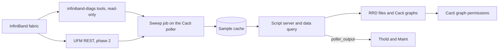

<!-- Source: README.md; SHA256: 19164b87c715ee79192e7772b7cd0029dc6c5e3c07d8ddc7dc44ebabb34ece2b -->

<!-- translations:start -->
[English](../../../README.md) | [简体中文](README.md) | [हिन्दी](../hi-IN/README.md) | [Español (España)](../es-ES/README.md) | [Español (Latinoamérica)](../es-419/README.md) | [العربية](../ar-SA/README.md)
<!-- translations:end -->

# plugin_fabric

这是一个 Cacti 1.2 插件，将 InfiniBand 端口计数器、链路宽度和速度以及拥塞指标作为普通设备、数据源和图表引入 Cacti。如果链路协商为 1X 而非 4X，其图表和 Thold 告警就会与所服务的主机一起显示，遵循 Cacti 权限，并可由 Maint 抑制。

> **状态：开发中，尚未发布。** 里程碑 2（基础）已合并到 `main`，里程碑 3（Cacti 对象和告警）正在审查。里程碑 1 根据文档和上游源代码验证了设计（PR #71）；结果及来源位于 [docs/research/](../../research)。里程碑 2 添加了插件基础：
>
> - 安装、升级、卸载和 PHP 8.2 版本检查
> - View、Operator 和 Admin 权限域及设置
> - 互连网络记录
> - `perfquery`、`ibnetdiscover` 和 `iblinkinfo` 的只读命令边界
> - 按 GUID 建立清单，包含标识冲突和重新关联建议
> - 链路状态和计数器扫描缓存
> - 清单、管理和健康状态页面
>
> 里程碑 3 添加了 Cacti 对象：
>
> - 以 Cacti 模板 XML 提供的设备、数据和图表模板，以及“Fabric Port”数据查询
> - 将节点映射到 Cacti 设备，或在确认后创建设备（[ADR 0010](../../decisions/0010-one-device-per-node.md)）
> - 用于图表的计数器数据源，以及供 Thold 使用的 GAUGE 链路状态和速率数据源（[ADR 0011](../../decisions/0011-derive-counters-and-gauge-alert-values.md)）
> - 不连续处理和将饱和的基本计数器读取为未知（[ADR 0012](../../decisions/0012-saturated-basic-counters-read-as-unknown.md)）、端口页面上的计数器有效性和图表链接，以及拥塞排名
> - 使用未经修改的 Thold v1.8.2 和 Maint v1.3 的端到端测试，以及针对模拟互连网络运行真实诊断工具的 CI 任务
>
> 在第 3 阶段支持远程数据采集器之前，只能从主采集器扫描互连网络。它已使用模拟工具和 ibsim 互连网络模拟器测试，但从未在真实 InfiniBand 互连网络上测试。需要真实网络的检查仍列在各研究页面的实时检查表中，尚未完成。本项目不隶属于 Cacti 项目。

## 访问角色

| 权限域 | 访问权限 |
| --- | --- |
| Fabric View | 现有监控页面。 |
| Fabric Operator | 监控、运维页面以及个人排查确认。 |
| Fabric Admin | 操作员访问权限及现有配置和管理操作。 |

复制升级文件后，以管理员身份打开插件页面，注册新权限域。在**配置 > 用户**或用户组中明确授予 Operator 权限域。升级保留现有 View 和 Admin 权限域的 ID 及授权。每次请求时，Admin 继承 Operator 访问权限，Operator 继承 View 访问权限；这不会向用户或组添加持久化授权。插件设置除需要 Cacti 的设置权限外，还需要 Fabric Admin 权限。

Cacti 设备权限仍限制每位用户可访问的行和操作；未映射对象需要管理员处理。凭据、配置、映射、删除和其他管理更改仍在管理页面中执行。确认记录仅在当前用户会话中有效，最多一小时，并且仅在同一观测结果仍然新鲜时有效。新出现或更改的观测结果会使确认失效。确认绝不会将失败的测量标记为健康，也不会抑制告警。

## 原因

降级的 InfiniBand 链路仍能传输流量。4X 链路重新协商为 1X 后，端口仍为“活动”，主机的 SNMP 接口图表看似正常，但紧密耦合的任务会变慢。证据在互连网络中：每个端口报告活动、启用及支持的宽度和速度，以及错误和拥塞计数器。读取这些数据需要 InfiniBand 诊断工具或互连网络管理器 API。手动运行这些工具有三个缺口：

- **没有历史。** `perfquery` 和 `iblinkinfo` 只显示当前状态，无法看出上周已降级的链路。
- **没有设备上下文。** 互连网络端口不是 Cacti 对象，因此无法将端口图表放在其服务的主机旁边。
- **无法接入 Cacti 告警。** Thold 和 Maint 作用于 Cacti 数据源和设备。

插件通过网络自身的诊断工具（以后也通过 UFM）读取互连网络，按 GUID 标识节点和端口，并将计数器和链路状态发布为 Cacti 数据源，补足这些缺口。它只读取：绝不重置计数器或改变端口状态。

## 计划范围

| 阶段 | 范围 | 里程碑 |
|---|---|---|
| 0，研究 | 版本矩阵、上游行为确认、硬件计数器行为、权限模型、MAD 预算、UFM API | [M1](https://github.com/somethingwithproof/plugin_fabric/milestone/1) |
| 1，观测 | GUID 清单、Cacti 设备、端口数据查询、计数器与链路状态数据源、Thold 告警、Maint 抑制、健康状态页面 | [M2](https://github.com/somethingwithproof/plugin_fabric/milestone/2)、[M3](https://github.com/somethingwithproof/plugin_fabric/milestone/3)、[M4](https://github.com/somethingwithproof/plugin_fabric/milestone/4) |
| 2，UFM | 只读 UFM REST 后端、凭据处理、不同后端间的标识连续性 | [M5](https://github.com/somethingwithproof/plugin_fabric/milestone/5) |
| 3，远程 | 远程数据采集器、复制、`remote_agent` 操作、大型互连网络的分片扫描 | [M6](https://github.com/somethingwithproof/plugin_fabric/milestone/6) |

范围之外：改变互连网络状态、替代互连网络或子网管理器、插件自有告警引擎、自定义守护进程或网络协议，以及以太网或 RoCE 互连网络（研究中）。

## 兼容性目标

| 组件 | 目标 |
|---|---|
| Cacti | 1.2.31 或更高版本，无需核心补丁 |
| PHP | 8.2 或更高版本；`setup.php` 在 8.0 中仍可解析，以便对不受支持的运行时明确拒绝，而不是损坏 Cacti 界面 |
| InfiniBand 工具 | rdma-core 中的 infiniband-diags；输出格式已对照 v66.0 源代码检查 |
| UFM | UFM Enterprise REST API，第 2 阶段；版本矩阵是里程碑 1 的交付项 |
| Thold、Maint | 无需更改 |

将 Cacti 脚本超时保持为默认的 25 秒或更高。数据查询读取触发的扫描将工具运行时间限制为该超时减去五秒，预留时间读取缓存并回复。预算到期时，查询返回最近的有效样本或未知值；下个周期会重试扫描。此限制也适用于 PHP 采集器。五秒或更短的超时不会留下启动工具的时间。

## 设计

- [docs/PLAN.md](../../PLAN.md) 是完整计划：架构、依赖的上游事实（含来源）与待验证假设、标识模型、计数器和链路状态规则、安全边界、性能计算、测试和风险。
- [docs/decisions/](../../decisions) 保存已做出的架构决策记录。
- [docs/REQUIREMENTS.md](../../REQUIREMENTS.md) 将每个需求 ID 映射到对应议题。

## 工作跟踪方式

- **里程碑**遵循计划。每个里程碑都有一个史诗议题，列出子议题和完成证据。
- **议题**按标签分类：`type: requirement`、`type: research`、`type: decision`、`type: epic`。需求议题包含带编号的可测试需求（`REQ-AREA-NNN`）和验收标准。
- **标签**还包括 `area:`、`phase:`、`priority:` 和 `status:`。参阅 [CONTRIBUTING.md](../../../CONTRIBUTING.md#labels)。
- [项目看板](https://github.com/users/somethingwithproof/projects/8) 显示各里程碑的全部议题。

## 贡献

请阅读 [CONTRIBUTING.md](../../../CONTRIBUTING.md)。提交需要 DCO 签署。设计讨论在议题中进行；未决决策带有 `type: decision` 标签。

## 安全

请私下报告漏洞；参阅 [SECURITY.md](../../../SECURITY.md)。

## 许可证

GNU 通用公共许可证 v2.0，与 Cacti 及其插件相同。参阅 [LICENSE](../../../LICENSE)。
