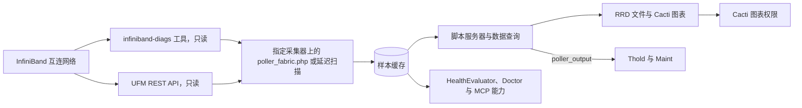

<!-- Source: README.md; SHA256: 79a16fb906f96ee79de2c719f18c38836f555440a7571a4a5ba38c64bb5b099f -->

<!-- translations:start -->
[English](../../../README.md) | [简体中文](README.md) | [हिन्दी](../hi-IN/README.md) | [Español (España)](../es-ES/README.md) | [Español (Latinoamérica)](../es-419/README.md) | [العربية (السعودية)](../ar-SA/README.md) | [Afrikaans](../af-ZA/README.md) | [አማርኛ](../am-ET/README.md) | [العربية (مصر)](../ar-EG/README.md) | [العربية (المغرب)](../ar-MA/README.md) | [বাংলা](../bn-BD/README.md) | [Bosanski](../bs-BA/README.md) | [Deutsch](../de-DE/README.md) | [فارسی](../fa-IR/README.md) | [Filipino](../fil-PH/README.md) | [Français](../fr-FR/README.md) | [Français (Maroc)](../fr-MA/README.md) | [Français (Sénégal)](../fr-SN/README.md) | [Hausa](../ha-NG/README.md) | [עברית](../he-IL/README.md) | [Hrvatski](../hr-HR/README.md) | [Bahasa Indonesia](../id-ID/README.md) | [Igbo](../ig-NG/README.md) | [Italiano](../it-IT/README.md) | [日本語](../ja-JP/README.md) | [한국어](../ko-KR/README.md) | [Malagasy](../mg-MG/README.md) | [मराठी](../mr-IN/README.md) | [Bahasa Melayu](../ms-MY/README.md) | [Nederlands](../nl-NL/README.md) | [Polski](../pl-PL/README.md) | [Português (Brasil)](../pt-BR/README.md) | [Русский](../ru-RU/README.md) | [Kinyarwanda](../rw-RW/README.md) | [Soomaali](../so-SO/README.md) | [Српски](../sr-RS/README.md) | [Svenska](../sv-SE/README.md) | [Kiswahili](../sw-KE/README.md) | [தமிழ்](../ta-IN/README.md) | [తెలుగు](../te-IN/README.md) | [ไทย](../th-TH/README.md) | [Türkçe](../tr-TR/README.md) | [Українська](../uk-UA/README.md) | [اردو](../ur-PK/README.md) | [Tiếng Việt](../vi-VN/README.md) | [isiXhosa](../xh-ZA/README.md) | [Yorùbá](../yo-NG/README.md) | [繁體中文](../zh-TW/README.md) | [isiZulu](../zu-ZA/README.md)
<!-- translations:end -->

# plugin_fabric

一个 Cacti 1.2 插件（`fabric`，版本 `0.1.0-dev`），将 InfiniBand 端口计数器、链路宽度和速度以及拥塞指标作为普通设备、数据源和图表引入 Cacti。协商为 1X 而非 4X 的链路会以图表和 Thold 告警的形式显示在其所服务的主机旁，遵循 Cacti 权限，并支持 Maint 感知和告警抑制。

> **状态：开发中，尚未发布。** 该分支已实现插件基础、Cacti 对象与告警、定时后台采集器扫描、远程采集器复制、带加密凭据库的只读 NVIDIA UFM REST 后端、配置即代码（CasC）CLI 管理以及 Cacti 生态钩子（CasC、Doctor 与 MCP / Abilities API v2）。目前仅针对模拟工具、合成 UFM 传输和 `ibsim` 互连网络模拟器（rdma-core 50.0）进行了测试，从未在物理 InfiniBand 互连网络或实时 UFM 服务器上测试。需要硬件的检查仍列在 [docs/research/](../../research/) 中。本项目不隶属于 Cacti 项目。

## 已实现功能

- **生命周期与数据库模式（v3）**：安装、幂等升级、卸载（默认保留插件表），以及在保持入口点可在 PHP 8.0 上解析的同时要求 PHP 8.2 的版本检查。
- **访问角色与页面**：`Fabric View`（`fabric.php`）、`Fabric Operator`（`fabric_operator.php`）和 `Fabric Admin`（`fabric_admin.php`、`fabric_health.php`）权限域，以及位于 **Configuration > Settings > Fabrics** 下的设置选项卡。
- **只读诊断后端（`diags`）**：严格按参数向量执行 `perfquery`、`ibnetdiscover` 和 `iblinkinfo`，基于 GUID 的清单及标识冲突检测与重新关联建议、链路状态评估以及按节点执行的计数器扫描。
- **只读 NVIDIA UFM REST 后端（`ufm`）与加密凭据库**：仅限 GET 的白名单 REST 客户端（`/ufmRest/resources/ports`、`/ufmRest/resources/systems`、`/ufmRest/monitoring/session/0/data` 及用于令牌认证的 `/ufmRestV3/...` 等效端点），将数据写入与 `diags` 相同的清单、链路状态、样本与健康表。凭据（`token` 或 `basic`）使用 AES-256-GCM 加密存储在 `plugin_fabric_secret` 中，密钥来自通过 `fabric_vault_key_file` 配置的外部 256 位密钥文件。UFM 互连网络可通过 CasC（`cli/fabric.php`）或存储库定义；Web 管理表单目前仅暴露 `diags` 字段。
- **Cacti 对象、Thold 与 Maint**：Cacti 设备、数据和图表模板（`templates/fabric-templates.xml`）、“Fabric Port”脚本服务器数据查询（`scripts/ss_fabric_ports.php`、`resource/script_server/fabric_ports.xml`）、用于 Thold 的 `DERIVE` 计数器数据源与 `GAUGE` 链路状态/速率数据源、不连续性跟踪，以及将饱和的基本计数器报告为 `U`。Maint 集成（`MaintMaintenance`）会查询 `plugin_maint_check_cacti_host()`（回退至 `is_device_in_maintenance` 钩子），将处于活动维护中的节点单独计数，并将其从失败扫描与降级端口的健康警告中排除。
- **定时扫描、分片与远程采集器**：`poller_bottom` 在后台为分配给当前采集器且已到期的互连网络启动 `poller_fabric.php`，同时支持由脚本服务器触发的延迟扫描。`INFO` 声明了 `remote_collect:1, remote_poller:1`，`poller_fabric.php` 支持确定性 GUID 分片（`--shard=K/N`），`replicate_out` 将非机密的 `plugin_fabric_fabric` 行复制到远程采集器（`poller_id >= 2`）。凭据库条目（`plugin_fabric_secret`）与外部密钥文件绝不会被复制。
- **CasC CLI 与生态钩子**：`cli/fabric.php` 支持 YAML/XML 导出、校验、预演差异规划、需确认的应用以及健康状态报告；此外还提供 `casc_register_providers`、`doctor_register_checks` 和 `abilities_register` 钩子。

## 访问角色

| 权限域 | 访问权限 |
| --- | --- |
| Fabric View | 监控清单与端口视图（`fabric.php`）。 |
| Fabric Operator | 查看权限，外加运维页面（`fabric_operator.php`）及个人排查确认。 |
| Fabric Admin | 操作员权限，外加配置、管理操作（`fabric_admin.php`）以及健康状态页面（`fabric_health.php`）。 |

复制升级文件后，以管理员身份打开“插件”页面以注册新的权限域和钩子。在 **Configuration > Users** 或用户组中明确分配 Operator 权限域。升级会保留现有的 View 和 Admin 权限域 ID 及授权。每次请求时，Admin 权限继承 Operator 权限，Operator 权限继承 View 权限；这不会向用户或组添加持久存储的授权。除 Cacti 的 Settings 权限外，插件设置还需要 Fabric Admin 权限。

Cacti 设备权限仍会限制每位用户可访问的行和操作；未映射的对象需要管理员处理。凭据、配置、映射、删除以及其他管理更改仍保留在管理页面或 CLI 中。确认仅在当前用户会话中有效，最长一小时，且仅在同一观测结果仍保持新鲜时有效。新出现或已更改的观测结果会使其失效。它们绝不会将失败的测量标记为健康，也不会抑制告警。

## 原因

降级的 InfiniBand 链路仍会传输流量。一条重新协商为 1X 的 4X 链路会让端口保持“active”状态，主机的 SNMP 接口图表看起来也正常，但紧密耦合的任务会变慢。证据就在互连网络中：每个端口都会报告其活动、启用和支持的宽度和速度，以及错误和拥塞计数器。读取这些数据需要 InfiniBand 诊断工具或互连网络管理器 API。手动运行它们会留下三个缺口：

- **没有历史记录。** `perfquery` 和 `iblinkinfo` 只显示当前状态，因此上周降级的链路不可见。
- **没有设备上下文。** 互连网络端口不是 Cacti 对象，因此无法将端口图表画在其所服务的主机旁。
- **无法接入 Cacti 告警。** Thold 和 Maint 作用于 Cacti 数据源和设备。

该插件通过 `infiniband-diags` 或 NVIDIA UFM REST API 读取互连网络，按 GUID 标识节点和端口，并将计数器和链路状态发布为 Cacti 数据源，从而填补这些缺口。它只执行读取操作：绝不重置计数器或更改端口状态。

## 运维与 CLI

### 后台采集器与手动扫描

`fabric_poller_bottom()` 会在每个采集器上于后台启动 `poller_fabric.php`，处理分配给该 `poller_id` 且已到期需要扫描的已启用互连网络。您也可以以采集器用户身份在所分配的采集器上直接运行采集器运行器或手动扫描（将 `/path/to/cacti` 替换为您的 Cacti 目录）：

```sh
php /path/to/cacti/plugins/fabric/poller_fabric.php [--fabric=ID] [--shard=K/N] [--force] [--debug]
php /path/to/cacti/plugins/fabric/fabric_sweep.php --fabric=ID [--node=GUID] [--force]
```

- `poller_fabric.php` 为本地采集器运行所有已到期的互连网络（或使用 `--fabric=ID` 指定单个互连网络），强制执行 Cacti 的进程注册表锁与 `ClaimRepository` 租约（时间预算为 `max(30, intdiv(sweep_interval, 2))` 秒），并支持 `--shard=K/N`（`0 <= K < N`）以按节点 GUID 确定性地对 `diags` 节点计数器扫描进行分片。
- `fabric_sweep.php` 对分配给本地采集器的单个已启用互连网络（或使用 `--node=GUID` 指定单个节点）运行按需扫描。`--force` 会忽略互连网络是否到期，但仍遵守认领租约。

首次发现填充清单后，请在 Fabric Admin 页面上将节点映射到 Cacti 设备。请将 Cacti 的脚本超时保持在 25 秒或更高：由数据查询读取触发的延迟扫描会将工具执行限制为 `script_timeout - 5` 秒，以便脚本服务器能够及时返回上次存储的样本或 `U`。

### NVIDIA UFM REST 后端与凭据库

`ufm` 互连网络要求使用不含内嵌凭据、查询字符串或片段的 `https://` URL。`UfmSocketTransport` 强制执行 TLS 对等方与主机名验证，拒绝重定向，并支持可选的 CA 证书包（`ufm_ca_file`）和 SHA-256 SPKI 固定（`ufm_spki_pin`）。

要在 `plugin_fabric_secret` 中存储 UFM 凭据，请在 **Configuration > Settings > Fabrics** 下配置 `fabric_vault_key_file`，指定一个由采集器用户拥有的常规文件的绝对路径（任何父目录中不得有符号链接，权限模式为 `0600`，包含 64 个十六进制字符，例如通过 `openssl rand -hex 32` 生成，或 32 个随机不可打印字节）。插件绝不会创建或写入该密钥文件，且 `replicate_out` 绝不会将 `plugin_fabric_secret` 或密钥文件复制到远程采集器。

### 配置即代码与健康 CLI

`cli/fabric.php` 以声明式 YAML 或 XML 管理插件设置和互连网络定义，并在不运行实时扫描的情况下报告具有维护感知的健康状态：

```sh
php /path/to/cacti/plugins/fabric/cli/fabric.php export [--format=yaml|xml] [--file=PATH]
php /path/to/cacti/plugins/fabric/cli/fabric.php validate --file=PATH [--format=yaml|xml]
php /path/to/cacti/plugins/fabric/cli/fabric.php plan --file=PATH [--format=yaml|xml]
php /path/to/cacti/plugins/fabric/cli/fabric.php apply --file=PATH --confirm=PLAN_HASH [--format=yaml|xml]
php /path/to/cacti/plugins/fabric/cli/fabric.php health [--format=text|json]
```

`export` 会以 `0600` 权限创建新文件，将 `fabric_vault_key_file` 脱敏为 `[REDACTED]`，并输出具名的 `ufm_credential_ref` 引用而非机密值。`plan` 和 `apply` 会拒绝内联的 `ufm_token`、`ufm_password`、`secret` 以及内联的 `fabric_vault_key_file` 值。`apply` 要求提供 `plan` 生成的完全一致的 `--confirm=PLAN_HASH`。

### 生态钩子

当存在相应的 Cacti 插件或宿主集成时，`setup.php` 会注册：

- `casc_register_providers`：导出、校验、规划并经确认后应用 `fabric` 配置（`yaml` 和 `xml`，模式 v1），并对机密进行脱敏。
- `doctor_register_checks`：提供四项只读诊断检查（`fabric.schema`、`fabric.poller_freshness`、`fabric.identity_conflicts`、`fabric.ufm_vault`）。
- `abilities_register`：在 `fabric` 类别下注册三项只读、非破坏性、幂等的能力，受 Fabric View 权限域（以及端口错误的 Cacti 设备权限）控制：`fabric-list-fabrics`、`fabric-get-health` 和 `fabric-list-port-errors`。

## 范围与边界

超出范围的内容：更改互连网络状态、重置计数器、替代互连网络管理器或子网管理器、插件自有告警引擎、自定义守护进程或网络协议，以及以太网或 RoCE 互连网络。

## 需求与兼容性

| 组件 | 目标 |
|---|---|
| Cacti | 1.2.31 或更高版本（`compat = 1.2.31`），无需核心补丁 |
| PHP | 8.2 或更高版本；入口点在 8.0 上保持可解析，并在 8.1 上拒绝激活，以便不受支持的运行时获得明确拒绝而非损坏的 Cacti 界面 |
| InfiniBand 工具 | 来自 `rdma-core` 的 `infiniband-diags`（在 CI 中使用 rdma-core 50.0 配合 `ibsim` 测试；输出格式已对照 v66.0 源码检查） |
| UFM | NVIDIA UFM Enterprise REST API（`ufmRest` 和 `ufmRestV3` 只读端点；在单元测试中针对合成传输进行了测试） |
| Thold, Maint | 无需更改；CI 会使用未修改的 Thold v1.8.2 和 Maint v1.3 运行端到端测试 |

## 开发与测试

CI 工作流（`.github/workflows/plugin-ci-workflow.yml`）在 PHP 8.2 至 8.5 上针对 Cacti `release/1.2.31` 和 `1.2.x` 运行测试，涵盖 PHP 8.0 入口点语法检查、PHP 8.1 拒绝测试、PHPStan、gettext/翻译校验、REUSE 许可检查、工作流 lint 检查、Thold/Maint 端到端回放以及 `ibsim` 互连网络模拟。

使用 Cacti 锁定的共享 Pest 插件测试套件（`CACTI_PEST_BIN`）和一次性 Cacti 数据库：

```sh
# Unit tests
"$CACTI_PEST_BIN" --configuration=phpunit.xml

# Lifecycle integration tests (disposable database only)
CACTI_PATH=/path/to/cacti FABRIC_TEST_DATABASE=disposable "$CACTI_PEST_BIN" --configuration=phpunit-integration.xml

# Static analysis (against Cacti 1.2.31)
CACTI_PATH=/path/to/cacti phpstan analyse -c phpstan.neon --no-progress

# Translation template, catalogs, and localized README checks
sh locales/build_gettext.sh --check

# Simulated ibsim fixture parser check
php tests/bin/check-ibsim-fixtures.php tests/fixtures/ibsim
```

## 设计

- [docs/PLAN.md](../../PLAN.md) 是架构与设计计划：包含附带来源的上游事实、待完成的硬件检查、标识模型、计数器和链路状态规则、安全边界、性能计算、测试以及风险。
- [docs/decisions/](../../decisions/) 保存架构决策记录。
- [docs/REQUIREMENTS.md](../../REQUIREMENTS.md) 将每个需求 ID 映射到对应议题。



## 工作跟踪方式

- **里程碑** 遵循计划中的里程碑。每个里程碑都有一个史诗议题，列出其子议题和退出证据。
- **议题** 按标签分类：`type: requirement`、`type: research`、`type: decision`、`type: epic`。需求议题声明带编号、可测试的需求（`REQ-AREA-NNN`）及验收标准。
- **标签** 还包含 `area:`、`phase:`、`priority:` 和 `status:`。参见 [CONTRIBUTING.md](../../../CONTRIBUTING.md#labels)。
- [项目看板](https://github.com/users/somethingwithproof/projects/8) 展示跨里程碑的所有议题。

## 贡献

请阅读 [CONTRIBUTING.md](../../../CONTRIBUTING.md)。提交需要包含 DCO 签署（`git commit -s`）。设计讨论在议题中进行；未决决策带有 `type: decision` 标签。

## 安全

请私下报告漏洞；参见 [SECURITY.md](../../../SECURITY.md)。

## 许可证

GNU 通用公共许可证 v2.0（GNU General Public License v2.0），与 Cacti 及其插件相同。参见 [LICENSE](../../../LICENSE)。
