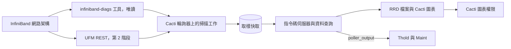

<!-- Source: README.md; SHA256: ce5af61a1bc993ec2aae6d4f22c3885694632f2b1d5eb94e2ce88b8390e96f1e -->

<!-- translations:start -->
[English](../../../README.md) | [简体中文](../zh-CN/README.md) | [हिन्दी](../hi-IN/README.md) | [Español (España)](../es-ES/README.md) | [Español (Latinoamérica)](../es-419/README.md) | [العربية (السعودية)](../ar-SA/README.md) | [Afrikaans](../af-ZA/README.md) | [አማርኛ](../am-ET/README.md) | [العربية (مصر)](../ar-EG/README.md) | [العربية (المغرب)](../ar-MA/README.md) | [বাংলা](../bn-BD/README.md) | [Bosanski](../bs-BA/README.md) | [Deutsch](../de-DE/README.md) | [فارسی](../fa-IR/README.md) | [Filipino](../fil-PH/README.md) | [Français](../fr-FR/README.md) | [Français (Maroc)](../fr-MA/README.md) | [Français (Sénégal)](../fr-SN/README.md) | [Hausa](../ha-NG/README.md) | [עברית](../he-IL/README.md) | [Hrvatski](../hr-HR/README.md) | [Bahasa Indonesia](../id-ID/README.md) | [Igbo](../ig-NG/README.md) | [Italiano](../it-IT/README.md) | [日本語](../ja-JP/README.md) | [한국어](../ko-KR/README.md) | [Malagasy](../mg-MG/README.md) | [मराठी](../mr-IN/README.md) | [Bahasa Melayu](../ms-MY/README.md) | [Nederlands](../nl-NL/README.md) | [Polski](../pl-PL/README.md) | [Português (Brasil)](../pt-BR/README.md) | [Русский](../ru-RU/README.md) | [Kinyarwanda](../rw-RW/README.md) | [Soomaali](../so-SO/README.md) | [Српски](../sr-RS/README.md) | [Svenska](../sv-SE/README.md) | [Kiswahili](../sw-KE/README.md) | [தமிழ்](../ta-IN/README.md) | [తెలుగు](../te-IN/README.md) | [ไทย](../th-TH/README.md) | [Türkçe](../tr-TR/README.md) | [Українська](../uk-UA/README.md) | [اردو](../ur-PK/README.md) | [Tiếng Việt](../vi-VN/README.md) | [isiXhosa](../xh-ZA/README.md) | [Yorùbá](../yo-NG/README.md) | [繁體中文](README.md) | [isiZulu](../zu-ZA/README.md)
<!-- translations:end -->

# plugin_fabric

這是一款 Cacti 1.2 外掛程式，可將 InfiniBand 埠計數器、鏈路寬度與速率以及擁塞指標匯入 Cacti，作為一般的裝置、資料來源與圖表。當某條鏈路協商（trained）於 1X 而非 4X 時，它便會以圖表與 Thold 警示的形式顯示在其所服務的主機旁，並受 Cacti 權限控管，同時可透過 Maint 加以抑制。

> **狀態：開發中，尚未發布正式版本。** 里程碑 2（基礎架構）已合併至 `main`，里程碑 3（Cacti 物件與警示）正進行審查中。里程碑 1 已依據文件與上游原始碼確認設計（PR #71）；相關結果與來源均收錄於 [docs/research/](../../research)。里程碑 2 新增了外掛程式的基礎架構：
>
> - 安裝、升級、解除安裝與 PHP 8.2 版本防護檢查
> - View、Operator 與 Admin 權限領域（realms），以及相關設定
> - 網路架構（fabric）記錄
> - 針對 `perfquery`、`ibnetdiscover` 與 `iblinkinfo` 的唯讀指令邊界
> - 依 GUID 建立的資產清冊，包含身分衝突偵測與重新連結建議
> - 鏈路狀態與計數器掃描快取
> - 資產清冊、管理與健康狀態頁面
>
> 里程碑 3 新增了 Cacti 物件：
>
> - 隨附於 Cacti 範本 XML 中的裝置、資料與圖表範本，以及「Fabric Port」資料查詢
> - 將節點對應至現有 Cacti 裝置，或在確認後建立新裝置（[ADR 0010](../../decisions/0010-one-device-per-node.md)）
> - 用於圖表的計數器資料來源，以及用於 Thold 的 GAUGE 鏈路狀態與速率資料來源（[ADR 0011](../../decisions/0011-derive-counters-and-gauge-alert-values.md)）
> - 不連續處理與飽和基本計數器讀取為未知值（[ADR 0012](../../decisions/0012-saturated-basic-counters-read-as-unknown.md)）、埠頁面上的計數器有效性與圖表連結，以及擁塞排行
> - 與未經修改的 Thold v1.8.2 及 Maint v1.3 進行的端對端測試，以及針對模擬網路架構執行真實診斷工具的 CI 工作
>
> 在第 3 階段支援遠端資料收集器之前，網路架構僅能從主輪詢器進行掃描。目前僅透過模擬工具與 ibsim 網路架構模擬器進行測試，尚未在真實的 InfiniBand 網路架構上測試。需要實體網路架構才能執行的檢查，仍列於各研究頁面的即時檢查（live-checks）表中為未完成狀態。本專案與 Cacti 專案無隸屬關係。

## 存取角色

| 權限領域 | 存取權限 |
| --- | --- |
| Fabric View | 現有的監控頁面。 |
| Fabric Operator | 監控權限，外加 Operations 頁面與個人分流確認（triage acknowledgments）。 |
| Fabric Admin | Operator 權限，外加現有的設定與管理操作。 |

複製升級檔案後，請以管理員身分開啟「Plugins」頁面以註冊新的權限領域。
接著於 **Configuration > Users** 或使用者群組中明確指派 Operator 權限領域。
升級時會保留現有的 View 與 Admin 權限領域 ID 及授權。每次請求時，
Admin 權限會自動繼承 Operator 權限，而 Operator 權限會自動繼承 View 權限；
此機制不會為使用者或群組額外新增儲存的授權記錄。除了 Cacti 的 Settings 權限外，
存取外掛程式設定亦須具備 Fabric Admin 權限。

Cacti 裝置權限仍會限制每位使用者可見的資料列與可用操作；未對應的物件則需要管理員權限才能操作。
憑證、設定、對應、刪除及其他管理變更仍保留在管理頁面中。
確認標記僅在目前使用者的工作階段（session）中有效，最長持續一小時，
且僅在相同觀測結果仍為最新狀態時有效。若出現新觀測或觀測結果有所變更，
確認標記即會失效。確認標記絕不會將失敗的量測標記為健康，也不會抑制警示。

## 開發動機

降級的 InfiniBand 鏈路仍可傳送流量。一條以 1X 重新協商的 4X 鏈路會讓埠維持在「active」狀態，主機的 SNMP 介面圖表看起來也一切正常，但緊密耦合（tightly coupled）的運算工作卻會變慢。證據就在網路架構之中：每個埠都會回報其作用中（active）、已啟用（enabled）與支援（supported）的寬度及速率，外加錯誤與擁塞計數器。讀取這些資訊需要透過 InfiniBand 診斷工具或網路架構管理員（fabric manager）API。若僅以手動方式執行，會留下三個缺口：

- **缺乏歷史記錄。** `perfquery` 與 `iblinkinfo` 僅顯示當下狀態，上週曾發生降級的鏈路便無從察覺。
- **缺乏裝置關聯資訊。** 網路架構埠並非 Cacti 物件，因此無法將埠的圖表繪製在其所連接的主機旁。
- **無法串接 Cacti 警示機制。** Thold 與 Maint 僅作用於 Cacti 資料來源與裝置。

本外掛程式透過自身的診斷工具（後續亦將支援透過 UFM）讀取網路架構資訊、依 GUID 識別節點與埠，並將計數器與鏈路狀態發佈為 Cacti 資料來源，藉此填補上述缺口。本外掛程式僅進行唯讀操作：絕不會重設計數器或變更埠狀態。

## 首次探索

新建的網路架構尚未包含任何節點，且僅有已對應至 Cacti 裝置的節點才會從指令碼伺服器（script server）啟動掃描。因此，首次探索必須手動執行。儲存並啟用網路架構後，請於該網路架構所指派的輪詢器上，以輪詢器的執行帳號執行一次以下指令，並將 `/path/to/cacti` 替換為您的 Cacti 目錄（使用絕對路徑亦可透過 cron 執行）：

```
php /path/to/cacti/plugins/fabric/fabric_sweep.php --fabric=ID --force
```

執行後資產清冊即會填入資料。請前往「Fabric Admin」頁面將節點對應至 Cacti 裝置；後續的掃描便會從資料查詢啟動。當網路架構中沒有任何已對應的節點時，系統不會自動更新其資產清冊，因此可視需要（亦可透過 cron）再次執行相同指令，以記錄新增或遺失的節點。若已啟用的網路架構尚未進行探索或尚無已對應的節點，健康狀態頁面亦會顯示此指令。

## 規劃範圍

| 階段 | 範圍 | 里程碑 |
|---|---|---|
| 0，研究 | 版本相容矩陣、上游行為確認、硬體上的計數器行為、權限模型、MAD 預算、UFM API | [M1](https://github.com/somethingwithproof/plugin_fabric/milestone/1) |
| 1，觀測 | 依 GUID 建立資產清冊、Cacti 裝置、埠資料查詢、計數器與鏈路狀態資料來源、Thold 警示、Maint 抑制、健康狀態頁面 | [M2](https://github.com/somethingwithproof/plugin_fabric/milestone/2), [M3](https://github.com/somethingwithproof/plugin_fabric/milestone/3), [M4](https://github.com/somethingwithproof/plugin_fabric/milestone/4) |
| 2，UFM | 唯讀 UFM REST 後端、憑證處理、不同後端之間的身分連續性 | [M5](https://github.com/somethingwithproof/plugin_fabric/milestone/5) |
| 3，遠端 | 遠端資料收集器、資料複寫、`remote_agent` 操作、針對大型網路架構的分片掃描 | [M6](https://github.com/somethingwithproof/plugin_fabric/milestone/6) |

不屬於本專案範圍：變更網路架構狀態、取代網路架構管理員（fabric manager）或子網路管理員（subnet manager）、由外掛程式自行維護的警示引擎、自訂常駐程式（daemon）或網路協定，以及乙太網路或 RoCE 架構（僅屬研究範疇）。

## 相容性目標

| 元件 | 目標 |
|---|---|
| Cacti | 1.2.31 或更新版本，無須修改核心程式 |
| PHP | 8.2 或更新版本；`setup.php` 維持與 8.0 語法相容，使不支援的執行環境能明確顯示拒絕訊息，而非導致 Cacti 介面毀損 |
| InfiniBand 工具 | 來自 rdma-core 的 infiniband-diags；輸出格式已依據 v66.0 原始碼驗證 |
| UFM | UFM Enterprise REST API，第 2 階段；版本矩陣為里程碑 1 的交付項目 |
| Thold, Maint | 無須進行任何修改 |

請將 Cacti 的指令碼逾時（script timeout）維持在預設的 25 秒或更高。由資料查詢讀取所觸發的掃描，會將工具執行時間限制在該逾時時間減去五秒，以保留讀取快取與回覆的時間。當時間預算耗盡時，查詢會傳回最後一筆有效取樣或未知值；下一個週期將重試掃描。此限制同樣適用於 PHP 輪詢器。若逾時設定為五秒或更短，將沒有足夠時間啟動工具。

## 設計

- [docs/PLAN.md](../../PLAN.md) 為完整規劃文件：包含系統架構、所依據的上游事實（附來源）與尚待確認的假設、身分模型、計數器與鏈路狀態規則、安全邊界、效能計算、測試與風險。
- [docs/decisions/](../../decisions) 存放已拍板決策的架構決策記錄（ADR）。
- [docs/REQUIREMENTS.md](../../REQUIREMENTS.md) 將每個需求 ID 對應至其所屬的 Issue。



## 工作追蹤方式

- **里程碑（Milestones）** 依循規劃文件中的里程碑劃分。每個里程碑皆設有一個 Epic Issue，列出其子 Issue 與完成佐證。
- **Issues** 透過標籤分類：`type: requirement`、`type: research`、`type: decision`、`type: epic`。需求類 Issue 會載明經編號、可測試的需求（`REQ-AREA-NNN`）與驗收條件。
- **標籤（Labels）** 亦包含 `area:`、`phase:`、`priority:` 與 `status:` 前綴。請參閱 [CONTRIBUTING.md](../../../CONTRIBUTING.md#labels)。
- [專案看板](https://github.com/users/somethingwithproof/projects/8) 顯示跨里程碑的所有 Issue。

## 貢獻指南

請閱讀 [CONTRIBUTING.md](../../../CONTRIBUTING.md)。提交（commit）須包含 DCO 簽署（sign-off）。設計討論於 Issue 中進行；尚未定案的決策均標有 `type: decision` 標籤。

## 安全性

請以非公開方式回報漏洞；詳見 [SECURITY.md](../../../SECURITY.md)。

## 授權條款

採用 GNU General Public License v2.0，與 Cacti 及其外掛程式相同。詳見 [LICENSE](../../../LICENSE)。
