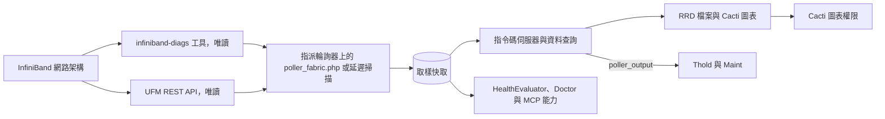

<!-- Source: README.md; SHA256: 79a16fb906f96ee79de2c719f18c38836f555440a7571a4a5ba38c64bb5b099f -->

<!-- translations:start -->
[English](../../../README.md) | [简体中文](../zh-CN/README.md) | [हिन्दी](../hi-IN/README.md) | [Español (España)](../es-ES/README.md) | [Español (Latinoamérica)](../es-419/README.md) | [العربية (السعودية)](../ar-SA/README.md) | [Afrikaans](../af-ZA/README.md) | [አማርኛ](../am-ET/README.md) | [العربية (مصر)](../ar-EG/README.md) | [العربية (المغرب)](../ar-MA/README.md) | [বাংলা](../bn-BD/README.md) | [Bosanski](../bs-BA/README.md) | [Deutsch](../de-DE/README.md) | [فارسی](../fa-IR/README.md) | [Filipino](../fil-PH/README.md) | [Français](../fr-FR/README.md) | [Français (Maroc)](../fr-MA/README.md) | [Français (Sénégal)](../fr-SN/README.md) | [Hausa](../ha-NG/README.md) | [עברית](../he-IL/README.md) | [Hrvatski](../hr-HR/README.md) | [Bahasa Indonesia](../id-ID/README.md) | [Igbo](../ig-NG/README.md) | [Italiano](../it-IT/README.md) | [日本語](../ja-JP/README.md) | [한국어](../ko-KR/README.md) | [Malagasy](../mg-MG/README.md) | [मराठी](../mr-IN/README.md) | [Bahasa Melayu](../ms-MY/README.md) | [Nederlands](../nl-NL/README.md) | [Polski](../pl-PL/README.md) | [Português (Brasil)](../pt-BR/README.md) | [Русский](../ru-RU/README.md) | [Kinyarwanda](../rw-RW/README.md) | [Soomaali](../so-SO/README.md) | [Српски](../sr-RS/README.md) | [Svenska](../sv-SE/README.md) | [Kiswahili](../sw-KE/README.md) | [தமிழ்](../ta-IN/README.md) | [తెలుగు](../te-IN/README.md) | [ไทย](../th-TH/README.md) | [Türkçe](../tr-TR/README.md) | [Українська](../uk-UA/README.md) | [اردو](../ur-PK/README.md) | [Tiếng Việt](../vi-VN/README.md) | [isiXhosa](../xh-ZA/README.md) | [Yorùbá](../yo-NG/README.md) | [繁體中文](README.md) | [isiZulu](../zu-ZA/README.md)
<!-- translations:end -->

# plugin_fabric

這是一款 Cacti 1.2 外掛程式（`fabric`，版本 `0.1.0-dev`），可將 InfiniBand 埠計數器、鏈路寬度與速率以及擁塞指標匯入 Cacti，作為一般的裝置、資料來源與圖表。當某條鏈路協商（trained）於 1X 而非 4X 時，它便會以圖表與 Thold 警示的形式顯示在其所服務的主機旁，並受 Cacti 權限控管，同時具備 Maint 維護感知與警示抑制功能。

> **狀態：開發中，尚未發布正式版本。** 本分支實作了外掛程式基礎架構、Cacti 物件與警示、排程背景輪詢器掃描、遠端收集器資料複寫、具備加密憑證保險庫的唯讀 NVIDIA UFM REST 後端、Configuration-as-Code（CasC）CLI 管理，以及 Cacti 生態系統掛鉤（CasC、Doctor 與 MCP / Abilities API v2）。目前僅針對模擬工具、合成 UFM 傳輸層及 `ibsim` 網路架構模擬器（rdma-core 50.0）進行測試，尚未在實體 InfiniBand 網路架構或運作中的 UFM 伺服器上測試。需要實體硬體才能執行的檢查仍列於 [docs/research/](../../research/) 為未完成狀態。本專案與 Cacti 專案無隸屬關係。

## 已實作項目

- **生命週期與資料庫結構（v3）**：安裝、具冪等性的升級、解除安裝（預設保留外掛程式資料表），以及 PHP 8.2 版本需求防護檢查，同時確保進入點在 PHP 8.0 上仍可解析。
- **存取角色與頁面**：`Fabric View`（`fabric.php`）、`Fabric Operator`（`fabric_operator.php`）與 `Fabric Admin`（`fabric_admin.php`、`fabric_health.php`）權限領域，外加位於 **Configuration > Settings > Fabrics** 下的設定分頁。
- **唯讀診斷後端（`diags`）**：針對 `perfquery`、`ibnetdiscover` 與 `iblinkinfo` 採用嚴格的引數向量執行、依 GUID 建立並具備身分衝突偵測與重新連結建議的資產清冊、鏈路狀態評估，以及逐節點計數器掃描。
- **唯讀 NVIDIA UFM REST 後端（`ufm`）與加密保險庫**：僅允許 GET 且採白名單機制的 REST 用戶端（`/ufmRest/resources/ports`、`/ufmRest/resources/systems`、`/ufmRest/monitoring/session/0/data`，以及用於權杖驗證的 `/ufmRestV3/...` 對應端點），將資料寫入與 `diags` 相同的資產清冊、鏈路狀態、取樣與健康狀態資料表。憑證（`token` 或 `basic`）會使用透過 `fabric_vault_key_file` 設定的外部 256 位元金鑰檔案，以 AES-256-GCM 加密後儲存於 `plugin_fabric_secret`。UFM 網路架構可透過 CasC（`cli/fabric.php`）或儲存庫（repositories）定義；網頁管理表單目前提供 `diags` 欄位。
- **Cacti 物件、Thold 與 Maint**：Cacti 裝置、資料與圖表範本（`templates/fabric-templates.xml`）、「Fabric Port」指令碼伺服器資料查詢（`scripts/ss_fabric_ports.php`、`resource/script_server/fabric_ports.xml`）、供 Thold 使用的 `DERIVE` 計數器資料來源與 `GAUGE` 鏈路狀態/速率資料來源、不連續追蹤，以及將飽和的基本計數器回報為 `U`。Maint 整合（`MaintMaintenance`）會查詢 `plugin_maint_check_cacti_host()`（若不存在則退回至 `is_device_in_maintenance` 掛鉤），使處於作用中維護狀態的節點得以分開計算，並從掃描失敗與降級埠的健康警告中排除。
- **排程掃描、分片與遠端收集器**：除了由指令碼伺服器觸發的延遲（lazy）掃描外，`poller_bottom` 會在背景啟動 `poller_fabric.php`，針對指派給目前輪詢器且已到期的啟用網路架構執行掃描。`INFO` 宣告 `remote_collect:1, remote_poller:1`，`poller_fabric.php` 支援決定性的 GUID 分片（`--shard=K/N`），而 `replicate_out` 會將非機密的 `plugin_fabric_fabric` 資料列複寫至遠端收集器（`poller_id >= 2`）。保險庫項目（`plugin_fabric_secret`）與外部金鑰檔案絕不會被複寫。
- **CasC CLI 與生態系統掛鉤**：提供 `cli/fabric.php` 執行 YAML/XML 匯出、驗證、預演（dry-run）差異規劃、需經確認的套用以及健康狀態報告，並註冊 `casc_register_providers`、`doctor_register_checks` 與 `abilities_register` 掛鉤。

## 存取角色

| 權限領域 | 存取權限 |
| --- | --- |
| Fabric View | 監控資產清冊與埠檢視（`fabric.php`）。 |
| Fabric Operator | View 權限，外加 Operations 頁面（`fabric_operator.php`）與個人分流確認（triage acknowledgments）。 |
| Fabric Admin | Operator 權限，外加設定、管理操作（`fabric_admin.php`）與健康狀態頁面（`fabric_health.php`）。 |

複製升級檔案後，請以管理員身分開啟「Plugins」頁面以註冊新的權限領域與掛鉤。接著於 **Configuration > Users** 或使用者群組中明確指派 Operator 權限領域。升級時會保留現有的 View 與 Admin 權限領域 ID 及授權。每次請求時，Admin 權限會自動繼承 Operator 權限，而 Operator 權限會自動繼承 View 權限；此機制不會為使用者或群組額外新增儲存的授權記錄。除了 Cacti 的 Settings 權限外，存取外掛程式設定亦須具備 Fabric Admin 權限。

Cacti 裝置權限會限制每位使用者可見的資料列與可用操作；未對應的物件則需要管理員權限才能操作。憑證、設定、對應、刪除及其他管理變更仍保留在管理頁面或 CLI 中。確認標記僅在目前使用者的工作階段（session）中有效，最長持續一小時，且僅在相同觀測結果仍為最新狀態時有效。若出現新觀測或觀測結果有所變更，確認標記即會失效。確認標記絕不會將失敗的量測標記為健康，也不會抑制警示。

## 開發動機

降級的 InfiniBand 鏈路仍可傳送流量。一條以 1X 重新協商的 4X 鏈路會讓埠維持在「active」狀態，主機的 SNMP 介面圖表看起來也一切正常，但緊密耦合（tightly coupled）的運算工作卻會變慢。證據就在網路架構之中：每個埠都會回報其作用中（active）、已啟用（enabled）與支援（supported）的寬度及速率，外加錯誤與擁塞計數器。讀取這些資訊需要透過 InfiniBand 診斷工具或網路架構管理員（fabric manager）API。若僅以手動方式執行，會留下三個缺口：

- **缺乏歷史記錄。** `perfquery` 與 `iblinkinfo` 僅顯示當下狀態，上週曾發生降級的鏈路便無從察覺。
- **缺乏裝置關聯資訊。** 網路架構埠並非 Cacti 物件，因此無法將埠的圖表繪製在其所服務的主機旁。
- **無法串接 Cacti 警示機制。** Thold 與 Maint 作用於 Cacti 資料來源與裝置。

本外掛程式透過 `infiniband-diags` 或 NVIDIA UFM REST API 讀取網路架構資訊、依 GUID 識別節點與埠，並將計數器與鏈路狀態發佈為 Cacti 資料來源，藉此填補上述缺口。本外掛程式僅進行唯讀操作：絕不會重設計數器或變更埠狀態。

## 操作與 CLI

### 背景輪詢器與手動掃描

`fabric_poller_bottom()` 會在每個輪詢器上，於背景啟動 `poller_fabric.php`，處理指派給該 `poller_id` 且已屆掃描時間的已啟用網路架構。您也可以直接於指派的輪詢器上，以輪詢器使用者身分執行輪詢器執行檔或手動掃描（請將 `/path/to/cacti` 替換為您的 Cacti 目錄）：

```sh
php /path/to/cacti/plugins/fabric/poller_fabric.php [--fabric=ID] [--shard=K/N] [--force] [--debug]
php /path/to/cacti/plugins/fabric/fabric_sweep.php --fabric=ID [--node=GUID] [--force]
```

- `poller_fabric.php` 會執行本地輪詢器所有已到期的網路架構（或透過 `--fabric=ID` 指定單一網路架構），強制執行 Cacti 的行程登錄鎖定與 `ClaimRepository` 租約，時間預算為 `max(30, intdiv(sweep_interval, 2))` 秒，並支援 `--shard=K/N`（`0 <= K < N`），依據節點 GUID 以決定性方式對 `diags` 節點計數器掃描進行分片。
- `fabric_sweep.php` 會對指派給本地輪詢器的單一已啟用網路架構（或透過 `--node=GUID` 指定單一節點）執行隨選掃描。`--force` 會忽略網路架構是否已屆掃描時間，但仍遵守鎖定宣告。

在首次探索填入資產清冊後，請前往「Fabric Admin」頁面將節點對應至 Cacti 裝置。請將 Cacti 的指令碼逾時維持在 25 秒或更高：由資料查詢讀取觸發的延遲掃描，會將工具執行時間限制在 `script_timeout - 5` 秒，以便指令碼伺服器能及時傳回最後儲存的取樣或 `U`。

### NVIDIA UFM REST 後端與憑證保險庫

`ufm` 網路架構需要不包含內嵌憑證、查詢字串或片段的 `https://` URL。`UfmSocketTransport` 會強制執行 TLS 對等端與主機名稱驗證、拒絕重新導向，並支援選用的 CA 憑證套件（`ufm_ca_file`）與 SHA-256 SPKI 釘選（`ufm_spki_pin`）。

若要將 UFM 憑證儲存於 `plugin_fabric_secret`，請在 **Configuration > Settings > Fabrics** 下設定 `fabric_vault_key_file`，指定由輪詢器使用者擁有的常規檔案之絕對路徑（任何上層目錄皆不得包含符號連結，權限模式為 `0600`，內容為 64 個十六進位字元如 `openssl rand -hex 32` 的輸出，或 32 個不可列印的隨機位元組）。本外掛程式絕不會建立或寫入金鑰檔案，且 `replicate_out` 絕不會將 `plugin_fabric_secret` 或金鑰檔案複寫至遠端輪詢器。

### Configuration-as-Code 與健康狀態 CLI

`cli/fabric.php` 以宣告式方式透過 YAML 或 XML 管理外掛程式設定與網路架構定義，並在不執行即時掃描的情況下回報具備維護感知的健康狀態：

```sh
php /path/to/cacti/plugins/fabric/cli/fabric.php export [--format=yaml|xml] [--file=PATH]
php /path/to/cacti/plugins/fabric/cli/fabric.php validate --file=PATH [--format=yaml|xml]
php /path/to/cacti/plugins/fabric/cli/fabric.php plan --file=PATH [--format=yaml|xml]
php /path/to/cacti/plugins/fabric/cli/fabric.php apply --file=PATH --confirm=PLAN_HASH [--format=yaml|xml]
php /path/to/cacti/plugins/fabric/cli/fabric.php health [--format=text|json]
```

`export` 會以 `0600` 權限建立新檔案，將 `fabric_vault_key_file` 遮罩為 `[REDACTED]`，並輸出具名的 `ufm_credential_ref` 參照而非機密內容。`plan` 與 `apply` 會拒絕內嵌的 `ufm_token`、`ufm_password`、`secret` 及內嵌的 `fabric_vault_key_file` 值。`apply` 必須提供與 `plan` 所產生完全一致的 `--confirm=PLAN_HASH`。

### 生態系統掛鉤

當對應的 Cacti 外掛程式或主機整合存在時，`setup.php` 會註冊：

- `casc_register_providers`：匯出、驗證、規劃並經確認後套用 `fabric` 組態（`yaml` 與 `xml`，架構 v1），並附帶機密遮罩。
- `doctor_register_checks`：提供四項唯讀診斷檢查（`fabric.schema`、`fabric.poller_freshness`、`fabric.identity_conflicts`、`fabric.ufm_vault`）。
- `abilities_register`：在 `fabric` 分類下註冊三項唯讀、非破壞性且具冪等性的能力，受 Fabric View 權限領域（以及埠錯誤所需的 Cacti 裝置權限）控管：`fabric-list-fabrics`、`fabric-get-health` 與 `fabric-list-port-errors`。

## 範圍與邊界

不屬於本專案範圍：變更網路架構狀態、重設計數器、取代網路架構管理員（fabric manager）或子網路管理員（subnet manager）、由外掛程式自行維護的警示引擎、自訂常駐程式（daemon）或網路協定，以及乙太網路或 RoCE 架構。

## 需求與相容性

| 元件 | 目標 |
|---|---|
| Cacti | 1.2.31 或更新版本（`compat = 1.2.31`），無須修改核心程式 |
| PHP | 8.2 或更新版本；進入點維持與 8.0 語法相容並在 8.1 上拒絕啟用，使不支援的執行環境能收到拒絕訊息，而非導致 Cacti 介面毀損 |
| InfiniBand 工具 | 來自 `rdma-core` 的 `infiniband-diags`（已在 CI 中於 `ibsim` 下搭配 rdma-core 50.0 測試；輸出格式已依據 v66.0 原始碼檢查） |
| UFM | NVIDIA UFM Enterprise REST API（`ufmRest` 與 `ufmRestV3` 唯讀端點；在單元測試中針對合成傳輸層進行測試） |
| Thold, Maint | 無須進行任何修改；CI 會與未經修改的 Thold v1.8.2 及 Maint v1.3 執行端對端測試 |

## 開發與測試

CI 工作流程（`.github/workflows/plugin-ci-workflow.yml`）會針對 Cacti `release/1.2.31` 與 `1.2.x` 測試 PHP 8.2 至 8.5、PHP 8.0 進入點語法檢查、PHP 8.1 拒絕啟用、PHPStan、gettext/翻譯驗證、REUSE 授權檢查、工作流程語法檢查、Thold/Maint 端對端重播以及 `ibsim` 網路架構模擬。

搭配 Cacti 鎖定的共用 Pest 外掛程式測試框架（`CACTI_PEST_BIN`）與可拋棄式 Cacti 資料庫：

```sh
# Unit tests
"$CACTI_PEST_BIN" --configuration=phpunit.xml

# Lifecycle integration tests (disposable database only)
CACTI_PATH=/path/to/cacti FABRIC_TEST_DATABASE=disposable "$CACTI_PEST_BIN" --configuration=phpunit-integration.xml

# Static analysis (against Cacti 1.2.31)
CACTI_PATH=/path/to/cacti phpstan analyse -c phpstan.neon --no-progress

# Translation template, catalogs, and localized README checks
sh locales/build_gettext.sh --check

# Simulated ibsim fixture parser check
php tests/bin/check-ibsim-fixtures.php tests/fixtures/ibsim
```

## 設計

- [docs/PLAN.md](../../PLAN.md) 為架構與設計規劃文件：附來源的上游事實、尚待執行的硬體檢查、身分模型、計數器與鏈路狀態規則、安全邊界、效能計算、測試與風險。
- [docs/decisions/](../../decisions/) 存放架構決策記錄。
- [docs/REQUIREMENTS.md](../../REQUIREMENTS.md) 將每個需求 ID 對應至其所屬的 Issue。



## 工作追蹤方式

- **里程碑（Milestones）** 依循規劃文件中的里程碑劃分。每個里程碑皆設有一個 Epic Issue，列出其子 Issue 與完成佐證。
- **Issues** 透過標籤分類：`type: requirement`、`type: research`、`type: decision`、`type: epic`。需求類 Issue 會載明經編號、可測試的需求（`REQ-AREA-NNN`）與驗收條件。
- **標籤（Labels）** 亦包含 `area:`、`phase:`、`priority:` 與 `status:`。請參閱 [CONTRIBUTING.md](../../../CONTRIBUTING.md#labels)。
- [專案看板](https://github.com/users/somethingwithproof/projects/8) 顯示跨里程碑的所有 Issue。

## 貢獻指南

請閱讀 [CONTRIBUTING.md](../../../CONTRIBUTING.md)。提交（commit）須包含 DCO 簽署（`git commit -s`）。設計討論於 Issue 中進行；尚未定案的決策均標有 `type: decision` 標籤。

## 安全性

請以非公開方式回報漏洞；詳見 [SECURITY.md](../../../SECURITY.md)。

## 授權條款

GNU General Public License v2.0，與 Cacti 及其外掛程式相同。詳見 [LICENSE](../../../LICENSE)。
