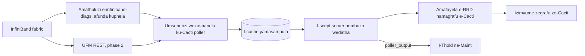

<!-- Source: README.md; SHA256: ce5af61a1bc993ec2aae6d4f22c3885694632f2b1d5eb94e2ce88b8390e96f1e -->

<!-- translations:start -->
[English](../../../README.md) | [简体中文](../zh-CN/README.md) | [हिन्दी](../hi-IN/README.md) | [Español (España)](../es-ES/README.md) | [Español (Latinoamérica)](../es-419/README.md) | [العربية (السعودية)](../ar-SA/README.md) | [Afrikaans](../af-ZA/README.md) | [አማርኛ](../am-ET/README.md) | [العربية (مصر)](../ar-EG/README.md) | [العربية (المغرب)](../ar-MA/README.md) | [বাংলা](../bn-BD/README.md) | [Deutsch](../de-DE/README.md) | [فارسی](../fa-IR/README.md) | [Filipino](../fil-PH/README.md) | [Français](../fr-FR/README.md) | [Français (Maroc)](../fr-MA/README.md) | [Français (Sénégal)](../fr-SN/README.md) | [Hausa](../ha-NG/README.md) | [עברית](../he-IL/README.md) | [Bahasa Indonesia](../id-ID/README.md) | [Igbo](../ig-NG/README.md) | [Italiano](../it-IT/README.md) | [日本語](../ja-JP/README.md) | [한국어](../ko-KR/README.md) | [Malagasy](../mg-MG/README.md) | [मराठी](../mr-IN/README.md) | [Bahasa Melayu](../ms-MY/README.md) | [Nederlands](../nl-NL/README.md) | [Polski](../pl-PL/README.md) | [Português (Brasil)](../pt-BR/README.md) | [Русский](../ru-RU/README.md) | [Kinyarwanda](../rw-RW/README.md) | [Soomaali](../so-SO/README.md) | [Svenska](../sv-SE/README.md) | [Kiswahili](../sw-KE/README.md) | [தமிழ்](../ta-IN/README.md) | [తెలుగు](../te-IN/README.md) | [ไทย](../th-TH/README.md) | [Türkçe](../tr-TR/README.md) | [Українська](../uk-UA/README.md) | [اردو](../ur-PK/README.md) | [Tiếng Việt](../vi-VN/README.md) | [isiXhosa](../xh-ZA/README.md) | [Yorùbá](../yo-NG/README.md) | [繁體中文](../zh-TW/README.md) | [isiZulu](README.md)
<!-- translations:end -->

# plugin_fabric

I-plugin ye-Cacti 1.2 eletha izibali zezimbobo ze-InfiniBand, ububanzi nesivinini sokuxhumana, kanye nezinkomba zokuminyana ku-Cacti njengamadivayisi ajwayelekile, imithombo yedatha, namagrafu. Ukuxhumana okuqeqeshwe ku-1X esikhundleni se-4X bese kuvela njengegrafu kanye nesixwayiso se-Thold eceleni kwe-host ekusebenzelayo, ngaphansi kwezimvume ze-Cacti, lapho i-Maint ikwazi ukukucindezela.

> **Isimo: isathuthukiswa, akukho ukukhishwa okwamanje.** I-Milestone 2 (isisekelo) ihlanganiswe ku-`main`, kanti i-milestone 3 (izinto ze-Cacti nezixwayiso) isabuyekezwa. I-Milestone 1 iqinisekise ukwakheka ngokubhekisela kumibhalo kanye nekhodi yomthombo engaphezulu (PR #71); imiphumela, kanye nemithombo, iku-[docs/research/](../../research). I-Milestone 2 yengeza isisekelo se-plugin:
>
> - ukufaka, ukuthuthukisa, ukukhipha, kanye nesivikelo se-PHP 8.2
> - izindawo zokufinyelela ze-View, Operator ne-Admin, kanye nezilungiselelo
> - amarekhodi e-fabric
> - umngcele wemiyalo efunda kuphela ye-`perfquery`, `ibnetdiscover`, ne-`iblinkinfo`
> - uhlu lwempahla nge-GUID, olunokungqubuzana kobunikazi neziphakamiso zokuxhumanisa kabusha
> - isimo sokuxhumana kanye ne-cache yokushanela izibali
> - amakhasi ohlu lwempahla, okuphatha, kanye nempilo
>
> I-Milestone 3 yengeza izinto ze-Cacti:
>
> - izifanekiso zedivayisi, zedatha, nezegrafu ezithunyelwa njenge-XML yesifanekiso se-Cacti, kanye nombuzo wedatha we-"Fabric Port"
> - ukuhlanganisa i-node nedivayisi ye-Cacti, noma ukudala eyodwa ngokuqinisekiswa ([ADR 0010](../../decisions/0010-one-device-per-node.md))
> - imithombo yedatha yezibali zamagrafu, kanye nesimo sokuxhumana se-GAUGE nemithombo yedatha yesilinganiso ye-Thold ([ADR 0011](../../decisions/0011-derive-counters-and-gauge-alert-values.md))
> - ukuphathwa kokuphazamiseka kanye nezibali eziyisisekelo ezigcwele ezifundeka njengezingaziwa ([ADR 0012](../../decisions/0012-saturated-basic-counters-read-as-unknown.md)), ukufaneleka kwezibali nezixhumanisi zamagrafu ekhasini lembobo, kanye nokuhlelwa kokuminyana
> - ukuhlolwa kokuphela-kuya-ekupheleni nge-Thold v1.8.2 ne-Maint v1.3 engashintshiwe, kanye nomsebenzi we-CI osebenzisa amathuluzi angempela okuxilonga ku-fabric elingisiwe
>
> I-fabric ingashanelwa kuphela kusukela ku-poller eyinhloko kuze kube yilapho abaqoqi bedatha abakude besekelwa ku-phase 3. Ihlolwe ngamathuluzi okuzenzisa kanye nesilingisi se-fabric i-ibsim, ayikaze ihlolwe ku-InfiniBand fabric yangempela. Ukuhlolwa okudinga i-fabric kuhlala kuvuliwe etafuleni lokuhlola okubukhoma ekhasini ngalinye locwaningo. Le phrojekthi ayihlangene nephrojekthi ye-Cacti.

## Izindima zokufinyelela

| Umkhakha | Ukufinyelela |
| --- | --- |
| Fabric View | Amakhasi okugada akhona. |
| Fabric Operator | Ukugada kanye nekhasi le-Operations nokuvuma kokuhlola komuntu siqu. |
| Fabric Admin | Ukufinyelela kwe-Operator kanye nezilungiselelo ezikhona nezenzo zokuphatha. |

Ngemva kokukopisha amafayela okuthuthukisa, vula ikhasi le-Plugins njengomphathi ukuze ubhalise
umkhakha omusha. Yabela umkhakha we-Operator ngokucacile ngaphansi kwe-**Configuration > Users** noma amaqembu abasebenzisi.
Ukuthuthukisa kugcina ama-ID emikhakha ye-View ne-Admin akhona kanye nezimvume. Ukufinyelela kwe-Admin
kuzuza ukufinyelela kwe-Operator, futhi ukufinyelela kwe-Operator kuzuza ukufinyelela kwe-View esicelweni ngasinye;
lokhu akwengezi izimvume ezigciniwe kubasebenzisi noma kumaqembu. Izilungiselelo ze-plugin zidinga futhi
ukufinyelela kwe-Fabric Admin ngaphezu kwemvume ye-Settings ye-Cacti.

Izimvume zedivayisi ye-Cacti zisalinganisa imigqa nezenzo ezitholakalayo kumsebenzisi ngamunye; izinto ezingahlanganisiwe zidinga umphathi.
Imininingwane yokuqinisekisa, ukumisa, ukuhlanganisa, ukususa kanye nezinye izinqubo zokuphatha
zihlala emakhasini okuphatha. Ukuvuma kuhlala kuphela kusikhathi seseshini yomsebenzisi
wamanje, isikhathi esingeqi ehoreni elilodwa futhi kuphela ngesikhathi ukubhekwa okufanayo kusakusha.
Ukubhekwa okusha noma okushintshile kuyakwenqabela. Akulokothi kumake ukukala okuhlulekile
njengokunempilo noma kucindezele izixwayiso.

## Kungani

Ukuxhumana kwe-InfiniBand okonakele kusadlulisa ithrafikhi. Ukuxhumana kwe-4X okuziqeqesha kabusha ku-1X kushiya imbobo "isebenza", futhi amagrafu esibonisi se-SNMP se-host abukeka ejwayelekile, kodwa imisebenzi ehlanganiswe ngokuqinile iyehla ngesivinini. Ubufakazi buku-fabric: imbobo ngayinye ibika ububanzi nesivinini sayo esisebenzayo, esinikwe amandla, nesisekelwayo, kanye nezibali zamaphutha nokuminyana. Ukukufunda kudinga amathuluzi okuxilonga e-InfiniBand noma i-API yomphathi we-fabric. Uma kwenziwa ngesandla, kushiya izikhala ezintathu:

- **Awukho umlando.** I-`perfquery` ne-`iblinkinfo` zibonisa okwamanje, ngakho ukuxhumana okonakale ngesonto eledlule akubonakali.
- **Ayikho ingqikithi yedivayisi.** Izimbobo ze-fabric azizona izinto ze-Cacti, ngakho imbobo ngeke idwetshwe njengegrafu eceleni kwe-host eyiphakelayo.
- **Ayikho indlela eya ezixwayisweni ze-Cacti.** I-Thold ne-Maint zisebenza emithonjeni yedatha nakumadivayisi e-Cacti.

Le plugin ivala lezi zikhala ngokufunda i-fabric ngamathuluzi ayo okuxilonga (kanti kamuva nge-UFM), ihlonza ama-node nezimbobo nge-GUID, futhi ishicilele izibali nesimo sokuxhumana njengemithombo yedatha ye-Cacti. Ifunda kuphela: ayilokothi isethe kabusha izibali noma ishintshe isimo sembobo.

## Ukutholwa kokuqala

I-fabric entsha ayinazo ama-node, futhi ukushanela kuqala kusukela ku-script server kuphela ku-node ehlanganiswe nedivayisi ye-Cacti. Ngakho-ke ukutholwa kokuqala kuyisinyathelo sesandla. Ngemva kokulondoloza i-fabric enikwe amandla, sebenzisa lokhu kanye ku-poller leyo fabric eyabelwe kuyo, njenge-akhawunti ye-poller, kuthi `/path/to/cacti` kushintshwe ngomkhombandlela wakho we-Cacti (indlela ephelele iyasebenza futhi kusukela ku-cron):

```
php /path/to/cacti/plugins/fabric/fabric_sweep.php --fabric=ID --force
```

Uhlu lwempahla lube selugcwala. Hlanganisa ama-node namadivayisi e-Cacti ekhasini le-Fabric Admin; ukushanela okulandelayo kuqala kusukela kumbuzo wedatha. Ngenkathi kungekho i-node ye-fabric ehlanganisiwe, akukho lutho oluvuselela uhlu lwayo lwempahla, ngakho sebenzisa umyalo ofanayo futhi, kusukela ku-cron uma uthanda, ukuze urekhode ama-node amasha noma angekho. Ikhasi lempilo libonisa lo myalo ku-fabric enikwe amandla engakatholwa noma engenayo i-node ehlanganisiwe.

## Ububanzi obuhleliwe

| Isigaba | Ububanzi | Ama-milestone |
|---|---|---|
| 0, ucwaningo | I-matrix yezinguqulo, ukuqinisekiswa kokuziphatha kwangaphezulu, ukuziphatha kwezibali kuhadiwe, imodeli yamalungelo, isabelomali se-MAD, i-API ye-UFM | [M1](https://github.com/somethingwithproof/plugin_fabric/milestone/1) |
| 1, ukubuka | Uhlu lwempahla nge-GUID, amadivayisi e-Cacti, umbuzo wedatha yembobo, izibali nemithombo yedatha yesimo sokuxhumana, izixwayiso ze-Thold, ukucindezelwa kwe-Maint, ikhasi lempilo | [M2](https://github.com/somethingwithproof/plugin_fabric/milestone/2), [M3](https://github.com/somethingwithproof/plugin_fabric/milestone/3), [M4](https://github.com/somethingwithproof/plugin_fabric/milestone/4) |
| 2, i-UFM | Ingemuva le-UFM REST elifunda kuphela, ukuphathwa kwemininingwane yokuqinisekisa, ukuqhubeka kobunikazi phakathi kwezingemuva | [M5](https://github.com/somethingwithproof/plugin_fabric/milestone/5) |
| 3, okukude | Abaqoqi bedatha abakude, ukukopisha, izenzo ze-`remote_agent`, ukushanela okuhlukanisiwe kwama-fabric amakhulu | [M6](https://github.com/somethingwithproof/plugin_fabric/milestone/6) |

Okungaphandle kobubanzi: ukushintsha isimo se-fabric, ukufaka esikhundleni umphathi we-fabric noma umphathi we-subnet, injini yezixwayiso ephethwe yi-plugin, i-daemon yangokwezifiso noma iphrothokholi yenethiwekhi, kanye nama-fabric e-Ethernet noma e-RoCE (ucwaningo).

## Okuhloswe ngokuhambisana

| Ingxenye | Okuhlosiwe |
|---|---|
| Cacti | 1.2.31 noma kamuva, azikho izichibiyelo eziyinhloko |
| PHP | 8.2 noma kamuva; i-`setup.php` ihlala ifundeka ku-8.0 ukuze indawo yokusebenza engasekelwe ithole ukwenqatshwa esikhundleni se-UI ye-Cacti ephukile |
| Amathuluzi e-InfiniBand | i-infiniband-diags kusukela ku-rdma-core; amafomethi okukhiphayo ahlolwe ngokumelene nomthombo we-v66.0 |
| UFM | I-UFM Enterprise REST API, isigaba 2; i-matrix yokukhishwa iyinto okumele ilethwe ku-milestone 1 |
| Thold, Maint | Azikho izinguquko ezidingekayo |

Gcina isikhathi sokuphela se-script ye-Cacti kusilungiselelo sayo esizenzakalelayo samasekhondi angu-25 noma ngaphezulu. Ukushanela okuqalwe ukufundwa kombuzo wedatha kukhawulela ukusetshenziswa kwethuluzi kuleso sikhathi sokuphela kususwe amasekhondi amahlanu, kugcinwa isikhathi sokufunda i-cache nokuphendula. Uma isabelomali siphela, umbuzo uhlinzeka ngesampula yamanje yokugcina noma engaziwa; umjikelezo olandelayo uzama ukushanela futhi. Lo mkhawulo usebenza nakwi-PHP poller. Isikhathi sokuphela samasekhondi amahlanu noma ngaphansi asishiyi sikhathi sokuqala ithuluzi.

## Ukwakheka

- [docs/PLAN.md](../../PLAN.md) wuhlelo oluphelele: ukwakheka, amaqiniso angaphezulu okuncike kuwo (nemithombo) kanye nokucatshangwayo okusazokwaziwa, imodeli yobunikazi, imithetho yezibali neyesimo sokuxhumana, imingcele yokuphepha, izibalo zokusebenza, ukuhlola, kanye nezingozi.
- [docs/decisions/](../../decisions) igcina amarekhodi ezinqumo zokwakheka ezishiwo kakade.
- [docs/REQUIREMENTS.md](../../REQUIREMENTS.md) ihlanganisa i-ID yesidingo ngayinye nenkinga yayo.



## Indlela umsebenzi olandelelwa ngayo

- **Ama-milestone** alandela ama-milestone ohlelo. Ngamunye unenkinga yohlobo lwe-epic efaka uhlu lwezinkinga ezincane kanye nobufakazi bokuphuma.
- **Izinkinga** zihlukaniswe ngelebuli: `type: requirement`, `type: research`, `type: decision`, `type: epic`. Izinkinga zezidingo zisho izidingo ezinenombolo, ezihlolwayo (`REQ-AREA-NNN`) kanye nemibandela yokwamukelwa.
- **Amalebula** aphinde aphathe i-`area:`, `phase:`, `priority:`, ne-`status:`. Bheka ku-[CONTRIBUTING.md](../../../CONTRIBUTING.md#labels).
- I-[bhodi lephrojekthi](https://github.com/users/somethingwithproof/projects/8) libonisa zonke izinkinga kuwo wonke ama-milestone.

## Ukufaka isandla

Funda ku-[CONTRIBUTING.md](../../../CONTRIBUTING.md). Ama-commit adinga isiginesha ye-DCO. Izingxoxo zokwakheka zenzeka ezinkingeni; izinqumo ezivuliwe zithwala ilebuli ye-`type: decision`.

## Ukuphepha

Bika ubungozi ngasese; bheka ku-[SECURITY.md](../../../SECURITY.md).

## Ilayisensi

I-GNU General Public License v2.0, ilayisensi efanayo neye-Cacti nama-plugin ayo. Bheka ku-[LICENSE](../../../LICENSE).
