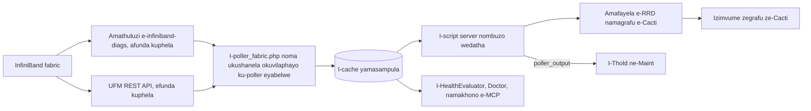

<!-- Source: README.md; SHA256: 79a16fb906f96ee79de2c719f18c38836f555440a7571a4a5ba38c64bb5b099f -->

<!-- translations:start -->
[English](../../../README.md) | [简体中文](../zh-CN/README.md) | [हिन्दी](../hi-IN/README.md) | [Español (España)](../es-ES/README.md) | [Español (Latinoamérica)](../es-419/README.md) | [العربية (السعودية)](../ar-SA/README.md) | [Afrikaans](../af-ZA/README.md) | [አማርኛ](../am-ET/README.md) | [العربية (مصر)](../ar-EG/README.md) | [العربية (المغرب)](../ar-MA/README.md) | [Български](../bg-BG/README.md) | [বাংলা](../bn-BD/README.md) | [Bosanski](../bs-BA/README.md) | [Deutsch](../de-DE/README.md) | [Ελληνικά](../el-GR/README.md) | [فارسی](../fa-IR/README.md) | [Filipino](../fil-PH/README.md) | [Français](../fr-FR/README.md) | [Français (Maroc)](../fr-MA/README.md) | [Français (Sénégal)](../fr-SN/README.md) | [Hausa](../ha-NG/README.md) | [עברית](../he-IL/README.md) | [Hrvatski](../hr-HR/README.md) | [Bahasa Indonesia](../id-ID/README.md) | [Igbo](../ig-NG/README.md) | [Italiano](../it-IT/README.md) | [日本語](../ja-JP/README.md) | [ქართული](../ka-GE/README.md) | [한국어](../ko-KR/README.md) | [Latviešu](../lv-LV/README.md) | [Malagasy](../mg-MG/README.md) | [मराठी](../mr-IN/README.md) | [Bahasa Melayu](../ms-MY/README.md) | [Nederlands](../nl-NL/README.md) | [Polski](../pl-PL/README.md) | [Português (Brasil)](../pt-BR/README.md) | [Português (Portugal)](../pt-PT/README.md) | [Русский](../ru-RU/README.md) | [Kinyarwanda](../rw-RW/README.md) | [Soomaali](../so-SO/README.md) | [Српски](../sr-RS/README.md) | [Svenska](../sv-SE/README.md) | [Kiswahili](../sw-KE/README.md) | [தமிழ்](../ta-IN/README.md) | [తెలుగు](../te-IN/README.md) | [ไทย](../th-TH/README.md) | [Türkçe](../tr-TR/README.md) | [Українська](../uk-UA/README.md) | [اردو](../ur-PK/README.md) | [Tiếng Việt](../vi-VN/README.md) | [isiXhosa](../xh-ZA/README.md) | [Yorùbá](../yo-NG/README.md) | [繁體中文](../zh-TW/README.md) | [isiZulu](README.md)
<!-- translations:end -->

# plugin_fabric

I-plugin ye-Cacti 1.2 (`fabric`, inguqulo `0.1.0-dev`) eletha izibali zezimbobo ze-InfiniBand, ububanzi nesivinini sokuxhumana, kanye nezinkomba zokuminyana ku-Cacti njengamadivayisi ajwayelekile, imithombo yedatha, namagrafu. Ukuxhumana okuqeqeshwe ku-1X esikhundleni se-4X bese kuvela njengegrafu kanye nesixwayiso se-Thold eceleni kwe-host ekusebenzelayo, ngaphansi kwezimvume ze-Cacti, ngokwazi nokucindezelwa kwe-Maint.

> **Isimo: isathuthukiswa, akukho ukukhishwa okwamanje.** Leli gatsha lenza isisekelo se-plugin, izinto ze-Cacti nezixwayiso, ukushanela okuhleliwe kwangemuva kwe-poller, ukukopisha kubaqoqi abakude, ingemuva le-NVIDIA UFM REST elifunda kuphela elinegumbi lemininingwane yokuqinisekisa elibethelwe, ukuphathwa kwe-CLI ye-Configuration-as-Code (CasC), kanye nezihuku ze-ecosystem ye-Cacti (CasC, Doctor, ne-MCP / Abilities API v2). Ihlolwe ngamathuluzi okuzenzisa, izindlela zokuhambisa ze-UFM ezenziwe, kanye nesilingisi se-fabric i-`ibsim` (rdma-core 50.0), ayikaze ihlolwe ku-InfiniBand fabric yangempela noma kuseva ye-UFM ephilayo. Ukuhlolwa okudinga ihadiwe kuhlala kuvuliwe ku-[docs/research/](../../research/). Le phrojekthi ayihlangene nephrojekthi ye-Cacti.

## Okuphunyeziwe

- **Umjikelezo wempilo nesikimu (v3)**: ukufaka, ukuthuthukisa okungashintshi umphumela uma kuphindwa, ukukhipha (okugcina amatafula e-plugin ngokuzenzakalelayo), kanye nesivikelo semfuneko ye-PHP 8.2 ngenkathi kugcina izindawo zokungena zifundeka ku-PHP 8.0.
- **Izindima zokufinyelela namakhasi**: izindawo zokusebenza ze-`Fabric View` (`fabric.php`), `Fabric Operator` (`fabric_operator.php`), ne-`Fabric Admin` (`fabric_admin.php`, `fabric_health.php`), kanye nethebhu ye-Settings ngaphansi kwe-**Configuration > Settings > Fabrics**.
- **Ingemuva lokuxilonga elifunda kuphela (`diags`)**: ukusebenzisa okuqinile kwe-argument-vector kwe-`perfquery`, `ibnetdiscover`, ne-`iblinkinfo`, uhlu lwempahla nge-GUID olunokuhlonza ukungqubuzana kobunikazi neziphakamiso zokuxhumanisa kabusha, ukuhlola isimo sokuxhumana, kanye nokushanela izibali ku-node ngayinye.
- **Ingemuva le-NVIDIA UFM REST elifunda kuphela (`ufm`) negumbi elibethelwe**: iklayenti le-REST le-GET kuphela elinohlu oluvunyelwe (`/ufmRest/resources/ports`, `/ufmRest/resources/systems`, `/ufmRest/monitoring/session/0/data`, kanye nokulingana kwe-`/ufmRestV3/...` kokuqinisekiswa kwe-token) elihlinzeka ngamatafula afanayo ohlu lwempahla, isimo sokuxhumana, amasampula, nempilo njenge-`diags`. Imininingwane yokuqinisekisa (`token` noma `basic`) igcinwa ibethelwe nge-AES-256-GCM ku-`plugin_fabric_secret` kusetshenziswa ifayela lokhiye wangaphandle ongu-256-bit elilungiselelwe nge-`fabric_vault_key_file`. Ama-fabric e-UFM angachazwa nge-CasC (`cli/fabric.php`) noma ngamakhosombe; ifomu lokuphatha lewebhu njengamanje libonisa izinkambu ze-`diags`.
- **Izinto ze-Cacti, i-Thold, ne-Maint**: izifanekiso zedivayisi, zedatha, nezegrafu ze-Cacti (`templates/fabric-templates.xml`), umbuzo wedatha we-script server we-"Fabric Port" (`scripts/ss_fabric_ports.php`, `resource/script_server/fabric_ports.xml`), imithombo yedatha yezibali ze-`DERIVE` nemithombo yedatha yesimo sokuxhumana/isilinganiso ye-`GAUGE` ye-Thold, ukulandelela ukuphazamiseka, kanye nezibali eziyisisekelo ezigcwele ezibikwa njenge-`U`. Ukuhlanganiswa kwe-Maint (`MaintMaintenance`) kubuza i-`plugin_maint_check_cacti_host()` (kubuyela kusihuku se-`is_device_in_maintenance`) ukuze ama-node asekulondolozeni okusebenzayo abalwe ngokwehlukana futhi akhishwe ezixwayisweni zempilo zokushanela okuhlulekile nezimbobo ezonakele.
- **Ukushanela okuhleliwe, ukuhlukaniswa (sharding), nabaqoqi abakude**: i-`poller_bottom` iqala i-`poller_fabric.php` ngemuva kuma-fabric afike isikhathi sawo abelwe i-poller yamanje, kanye nokushanela okuvilaphayo okuqalwa yi-script server. I-`INFO` imemezela `remote_collect:1, remote_poller:1`, i-`poller_fabric.php` isekela ukuhlukaniswa kwe-GUID okunqunywa ngokuqinisekile (`--shard=K/N`), kanti i-`replicate_out` ikopisha imigqa engeyona eyemfihlo ye-`plugin_fabric_fabric` kubaqoqi abakude (`poller_id >= 2`). Okufakiwe kwegumbi (`plugin_fabric_secret`) namafayela okhiye bangaphandle akukaze kukopishwe.
- **I-CasC CLI nezihuku ze-ecosystem**: i-`cli/fabric.php` yokuthekelisa i-YAML/XML, ukuqinisekisa, ukuhlela umehluko we-dry-run, ukusebenzisa okunesango lokuqinisekisa, kanye nokubika impilo, kanye nezihuku ze-`casc_register_providers`, `doctor_register_checks`, ne-`abilities_register`.

## Izindima zokufinyelela

| Umkhakha | Ukufinyelela |
| --- | --- |
| Fabric View | Ukubuka kokugada uhlu lwempahla nezimbobo (`fabric.php`). |
| Fabric Operator | Ukufinyelela kwe-View kanye nekhasi le-Operations (`fabric_operator.php`) nokuvuma kokuhlola komuntu siqu. |
| Fabric Admin | Ukufinyelela kwe-Operator kanye nokumisa, izenzo zokuphatha (`fabric_admin.php`), nekhasi lempilo (`fabric_health.php`). |

Ngemva kokukopisha amafayela okuthuthukisa, vula ikhasi le-Plugins njengomphathi ukuze ubhalise izindawo zokusebenza nezihuku ezintsha. Yabela umkhakha we-Operator ngokucacile ngaphansi kwe-**Configuration > Users** noma amaqembu abasebenzisi. Ukuthuthukisa kugcina ama-ID emikhakha ye-View ne-Admin akhona kanye nezimvume. Ukufinyelela kwe-Admin kuzuza ukufinyelela kwe-Operator, futhi ukufinyelela kwe-Operator kuzuza ukufinyelela kwe-View esicelweni ngasinye; lokhu akwengezi izimvume ezigciniwe kubasebenzisi noma kumaqembu. Izilungiselelo ze-plugin zidinga futhi ukufinyelela kwe-Fabric Admin ngaphezu kwemvume ye-Settings ye-Cacti.

Izimvume zedivayisi ye-Cacti zilinganisa imigqa nezenzo ezitholakalayo kumsebenzisi ngamunye; izinto ezingahlanganisiwe zidinga umphathi. Imininingwane yokuqinisekisa, ukumisa, ukuhlanganisa, ukususa, nezinye izinqubo zokuphatha zihlala emakhasini okuphatha noma ku-CLI. Ukuvuma kuhlala kuphela kusikhathi seseshini yomsebenzisi wamanje, isikhathi esingeqi ehoreni elilodwa futhi kuphela ngesikhathi ukubhekwa okufanayo kusakusha. Ukubhekwa okusha noma okushintshile kuyakwenqabela. Akulokothi kumake ukukala okuhlulekile njengokunempilo noma kucindezele izixwayiso.

## Kungani

Ukuxhumana kwe-InfiniBand okonakele kusadlulisa ithrafikhi. Ukuxhumana kwe-4X okuziqeqesha kabusha ku-1X kushiya imbobo iku-"active", futhi amagrafu esibonisi se-SNMP se-host abukeka ejwayelekile, kodwa imisebenzi ehlanganiswe ngokuqinile iyehla ngesivinini. Ubufakazi buku-fabric: imbobo ngayinye ibika ububanzi nesivinini sayo esisebenzayo, esinikwe amandla, nesisekelwayo, kanye nezibali zamaphutha nokuminyana. Ukukufunda kudinga amathuluzi okuxilonga e-InfiniBand noma i-API yomphathi we-fabric. Uma kwenziwa ngesandla, kushiya izikhala ezintathu:

- **Awukho umlando.** I-`perfquery` ne-`iblinkinfo` zibonisa okwamanje, ngakho ukuxhumana okonakale ngesonto eledlule akubonakali.
- **Ayikho ingqikithi yedivayisi.** Izimbobo ze-fabric azizona izinto ze-Cacti, ngakho imbobo ngeke idwetshwe njengegrafu eceleni kwe-host eyisebenzelayo.
- **Ayikho indlela eya ezixwayisweni ze-Cacti.** I-Thold ne-Maint zisebenza emithonjeni yedatha nakumadivayisi e-Cacti.

Le plugin ivala lezi zikhala ngokufunda i-fabric nge-`infiniband-diags` noma i-NVIDIA UFM REST API, ihlonza ama-node nezimbobo nge-GUID, futhi ishicilele izibali nesimo sokuxhumana njengemithombo yedatha ye-Cacti. Ifunda kuphela: ayilokothi isethe kabusha izibali noma ishintshe isimo sembobo.

## Ukusebenza ne-CLI

### I-poller yangemuva nokushanela okwenziwa ngesandla

I-`fabric_poller_bottom()` iqala i-`poller_fabric.php` ngemuva ku-poller ngayinye kuma-fabric anikwe amandla abelwe leyo `poller_id` okufike isikhathi sawo sokushanela. Ungasebenzisa futhi isiqalisi se-poller noma ukushanela okwenziwa ngesandla ngqo ku-poller eyabelwe njengomsebenzisi we-poller (ushintsha i-`/path/to/cacti` ngomkhombandlela wakho we-Cacti):

```sh
php /path/to/cacti/plugins/fabric/poller_fabric.php [--fabric=ID] [--shard=K/N] [--force] [--debug]
php /path/to/cacti/plugins/fabric/fabric_sweep.php --fabric=ID [--node=GUID] [--force]
```

- I-`poller_fabric.php` isebenza wonke ama-fabric afike isikhathi sawo e-poller yendawo (noma i-fabric eyodwa nge-`--fabric=ID`), iphoqelela ukukhiya kwerejistri yenqubo ye-Cacti nokuqasha kwe-`ClaimRepository` ngesabelomali sesikhathi samasekhondi angu-`max(30, intdiv(sweep_interval, 2))`, futhi isekela i-`--shard=K/N` (`0 <= K < N`) ukuze ihlukanise ukushanela kwezibali ze-node ze-`diags` ngokuqinisekile nge-GUID ye-node.
- I-`fabric_sweep.php` isebenza ukushanela okudingekayo kwe-fabric eyodwa enikwe amandla (noma i-node eyodwa nge-`--node=GUID`) eyabelwe i-poller yendawo. I-`--force` ayinaki ukuthi isikhathi se-fabric sifike yini ngenkathi isahlonipha izicelo zokugodla.

Ngemva kokuba ukutholwa kokuqala kugcwalise uhlu lwempahla, hlanganisa ama-node namadivayisi e-Cacti ekhasini le-Fabric Admin. Gcina isikhathi sokuphela se-script ye-Cacti kumasekhondi angu-25 noma ngaphezulu: ukushanela okuvilaphayo okuqalwe ukufundwa kombuzo wedatha kukhawulela ukusetshenziswa kwethuluzi kumasekhondi angu-`script_timeout - 5` ukuze i-script server ibuye ngesikhathi nesampula yokugcina egciniwe noma u-`U`.

### Ingemuva le-NVIDIA UFM REST negumbi lemininingwane yokuqinisekisa

I-fabric ye-`ufm` idinga i-URL ye-`https://` engenayo imininingwane yokuqinisekisa eshumekiwe, imicu yemibuzo, noma izingxenye. I-`UfmSocketTransport` iphoqelela ukuqinisekiswa kwe-TLS peer negama le-host, yenqaba ukudluliselwa kwenye indawo, futhi isekela iphakethe le-CA elingakhethwa (`ufm_ca_file`) kanye ne-SHA-256 SPKI pin (`ufm_spki_pin`).

Ukuze ugcine imininingwane yokuqinisekisa ye-UFM ku-`plugin_fabric_secret`, lungiselela i-`fabric_vault_key_file` ngaphansi kwe-**Configuration > Settings > Fabrics** ngendlela ephelele eya kufayela elijwayelekile eliphethwe ngumsebenzisi we-poller (azikho izixhumanisi ze-symlink kunoma yimuphi umkhombandlela womzali, imodi `0600`, elinezinhlamvu ezingama-64 ze-hex ezinjenge-`openssl rand -hex 32` noma amabhayithi angama-32 angahleliwe angaphrinteki). Le plugin ayilokothi idale noma ibhale ifayela lokhiye, futhi i-`replicate_out` ayilokothi ikopishe i-`plugin_fabric_secret` noma amafayela okhiye kuma-poller akude.

### I-Configuration-as-Code ne-CLI yempilo

I-`cli/fabric.php` iphatha izilungiselelo ze-plugin nezincazelo ze-fabric ngokusho ngaphakathi kwe-YAML noma i-XML, futhi ibika impilo eqaphela ukulondolozwa ngaphandle kokusebenzisa ukushanela okubukhoma:

```sh
php /path/to/cacti/plugins/fabric/cli/fabric.php export [--format=yaml|xml] [--file=PATH]
php /path/to/cacti/plugins/fabric/cli/fabric.php validate --file=PATH [--format=yaml|xml]
php /path/to/cacti/plugins/fabric/cli/fabric.php plan --file=PATH [--format=yaml|xml]
php /path/to/cacti/plugins/fabric/cli/fabric.php apply --file=PATH --confirm=PLAN_HASH [--format=yaml|xml]
php /path/to/cacti/plugins/fabric/cli/fabric.php health [--format=text|json]
```

I-`export` idala amafayela amasha ngemodi `0600`, ifihle i-`fabric_vault_key_file` njenge-`[REDACTED]`, futhi ikhiphe izinkomba eziqanjiwe ze-`ufm_credential_ref` esikhundleni sezimfihlo. I-`plan` ne-`apply` ziyenqaba amanani e-`ufm_token`, `ufm_password`, `secret`, namanani e-`fabric_vault_key_file` afakwe ngaphakathi. I-`apply` idinga i-`--confirm=PLAN_HASH` enembile ekhiqizwe yi-`plan`.

### Izihuku ze-ecosystem

Uma kukhona ama-plugin e-Cacti ahambisanayo noma ukuhlanganiswa kwe-host, i-`setup.php` ibhalisa:

- `casc_register_providers`: ithekelisa, iqinisekisa, ihlela, futhi isebenzisa ngokuqinisekiswa ukumiswa kwe-`fabric` (`yaml` ne-`xml`, isikimu v1) ngokufihla izimfihlo.
- `doctor_register_checks`: ihlinzeka ngokuhlolwa okune kokuxilonga okufunda kuphela (`fabric.schema`, `fabric.poller_freshness`, `fabric.identity_conflicts`, `fabric.ufm_vault`).
- `abilities_register`: ibhalisa amakhono amathathu afunda kuphela, angalimazi, angashintshi umphumela uma ephindwa ngaphansi kwesigaba se-`fabric`, alawulwa wumkhakha we-Fabric View (nezimvume zedivayisi ye-Cacti kumaphutha embobo): `fabric-list-fabrics`, `fabric-get-health`, ne-`fabric-list-port-errors`.

## Ububanzi nemingcele

Okungaphandle kobubanzi: ukushintsha isimo se-fabric, ukusetha kabusha izibali, ukufaka esikhundleni umphathi we-fabric noma umphathi we-subnet, injini yezixwayiso ephethwe yi-plugin, i-daemon yangokwezifiso noma iphrothokholi yenethiwekhi, kanye nama-fabric e-Ethernet noma e-RoCE.

## Izidingo nokuhambelana

| Ingxenye | Okuhlosiwe |
|---|---|
| Cacti | 1.2.31 noma kamuva (`compat = 1.2.31`), azikho izichibiyelo eziyinhloko |
| PHP | 8.2 noma kamuva; izindawo zokungena zihlala zifundeka ku-8.0 futhi zenqabe ukusebenza ku-8.1 ukuze indawo yokusebenza engasekelwe ithole ukwenqatshwa esikhundleni se-UI ye-Cacti ephukile |
| Amathuluzi e-InfiniBand | i-`infiniband-diags` kusuka ku-`rdma-core` (ihlolwe ku-CI nge-rdma-core 50.0 ngaphansi kwe-`ibsim`; amafomethi okukhiphayo ahlolwe ngokumelene nomthombo we-v66.0) |
| UFM | I-NVIDIA UFM Enterprise REST API (izindawo zokugcina ezifunda kuphela ze-`ufmRest` ne-`ufmRestV3`; zihlolwe ngokumelene nezindlela zokuhambisa ezenziwe ekuhloleni kweyunithi) |
| Thold, Maint | Azikho izinguquko ezidingekayo; i-CI isebenzisa ukuhlolwa kokuphela-kuya-ekupheleni nge-Thold v1.8.2 ne-Maint v1.3 engashintshiwe |

## Ukuthuthukisa nokuhlola

Ukuhamba komsebenzi kwe-CI (`.github/workflows/plugin-ci-workflow.yml`) kuhlola i-PHP 8.2 kuya ku-8.5 ngokumelene ne-Cacti `release/1.2.31` ne-`1.2.x`, ukuhlola indawo yokungena ye-PHP 8.0, ukwenqatshwa kwe-PHP 8.1, i-PHPStan, ukuqinisekiswa kwe-gettext/ukuhumusha, ukulayisensa kwe-REUSE, ukuhlolwa kokuhamba komsebenzi, ukudlalwa kabusha kokuphela-kuya-ekupheleni kwe-Thold/Maint, kanye nokulingiswa kwe-fabric ye-`ibsim`.

Nge-harness ye-plugin ye-Pest ehlanganyelwe ekhiyiwe ye-Cacti (`CACTI_PEST_BIN`) kanye nesizindalwazi se-Cacti esilahlwayo:

```sh
# Unit tests
"$CACTI_PEST_BIN" --configuration=phpunit.xml

# Lifecycle integration tests (disposable database only)
CACTI_PATH=/path/to/cacti FABRIC_TEST_DATABASE=disposable "$CACTI_PEST_BIN" --configuration=phpunit-integration.xml

# Static analysis (against Cacti 1.2.31)
CACTI_PATH=/path/to/cacti phpstan analyse -c phpstan.neon --no-progress

# Translation template, catalogs, and localized README checks
sh locales/build_gettext.sh --check

# Simulated ibsim fixture parser check
php tests/bin/check-ibsim-fixtures.php tests/fixtures/ibsim
```

## Ukwakheka

- [docs/PLAN.md](../../PLAN.md) wuhlelo lokwakha nolwesakhiwo: amaqiniso angaphezulu anemithombo, ukuhlolwa kwehadiwe okuvuliwe, imodeli yobunikazi, imithetho yezibali neyesimo sokuxhumana, imingcele yokuphepha, izibalo zokusebenza, ukuhlola, kanye nezingozi.
- [docs/decisions/](../../decisions/) igcina amarekhodi ezinqumo zokwakheka.
- [docs/REQUIREMENTS.md](../../REQUIREMENTS.md) ihlanganisa i-ID yesidingo ngayinye nenkinga yayo.



## Indlela umsebenzi olandelelwa ngayo

- **Ama-milestone** alandela ama-milestone ohlelo. Ngamunye unenkinga yohlobo lwe-epic efaka uhlu lwezinkinga ezincane kanye nobufakazi bokuphuma.
- **Izinkinga** zihlukaniswe ngelebuli: `type: requirement`, `type: research`, `type: decision`, `type: epic`. Izinkinga zezidingo zisho izidingo ezinenombolo, ezihlolwayo (`REQ-AREA-NNN`) kanye nemibandela yokwamukelwa.
- **Amalebula** aphinde aphathe i-`area:`, `phase:`, `priority:`, ne-`status:`. Bheka ku-[CONTRIBUTING.md](../../../CONTRIBUTING.md#labels).
- I-[bhodi lephrojekthi](https://github.com/users/somethingwithproof/projects/8) libonisa zonke izinkinga kuwo wonke ama-milestone.

## Ukufaka isandla

Funda ku-[CONTRIBUTING.md](../../../CONTRIBUTING.md). Ama-commit adinga isiginesha ye-DCO (`git commit -s`). Izingxoxo zokwakheka zenzeka ezinkingeni; izinqumo ezivuliwe zithwala ilebuli ye-`type: decision`.

## Ukuphepha

Bika ubungozi ngasese; bheka ku-[SECURITY.md](../../../SECURITY.md).

## Ilayisensi

GNU General Public License v2.0, ilayisensi efanayo neye-Cacti nama-plugin ayo. Bheka ku-[LICENSE](../../../LICENSE).
